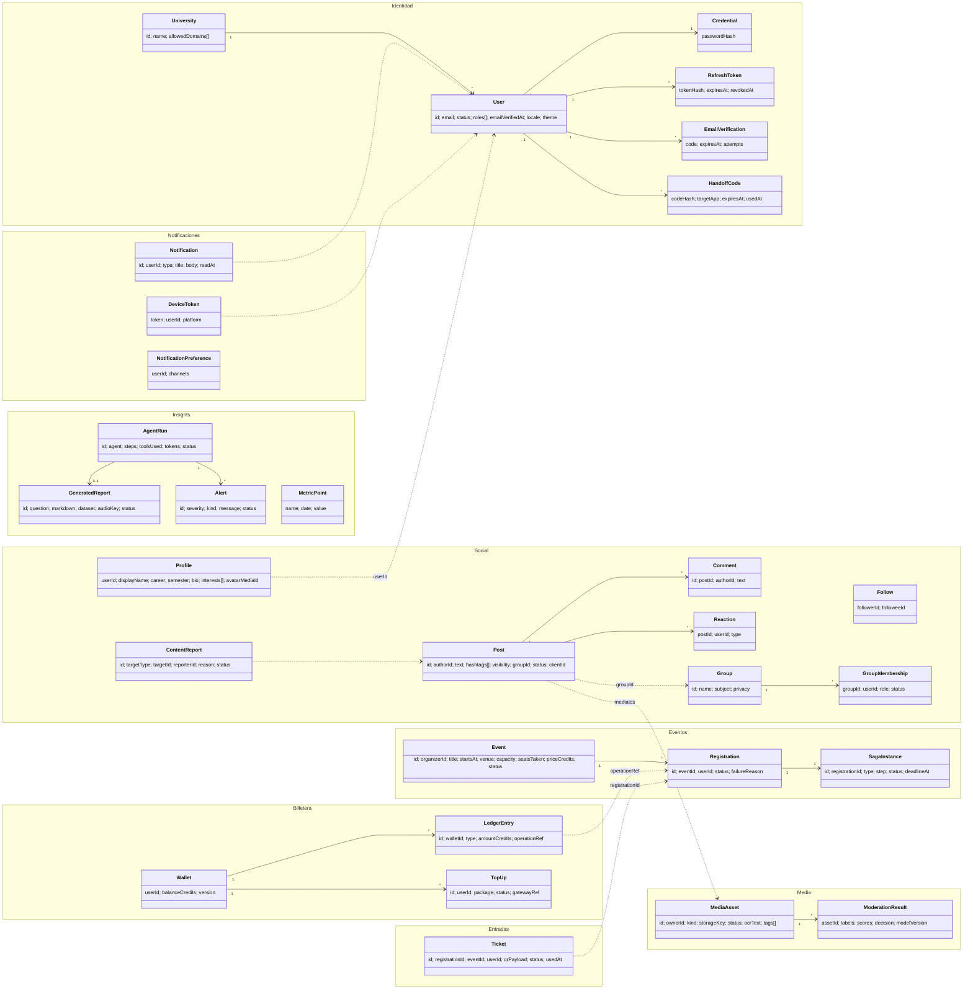

# Modelo de dominio

Primer artefacto ICONIX. Solo conceptos y relaciones (sin métodos). Se actualiza al
terminar cada diagrama de robustez. Los nombres son los del glosario
(`bandadau-docs/docs/01-vision/glosario.md`). Cada paquete corresponde a un bounded context y a
**un solo servicio dueño**; las referencias entre paquetes son **por ID**, nunca por
relación física.

## Vista global

## Enumeraciones (valores en inglés, únicos en API/DB)

| Enum | Valores |
|---|---|
| `UserStatus` | `PENDING_VERIFICATION`, `ACTIVE`, `SUSPENDED`, `DELETED` |
| `Role` | `STUDENT`, `ORGANIZER`, `MODERATOR`, `ADMIN` |
| `Locale` | `es`, `en` |
| `ThemePreference` | `SYSTEM`, `LIGHT`, `DARK` |
| `PostVisibility` | `PUBLIC`, `FOLLOWERS`, `GROUP` |
| `PostStatus` | `PENDING_MEDIA`, `PUBLISHED`, `HIDDEN`, `REMOVED` |
| `ReactionType` | `LIKE`, `HELPFUL`, `FUNNY`, `SUPPORT` |
| `GroupPrivacy` | `PUBLIC`, `PRIVATE` |
| `MembershipStatus` | `PENDING`, `ACTIVE`, `REJECTED`, `LEFT` |
| `MediaKind` | `IMAGE`, `VIDEO` |
| `MediaStatus` | `PENDING_UPLOAD`, `PROCESSING`, `APPROVED`, `FLAGGED`, `REJECTED` |
| `ModerationDecision` | `ALLOW`, `REVIEW`, `BLOCK` |
| `ReportStatus` | `OPEN`, `RESOLVED_KEPT`, `RESOLVED_REMOVED` |
| `EventStatus` | `DRAFT`, `PUBLISHED`, `CANCELLED`, `FINISHED` |
| `RegistrationStatus` | `PENDING`, `CONFIRMED`, `FAILED`, `CANCELLATION_PENDING`, `CANCELLED` |
| `SagaStatus` | `STARTED`, `AWAITING_DEBIT`, `AWAITING_TICKET`, `COMPENSATING`, `COMPLETED`, `COMPENSATED`, `FAILED` |
| `LedgerEntryType` | `TOPUP`, `DEBIT`, `REFUND` |
| `TopUpStatus` | `PENDING`, `PAID`, `FAILED`, `EXPIRED` |
| `TicketStatus` | `ISSUED`, `USED`, `VOIDED` |
| `NotificationType` | `REGISTRATION_CONFIRMED`, `REGISTRATION_FAILED`, `EVENT_REMINDER`, `NEW_COMMENT`, `NEW_REACTION`, `NEW_FOLLOWER`, `GROUP_REQUEST`, `TOPUP_PAID`, `CONTENT_FLAGGED`, `ALERT` |
| `AlertSeverity` | `INFO`, `WARNING`, `CRITICAL` |

## Invariantes de negocio clave

1. `Event.seatsTaken ≤ Event.capacity` (se protege en el agregado con bloqueo optimista).
2. Una sola `Registration` en estado `PENDING` o `CONFIRMED` por par (`eventId`, `userId`).
3. `Wallet.balanceCredits ≥ 0` siempre; el saldo es la suma de `LedgerEntry`.
4. `LedgerEntry.operationRef` es único por tipo (`DEBIT:<registrationId>`, `REFUND:<registrationId>`, `TOPUP:<topUpId>`).
5. Un `Ticket` por `Registration`; un ticket `USED` o `VOIDED` no cambia de estado.
6. Un `Post` con medios no está `PUBLISHED` hasta que todos sus `MediaAsset` estén `APPROVED`.
7. `Post.clientId` (UUIDv7 generado en el dispositivo) es único por autor → evita duplicados offline.

## Ampliaciones ADR-0016 (consolidación del diseño detallado)

Campos agregados (detalle de tipos en `06-modelo-estatico/`):

| Entidad | Campos nuevos |
|---|---|
| `User` | `displayName` |
| `University` | `enabled` |
| `Profile` | `pendingAvatarMediaId` |
| `Post` | `mediaIds[]`, `hiddenReason`, `stats { comments, reactions{like,helpful,funny,support} }`, `openReportsCount` |
| `Comment` | `status` |
| `Group` | `description`, `membersCount` |
| `MediaAsset` | `purpose` |
| `ModerationResult` | `frameScores[]` (video) |
| `Event` | `description`, `endsAt`, `coverMediaId`, `publishedAt`, `version` |
| `Registration` | `priceCredits` (precio congelado al inscribirse), `ticketId` |
| `SagaInstance` | `type`, `attempts`, `version` |
| `TopUp` | `amountCredits`, `expiresAt` (30 min) |
| `Alert` | `kind`, `status`, `resource`, `fingerprint`, `occurrences`, `params` |
| `AgentRun` | `kind`, `status`, `stopReason` |
| `GeneratedReport` | `locale`, `failureReason` |

Cardinalidad corregida: `Registration "1" --> "1..2" SagaInstance` (una de inscripción y como máximo
una de cancelación).

| Enum nuevo | Valores |
|---|---|
| `CommentStatus` | `VISIBLE`, `HIDDEN`, `REMOVED` |
| `HiddenReason` | `MEDIA_FLAGGED`, `REPORTED`, `MODERATOR`, `AUTHOR_SUSPENDED` |
| `GroupMemberRole` | `OWNER`, `ADMIN`, `MEMBER` |
| `ReportTargetType` | `POST`, `COMMENT` |
| `ReportReason` | `SPAM`, `HARASSMENT`, `NSFW`, `VIOLENCE`, `MISINFORMATION`, `OTHER` |
| `ReportResolution` | `KEEP`, `REMOVE` |
| `MediaPurpose` | `POST`, `AVATAR`, `EVENT_COVER` |
| `TopUpPackage` | `CREDITS_20`, `CREDITS_50`, `CREDITS_100` |
| `SagaType` | `REGISTRATION`, `CANCELLATION` |
| `SagaStep` | `RESERVE_SEAT`, `DEBIT_CREDITS`, `ISSUE_TICKET`, `VOID_TICKET`, `REFUND_CREDITS`, `RELEASE_SEAT` |
| `RegistrationFailureReason` | `EVENT_FULL`, `INSUFFICIENT_FUNDS`, `WALLET_NOT_FOUND`, `TICKET_ISSUE_FAILED`, `TIMEOUT`, `SAGA_ABORTED` |
| `GeneratedReportStatus` | `PENDING`, `RUNNING`, `READY`, `FAILED` |
| `AgentKind` | `MONITORING`, `REPORT`, `EXTERNAL_MCP` |
| `AgentRunStatus` | `RUNNING`, `SUCCEEDED`, `FAILED`, `ABORTED` |
| `AlertStatus` | `OPEN`, `ACKNOWLEDGED`, `RESOLVED` |
| `AlertKind` | `SERVICE_DOWN`, `SAGA_FAILURES`, `DLQ_BACKLOG`, `MODERATION_BACKLOG`, `METRIC_ANOMALY`, `MODERATION_ESCALATION` |
| `ServiceStatus` | `UP`, `DEGRADED`, `DOWN` |

`NotificationType` agrega `WELCOME`, `REGISTRATION_CANCELLED`, `EVENT_CANCELLED`, `NEW_EVENT`.

> Nota de nombres: `ReportStatus` sigue siendo el estado de las **denuncias** (`ContentReport`); el
> estado de los reportes generativos es `GeneratedReportStatus`. Los contratos que usen otro nombre
> o `COMPLETED` en lugar de `READY` deben alinearse.
