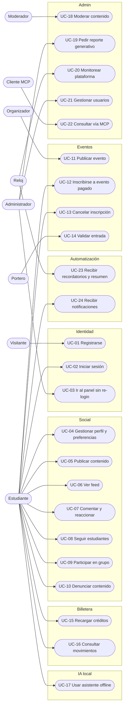

# Catálogo de casos de uso

24 casos de uso agrupados en 7 paquetes. Cada uno tiene su archivo `UC-XX-slug.md`
siguiendo la plantilla de `../00-metodologia-iconix.md`.

## Actores

| Actor | Tipo | Descripción |
|---|---|---|
| Visitante | Humano | Persona sin sesión (landing, registro) |
| Estudiante | Humano | Usuario con rol `STUDENT` |
| Organizador | Humano | Hereda de Estudiante; rol `ORGANIZER` |
| Moderador | Humano | Rol `MODERATOR` |
| Administrador | Humano | Rol `ADMIN`; hereda de Moderador |
| Portero | Humano | Organizador o staff que valida entradas en la puerta |
| Cliente MCP externo | Sistema | Claude Desktop / Claude Code de un administrador |
| Reloj | Sistema | Disparadores programados (cron de n8n, scheduler del agente) |
| Pasarela de recarga | Sistema | Pasarela de pago simulada |
| Modelo de IA | Sistema | LLM / modelos ONNX / modelo on-device |

## Diagrama general

## Tabla maestra

| ID | Caso de uso | Actor principal | Prioridad | Servicios | Requisitos | Cátedra | Release | Archivo |
|---|---|---|---|---|---|---|---|---|
| UC-01 | Registrarse con correo institucional | Visitante | Must | identity, notification, social, n8n | RF-01, RF-02 | T4, T10 | R0 | `UC-01-registrarse.md` |
| UC-02 | Iniciar sesión y renovar sesión | Estudiante | Must | identity | RF-03 | T4 | R0 | `UC-02-iniciar-sesion.md` |
| UC-03 | Acceder al panel desde la app sin re-login | Administrador | Must | identity, mobile, admin-shell | RF-04 | **T13** | R0 | `UC-03-acceso-unico-panel.md` |
| UC-04 | Gestionar perfil académico y preferencias (tema, idioma) | Estudiante | Must | social, media, identity | RF-05, RF-29, RF-30 | T4, E18 | R1 | `UC-04-gestionar-perfil.md` |
| UC-05 | Publicar contenido (texto, imagen, video) | Estudiante | Must | social, media, mobile | RF-06, RF-07, RF-08 | **T6, T7, T8, T9** | R1 | `UC-05-publicar-contenido.md` |
| UC-06 | Ver feed personalizado | Estudiante | Must | social, mobile | RF-09 | **T7, T9** | R1 | `UC-06-ver-feed.md` |
| UC-07 | Comentar y reaccionar | Estudiante | Must | social, notification | RF-10 | T4, T8 | R1 | `UC-07-comentar-reaccionar.md` |
| UC-08 | Seguir estudiantes y ver sugerencias | Estudiante | Should | social | RF-11 | T9 (ML) | R1 | `UC-08-seguir-estudiantes.md` |
| UC-09 | Crear y participar en grupo de estudio | Estudiante | Must | social | RF-12 | T4 | R1 | `UC-09-grupos-estudio.md` |
| UC-10 | Denunciar contenido | Estudiante | Should | social, media | RF-13 | T4 | R1 | `UC-10-denunciar-contenido.md` |
| UC-11 | Publicar evento | Organizador | Must | events, media, n8n | RF-14 | T4, T10 | R2 | `UC-11-publicar-evento.md` |
| UC-12 | Inscribirse a evento pagado | Estudiante | Must | **events, wallet, ticketing**, notification | RF-15, RF-16 | **C1, T8** | R2 | `UC-12-inscribirse-evento.md` |
| UC-13 | Cancelar inscripción | Estudiante | Must | events, wallet, ticketing | RF-17 | **C1** | R2 | `UC-13-cancelar-inscripcion.md` |
| UC-14 | Validar entrada en la puerta | Portero | Must | ticketing | RF-18 | T4, T8 | R2 | `UC-14-validar-entrada.md` |
| UC-15 | Recargar créditos | Estudiante | Must | wallet | RF-19 | **T8** | R2 | `UC-15-recargar-creditos.md` |
| UC-16 | Consultar saldo y movimientos | Estudiante | Must | wallet | RF-20 | T4 | R2 | `UC-16-consultar-movimientos.md` |
| UC-17 | Usar asistente de estudio offline | Estudiante | Must | mobile (on-device) | RF-21 | **T6, T7** | R4 | `UC-17-asistente-offline.md` |
| UC-18 | Moderar contenido marcado por IA | Moderador | Must | admin-shell, mfe-moderation, admin-gateway, media, social, n8n | RF-22 | **T2, T3, T9, T10** | R3 | `UC-18-moderar-contenido.md` |
| UC-19 | Solicitar reporte generativo (texto + audio) | Administrador | Must | mfe-insights, admin-gateway, insights (MCP) | RF-23 | **T5, T11, T12** | R3 | `UC-19-reporte-generativo.md` |
| UC-20 | Monitorear plataforma con agente | Reloj / Administrador | Must | insights, admin-gateway, n8n | RF-24 | **T5, T3, T9** | R3 | `UC-20-monitorear-plataforma.md` |
| UC-21 | Gestionar usuarios y roles | Administrador | Must | admin-shell, admin-gateway, identity | RF-25 | **T3** | R3 | `UC-21-gestionar-usuarios.md` |
| UC-22 | Consultar la plataforma desde un cliente MCP | Cliente MCP externo | Must | insights | RF-26 | **T12** | R3 | `UC-22-consulta-mcp-externa.md` |
| UC-23 | Recibir recordatorios y resumen semanal | Reloj | Must | n8n, events, insights, notification | RF-27 | **T10, T11** | R3 | `UC-23-recordatorios-n8n.md` |
| UC-24 | Recibir notificaciones push/in-app | Estudiante | Must | notification, mobile | RF-28 | T4, T8 | R2 | `UC-24-recibir-notificaciones.md` |

## Relaciones entre casos de uso

- UC-12 «include» validar saldo (UC-16 parcialmente) y «extend» UC-15 cuando el saldo es insuficiente ("Recargar y continuar").
- UC-13 reutiliza las compensaciones de la SAGA de UC-12.
- UC-05 «include» moderación automática (media-service) que alimenta UC-18.
- UC-19 y UC-22 comparten las mismas herramientas MCP.
- UC-03 «extend» UC-02 (requiere sesión activa).
