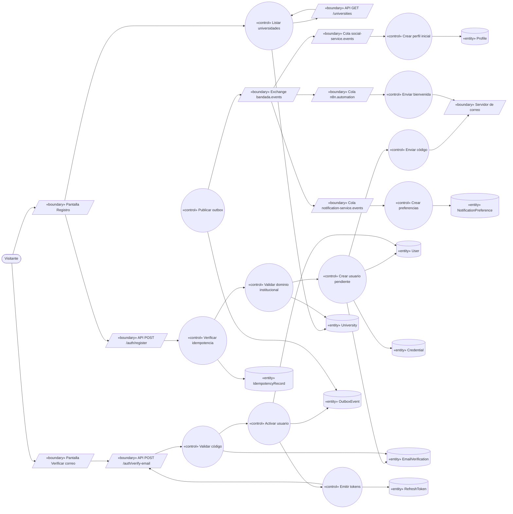
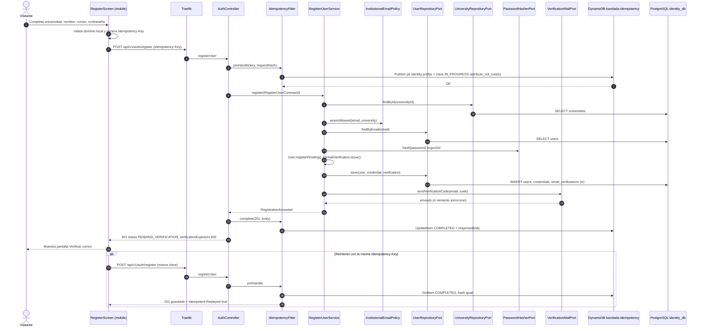
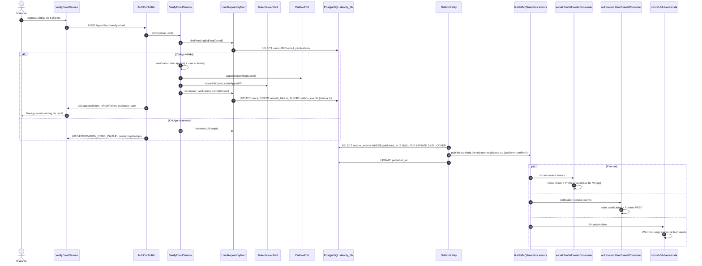

# UC-01 — Registrarse con correo institucional

| Campo | Valor |
|---|---|
| Paquete | Identidad |
| Actor principal | Visitante |
| Actores secundarios | `social-service`, `notification-service`, n8n (`wf-01-bienvenida`), servidor de correo (Mailpit en dev / SES en prod) |
| Prioridad (MoSCoW) | Must |
| Requisitos | RF-01, RF-02, RF-30 (idioma inicial), RNF-05, RNF-06, RNF-13 |
| Tecnologías de la cátedra que demuestra | T4 (REST), T8 (Idempotency-Key + inbox), T10 (n8n) |
| Servicios involucrados | identity-service (Hexagonal, Spring Boot 4), social-service, notification-service, n8n, mobile (app web PWA / nativa) |
| Estado ICONIX | Secuencia (CDR aprobada 2026-10-14 — acta retroactiva; implementación en curso) |

---

## 1. Narrativa (fase de requisitos)

### Precondiciones

- El visitante no tiene sesión activa en la app.
- Existe al menos una `University` habilitada con `allowedDomains` no vacío (cargada por `make seed` o por UC-21).
- `identity-service` tiene acceso a su servidor de correo (Mailpit `:1025` en dev).

### Disparador

El visitante pulsa **"Crear cuenta"** en la app (nativa o PWA) o llega desde el botón "Entrar" de la landing.

### Curso básico

1. La app muestra la **pantalla Registro** y solicita al sistema la lista de universidades (`listUniversities`).
2. El sistema devuelve las `University` habilitadas con sus `allowedDomains`.
3. El visitante elige su universidad e ingresa nombre visible, correo institucional y contraseña. Todos los textos de la pantalla vienen de i18n (namespace `auth`, `es`/`en`, D14); el idioma inicial es el resuelto en el dispositivo (`expo-localization` / navegador → `es`).
4. La app valida en el cliente el formato del correo, que su dominio pertenezca a los `allowedDomains` de la universidad elegida y la política de contraseña; genera una `Idempotency-Key` (UUID) para el envío.
5. La app envía la solicitud de registro (`registerUser`) con la `Idempotency-Key`, el `locale` resuelto (`es|en`) y la cabecera `Accept-Language`.
6. El sistema verifica la clave de idempotencia (prefijo `identity#`) en `bandada-idempotency`.
7. El sistema valida que el dominio del correo pertenezca a `University.allowedDomains` y que no exista un `User` `ACTIVE` con ese correo.
8. El sistema crea el `User` en estado `PENDING_VERIFICATION` con rol `STUDENT`, `locale` (el enviado o, si falta, el de `Accept-Language`; por defecto `es`) y `theme = SYSTEM`, su `Credential` (hash Argon2id) y una `EmailVerification` (código de 6 dígitos guardado hasheado, vence en 15 min, 0 intentos).
9. El sistema envía al correo institucional el código de verificación, con la plantilla del `locale` del usuario (solo tema claro en correos, D13).
10. El sistema responde `201 Created` (alineado con el OpenAPI; ver nota de consolidación) y la app muestra la **pantalla Verificar correo**.
11. El visitante ingresa el código de 6 dígitos recibido.
12. La app envía `verifyEmail` con `{ email, code }`.
13. El sistema valida el código (no vencido, intentos < 5, hash coincide), activa el `User` (`ACTIVE`, `emailVerifiedAt = now`) y registra en el **outbox** el evento `bandada.identity.user.registered.v1`, todo en una sola transacción.
14. El sistema emite un access token (15 min) y un refresh token (30 días) y los devuelve con el `user`.
15. La app guarda la sesión (ver UC-02) y navega al **onboarding de perfil** (UC-04).
16. El relay del outbox publica el evento en el exchange `bandada.events`.
17. `social-service` consume el evento y crea el `Profile` inicial del estudiante (con `displayName` y `universityId`).
18. `notification-service` consume el evento, crea las `NotificationPreference` por defecto del usuario y guarda su copia local del `locale` para las plantillas (D14).
19. n8n (`wf-01-bienvenida`) consume el evento, espera 1 h y envía el correo de bienvenida con tips y grupos sugeridos de su universidad/carrera.

### Cursos alternos

- **4a. Dominio no permitido (cliente):** la app marca el campo correo con "Ese correo no pertenece a {universidad}. Usa tu correo institucional." y no envía la solicitud.
- **6a. Reintento con la misma `Idempotency-Key` (doble toque o red intermitente):** el sistema devuelve la respuesta guardada con `Idempotent-Replayed: true`; no se crea un segundo `User` ni se envía otro correo.
- **6b. Misma clave con cuerpo distinto:** el sistema responde `422 IDEMPOTENCY_KEY_REUSED`.
- **7a. Dominio no permitido (servidor):** el sistema responde `422` Problem Details `EMAIL_DOMAIN_NOT_ALLOWED`; la app muestra el mensaje del paso 4a.
- **7b. Ya existe un `User` `ACTIVE` con ese correo:** para no permitir enumeración de cuentas, el sistema responde igual que en el alta (`201`, solo con `REGISTER_HIDE_EXISTING_ACCOUNTS=true`; por defecto, `409 EMAIL_ALREADY_REGISTERED`) y envía al correo un aviso "Ya tienes una cuenta en Bandada U, inicia sesión o recupera tu contraseña". No se crea nada.
- **7c. Existe un `User` `PENDING_VERIFICATION` con ese correo:** el sistema reemplaza el nombre visible y la `Credential` pendientes, invalida la `EmailVerification` anterior y genera una nueva (vuelve al paso 9). Quien controle el buzón es quien termina la verificación.
- **9a. Falla el servidor de correo:** el `User` queda creado; el sistema reintenta el envío 3 veces con backoff y responde `201` igualmente. El visitante puede usar "Reenviar código" (12b).
- **12a. Código incorrecto:** el sistema incrementa `attempts` y responde `400 VERIFICATION_CODE_INVALID` con `remainingAttempts`. Al llegar a 5 intentos responde `429 VERIFICATION_ATTEMPTS_EXCEEDED` y exige reenviar código.
- **12b. Código vencido o agotado:** el visitante pulsa **"Reenviar código"** → `resendVerificationCode` (rate-limit: 1 por 60 s y 5 por hora por correo) → se invalida el anterior y se envía uno nuevo.
- **12c. El visitante cierra la app antes de verificar:** al volver e intentar iniciar sesión (UC-02), el sistema responde `403 EMAIL_NOT_VERIFIED` y la app lo lleva a la pantalla Verificar correo.
- **17a/18a. Mensaje duplicado (redelivery de RabbitMQ):** el consumidor detecta el `id` del CloudEvent en su inbox (`processed_messages`) y hace `ack` sin efecto.
- **17b. `social-service` caído:** el mensaje permanece en `social-service.events`; el registro no se ve afectado (RNF-03). Si la app pide `getMyProfile` antes de que exista el perfil, social responde `404 PROFILE_NOT_READY` y la app reintenta con backoff (máx. 10 s) mostrando "Preparando tu perfil…".
- **19a. n8n caído:** el mensaje queda en la cola `n8n.automation` y se procesa al volver; la bienvenida es *best effort*.

### Postcondiciones

- **Éxito:** `User` `ACTIVE` con rol `STUDENT`; sesión abierta en la app; `Profile` creado en `social`; preferencias de notificación creadas; correo de bienvenida programado.
- **Fallo:** no queda ningún `User` `ACTIVE`; a lo sumo un `User` `PENDING_VERIFICATION` que una tarea de limpieza elimina tras 7 días sin verificar.

### Reglas de negocio

| ID | Regla |
|---|---|
| RN-01.1 | El dominio del correo (parte posterior a `@`, en minúsculas) debe coincidir exactamente o como subdominio con un elemento de `University.allowedDomains` (`est.umsa.bo` vale para `umsa.bo`). |
| RN-01.2 | El correo se normaliza a minúsculas y es único entre usuarios no `DELETED`. |
| RN-01.3 | Contraseña: mínimo 10 caracteres, no igual al correo; se guarda solo como hash Argon2id (RNF-06). |
| RN-01.4 | Código de verificación: 6 dígitos aleatorios (`SecureRandom`), guardado hasheado, válido 15 min, máximo 5 intentos (RF-02). |
| RN-01.5 | El evento `bandada.identity.user.registered.v1` se publica **al verificar** (cuando el usuario pasa a `ACTIVE`), no al registrarse; así social, notification y n8n solo actúan sobre cuentas reales. |
| RN-01.6 | El código de verificación **nunca** viaja por el broker ni se loguea: lo envía `identity-service` directamente por su puerto de correo. |
| RN-01.7 | Rol inicial siempre `STUDENT`; `ORGANIZER`/`MODERATOR`/`ADMIN` solo se asignan en UC-21. |
| RN-01.8 | Rate-limit en `/auth/*`: 10 req/min/IP en Traefik (RNF-06). |
| RN-01.9 | `locale ∈ {es, en}`; valor desconocido → `es`. El cambio posterior de idioma/tema se hace en UC-04 (`updateMyPreferences`). Los mensajes de error se muestran traduciendo el `code` del Problem Details con `@bandada/i18n`; `title`/`detail` vienen localizados según `Accept-Language` con `Content-Language`. |

---

## 2. Diagrama de robustez (fase de análisis)



> Nota: la flecha `B1 --> B3` representa que la pantalla invoca el endpoint (boundary → boundary del lado cliente/servidor). Las pantallas y endpoints son ambos *boundaries*; ningún actor habla con un control.

| Objeto | Tipo | Componente real |
|---|---|---|
| Pantalla Registro | Boundary | `bandadau-frontend/app/(auth)/register.tsx` |
| Pantalla Verificar correo | Boundary | `bandadau-frontend/app/(auth)/verify-email.tsx` |
| API `GET /universities` | Boundary | `identity-service` · `UniversityController` (`adapter.in.web`) |
| API `POST /auth/register` | Boundary | `identity-service` · `AuthController#register` |
| API `POST /auth/verify-email` | Boundary | `identity-service` · `AuthController#verifyEmail` |
| Servidor de correo | Boundary | `SmtpMailAdapter` → Mailpit (dev) / SES (prod) |
| Exchange / colas | Boundary | RabbitMQ `bandada.events`, `social-service.events`, `notification-service.events`, `n8n.automation` |
| Listar universidades | Control | `ListUniversitiesService` (port in `ListUniversitiesUseCase`) |
| Verificar idempotencia | Control | `IdempotencyFilter` + `DynamoDbIdempotencyStoreAdapter` |
| Validar dominio institucional | Control | `InstitutionalEmailPolicy` (servicio de dominio) |
| Crear usuario pendiente | Control | `RegisterUserService` |
| Enviar código | Control | `VerificationMailPort` → `SmtpMailAdapter` |
| Validar código / Activar usuario | Control | `VerifyEmailService` + método `User.activate()` |
| Emitir tokens | Control | `TokenIssuerPort` → `JwtTokenIssuerAdapter` (RS256) |
| Publicar outbox | Control | `OutboxRelay` (`@Scheduled`, cada 1 s) |
| Crear perfil inicial | Control | social: `CreateProfileOnUserRegisteredUseCase` |
| Crear preferencias | Control | notification: `CreateDefaultPreferencesAction` |
| Enviar bienvenida | Control | n8n `wf-01-bienvenida` |
| University, User, Credential, EmailVerification, RefreshToken | Entity | `identity_db`: `universities`, `users`, `credentials`, `email_verifications`, `refresh_tokens` |
| OutboxEvent | Entity | `identity_db.outbox_events` |
| IdempotencyRecord | Entity | DynamoDB `bandada-idempotency` (`pk = identity#<key>`) |
| Profile | Entity | Mongo `social.profiles` |
| NotificationPreference | Entity | DynamoDB `bandada-notifications` (`pk = USER#<userId>`, `sk = PREF`) |

---

## 3. Diagrama de secuencia (fase de diseño)

### 3.1 Registro (curso básico, pasos 1–10)



### 3.2 Verificación y propagación (pasos 11–19)



---

## 4. Clases / contratos involucrados

### identity-service (Hexagonal — `com.bandadau.identity`)

| Capa | Clase / interfaz | Responsabilidad |
|---|---|---|
| `domain.model` | `User` (agregado), `Credential`, `EmailVerification`, `University`, `Email` (VO), `UserStatus`, `Role` | Invariantes: transición `PENDING_VERIFICATION → ACTIVE`, intentos ≤ 5 |
| `domain.service` | `InstitutionalEmailPolicy` | RN-01.1 |
| `domain.event` | `UserRegistered` | Evento de dominio → outbox |
| `application.port.in` | `RegisterUserUseCase`, `VerifyEmailUseCase`, `ResendVerificationCodeUseCase`, `ListUniversitiesUseCase` | Puertos de entrada |
| `application.service` | `RegisterUserService`, `VerifyEmailService`, `ResendVerificationCodeService`, `ListUniversitiesService` | Casos de uso |
| `application.port.out` | `UserRepositoryPort`, `UniversityRepositoryPort`, `PasswordHasherPort`, `VerificationMailPort`, `TokenIssuerPort`, `OutboxPort`, `IdempotencyStorePort`, `ClockPort` | Puertos de salida |
| `adapter.in.web` | `AuthController`, `UniversityController`, `IdempotencyFilter`, `ProblemDetailsAdvice` | REST + RFC 9457 |
| `adapter.out.persistence` | `UserJpaAdapter`, `UniversityJpaAdapter`, `OutboxJpaAdapter` (+ entidades JPA separadas del dominio) | `identity_db` |
| `adapter.out.security` | `Argon2PasswordHasherAdapter`, `JwtTokenIssuerAdapter` | Argon2id, RS256 + JWKS |
| `adapter.out.mail` | `SmtpMailAdapter` | Mailpit / SES |
| `adapter.out.idempotency` | `DynamoDbIdempotencyStoreAdapter` | `bandada-idempotency` |
| `adapter.out.messaging` | `OutboxRelay`, `RabbitEventPublisherAdapter` | CloudEvents → `bandada.events` |

Prueba de arquitectura (ArchUnit): `domain..` no depende de `org.springframework..`, `jakarta.persistence..` ni `adapter..`.

### social-service (Clean)

`ProfileEventsConsumer` (interface adapter, RabbitMQ) → `CreateProfileOnUserRegisteredUseCase` → `ProfileRepository` (interfaz) / `MongoProfileRepository`, `InboxRepository` / `MongoInboxRepository` (`processedMessages`).

### notification-service (Clean, Laravel)

`UserEventsConsumer` → `CreateDefaultPreferencesAction` → `PreferenceRepository` (DynamoDB).

### Contratos

| Tipo | Identificador | Detalle |
|---|---|---|
| OpenAPI | `listUniversities` | `GET /api/v1/universities` → `{ items: [{ id, name, allowedDomains[] }], nextCursor }` |
| OpenAPI | `registerUser` ♻️ | `POST /api/v1/auth/register` body `{ universityId, email, password, locale? }` → `201 { userId, email, status: "PENDING_VERIFICATION", verificationExpiresIn: 900 }` (el contrato no recibe `displayName`: se deriva de la parte local del correo); errores `422 EMAIL_DOMAIN_NOT_ALLOWED`, `422 IDEMPOTENCY_KEY_REUSED`, `400 IDEMPOTENCY_KEY_REQUIRED`, `409 EMAIL_ALREADY_REGISTERED`, `409 IDEMPOTENCY_IN_PROGRESS`, `429` |
| OpenAPI | `verifyEmail` | `POST /api/v1/auth/verify-email` body `{ email, code }` → `200 { accessToken, refreshToken, expiresIn, user }`; errores `400 VERIFICATION_CODE_INVALID`, `410 VERIFICATION_CODE_EXPIRED`, `429 VERIFICATION_ATTEMPTS_EXCEEDED` |
| OpenAPI | `resendVerificationCode` | `POST /api/v1/auth/resend-code` body `{ email }` → `202` siempre (anti-enumeración); `429` por rate-limit |
| AsyncAPI | `bandada.identity.user.registered.v1` | `data: { userId, email, displayName, universityId, roles: ["STUDENT"], locale, registeredAt }`; `subject = userId` |

Ejemplo de sobre:

```json
{
  "specversion": "1.0",
  "id": "01927f3a-7c1e-7b2a-9f00-3c4d5e6f7a8b",
  "source": "/services/identity-service",
  "type": "bandada.identity.user.registered.v1",
  "subject": "01927f3a-6a00-7000-8000-000000000001",
  "time": "2026-10-14T15:04:05Z",
  "datacontenttype": "application/json",
  "correlationid": "01927f3a-5b00-7000-8000-0000000000aa",
  "data": {
    "userId": "01927f3a-6a00-7000-8000-000000000001",
    "email": "lucia.perez@est.umsa.bo",
    "displayName": "Lucía Pérez",
    "universityId": "01927f00-0000-7000-8000-000000000010",
    "roles": ["STUDENT"],
    "locale": "es",
    "registeredAt": "2026-10-14T15:04:05Z"
  }
}
```

---

## 5. Pruebas de aceptación

| ID | Escenario |
|---|---|
| AT-01-01 | **Given** la universidad UMSA con `allowedDomains = ["umsa.bo"]` **When** el visitante se registra con `lucia@est.umsa.bo` y una contraseña válida **Then** recibe `201`, existe un `User` `PENDING_VERIFICATION` y Mailpit contiene un correo con un código de 6 dígitos. |
| AT-01-02 | **Given** un registro pendiente **When** envía el código correcto a `verifyEmail` **Then** recibe `200` con tokens, el `User` queda `ACTIVE` con rol `STUDENT` y en `outbox_events` hay un `bandada.identity.user.registered.v1`. |
| AT-01-03 | **Given** el evento publicado **When** social y notification lo consumen **Then** en ≤ 5 s existe `Profile` con el `displayName` y existe el ítem `PREF` del usuario. |
| AT-01-04 | **Given** el mismo evento entregado dos veces (mismo `id`) **When** social lo procesa **Then** existe un solo `Profile` y un solo registro en `processedMessages`. |
| AT-01-05 | **Given** un correo `lucia@gmail.com` **When** se registra **Then** recibe `422 EMAIL_DOMAIN_NOT_ALLOWED` y no se crea `User`. |
| AT-01-06 | **Given** una `Idempotency-Key` ya completada **When** se reenvía el mismo cuerpo **Then** recibe la misma respuesta con `Idempotent-Replayed: true` y Mailpit tiene un solo correo. |
| AT-01-07 | **Given** una `Idempotency-Key` ya usada **When** se envía con otro cuerpo **Then** recibe `422 IDEMPOTENCY_KEY_REUSED`. |
| AT-01-08 | **Given** un `User` `ACTIVE` con ese correo **When** alguien se registra con él **Then** recibe `201` (indistinguible; solo con `REGISTER_HIDE_EXISTING_ACCOUNTS=true`, por defecto `409`) y el correo recibido es el aviso "ya tienes cuenta". |
| AT-01-09 | **Given** un código emitido **When** se envían 5 códigos incorrectos **Then** el 5.º devuelve `429 VERIFICATION_ATTEMPTS_EXCEEDED` y ni el código correcto activa la cuenta hasta reenviar. |
| AT-01-10 | **Given** un código emitido hace 16 min **When** se envía **Then** `410 VERIFICATION_CODE_EXPIRED`. |
| AT-01-11 | **Given** `social-service` detenido **When** se completa la verificación **Then** el login funciona; al levantar social el `Profile` aparece (degradación elegante, RNF-03). |
| AT-01-12 | **Given** el evento en la cola `n8n.automation` **When** `wf-01-bienvenida` corre (espera acortada en test) **Then** Mailpit recibe el correo de bienvenida. |
| AT-01-14 | **Given** el dispositivo en inglés **When** el visitante se registra sin enviar `locale` pero con `Accept-Language: en` **Then** el `User` queda con `locale = en`, el correo del código llega en inglés y un error `422` trae `Content-Language: en`. |
| AT-01-13 (arquitectura) | ArchUnit: el paquete `domain` no importa Spring/JPA. |

---

## 6. Trazabilidad

| Requisito | Paso UC | Endpoint / evento | Clases | Pruebas |
|---|---|---|---|---|
| RF-01 | 3–8, 4a, 7a | `listUniversities`, `registerUser` | `InstitutionalEmailPolicy`, `RegisterUserService`, `UniversityController` | AT-01-01, AT-01-05, `InstitutionalEmailPolicyTest` |
| RF-02 | 9–14, 12a–12b | `verifyEmail`, `resendVerificationCode` | `EmailVerification`, `VerifyEmailService`, `SmtpMailAdapter` | AT-01-02, AT-01-09, AT-01-10, `EmailVerificationTest` |
| RNF-05 / T8 | 6, 6a, 6b, 17a | `Idempotency-Key`, inbox | `IdempotencyFilter`, `DynamoDbIdempotencyStoreAdapter`, `MongoInboxRepository` | AT-01-04, AT-01-06, AT-01-07 |
| RNF-06 | 8, RN-01.3, RN-01.8 | — | `Argon2PasswordHasherAdapter`, Traefik rate-limit | AT-01-08, revisión ZAP |
| T10 | 19 | `bandada.identity.user.registered.v1` → `wf-01-bienvenida` | `bandadau-infra/n8n/workflows/wf-01-bienvenida.json` | AT-01-12 |
| RNF-03 | 17b | — | `ProfileEventsConsumer` | AT-01-11 |
| RNF-14 | — | — | Reglas ArchUnit | AT-01-13 |
| RF-30 | 3, 5, 8, 9, 18 | `registerUser` (`locale`), `Accept-Language` | `User.locale`, `SmtpMailAdapter` (plantillas por idioma), `@bandada/i18n` | AT-01-14 |

**PROPUESTAS derivadas de este UC** (no aplicadas en documentos normativos):

1. *Modelo de dominio:* agregar `displayName` a `User` (se necesita persistir entre el registro y la verificación, y lo usa `searchUsers` en UC-21).
2. *D12:* dejar explícito que `bandada.identity.user.registered.v1` se publica al pasar a `ACTIVE` (RN-01.5) e incluir el esquema `data` mostrado arriba, **con `locale`** (PROPUESTA: agregar a D12/D14), para que notification-service y n8n tengan el idioma desde el primer mensaje sin esperar `preferences-changed`.
