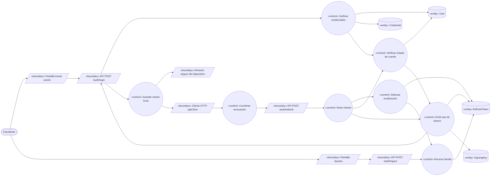
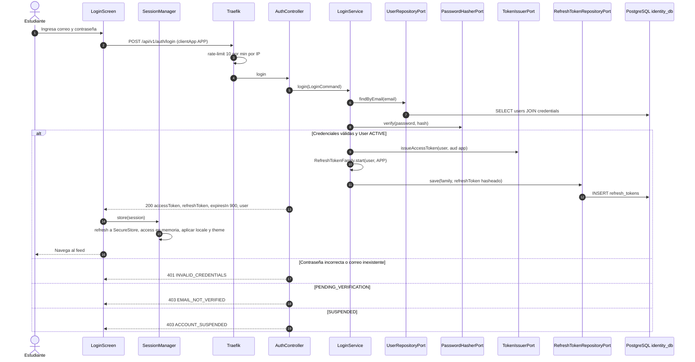
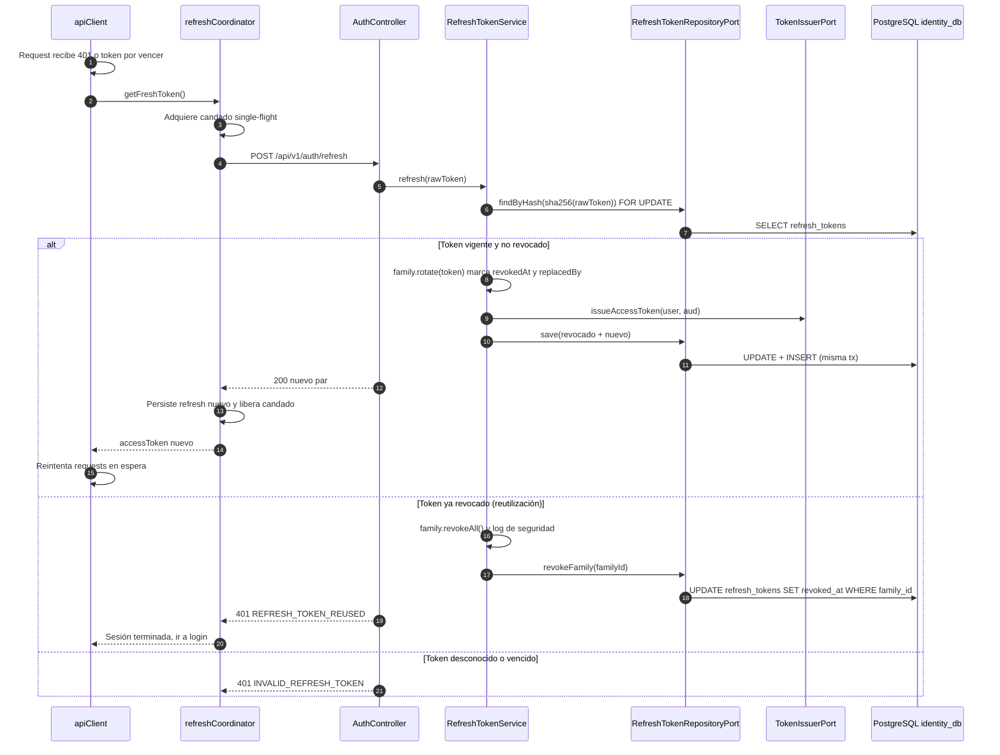
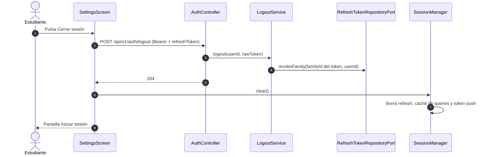

# UC-02 — Iniciar sesión y renovar sesión

| Campo | Valor |
|---|---|
| Paquete | Identidad |
| Actor principal | Estudiante (cualquier `User` con rol `STUDENT`, `ORGANIZER`, `MODERATOR` o `ADMIN`) |
| Actores secundarios | Todos los servicios que validan el JWT por JWKS; admin-shell (mismo flujo de login para el panel) |
| Prioridad (MoSCoW) | Must |
| Requisitos | RF-03, RNF-06, RNF-07, RNF-13 |
| Tecnologías de la cátedra que demuestra | T4 (REST), base de T13 (identidad única) |
| Servicios involucrados | identity-service (Hexagonal, Spring Boot 4), mobile, admin-shell |
| Estado ICONIX | Secuencia (CDR aprobada 2026-10-14 — acta retroactiva; implementación en curso) |

Este UC agrupa tres flujos de la misma sesión: **login**, **renovación rotativa del refresh token** (con detección de reutilización) y **logout**. UC-03 lo «extiende» (requiere sesión activa).

---

## 1. Narrativa (fase de requisitos)

### Precondiciones

- El estudiante tiene un `User` `ACTIVE` (UC-01 completado).
- `identity-service` publica su JWKS en `/.well-known/jwks.json` y los demás servicios lo tienen en caché (TTL 10 min, refresco ante `kid` desconocido).

### Disparador

- **Login:** el estudiante abre la app sin sesión válida y pulsa **"Iniciar sesión"**.
- **Renovación:** un request de la app recibe `401` por access token vencido, o el access token está a < 60 s de vencer.
- **Logout:** el estudiante pulsa **"Cerrar sesión"** en Ajustes.

### Curso básico A — Login

1. La app muestra la **pantalla Iniciar sesión** (textos desde i18n, namespace `auth`).
2. El estudiante ingresa correo y contraseña y pulsa "Entrar".
3. La app envía `login` con `{ email, password }` y `clientApp = APP` (el panel envía `ADMIN`).
4. El sistema busca el `User` por correo normalizado y verifica la `Credential` con Argon2id.
5. El sistema verifica que el `User` esté `ACTIVE`.
6. El sistema emite un **access token** JWT RS256 (15 min) con claims `sub`, `roles`, `uni`, `locale`, `aud` (`bandada-app` o `bandada-admin`), `typ=user`, `kid`.
7. El sistema crea una **familia** de refresh (`familyId` nuevo) y un `RefreshToken` opaco (32 bytes aleatorios, base64url) guardado solo como hash SHA-256, con vencimiento a 30 días.
8. El sistema responde `{ accessToken, refreshToken, expiresIn: 900, user }`.
9. La app guarda el refresh token en almacenamiento seguro (nativo: `expo-secure-store`; web: IndexedDB), mantiene el access token solo en memoria y aplica las preferencias `locale`/`theme` del `user` (D13, D14).
10. La app navega al feed (UC-06).

### Curso básico B — Renovación rotativa

1. El cliente HTTP de la app (`apiClient`) detecta access token vencido o próximo a vencer.
2. La app obtiene un **candado de una sola ejecución** (*single-flight*): si ya hay una renovación en curso, el request espera su resultado en lugar de lanzar otra.
3. La app envía `refreshToken` con `{ refreshToken }`.
4. El sistema calcula el hash y busca el `RefreshToken`.
5. El sistema verifica que no esté revocado ni vencido y que el `User` siga `ACTIVE`.
6. El sistema **revoca** el token presentado (`revokedAt = now`, `replacedBy = nuevoId`) y emite un nuevo par (access + refresh) en la **misma familia**, en una sola transacción.
7. El sistema responde el nuevo par; la app reemplaza el refresh guardado y reintenta los requests que esperaban.

### Curso básico C — Logout

1. El estudiante pulsa "Cerrar sesión".
2. La app envía `logout` (con `Authorization: Bearer <access>`) y `{ refreshToken }`.
3. El sistema revoca el `RefreshToken` presentado y toda su familia (las otras sesiones del usuario en otros dispositivos **no** se tocan, pertenecen a otras familias).
4. El sistema responde `204`.
5. La app borra el refresh del almacenamiento seguro, limpia el caché de TanStack Query del usuario, desregistra el token push (`DELETE /devices/{token}`, UC-24) y vuelve a la pantalla Iniciar sesión. La cola offline pendiente (`OfflineMutation`) se conserva cifrada por `userId` y solo se drena si vuelve a entrar el mismo usuario.

### Cursos alternos

- **A4a. Credenciales incorrectas** (correo inexistente o contraseña errónea): el sistema responde `401 INVALID_CREDENTIALS` con el mismo tiempo de respuesta en ambos casos (se calcula un hash Argon2id ficticio si el correo no existe). La app muestra el mensaje traducido del `code`.
- **A4b. Demasiados intentos:** Traefik limita `/api/v1/auth/*` a 10/min/IP → `429`. Además, tras 5 fallos seguidos para el mismo correo el sistema aplica espera progresiva (1, 2, 4… hasta 15 min) y responde `429 LOGIN_TEMPORARILY_LOCKED` con `Retry-After`.
- **A5a. Correo no verificado** (`PENDING_VERIFICATION`): `403 EMAIL_NOT_VERIFIED`; la app lleva a la pantalla Verificar correo (UC-01 paso 11) y ofrece "Reenviar código".
- **A5b. Cuenta suspendida** (`SUSPENDED`): `403 ACCOUNT_SUSPENDED`; la app muestra el aviso y no guarda nada.
- **A9a. Sin conexión al iniciar sesión:** la app muestra "Necesitas conexión para iniciar sesión". Si ya existía una sesión en el dispositivo, la app abre en **modo offline** con los datos cacheados (UC-06) sin validar tokens hasta recuperar la red.
- **B4a. Reutilización detectada** (el refresh presentado ya estaba revocado): indica robo o una copia antigua. El sistema **revoca toda la familia** (`familyId`), registra un log de seguridad `refresh_token_reuse_detected` (sin el token) y responde `401 REFRESH_TOKEN_REUSED`. La app (la legítima o la atacante) pierde la sesión y vuelve a Iniciar sesión.
- **B4b. Refresh desconocido o vencido:** `401 INVALID_REFRESH_TOKEN`; la app cierra sesión localmente.
- **B5a. Usuario suspendido entre renovaciones** (UC-21): `401 ACCOUNT_SUSPENDED` y se revoca la familia. El access token vigente sigue siendo válido hasta su vencimiento (≤ 15 min), riesgo aceptado y documentado.
- **B2a. Dos pestañas de la PWA renuevan a la vez:** el candado single-flight se comparte entre pestañas con `navigator.locks.request('bandada-refresh')` (Web Locks API); la segunda pestaña lee el refresh nuevo desde IndexedDB al soltarse el candado. Sin esta coordinación la segunda renovación dispararía B4a.
- **B7a. Se pierde la respuesta de la renovación** (red cae justo después de que el servidor rotó): el siguiente intento usa el refresh viejo → B4a → el usuario debe volver a iniciar sesión. Se acepta este costo a cambio de detección estricta de reutilización (no hay ventana de gracia).
- **C2a. Logout sin red:** la app borra la sesión local de todas formas y encola el `logout` como `OfflineMutation` para revocar el refresh al recuperar la red.

### Postcondiciones

- **Login / renovación exitosa:** existe exactamente un `RefreshToken` no revocado por familia; el cliente tiene un access token vigente.
- **Logout:** la familia del dispositivo queda revocada; la app no conserva tokens.
- **Reutilización:** toda la familia queda revocada; queda registro de seguridad con `userId`, `familyId`, IP y `traceId`.

### Reglas de negocio

| ID | Regla |
|---|---|
| RN-02.1 | Access token: JWT RS256, 15 min, firmado con la llave activa del JWKS; las llaves rotan cada 90 días manteniendo la anterior publicada hasta que expiren sus tokens. |
| RN-02.2 | Refresh token: opaco, 30 días, guardado hasheado (SHA-256), uso único, rotación obligatoria en cada renovación. |
| RN-02.3 | Presentar un refresh ya revocado revoca la familia completa (detección de reutilización, D1 `refreshToken`). |
| RN-02.4 | La familia guarda `clientApp` (`APP` / `ADMIN`); el `aud` del access token lo refleja y admin-gateway solo acepta `aud=bandada-admin`. |
| RN-02.5 | Nunca se loguean contraseñas ni tokens (convenciones §7). |
| RN-02.6 | Los servicios validan el access token localmente con JWKS (firma, `exp`, `aud`, `typ=user`); ninguno consulta `identity_db`. |

---

## 2. Diagrama de robustez (fase de análisis)

| Objeto | Tipo | Componente real |
|---|---|---|
| Pantalla Iniciar sesión | Boundary | `bandadau-frontend/app/(auth)/login.tsx` (panel: `bandadau-admin/shell/app/login/page.tsx`) |
| Pantalla Ajustes | Boundary | `bandadau-frontend/app/(tabs)/settings/index.tsx` |
| Cliente HTTP `apiClient` | Boundary | `bandadau-frontend/src/api/client.ts` (interceptor de 401 + single-flight) |
| Almacén seguro | Boundary | `expo-secure-store` (nativo) / IndexedDB (web) — `bandadau-frontend/src/auth/session-store.ts` (+ `.native.ts` / `.web.ts`) |
| API `/auth/login`, `/auth/refresh`, `/auth/logout` | Boundary | identity-service `AuthController` |
| Verificar credenciales | Control | `LoginService` + `PasswordHasherPort` (Argon2id) |
| Verificar estado de cuenta | Control | método de dominio `User.assertCanAuthenticate()` |
| Emitir par de tokens | Control | `TokenIssuerPort` → `JwtTokenIssuerAdapter`; `RefreshTokenFactory` |
| Coordinar renovación | Control | `refreshCoordinator` en la app (single-flight + Web Locks) |
| Rotar refresh / Detectar reutilización / Revocar familia | Control | `RefreshTokenService` + métodos del agregado `RefreshTokenFamily` |
| Guardar sesión local | Control | `SessionManager` (app) |
| User, Credential, RefreshToken | Entity | `identity_db.users`, `credentials`, `refresh_tokens` (`id`, `user_id`, `family_id`, `token_hash` único, `client_app`, `expires_at`, `revoked_at`, `replaced_by`) |
| SigningKey | Entity | llave RSA activa (`identity_db.signing_keys`, privada cifrada con secreto de entorno) |

---

## 3. Diagrama de secuencia (fase de diseño)

### 3.1 Login

### 3.2 Renovación rotativa y detección de reutilización

### 3.3 Logout

---

## 4. Clases / contratos involucrados

### identity-service (Hexagonal — `com.bandadau.identity`)

| Capa | Clase / interfaz |
|---|---|
| `domain.model` | `User` (`assertCanAuthenticate()`), `Credential`, `RefreshTokenFamily` (agregado: `start`, `rotate`, `revokeAll`), `RefreshToken`, `ClientApp` (`APP`, `ADMIN`) |
| `domain.exception` | `InvalidCredentialsException`, `EmailNotVerifiedException`, `AccountSuspendedException`, `RefreshTokenReusedException`, `RefreshTokenInvalidException` |
| `application.port.in` | `LoginUseCase`, `RefreshTokenUseCase`, `LogoutUseCase`, `GetJwksUseCase` |
| `application.service` | `LoginService`, `RefreshTokenService`, `LogoutService`, `LoginThrottle` |
| `application.port.out` | `UserRepositoryPort`, `RefreshTokenRepositoryPort`, `PasswordHasherPort`, `TokenIssuerPort`, `SigningKeyPort`, `ClockPort`, `SecurityAuditPort` |
| `adapter.in.web` | `AuthController`, `JwksController`, `ProblemDetailsAdvice` |
| `adapter.out.persistence` | `RefreshTokenJpaAdapter`, `UserJpaAdapter`, `SigningKeyJpaAdapter` |
| `adapter.out.security` | `Argon2PasswordHasherAdapter`, `JwtTokenIssuerAdapter` (Nimbus JOSE), `Slf4jSecurityAuditAdapter` |

### Lado cliente (`bandadau-frontend`)

`SessionManager`, `apiClient`, `refreshCoordinator`, `session-store.native.ts` (`expo-secure-store`), `session-store.web.ts` (IndexedDB + `navigator.locks`).

### Validación en otros servicios

`@bandada/auth-ts` (`JwtAuthGuard` con JWKS remoto) en NestJS; Spring Security Resource Server en events-service; middleware JWKS en Laravel. Todos aplican RN-02.6.

### Contratos

| Tipo | operationId | Detalle |
|---|---|---|
| OpenAPI | `login` | `POST /api/v1/auth/login` `{ email, password, clientApp? }` → `200 { accessToken, refreshToken, expiresIn, user }`; `401 INVALID_CREDENTIALS`, `403 EMAIL_NOT_VERIFIED`, `403 ACCOUNT_SUSPENDED`, `429 LOGIN_TEMPORARILY_LOCKED` |
| OpenAPI | `refreshToken` | `POST /api/v1/auth/refresh` `{ refreshToken }` → `200` mismo esquema; `401 REFRESH_TOKEN_REUSED`, `401 INVALID_REFRESH_TOKEN`, `401 ACCOUNT_SUSPENDED` |
| OpenAPI | `logout` 🔑 | `POST /api/v1/auth/logout` `{ refreshToken }` → `204` (idempotente: revocar algo ya revocado devuelve `204`) |
| OpenAPI | `getMe` 🔑 | `GET /api/v1/users/me` → `{ id, email, displayName, roles, universityId, locale, theme }` |
| OpenAPI | `getJwks` | `GET /.well-known/jwks.json` |

Este UC **no** publica eventos de dominio (login/refresh son operaciones de sesión, no hechos de negocio). Las métricas de login se exponen por OpenTelemetry (`identity_logins_total{result}`).

---

## 5. Pruebas de aceptación

| ID | Escenario |
|---|---|
| AT-02-01 | **Given** un `User` `ACTIVE` **When** hace login con credenciales correctas **Then** recibe `200`, un access token con `exp - iat = 900` y `roles` correctos, y existe un `refresh_tokens` no revocado con nueva `family_id`. |
| AT-02-02 | **Given** un access token emitido **When** social-service lo valida con el JWKS **Then** acepta el request sin consultar identity. |
| AT-02-03 | **Given** contraseña incorrecta y, por separado, correo inexistente **When** se hace login **Then** ambos responden `401 INVALID_CREDENTIALS` con diferencia de latencia p50 < 50 ms. |
| AT-02-04 | **Given** un `User` `PENDING_VERIFICATION` **When** hace login **Then** `403 EMAIL_NOT_VERIFIED`. |
| AT-02-05 | **Given** un refresh R1 vigente **When** se renueva **Then** recibe R2, R1 queda `revoked_at` con `replaced_by = R2`. |
| AT-02-06 | **Given** R1 ya rotado a R2 **When** alguien presenta R1 **Then** `401 REFRESH_TOKEN_REUSED` y R2 también queda revocado (familia completa). |
| AT-02-07 | **Given** dos requests concurrentes con access vencido en la app **When** ambos detectan `401` **Then** solo se envía **un** `POST /auth/refresh` y ambos requests se reintentan con éxito. |
| AT-02-08 | **Given** dos pestañas de la PWA **When** ambas renuevan al mismo tiempo **Then** el candado Web Locks serializa y no se produce `REFRESH_TOKEN_REUSED`. |
| AT-02-09 | **Given** una sesión activa **When** hace logout **Then** `204`, la familia queda revocada y un refresh posterior con ese token da `401`. |
| AT-02-10 | **Given** dos dispositivos con sesión **When** cierra sesión en uno **Then** el otro sigue renovando normalmente. |
| AT-02-11 | **Given** 11 logins en 1 min desde la misma IP **When** llega el 11.º **Then** Traefik responde `429`. |
| AT-02-12 | **Given** un usuario suspendido en UC-21 **When** su app intenta renovar **Then** `401 ACCOUNT_SUSPENDED` y la app vuelve a login. |

---

## 6. Trazabilidad

| Requisito | Paso UC | Endpoint | Clases | Pruebas |
|---|---|---|---|---|
| RF-03 (login, 15 min / 30 días) | A1–A10 | `login` | `LoginService`, `JwtTokenIssuerAdapter`, `RefreshTokenFamily.start` | AT-02-01, AT-02-04 |
| RF-03 (rotación) | B1–B7, B4a, B2a | `refreshToken` | `RefreshTokenService`, `RefreshTokenFamily.rotate/revokeAll`, `refreshCoordinator` | AT-02-05 – AT-02-08 |
| RF-03 (logout) | C1–C5 | `logout` | `LogoutService`, `SessionManager` | AT-02-09, AT-02-10 |
| RNF-06 | A4a, A4b, RN-02.1 | rate-limit Traefik, JWKS | `LoginThrottle`, `Argon2PasswordHasherAdapter`, `JwksController` | AT-02-03, AT-02-11 |
| RNF-07 | RN-02.6 | `getJwks` | `@bandada/auth-ts JwtAuthGuard` | AT-02-02 |
| RF-25 (efecto de suspensión) | B5a | `refreshToken` | `User.assertCanAuthenticate` | AT-02-12 |

**PROPUESTAS derivadas** (no aplicadas en normativos):

1. *D1 identity:* documentar el campo opcional `clientApp` (`APP|ADMIN`) en `login` y el claim `aud` (`app|admin`) para que admin-gateway rechace tokens de la app (RN-02.4). Detalle a fijar en `seguridad-y-sso.md`.
2. *seguridad-y-sso.md:* evaluar entregar el refresh de la PWA en cookie `HttpOnly; Secure; SameSite=Strict; Path=/api/v1/auth` en lugar de IndexedDB (mitiga XSS). Mientras no se decida, se usa IndexedDB + CSP estricta.
