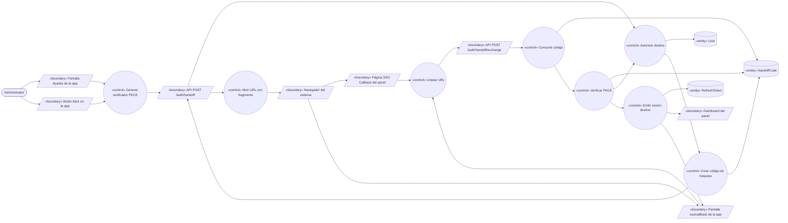
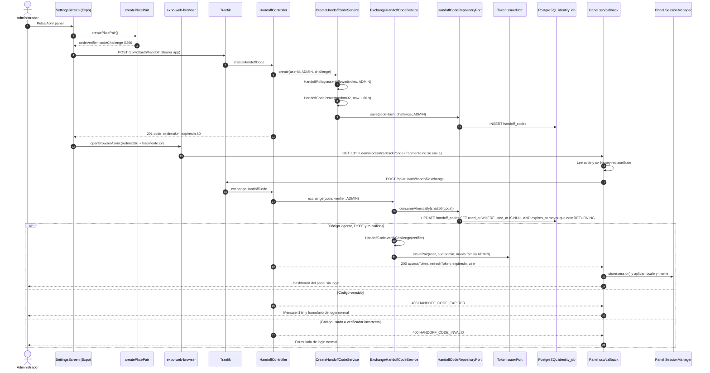
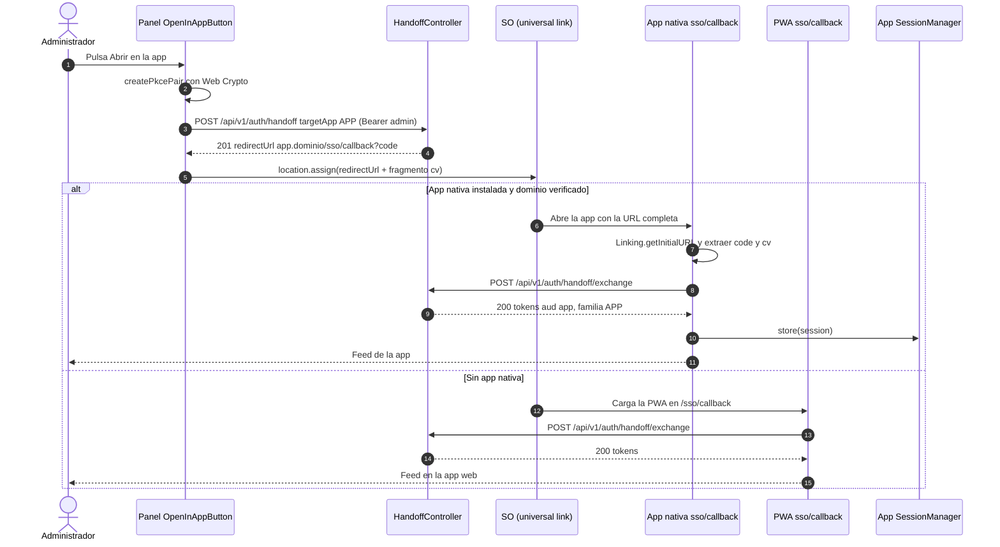

# UC-03 — Acceder al panel desde la app sin re-login (y volver)

| Campo | Valor |
|---|---|
| Paquete | Identidad |
| Actor principal | Administrador (también Moderador) |
| Actores secundarios | admin-shell (panel), app móvil/PWA, navegador del sistema, SO (universal links / App Links) |
| Prioridad (MoSCoW) | Must |
| Requisitos | RF-04, RNF-06, RNF-08 |
| Tecnologías de la cátedra que demuestra | **T13** (acceso por una sola entrada), T4 |
| Servicios involucrados | identity-service (Hexagonal), bandadau-frontend (Expo SDK 57: iOS, Android, web), bandadau-admin/shell (Next.js 16 static export) |
| Estado ICONIX | Secuencia (pendiente CDR) |

Relación: UC-03 «extend» UC-02 (requiere sesión activa en la app de origen). Implementa D4 de `decisiones-clave.md`.

---

## 1. Narrativa (fase de requisitos)

### Precondiciones

- El administrador tiene sesión activa en la app de origen (UC-02) con access token vigente.
- Para ir **app → panel**: su `User.roles` contiene `MODERATOR` o `ADMIN`.
- Para ir **panel → app**: tiene sesión en el panel (cualquier rol que permita entrar al panel).
- Los dominios están configurados con `BASE_DOMAIN` (`admin.bandada.localhost`, `app.bandada.localhost` en dev).

### Disparador

- **Directo:** el administrador pulsa **"Abrir panel"** en Ajustes de la app (botón visible solo si tiene `MODERATOR`/`ADMIN`).
- **Inverso:** en el panel pulsa **"Abrir en la app"**.

### Curso básico (app nativa → panel)

1. El administrador pulsa "Abrir panel" en la **pantalla Ajustes**.
2. La app genera un `codeVerifier` (32 bytes aleatorios con `expo-crypto`, codificado base64url, 43 caracteres) y su `codeChallenge = BASE64URL(SHA-256(codeVerifier))`.
3. La app envía `createHandoffCode` con `{ targetApp: ADMIN, codeChallenge, codeChallengeMethod: S256 }` y su access token.
4. El sistema verifica que el `User` siga `ACTIVE` y tenga rol `MODERATOR` o `ADMIN`.
5. El sistema genera un `HandoffCode`: 32 bytes aleatorios; guarda solo `codeHash` (SHA-256), `codeChallenge`, `userId`, `targetApp = ADMIN`, `expiresAt = now + 60 s`, `usedAt = null`.
6. El sistema responde `{ code, redirectUrl: "https://admin.<dominio>/sso/callback?code=<code>", expiresIn: 60 }`.
7. La app arma la URL final agregando el verificador en el **fragmento**: `<redirectUrl>#cv=<codeVerifier>` y la abre con `WebBrowser.openBrowserAsync` de `expo-web-browser` (SFSafariViewController en iOS, Custom Tabs en Android).
8. El navegador carga la página estática `/sso/callback` del panel. El fragmento `#cv=…` **no** viaja al servidor ni a los logs de Traefik/CloudFront.
9. El panel (**página SSO Callback**) lee `code` de la query y `cv` del fragmento y los borra de inmediato de la barra con `history.replaceState` (no quedan en historial ni en `Referer`).
10. El panel envía `exchangeHandoffCode` con `{ code, codeVerifier }`.
11. El sistema busca el `HandoffCode` por hash y lo **consume atómicamente**: `UPDATE handoff_codes SET used_at = now() WHERE code_hash = ? AND used_at IS NULL AND expires_at > now() RETURNING …`.
12. El sistema verifica `BASE64URL(SHA-256(codeVerifier)) == codeChallenge` y que `targetApp` corresponda a la app que canjea (`ADMIN`).
13. El sistema vuelve a verificar que el `User` siga `ACTIVE` con rol `MODERATOR`/`ADMIN` y emite un **par de tokens nuevo** con `aud=admin` y una **familia de refresh nueva** (`clientApp = ADMIN`), independiente de la sesión de la app.
14. El panel guarda la sesión (access en memoria, refresh según su `SessionManager`), aplica `locale`/`theme` del usuario y navega a `/` (dashboard). Los MFEs reciben el `access-token` como propiedad (D5).
15. El administrador ve el panel sin haber escrito credenciales.

### Variante web (PWA → panel)

7w. En la app web (`Platform.OS === 'web'`) la app abre `<redirectUrl>#cv=<codeVerifier>` en una pestaña nueva con `window.open(url, '_blank', 'noopener')` (o `window.location.assign` si la PWA está instalada en modo standalone, según preferencia de UX). Como `app.<dominio>` y `admin.<dominio>` son orígenes distintos, no comparten `sessionStorage`/`IndexedDB`; por eso el verificador viaja en el fragmento igual que en nativo. Los pasos 8–15 son idénticos.

### Curso inverso (panel → app) — pasos I1 a I11

Los pasos de esta sección se citan como I1…I11 en los alternos y en la trazabilidad.

1. El administrador pulsa "Abrir en la app" en el panel.
2. El panel genera `codeVerifier`/`codeChallenge` con `crypto.getRandomValues` y `crypto.subtle.digest('SHA-256', …)`.
3. El panel envía `createHandoffCode` con `{ targetApp: APP, codeChallenge, codeChallengeMethod: S256 }` y su access token (`aud=admin`).
4. El sistema verifica que el `User` esté `ACTIVE` (cualquier rol puede ir a la app) y crea el `HandoffCode` con `targetApp = APP`.
5. El sistema responde `redirectUrl = "https://app.<dominio>/sso/callback?code=<code>"`.
6. El panel navega a `<redirectUrl>#cv=<codeVerifier>`.
7. En un **teléfono con la app instalada**, el SO abre la app nativa por *universal link* (iOS, `associatedDomains: ["applinks:app.<dominio>"]` + `apple-app-site-association`) o *App Link* (Android, `intentFilters` con `autoVerify` + `/.well-known/assetlinks.json`), ambos servidos por el host web de la app. expo-router enruta a `app/sso/callback.tsx`.
8. En un **escritorio o teléfono sin la app**, se carga la PWA en la misma ruta `/sso/callback`.
9. La pantalla `sso/callback` obtiene la URL completa (`Linking.getInitialURL()` / evento `url` en nativo; `window.location` en web), extrae `code` y `cv`, y llama `exchangeHandoffCode`.
10. El sistema canjea como en los pasos 11–13 con `targetApp = APP`, `aud=app`, familia nueva `clientApp = APP`.
11. La app guarda la sesión (UC-02 paso 9) y navega al feed.

### Cursos alternos

- **1a. Usuario sin rol de panel:** el botón "Abrir panel" no se muestra. Si se llama la API igualmente, el sistema responde `403 HANDOFF_TARGET_FORBIDDEN`.
- **3a. Access token vencido:** el `apiClient` renueva (UC-02 curso B) y reintenta.
- **3b. Sin conexión:** la app muestra "Necesitas conexión para abrir el panel" (texto i18n) y no genera código.
- **10a. Código vencido (> 60 s, p. ej. el navegador tardó en abrir):** `400 HANDOFF_CODE_EXPIRED`. El panel muestra "El enlace expiró" y el **formulario de login normal** del panel (UC-02); el administrador puede volver a la app y reintentar.
- **10b. Código ya usado** (recarga de la página callback, doble pestaña o intento de *replay*): el `UPDATE` atómico no afecta filas → `400 HANDOFF_CODE_INVALID`. Si el panel ya tenía sesión por el primer canje, simplemente navega a `/`.
- **10c. Verificador incorrecto o ausente** (alguien obtuvo solo el `code` de un log o historial): `400 HANDOFF_CODE_INVALID`; el código queda consumido (no se puede reintentar con otro verificador) y se registra log de seguridad `handoff_pkce_mismatch`.
- **10d. `targetApp` no coincide** (un código `APP` se intenta canjear en el panel): `400 HANDOFF_CODE_INVALID`.
- **13a. El usuario perdió el rol o fue suspendido entre el paso 4 y el canje:** `403 HANDOFF_TARGET_FORBIDDEN` / `403 ACCOUNT_SUSPENDED`; el panel muestra login normal.
- **7a. (nativo) El usuario cierra el navegador in-app antes de cargar:** el código vence sin uso a los 60 s; no hay efecto. Una tarea de limpieza borra códigos vencidos cada hora.
- **I7a. (inverso) El universal link no abre la app** (dominio no verificado, navegador in-app de otra aplicación): se carga la PWA (paso I8); el flujo funciona igual en web.
- **I9a. (inverso) El fragmento no llega a la app nativa:** en algunas combinaciones SO/navegador el fragmento podría perderse. Mitigación: si `cv` falta, la pantalla callback muestra "Abre la app e inicia sesión" y ofrece login normal. **Riesgo a verificar en dispositivo real durante la implementación** (registrar resultado en `registro-de-sesiones.md`).
- **Rate-limit:** `createHandoffCode` admite 10 códigos/min por usuario; excedido → `429`.

### Postcondiciones

- **Éxito:** el `HandoffCode` queda con `usedAt` (no reutilizable); existe una sesión nueva e independiente en la app destino (familia de refresh propia). La sesión de origen no cambia.
- **Fallo:** ningún token emitido; el destino ofrece login normal (degradación sin bloqueo).

### Reglas de negocio

| ID | Regla |
|---|---|
| RN-03.1 | `HandoffCode`: 32 bytes aleatorios, guardado hasheado (SHA-256), válido 60 s, un solo uso, ligado a `userId` y `targetApp` (D4). |
| RN-03.2 | PKCE obligatorio con método `S256`; no se acepta `plain`. |
| RN-03.3 | El `codeVerifier` viaja solo en el fragmento `#cv=` (nunca en query ni en el body de `createHandoffCode`). |
| RN-03.4 | `targetApp = ADMIN` exige rol `MODERATOR` o `ADMIN` al crear **y** al canjear. |
| RN-03.5 | El canje nunca reutiliza el refresh de origen: crea una familia nueva con `clientApp` del destino. |
| RN-03.6 | `redirectUrl` se construye en el servidor desde configuración (`ADMIN_BASE_URL`, `APP_BASE_URL`); el cliente no puede elegir la URL (evita *open redirect*). |
| RN-03.7 | La página `/sso/callback` responde con `Referrer-Policy: no-referrer` y `Cache-Control: no-store`. |

---

## 2. Diagrama de robustez (fase de análisis)

| Objeto | Tipo | Componente real |
|---|---|---|
| Pantalla Ajustes de la app | Boundary | `bandadau-frontend/app/(tabs)/settings/index.tsx` (`OpenAdminPanelButton`) |
| Botón Abrir en la app | Boundary | `bandadau-admin/shell/src/components/open-in-app-button.tsx` |
| Navegador del sistema | Boundary | `expo-web-browser` (nativo), `window.open`/`location` (web), universal link del SO |
| Página SSO Callback del panel | Boundary | `bandadau-admin/shell/app/sso/callback/page.tsx` (client component) |
| Pantalla sso/callback de la app | Boundary | `bandadau-frontend/app/sso/callback.tsx` |
| Dashboard del panel | Boundary | `bandadau-admin/shell/app/page.tsx` |
| API `/auth/handoff`, `/auth/handoff/exchange` | Boundary | identity-service `HandoffController` |
| Generar verificador PKCE | Control | `@bandada/auth-ts` → `createPkcePair()` (usa `expo-crypto` en nativo y Web Crypto en web) |
| Autorizar destino | Control | `HandoffPolicy` (servicio de dominio: rol vs `targetApp`) |
| Crear código de traspaso | Control | `CreateHandoffCodeService` |
| Abrir URL con fragmento | Control | `openHandoffUrl()` (`.native.ts` / `.web.ts`) |
| Limpiar URL | Control | `consumeCallbackParams()` (lee y hace `history.replaceState`) |
| Consumir código / Verificar PKCE | Control | `ExchangeHandoffCodeService` + `HandoffCode.redeem(verifier, targetApp, now)` |
| Emitir sesión destino | Control | `TokenIssuerPort` + `RefreshTokenFamily.start(user, targetApp)` |
| User, HandoffCode, RefreshToken | Entity | `identity_db.users`, `handoff_codes` (`id`, `user_id`, `code_hash` único, `code_challenge`, `target_app`, `expires_at`, `used_at`, `created_ip`), `refresh_tokens` |

---

## 3. Diagrama de secuencia (fase de diseño)

### 3.1 App nativa → panel (curso básico) con alterno de código vencido

### 3.2 Panel → app (curso inverso) con universal link

---

## 4. Clases / contratos involucrados

### identity-service (Hexagonal — `com.bandadau.identity`)

| Capa | Clase / interfaz |
|---|---|
| `domain.model` | `HandoffCode` (`issue`, `redeem`, `verifyChallenge`, `isExpired`), `TargetApp` (`ADMIN`, `APP`), `CodeChallenge` (VO, solo S256) |
| `domain.service` | `HandoffPolicy` (RN-03.4) |
| `domain.exception` | `HandoffCodeExpiredException`, `HandoffCodeInvalidException`, `HandoffTargetForbiddenException` |
| `application.port.in` | `CreateHandoffCodeUseCase`, `ExchangeHandoffCodeUseCase` |
| `application.service` | `CreateHandoffCodeService`, `ExchangeHandoffCodeService`, `PurgeExpiredHandoffCodesJob` (`@Scheduled` cada hora) |
| `application.port.out` | `HandoffCodeRepositoryPort` (`save`, `consumeAtomically`), `UserRepositoryPort`, `TokenIssuerPort`, `RefreshTokenRepositoryPort`, `RedirectUrlConfigPort`, `SecurityAuditPort` |
| `adapter.in.web` | `HandoffController` |
| `adapter.out.persistence` | `HandoffCodeJpaAdapter` (consulta nativa `UPDATE … RETURNING`) |

### Clientes

- `bandadau-shared/packages/auth-ts`: `createPkcePair()`, `buildHandoffUrl(redirectUrl, verifier)`, `parseHandoffCallback(url)`.
- `bandadau-frontend`: `OpenAdminPanelButton`, `src/auth/open-handoff-url.native.ts` (`WebBrowser.openBrowserAsync`), `open-handoff-url.web.ts`, `app/sso/callback.tsx`; `app.config.ts` con `ios.associatedDomains` y `android.intentFilters`.
- `bandadau-admin/shell`: `app/sso/callback/page.tsx`, `OpenInAppButton`, `SessionManager`. Cabeceras de RN-03.7 en la configuración del host estático (CloudFront *response headers policy* / Traefik middleware en dev).

### Contratos

| Tipo | operationId | Detalle |
|---|---|---|
| OpenAPI | `createHandoffCode` 🔑 | `POST /api/v1/auth/handoff` body `{ targetApp: "ADMIN" \| "APP", codeChallenge, codeChallengeMethod: "S256" }` → `201 { code, redirectUrl, expiresIn: 60 }`; `403 HANDOFF_TARGET_FORBIDDEN`, `429` |
| OpenAPI | `exchangeHandoffCode` | `POST /api/v1/auth/handoff/exchange` body `{ code, codeVerifier }` → `200 { accessToken, refreshToken, expiresIn, user }`; `400 HANDOFF_CODE_EXPIRED`, `400 HANDOFF_CODE_INVALID`, `403 HANDOFF_TARGET_FORBIDDEN`, `403 ACCOUNT_SUSPENDED` |
| Estático | `/.well-known/apple-app-site-association`, `/.well-known/assetlinks.json` | Servidos por el host de la app web (`app.<dominio>`) |

No se publican eventos de dominio (se audita en logs de seguridad y trazas OTel con `handoff.target_app` y `handoff.result`).

---

## 5. Pruebas de aceptación

| ID | Escenario |
|---|---|
| AT-03-01 | **Given** un `ADMIN` con sesión en la app nativa **When** pulsa "Abrir panel" **Then** el navegador in-app abre el dashboard del panel sin pedir credenciales en < 3 s. |
| AT-03-02 | **Given** un `STUDENT` sin otros roles **When** llama `createHandoffCode` con `targetApp=ADMIN` **Then** `403 HANDOFF_TARGET_FORBIDDEN` y el botón no aparece en Ajustes. |
| AT-03-03 | **Given** un código emitido **When** se canjea a los 61 s **Then** `400 HANDOFF_CODE_EXPIRED` y el panel muestra el login normal. |
| AT-03-04 | **Given** un código ya canjeado **When** se recarga `/sso/callback` **Then** el segundo canje da `400 HANDOFF_CODE_INVALID` y no se emiten tokens nuevos. |
| AT-03-05 | **Given** dos canjes concurrentes del mismo código **When** llegan a la vez **Then** exactamente uno recibe `200` (consumo atómico). |
| AT-03-06 | **Given** un código válido **When** se canjea con un `codeVerifier` distinto **Then** `400 HANDOFF_CODE_INVALID` y el código queda inutilizable. |
| AT-03-07 | **Given** el flujo completo **When** se revisan los logs de Traefik y del panel **Then** aparece `code` pero nunca `cv`, y la barra del navegador queda en `/sso/callback` sin parámetros. |
| AT-03-08 | **Given** un código `targetApp=APP` **When** se canjea desde el panel esperando `ADMIN` **Then** `400 HANDOFF_CODE_INVALID`. |
| AT-03-09 | **Given** un `MODERATOR` en el panel en un teléfono con la app instalada **When** pulsa "Abrir en la app" **Then** se abre la app nativa en el feed con sesión. |
| AT-03-10 | **Given** el mismo flujo en un escritorio **When** pulsa "Abrir en la app" **Then** se abre la PWA con sesión. |
| AT-03-11 | **Given** el canje exitoso **When** el administrador cierra sesión en el panel **Then** la sesión de la app sigue activa (familias independientes). |
| AT-03-12 | **Given** la app web PWA de un `ADMIN` **When** pulsa "Abrir panel" **Then** se abre una pestaña del panel con sesión. |

---

## 6. Trazabilidad

| Requisito | Paso UC | Endpoint | Clases | Pruebas |
|---|---|---|---|---|
| RF-04 / T13 (app → panel) | 1–15, 7w | `createHandoffCode`, `exchangeHandoffCode` | `CreateHandoffCodeService`, `ExchangeHandoffCodeService`, `HandoffCode`, `open-handoff-url.native.ts` | AT-03-01, AT-03-12 |
| RF-04 / T13 (panel → app) | I1–I11 | mismos | `OpenInAppButton`, `app/sso/callback.tsx`, universal links | AT-03-09, AT-03-10 |
| RF-04 (60 s, un uso) | 11, 10a, 10b | `exchangeHandoffCode` | `HandoffCodeJpaAdapter.consumeAtomically` | AT-03-03 – AT-03-05 |
| RNF-06 (PKCE, roles) | 2, 4, 12, 13a | — | `HandoffPolicy`, `CodeChallenge` | AT-03-02, AT-03-06, AT-03-08 |
| RNF-08 (no filtrar secretos) | 8, 9, RN-03.3, RN-03.7 | — | `consumeCallbackParams` | AT-03-07 |
| RN-03.5 | 13 | — | `RefreshTokenFamily.start` | AT-03-11 |

**PROPUESTAS derivadas** (no aplicadas en normativos):

1. *D1 identity:* la fila de `createHandoffCode` lista solo `{ targetApp }`; D4 agrega `codeChallenge`. Unificar el body como `{ targetApp, codeChallenge, codeChallengeMethod: "S256" }` y la respuesta como `201`.
2. *Códigos de error* `HANDOFF_CODE_EXPIRED`, `HANDOFF_CODE_INVALID`, `HANDOFF_TARGET_FORBIDDEN`: agregar al catálogo de errores de `api-rest-guidelines.md` y a los mensajes de `@bandada/i18n`.
