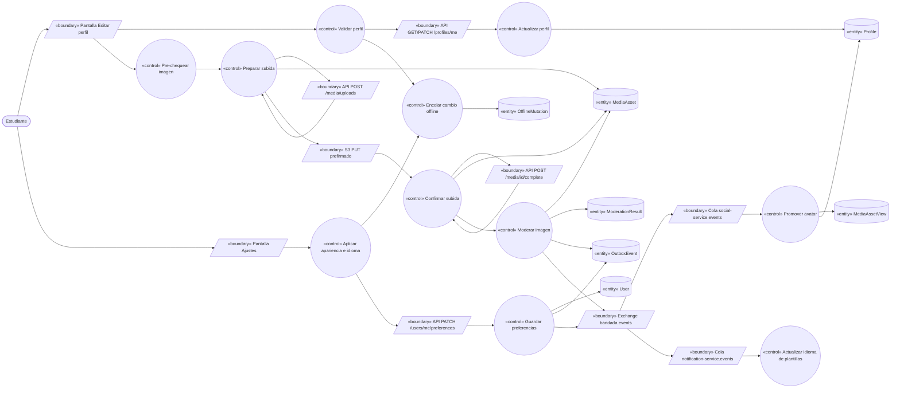
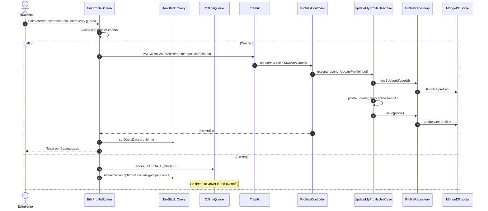
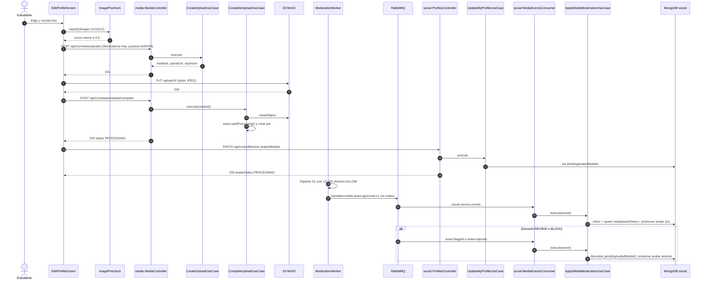
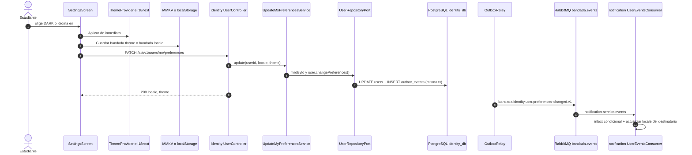

# UC-04 — Gestionar perfil académico y preferencias

| Campo | Valor |
|---|---|
| Paquete | Social (perfil) + Identidad (preferencias) |
| Actor principal | Estudiante |
| Actores secundarios | `media-service` (avatar + moderación DL), `identity-service` (preferencias), `notification-service` (copia del idioma) |
| Prioridad (MoSCoW) | Must |
| Requisitos | RF-05, RF-29 (tema), RF-30 (idioma), RF-07 (moderación del avatar), RNF-08, RNF-09 |
| Tecnologías de la cátedra que demuestra | T4 (REST), T8 (Idempotency-Key en upload), T9 (moderación DL del avatar), T7 (cambios offline encolados) |
| Servicios involucrados | social-service (Clean, NestJS 11, Mongo `social`), media-service (Clean, Mongo `media` + S3), identity-service (Hexagonal), notification-service, bandadau-frontend |
| Estado ICONIX | Implementado (fase 1, 2026-10-15) — evidencia en `../07-trazabilidad.md` |

Este UC tiene tres sub-flujos que comparten la **pantalla Editar perfil / Ajustes**: (A) editar datos académicos, (B) cambiar avatar y (C) cambiar tema e idioma. Los textos de todas las pantallas provienen de i18n (namespaces `profile` y `settings`, D14); los colores, de tokens semánticos (D13).

---

## 1. Narrativa (fase de requisitos)

### Precondiciones

- El estudiante tiene sesión activa (UC-02).
- Existe su `Profile` en `social` (creado en UC-01 al consumir `bandada.identity.user.registered.v1`).

### Disparador

El estudiante abre **"Mi perfil" → "Editar"**, o **"Ajustes" → "Apariencia" / "Idioma"**, o llega al **onboarding** tras verificar el correo (UC-01 paso 15).

### Curso básico A — Editar datos académicos

1. La app pide el perfil (`getMyProfile`).
2. El sistema devuelve el `Profile`: `displayName`, `avatarUrl`, `universityId` (y nombre), `career`, `semester`, `bio`, `interests[]`.
3. La app muestra la **pantalla Editar perfil**; la universidad aparece como solo lectura.
4. El estudiante modifica nombre visible, carrera, semestre, bio e intereses y pulsa "Guardar".
5. La app valida localmente (mismas reglas RN-04.1) y envía `updateMyProfile` con **solo los campos cambiados**.
6. El sistema valida las reglas de negocio, aplica los cambios al `Profile` (normaliza intereses a minúsculas, sin duplicados) y actualiza `updatedAt`.
7. El sistema responde el `Profile` actualizado; la app actualiza el caché de TanStack Query (`['profile','me']` y `['profile', userId]`) y muestra "Perfil actualizado" (toast i18n).

### Curso básico B — Cambiar avatar

1. El estudiante pulsa "Cambiar foto" y elige una imagen (`expo-image-picker`), la recorta 1:1 y la app la redimensiona a 512×512 JPEG (`expo-image-manipulator`).
2. La app ejecuta el **pre-chequeo on-device** (`ImagePrecheck`, modelo `nsfw-mobile`, D6). Si el puntaje es < 0.5 continúa sin aviso.
3. La app genera una `Idempotency-Key` y pide una subida (`createUpload`) con `{ kind: IMAGE, contentType: "image/jpeg", sizeBytes, purpose: AVATAR }`.
4. `media-service` crea un `MediaAsset` `PENDING_UPLOAD` (`ownerId` = usuario, `storageKey = media/<ownerId>/<mediaId>/original.jpg`) y responde `{ mediaId, uploadUrl, expiresIn }` (PUT prefirmado de S3/MinIO).
5. La app sube el archivo con `PUT uploadUrl` directo a S3/MinIO.
6. La app confirma (`completeUpload`); media-service verifica el objeto (`HeadObject`: tamaño y tipo), pasa el asset a `PROCESSING` y encola el job de moderación (mismo pipeline que UC-05, sin OCR ni auto-etiquetado por ser `AVATAR`).
7. La app envía `updateMyProfile` con `{ avatarMediaId }`.
8. social-service guarda `pendingAvatarMediaId` (el avatar visible no cambia todavía) y responde `200` con `avatarStatus: PROCESSING`. La app muestra la nueva foto localmente con la insignia "En revisión".
9. media-service termina la moderación con decisión `ALLOW`, marca el asset `APPROVED` y publica `bandada.media.asset.approved.v1` (vía outbox).
10. social-service consume el evento, actualiza su read model `mediaAssetViews` y, como el asset coincide con `pendingAvatarMediaId` del dueño, promueve `avatarMediaId = pendingAvatarMediaId` y limpia el pendiente.
11. La próxima vez que la app pide el perfil (o al refrescar con *pull-to-refresh*), recibe `avatarUrl` prefirmada (15 min) y quita la insignia.

### Curso básico C — Cambiar tema e idioma

1. El estudiante abre **Ajustes → Apariencia** y elige `SYSTEM`, `LIGHT` o `DARK`; o **Ajustes → Idioma** y elige `es` o `en`.
2. La app aplica el cambio **de inmediato** (sin esperar red): tema → `useColorScheme()` + `vars()` de NativeWind (nativo) o atributo `data-theme` en `<html>` (web); idioma → `i18next.changeLanguage()`. Persiste localmente `bandada.theme` / `bandada.locale` (MMKV en nativo, `localStorage` en web).
3. La app envía `updateMyPreferences` (`PATCH /api/v1/users/me/preferences`) con `{ theme }` o `{ locale }`.
4. identity-service valida los valores, actualiza `User.theme` / `User.locale` y, si cambió el `locale`, registra en el outbox `bandada.identity.user.preferences-changed.v1` (`userId`, `locale`, `theme`) en la misma transacción.
5. El sistema responde `200` con `{ locale, theme }`.
6. El relay publica el evento; `notification-service` lo consume y actualiza su copia local del idioma para las plantillas de push/email/in-app (D14). (social-service también recibe el evento por su binding `bandada.identity.user.#` y lo ignora con `ack`.)
7. En otro dispositivo o en el panel, al iniciar sesión o renovar `getMe`, se aplican las preferencias de la cuenta (resolución D14: cuenta → dispositivo → sistema → `es`).

### Cursos alternos

- **A1a. Perfil aún no creado** (evento de UC-01 en tránsito): `404 PROFILE_NOT_READY` → la app reintenta con backoff hasta 10 s mostrando "Preparando tu perfil…".
- **A5a. Validación local falla:** la app marca el campo (p. ej. "Máximo 280 caracteres") con texto i18n; no envía.
- **A6a. Validación del servidor falla:** `422 VALIDATION_FAILED` con `errors[]` por campo (`pointer: /bio`); la app traduce cada `code`.
- **A6b. Intento de cambiar `universityId`:** el campo no existe en el esquema de `updateMyProfile` (`additionalProperties: false`) → `422`.
- **A5b. Sin conexión:** la app guarda el cambio como `OfflineMutation` (`type: UPDATE_PROFILE`, cuerpo completo de los campos cambiados) y actualiza el caché local de forma optimista con la insignia "Pendiente de sincronizar". Al volver la red se drena (PATCH es idempotente por naturaleza: valores absolutos). Si dos dispositivos editan, gana la última escritura que llegue al servidor (*last-write-wins* por `updatedAt` del servidor).
- **B2a. Pre-chequeo con puntaje 0.5–0.85:** la app muestra "Esta imagen podría no cumplir las normas de la comunidad" con opciones "Elegir otra" / "Usar igual". Si usa igual, continúa (la decisión final es del servidor).
- **B2b. Pre-chequeo con puntaje ≥ 0.85:** aviso fuerte; el botón "Usar igual" sigue disponible pero se recomienda elegir otra. El modelo on-device no bloquea por sí solo.
- **B2c. Modelo on-device no descargado o no soportado** (web sin WebGPU/WASM SIMD): se omite el pre-chequeo sin aviso.
- **B3a. Reintento de `createUpload` con la misma `Idempotency-Key`:** media devuelve el mismo `mediaId` y `uploadUrl` (`Idempotent-Replayed: true`).
- **B5a. URL prefirmada vencida** (subida lenta, > `expiresIn`): S3 responde `403`; la app pide **otra** subida con una `Idempotency-Key` nueva (nuevo `mediaId`). El asset huérfano `PENDING_UPLOAD` lo purga media-service tras 24 h.
- **B6a. Archivo no coincide** (tamaño o `contentType` distinto al declarado, o no es una imagen decodificable): `422 MEDIA_INVALID_OBJECT`; media borra el objeto y marca el asset `REJECTED`.
- **B9a. Decisión `REVIEW`** (0.5–0.85): asset `FLAGGED` → `bandada.media.asset.flagged.v1`. social descarta `pendingAvatarMediaId` (el avatar anterior sigue visible) y responde `avatarStatus: REJECTED` en el siguiente `getMyProfile`; la app muestra "Tu foto no fue aprobada" (i18n). Si un moderador la aprueba luego en UC-18 (`decideMedia` → `bandada.media.asset.approved.v1`), social **no** la aplica automáticamente (el usuario pudo haber elegido otra); el estudiante puede volver a seleccionarla.
- **B9b. Decisión `BLOCK`** (≥ 0.85): asset `REJECTED` → `bandada.media.asset.rejected.v1`; social descarta el pendiente igual que B9a.
- **B10a. Evento duplicado:** inbox `processedMessages` → `ack` sin efecto.
- **B10b. Evento de un asset ajeno** (`ownerId` del evento ≠ `userId` del perfil que lo tiene pendiente): se ignora y se registra un log de seguridad.
- **B7a. `avatarMediaId` que el usuario no posee o inexistente:** social no puede verificarlo sincrónicamente; lo guarda como pendiente y solo lo promueve si llega un `asset.approved` con `ownerId` igual al usuario (B10b). Un pendiente sin evento en 24 h se descarta.
- **C3a. Sin conexión:** el cambio ya está aplicado localmente; se encola `OfflineMutation` (`type: UPDATE_PREFERENCES`) y se sincroniza después.
- **C3b. Sin sesión** (pantalla de login o landing): solo se aplica y persiste localmente; no se llama a la API.
- **C4a. Valor inválido** (`locale: "fr"`): `422 VALIDATION_FAILED`; la app revierte al valor anterior.
- **C4b. Solo cambia el tema:** se actualiza `User.theme`; el evento también se publica (lleva ambos campos) para mantener una sola fuente de verdad, aunque notification solo use `locale`.

### Postcondiciones

- **A:** `Profile` actualizado en `social.profiles`.
- **B:** `Profile.avatarMediaId` apunta a un `MediaAsset` `APPROVED`, o el avatar anterior se conserva si la moderación no aprobó.
- **C:** `User.locale`/`User.theme` actualizados en `identity_db`; la UI y notification-service usan el nuevo idioma.

### Reglas de negocio

| ID | Regla |
|---|---|
| RN-04.1 | `displayName` 2–50 caracteres; `career` ≤ 100; `semester` entero 1–12; `bio` ≤ 280; `interests` ≤ 10 elementos de 2–30 caracteres (RF-05). |
| RN-04.2 | `universityId` es de solo lectura (proviene de identity; cambiarlo requiere UC-21). |
| RN-04.3 | El avatar visible siempre es un `MediaAsset` `APPROVED` del mismo dueño (consecuencia de RF-07 e invariante 6 extendida a perfiles). |
| RN-04.4 | Avatar: imagen ≤ 5 MB, `image/jpeg`, `image/png` o `image/webp`; la app lo normaliza a 512×512 JPEG. |
| RN-04.5 | Los medios se sirven con URL prefirmada de 15 min (RNF-08); social nunca guarda URLs, solo `mediaId`. |
| RN-04.6 | `theme ∈ {SYSTEM, LIGHT, DARK}` (defecto `SYSTEM`); `locale ∈ {es, en}` (defecto `es`) (D13, D14). |
| RN-04.7 | El cambio de tema/idioma se aplica localmente antes de sincronizar (la UI nunca espera a la red para cambiar de apariencia). |
| RN-04.8 | Los textos de la UI no se escriben literales: claves i18n `profile.*` / `settings.*`; los errores se traducen por `code` del Problem Details. |

---

## 2. Diagrama de robustez (fase de análisis)

| Objeto | Tipo | Componente real |
|---|---|---|
| Pantalla Editar perfil | Boundary | `bandadau-frontend/app/(tabs)/profile/edit.tsx` |
| Pantalla Ajustes | Boundary | `bandadau-frontend/app/(tabs)/settings/appearance.tsx`, `settings/language.tsx` |
| API `/profiles/me` | Boundary | social-service `ProfilesController` (`getMyProfile`, `updateMyProfile`) |
| API `/media/uploads`, `/media/{mediaId}/complete` | Boundary | media-service `MediaController` (`createUpload`, `completeUpload`) |
| S3 PUT prefirmado | Boundary | MinIO (dev) / S3 bucket privado `bandada-media` |
| API `/users/me/preferences` | Boundary | identity-service `UserController#updateMyPreferences` |
| Colas / exchange | Boundary | RabbitMQ `bandada.events`, `social-service.events`, `notification-service.events` |
| Validar perfil | Control | `profileSchema` (zod) en la app; `UpdateMyProfileUseCase` en social |
| Actualizar perfil | Control | `UpdateMyProfileUseCase` |
| Pre-chequear imagen | Control | `ImagePrecheck` (`bandadau-frontend/src/ai/image-precheck.ts` + `.native.ts`/`.web.ts`) |
| Preparar subida / Confirmar subida | Control | `CreateUploadUseCase`, `CompleteUploadUseCase` (media) |
| Moderar imagen | Control | `ModerateMediaUseCase` (media, ver UC-05) |
| Promover avatar | Control | `ApplyMediaModerationUseCase` (social) |
| Aplicar apariencia e idioma | Control | `ThemeProvider` + `usePreferences()` (app), `i18next.changeLanguage` |
| Guardar preferencias | Control | `UpdateMyPreferencesService` (identity) |
| Actualizar idioma de plantillas | Control | `UpdateRecipientLocaleAction` (notification) |
| Encolar cambio offline | Control | `OfflineQueue.enqueue()` |
| Profile | Entity | Mongo `social.profiles` (`_id = userId`, `pendingAvatarMediaId`, `avatarMediaId`, `updatedAt`) |
| MediaAssetView | Entity | Mongo `social.mediaAssetViews` (read model de social: `mediaId`, `ownerId`, `status`, `kind`) |
| MediaAsset, ModerationResult | Entity | Mongo `media.mediaAssets`, `media.moderationResults` |
| User | Entity | `identity_db.users` (`locale`, `theme`) |
| OutboxEvent | Entity | `media.outbox`, `identity_db.outbox_events` |
| OfflineMutation | Entity | `expo-sqlite` tabla `offline_mutations` (nativo) / IndexedDB store `offlineMutations` (web) |

---

## 3. Diagrama de secuencia (fase de diseño)

### 3.1 Editar datos académicos (curso A) con alterno offline

### 3.2 Cambiar avatar (curso B) con moderación asíncrona

### 3.3 Cambiar tema e idioma (curso C)

---

## 4. Clases / contratos involucrados

### social-service (Clean — `bandadau-backend/services/social-service/src`)

| Capa | Clases |
|---|---|
| `domain/entities` | `Profile` (`update`, `setPendingAvatar`, `promoteAvatar`, `discardPendingAvatar`), `MediaAssetView` |
| `domain/value-objects` | `Bio`, `Interests`, `Semester`, `DisplayName` |
| `application/use-cases` | `GetMyProfileUseCase`, `GetProfileUseCase`, `UpdateMyProfileUseCase`, `ApplyMediaModerationUseCase`, `CreateProfileOnUserRegisteredUseCase` |
| `application/ports` | `ProfileRepository`, `MediaAssetViewRepository`, `InboxRepository`, `MediaUrlGateway` |
| `interface-adapters/http` | `ProfilesController`, DTOs `UpdateProfileDto` (class-validator) |
| `interface-adapters/messaging` | `MediaEventsConsumer`, `IdentityEventsConsumer` |
| `infrastructure` | `MongoProfileRepository`, `MongoMediaAssetViewRepository`, `MongoInboxRepository`, `HttpMediaUrlGateway` (token de servicio, circuit breaker) |

### media-service (Clean)

`MediaController`, `CreateUploadUseCase`, `CompleteUploadUseCase`, `ModerateMediaUseCase`, `MediaAssetRepository`, `ObjectStorage` → `S3ObjectStorage` (detalle del pipeline en UC-05).

### identity-service (Hexagonal)

`UserController` (`adapter.in.web`), `UpdateMyPreferencesUseCase` / `UpdateMyPreferencesService`, `User.changePreferences(locale, theme)`, `Locale` y `ThemePreference` (enums de dominio), `OutboxPort`, `UserRepositoryPort`.

### notification-service (Clean, Laravel)

`UserEventsConsumer` → `UpdateRecipientLocaleAction` → `RecipientRepository` (DynamoDB `bandada-notifications`, ítem `PREF` con atributo `locale`).

### Cliente (`bandadau-frontend`)

`EditProfileScreen`, `SettingsScreen`, `ThemeProvider` (`@bandada/ui-tokens` + NativeWind `vars()`), `usePreferences`, `ImagePrecheck`, `OfflineQueue`, `useUpdateProfile` (mutation TanStack Query).

### Contratos

| Tipo | Identificador | Detalle |
|---|---|---|
| OpenAPI social | `getMyProfile` | `GET /api/v1/profiles/me` → `{ userId, displayName, avatarMediaId, avatarUrl, avatarStatus, universityId, career, semester, bio, interests[], updatedAt }`; `404 PROFILE_NOT_READY` |
| OpenAPI social | `updateMyProfile` | `PATCH /api/v1/profiles/me` (merge parcial) `{ displayName?, career?, semester?, bio?, interests?, avatarMediaId? }`; `422 VALIDATION_FAILED` |
| OpenAPI social | `GET /api/v1/profiles/{userId}` | perfil público (sin `pendingAvatarMediaId` ni `avatarStatus`) |
| OpenAPI media | `createUpload` ♻️ | `POST /api/v1/media/uploads` `{ kind, contentType, sizeBytes, purpose }` → `201 { mediaId, uploadUrl, expiresIn }` |
| OpenAPI media | `completeUpload` | `POST /api/v1/media/{mediaId}/complete` → `202 { mediaId, status: PROCESSING }` (idempotente por estado) |
| OpenAPI identity | `updateMyPreferences` 🔑 | `PATCH /api/v1/users/me/preferences` `{ locale?, theme? }` → `200 { locale, theme }` |
| OpenAPI identity | `getMe` 🔑 | incluye `locale`, `theme` |
| AsyncAPI | `bandada.media.asset.approved.v1`, `.flagged.v1`, `.rejected.v1` | `data: { mediaId, ownerId, kind, purpose, decision, scores, modelVersion, tags[] }` |
| AsyncAPI | `bandada.identity.user.preferences-changed.v1` | `data: { userId, locale, theme }` |

`avatarStatus` (enum de respuesta): `NONE`, `PROCESSING`, `APPROVED`, `REJECTED`.

---

## 5. Pruebas de aceptación

| ID | Escenario |
|---|---|
| AT-04-01 | **Given** un perfil existente **When** el estudiante envía `PATCH /profiles/me` con `semester: 5` y `interests: ["IA","Redes","ia"]` **Then** `200` con `semester = 5` e `interests = ["ia","redes"]`. |
| AT-04-02 | **Given** una bio de 281 caracteres **When** se envía **Then** `422 VALIDATION_FAILED` con `pointer /bio`. |
| AT-04-03 | **Given** un body con `universityId` **When** se envía **Then** `422` y la universidad no cambia. |
| AT-04-04 | **Given** el dispositivo en modo avión **When** guarda cambios de perfil **Then** se crea un `OfflineMutation UPDATE_PROFILE`; al volver la red el perfil del servidor queda actualizado y la mutación se elimina. |
| AT-04-05 | **Given** una foto apta **When** completa el flujo de avatar **Then** en ≤ 10 s `getMyProfile` devuelve `avatarStatus = APPROVED` y `avatarUrl` prefirmada que vence en 15 min. |
| AT-04-06 | **Given** la imagen de prueba "no apta" del set de demo **When** la sube como avatar **Then** el asset queda `REJECTED` o `FLAGGED`, el avatar anterior sigue visible y `avatarStatus = REJECTED`. |
| AT-04-07 | **Given** un `bandada.media.asset.approved.v1` entregado dos veces **When** social lo procesa **Then** un solo registro en `processedMessages` y el perfil igual. |
| AT-04-08 | **Given** un evento `asset.approved` cuyo `ownerId` no es el usuario que lo tiene como pendiente **When** se procesa **Then** el avatar no cambia. |
| AT-04-09 | **Given** el pre-chequeo on-device devuelve 0.7 **When** el estudiante elige una foto **Then** ve el aviso con "Elegir otra" / "Usar igual". |
| AT-04-10 | **Given** `createUpload` repetido con la misma `Idempotency-Key` **When** se reenvía **Then** mismo `mediaId` y `Idempotent-Replayed: true`. |
| AT-04-11 | **Given** el estudiante en Ajustes **When** elige `DARK` sin red **Then** la UI cambia al instante; al volver la red `getMe` devuelve `theme = DARK`. |
| AT-04-12 | **Given** el estudiante cambia el idioma a `en` **When** se procesa **Then** la UI está en inglés, identity publica `preferences-changed` y la siguiente notificación push le llega en inglés. |
| AT-04-13 | **Given** `theme = DARK` en la cuenta **When** inicia sesión en el panel **Then** el panel arranca en oscuro sin parpadeo. |
| AT-04-14 | **Given** `locale: "fr"` **When** se envía `updateMyPreferences` **Then** `422` y la app revierte la selección. |

---

## 6. Trazabilidad

| Requisito | Paso UC | Endpoint / evento | Clases | Pruebas |
|---|---|---|---|---|
| RF-05 | A1–A7, A5a–A6b | `getMyProfile`, `updateMyProfile` | `Profile`, `UpdateMyProfileUseCase`, `ProfilesController` | AT-04-01 – AT-04-03 |
| RF-05 (avatar) / RF-07 | B1–B11, B9a, B9b | `createUpload`, `completeUpload`, `bandada.media.asset.*.v1` | `CreateUploadUseCase`, `ModerateMediaUseCase`, `ApplyMediaModerationUseCase`, `Profile.promoteAvatar` | AT-04-05, AT-04-06, AT-04-08 |
| T6 | B2, B2a–B2c | — | `ImagePrecheck` | AT-04-09 |
| T8 / RNF-05 | B3a, B10a | `Idempotency-Key`, inbox | `IdempotencyInterceptor` (`@bandada/idempotency-ts`), `MongoInboxRepository` | AT-04-07, AT-04-10 |
| RNF-09 / T7 | A5b, C3a | `OfflineMutation` | `OfflineQueue` | AT-04-04, AT-04-11 |
| RF-29 | C1–C7 | `updateMyPreferences`, `getMe` | `ThemeProvider`, `UpdateMyPreferencesService`, `User.changePreferences` | AT-04-11, AT-04-13 |
| RF-30 | C1–C7 | `updateMyPreferences`, `bandada.identity.user.preferences-changed.v1` | `i18next`, `UpdateRecipientLocaleAction` | AT-04-12, AT-04-14 |
| RNF-08 | B11, RN-04.5 | `getMediaUrls` (PROPUESTA) | `HttpMediaUrlGateway` | AT-04-05 |

**PROPUESTAS derivadas** (no aplicadas en normativos):

1. *D1 media-service:* agregar `purpose: POST | AVATAR | EVENT_COVER` al body de `createUpload` (permite omitir OCR/CLIP en avatares y aplicar límites distintos).
2. *D1 media-service (interno):* `GET /internal/v1/media/urls?ids=…` (`getMediaUrls`) que devuelva `{ mediaId, status, url, thumbnailUrl }` prefirmadas en lote, para que social hidrate perfiles y feed sin N llamadas desde el cliente. **PROPUESTA: agregar a decisiones-clave.md D1.**
3. *D12 / AsyncAPI:* fijar el esquema `data` de `bandada.media.asset.*.v1` incluyendo `ownerId` y `purpose` (social los necesita para B10b).
4. *Modelo de dominio:* agregar `pendingAvatarMediaId` a `Profile` y el read model `MediaAssetView` en el paquete Social.
