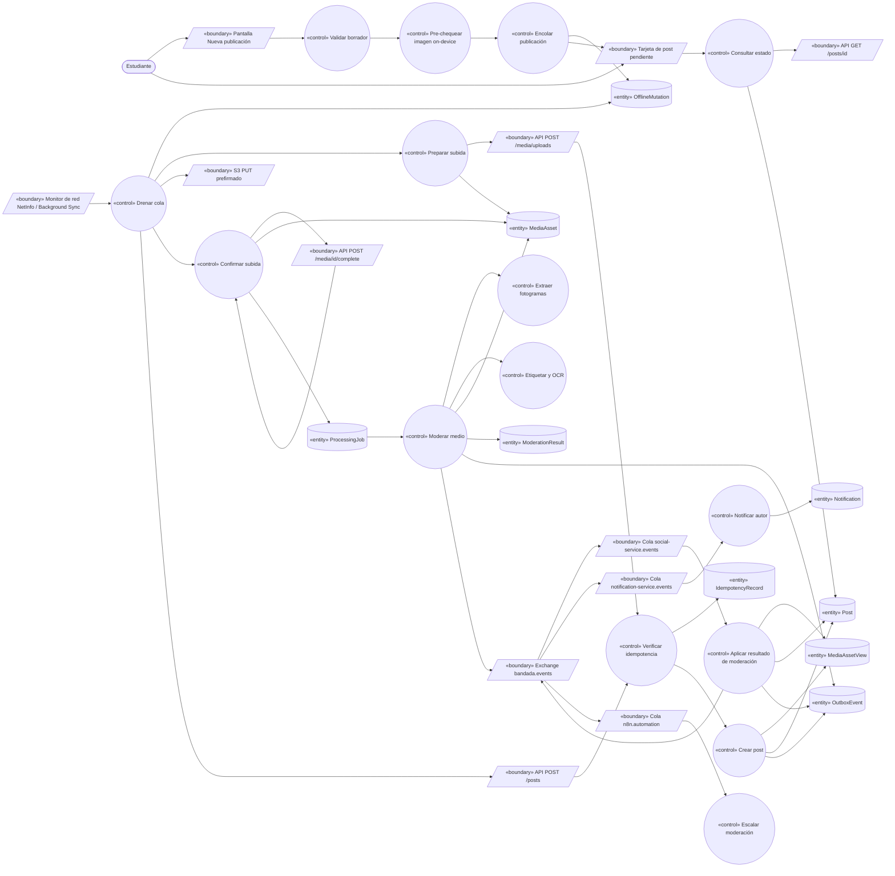
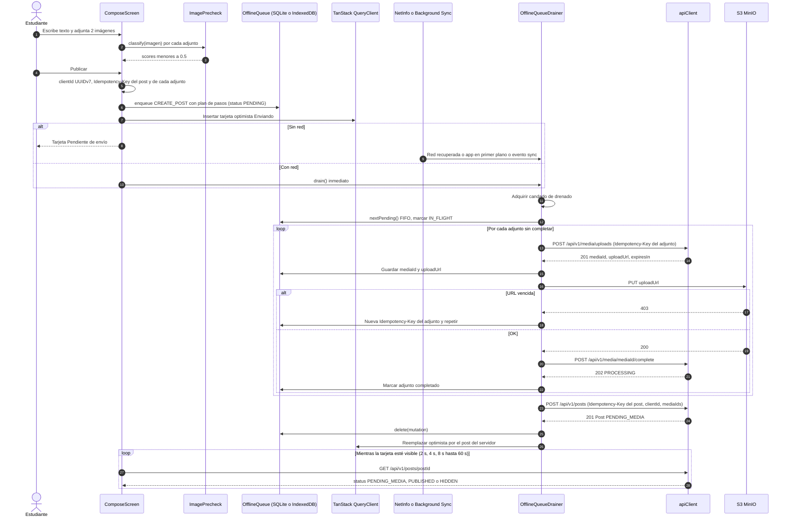
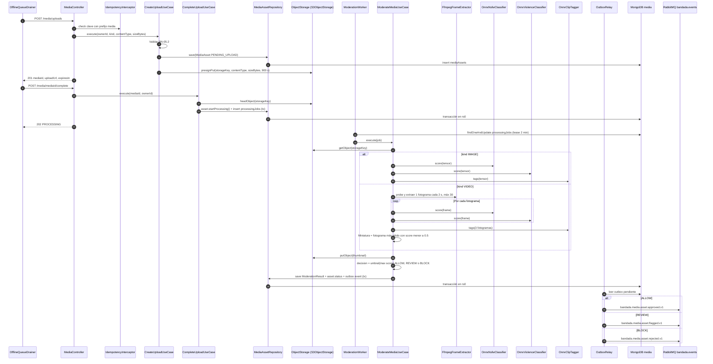
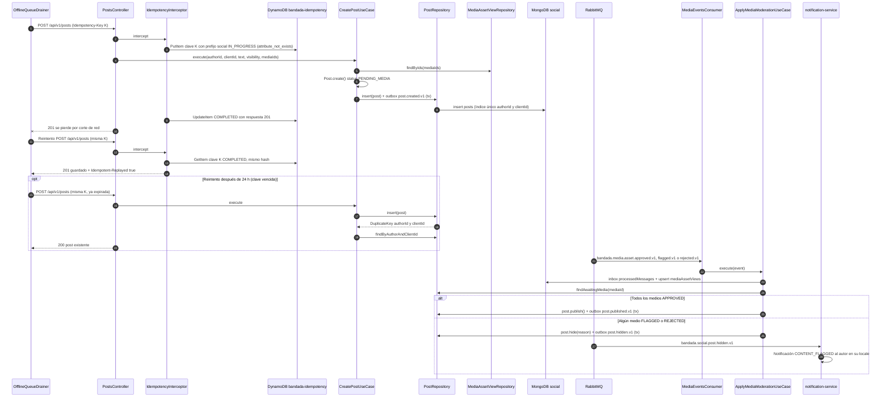

# UC-05 — Publicar contenido (texto, imagen, video)

| Campo | Valor |
|---|---|
| Paquete | Social |
| Actor principal | Estudiante |
| Actores secundarios | Modelo de IA on-device (`nsfw-mobile`), `media-service` (pipeline DL), S3/MinIO, `notification-service`, n8n (`wf-03-escalamiento-moderacion`), `insights-service` (métricas) |
| Prioridad (MoSCoW) | Must |
| Requisitos | RF-06, RF-07, RF-08, RNF-05, RNF-08, RNF-09, RNF-12 |
| Tecnologías de la cátedra que demuestra | **T6** (IA local), **T7** (PWA / offline), **T8** (idempotencia), **T9** (DL imágenes y video), T4 |
| Servicios involucrados | bandadau-frontend (Expo SDK 57, nativo + web PWA), social-service (Clean, Mongo `social`), media-service (Clean, Mongo `media` + S3, onnxruntime-node, ffmpeg), notification-service, n8n |
| Estado ICONIX | Implementado (fase 1, 2026-10-15) (sin moderación ML: `MODERATION_MODE` allow-all/manual) — evidencia en `../07-trazabilidad.md` |

Relación: UC-05 «include» la moderación automática de media-service, que alimenta UC-18 (Moderar contenido). Es el caso central de la demo (guion, paso 2 y 3 de `cumplimiento-catedra.md`).

---

## 1. Narrativa (fase de requisitos)

### Precondiciones

- El estudiante tiene sesión (UC-02) o, si está offline, una sesión guardada en el dispositivo.
- Si la visibilidad es `GROUP`, el estudiante tiene `GroupMembership` `ACTIVE` en el grupo (UC-09).
- El modelo `nsfw-mobile` está empaquetado con la app (~5 MB, D6) o descargado.

### Disparador

El estudiante pulsa **"+" (Nueva publicación)** en la barra inferior o "Publicar en el grupo" dentro de un grupo.

### Curso básico (con imágenes y con red)

1. La app muestra la **pantalla Nueva publicación** (textos de i18n, namespace `compose`).
2. El estudiante escribe el texto (≤ 2 000 caracteres), elige la visibilidad (`PUBLIC`, `FOLLOWERS` o `GROUP`) y adjunta hasta 4 imágenes **o** 1 video desde la galería o la cámara (`expo-image-picker`).
3. La app extrae los hashtags del texto y muestra el contador de caracteres.
4. Por cada imagen (y para el video, sobre 3 fotogramas obtenidos con `expo-video-thumbnails`), la app ejecuta el **pre-chequeo on-device** `ImagePrecheck` con el modelo `nsfw-mobile`; todas puntúan < 0.5 y no se muestra aviso.
5. El estudiante pulsa "Publicar".
6. La app genera un `clientId` UUIDv7 para el post, una `Idempotency-Key` para `createPost` y una `Idempotency-Key` por cada adjunto; copia cada archivo al almacenamiento de la app (`expo-file-system`, o Blob en IndexedDB en web) y guarda **una** `OfflineMutation` `CREATE_POST` con todo el plan de pasos. **La app siempre encola**, con red o sin ella: hay un solo camino de código.
7. La app agrega el post al tope del feed local en estado "Enviando…" (actualización optimista en el caché de TanStack Query) y cierra el compositor.
8. El **drenador de la cola** (`OfflineQueueDrainer`) toma la mutación y, por cada adjunto, solicita una subida (`createUpload`) con su `Idempotency-Key`.
9. `media-service` crea el `MediaAsset` `PENDING_UPLOAD` y devuelve `{ mediaId, uploadUrl, expiresIn: 900 }` (PUT prefirmado al bucket privado); la app guarda `mediaId` y `uploadUrl` en la mutación.
10. La app sube cada archivo directamente a S3/MinIO con `PUT uploadUrl` y lo marca como subido en la mutación.
11. La app confirma cada subida (`completeUpload`).
12. `media-service` verifica el objeto (`HeadObject`: tamaño y `Content-Type` declarados), pasa el asset a `PROCESSING` y crea un job en `processingJobs` (misma transacción Mongo); responde `202`.
13. La app envía `createPost` con `{ clientId, text, visibility, groupId?, mediaIds[] }` y la `Idempotency-Key` del post.
14. `social-service` verifica la idempotencia (prefijo `social#`), valida el post, extrae hashtags y consulta su read model `mediaAssetViews`: como los assets aún se procesan, crea el `Post` en `PENDING_MEDIA` y registra en el outbox `bandada.social.post.created.v1`, todo en una transacción.
15. `social-service` responde `201` con el post (`status: PENDING_MEDIA`). La app borra la mutación de la cola, reemplaza el ítem optimista por el del servidor y muestra la insignia "Procesando".
16. En `media-service`, el `ModerationWorker` toma el job y ejecuta el **pipeline DL** por imagen: decodifica y normaliza, corre `nsfw-classifier` y `violence-classifier` (onnxruntime-node), auto-etiqueta con `clip-zero-shot` (`apuntes`, `evento`, `deporte`, `meme`…), corre `ocr` si la etiqueta principal es `apuntes`, y genera la miniatura.
17. El sistema toma el puntaje máximo entre clasificadores y decide `ALLOW` (< 0.5); guarda el `ModerationResult` (`labels`, `scores`, `decision`, `modelVersion`), pasa el asset a `APPROVED` con `tags` y `ocrText`, y registra `bandada.media.asset.approved.v1` en el outbox, en una transacción.
18. `social-service` consume el evento, actualiza `mediaAssetViews` y, como **todos** los medios del post están `APPROVED`, pasa el `Post` a `PUBLISHED` y registra `bandada.social.post.published.v1` (invariante 6 del dominio).
19. La app, que consulta el estado del post con backoff mientras la insignia "Procesando" es visible (`GET /posts/{postId}`), lo ve `PUBLISHED` y quita la insignia. El post ya aparece en el feed de sus seguidores (UC-06).

### Variante: post solo texto

14t. Sin `mediaIds`, social crea el `Post` directamente `PUBLISHED` y registra `post.created.v1` y `post.published.v1` en la misma transacción. Se omiten los pasos 8–12 y 16–19.

### Variante: video

- 2v. La app valida localmente duración ≤ 60 s y tamaño ≤ 50 MB (`asset.duration` y `fileSize` del picker).
- 16v. El `ModerationWorker` valida con `ffprobe` (duración ≤ 60 s, contenedor `mp4`/`mov`, códec de video presente), extrae **1 fotograma cada 2 s (máx. 30)** con `ffmpeg` (`fps=1/2`), corre `nsfw-classifier` y `violence-classifier` sobre cada fotograma, agrega por **máximo** de cada etiqueta, corre `clip-zero-shot` sobre 3 fotogramas representativos y elige como miniatura el fotograma de **mayor calidad** (mayor nitidez por varianza del Laplaciano) entre los que no superan 0.5. Guarda en `ModerationResult.frameScores` el puntaje por fotograma (segundo → puntaje) para que el moderador vea dónde está el problema (UC-18).

### Cursos alternos

- **2a. Excede límites** (texto > 2 000, > 4 imágenes, imagen + video juntos, video > 60 s o > 50 MB): la app deshabilita "Publicar" y muestra el motivo (i18n). Si aun así llega al servidor: social `422 VALIDATION_FAILED`; media `422 MEDIA_TOO_LARGE` / `422 MEDIA_UNSUPPORTED_TYPE`.
- **4a. Pre-chequeo sospechoso (0.5 – 0.85):** la app marca la imagen con un aviso "Esta imagen podría no cumplir las normas" y ofrece "Quitar imagen" / "Publicar igual". El estudiante decide; el pre-chequeo nunca bloquea (la decisión final es del servidor, D6).
- **4b. Pre-chequeo alto (≥ 0.85):** aviso fuerte con la consecuencia explícita: "Si la publicas, probablemente quedará oculta". "Publicar igual" sigue disponible.
- **4c. Modelo on-device no disponible** (web sin WASM SIMD, error de carga): se omite el pre-chequeo y se registra telemetría `precheck_unavailable`; no se avisa.
- **5a. Sin conexión (modo avión):** los pasos 6–7 ocurren igual (la mutación queda `PENDING`); la tarjeta optimista muestra "Pendiente de envío · se publicará cuando vuelva la conexión". La cola sobrevive al cierre de la app (SQLite / IndexedDB, RNF-09).
  - 5a.1. Al recuperar la red (evento de `@react-native-community/netinfo`, `online` en web), al volver la app a primer plano o por **Background Sync** (tag `bandada-offline-queue`, navegadores Chromium; el service worker importa el mismo módulo `drainOfflineQueue`, ya que IndexedDB es accesible desde el SW), el drenador procesa la cola en **orden FIFO**, una mutación a la vez, con un candado (`navigator.locks` en web, mutex en memoria en nativo) para que no haya dos drenados simultáneos.
  - 5a.2. Continúa desde el paso 8. Como cada paso guarda su resultado en la mutación, el drenado se **reanuda** en el primer paso pendiente.
- **8a. La app se cerró a mitad del drenado:** al reabrir, la mutación está en `IN_FLIGHT` con pasos parciales; se reanuda. Repetir `createUpload` con la misma clave devuelve el mismo `mediaId` (`Idempotent-Replayed: true`); repetir `completeUpload` sobre un asset ya `PROCESSING`/`APPROVED` devuelve `202`/`200` con el estado actual sin crear otro job (idempotente por estado).
- **10a. URL prefirmada vencida** (la cola esperó más de 15 min entre el paso 9 y el 10, o el upload fue lento): S3 responde `403`. La app descarta `mediaId`/`uploadUrl` del adjunto, genera una **nueva** `Idempotency-Key` y vuelve al paso 8 (nuevo `mediaId`). El asset huérfano `PENDING_UPLOAD` lo purga `PurgeStaleUploadsJob` a las 24 h. El `clientId` y la clave de `createPost` **no** cambian.
- **10b. Subida interrumpida:** reintento con backoff exponencial (1 s, 2 s, 4 s… máx. 5 min, con *jitter*). En nativo la subida usa `FileSystem.uploadAsync` (sesión en segundo plano).
- **12a. Objeto inválido** (tamaño o tipo no coinciden, imagen no decodificable): `422 MEDIA_INVALID_OBJECT`; media marca el asset `REJECTED` y borra el objeto. La mutación pasa a `FAILED` y la tarjeta muestra "No se pudo publicar: un archivo está dañado" con "Editar" / "Descartar".
- **13a. Duplicado por reintento (respuesta perdida):** el servidor creó el post pero la respuesta no llegó (timeout, red cayó). El drenador reintenta `createPost` con la **misma** `Idempotency-Key` → social devuelve la respuesta guardada con `Idempotent-Replayed: true` → no hay segundo post.
- **13b. Duplicado tras vencer la clave** (reintento > 24 h después, TTL de `bandada-idempotency`): la clave ya no existe, pero el índice único `posts(authorId, clientId)` rechaza la inserción; social captura el error de clave duplicada, carga el post existente y responde **`200`** con él (no `201`). Resultado: exactamente un post (D3, mecanismos 3 y 4).
- **13c. Petición en curso** (dos drenados concurrentes, p. ej. pestaña + Background Sync): `409 IDEMPOTENCY_IN_PROGRESS` → la app reintenta en 2 s.
- **13d. Clave reutilizada con otro cuerpo** (el estudiante editó el texto de un post en `FAILED` y reintentó): la app genera una **nueva** `Idempotency-Key` al editar (pero mantiene el `clientId`); si por error se reusa, `422 IDEMPOTENCY_KEY_REUSED` → `FAILED` y log de error.
- **13e. No es miembro del grupo** (`GROUP` sin membresía `ACTIVE`): `403 NOT_GROUP_MEMBER` → `FAILED` con mensaje i18n.
- **13f. Sesión vencida durante el drenado:** `401` → el `apiClient` renueva (UC-02 B) y reintenta; si la renovación falla, la cola se pausa hasta un nuevo login del **mismo** usuario.
- **13g. Error 5xx o timeout:** reintento con backoff; tras 10 intentos fallidos la mutación pasa a `FAILED` con "Reintentar".
- **14a. Assets ya procesados antes de `createPost`** (moderación rápida, el evento llegó antes que el post): `mediaAssetViews` ya los tiene `APPROVED` → el post se crea directamente `PUBLISHED`. Si alguno está `FLAGGED`/`REJECTED`, se crea `HIDDEN`.
- **17a. Imagen bloqueada (≥ 0.85, `BLOCK`):** el asset pasa a `REJECTED` y se publica `bandada.media.asset.rejected.v1`. social pasa el post a `HIDDEN` (`hiddenReason: MEDIA_REJECTED`) y publica `bandada.social.post.hidden.v1`; `notification-service` (binding `bandada.social.#`) envía al autor una notificación `CONTENT_FLAGGED` ("Tu publicación no cumple las normas y fue ocultada"). El objeto se conserva 30 días con prefijo de cuarentena para auditoría (UC-18) y luego se borra.
- **17b. Imagen dudosa (0.5 – 0.85, `REVIEW`):** el asset pasa a `FLAGGED` → `bandada.media.asset.flagged.v1`. social pasa el post a `HIDDEN` (`hiddenReason: MEDIA_FLAGGED`) → `post.hidden.v1` → notificación `CONTENT_FLAGGED` ("Tu publicación está en revisión"). n8n `wf-03-escalamiento-moderacion` evalúa si escalar (score ≥ 0.95 o 3+ flags del autor en 24 h). Si un moderador la aprueba en UC-18 (`decideMedia APPROVE` → `asset.approved.v1`), social reevalúa el post y lo pasa a `PUBLISHED`.
- **16a. Falla del pipeline** (modelo no carga, ffmpeg falla, S3 no responde): el job se reintenta 3 veces con backoff (10 s, 60 s, 300 s). Si sigue fallando, el asset pasa a `FLAGGED` con `labels: ["processing_failed"]` (*fail-safe*: nada se publica sin revisión) y se publica `asset.flagged.v1`.
- **16b. Video demasiado largo según `ffprobe`** (el cliente mintió o recortó mal): asset `REJECTED` (`reason: VIDEO_TOO_LONG`) → como 17a.
- **18a. Evento duplicado:** el inbox `processedMessages` lo descarta.
- **18b. Evento de un asset que no es del autor** (`ownerId` ≠ `post.authorId`, alguien adjuntó un `mediaId` ajeno): social pasa el post a `HIDDEN` (`hiddenReason: INVALID_MEDIA`) y registra log de seguridad.
- **18c. Post con medios que nunca terminan** (el cliente nunca subió o confirmó): `PendingMediaSweeper` (cada 10 min) pasa a `HIDDEN` (`hiddenReason: MEDIA_TIMEOUT`) los posts `PENDING_MEDIA` con más de 24 h.
- **18d. `social-service` caído al llegar el evento:** el mensaje espera en `social-service.events`; al volver se procesa (RNF-03, consistencia eventual).

### Postcondiciones

- **Éxito:** exactamente un `Post` por `(authorId, clientId)`, `PUBLISHED`, con todos sus `MediaAsset` `APPROVED`, `ModerationResult` con `modelVersion` por asset, y eventos `post.created.v1` + `post.published.v1` publicados.
- **Contenido no apto:** `Post` `HIDDEN` con `hiddenReason`, asset `FLAGGED`/`REJECTED`, autor notificado, entrada en la cola de moderación (UC-18).
- **Fallo del cliente:** la `OfflineMutation` queda `FAILED` y visible para que el estudiante reintente o descarte; ningún post parcial queda visible para otros.

### Reglas de negocio

| ID | Regla |
|---|---|
| RN-05.1 | Texto ≤ 2 000 caracteres; un post debe tener texto o al menos un medio. |
| RN-05.2 | Medios: hasta 4 imágenes (≤ 10 MB c/u; `image/jpeg`, `image/png`, `image/webp`, `image/heic`) **o** 1 video (≤ 60 s, ≤ 50 MB; `video/mp4`, `video/quicktime`) (RF-06). |
| RN-05.3 | Hashtags: `#` seguido de 2–50 letras/dígitos/`_` (Unicode), normalizados a minúsculas, máx. 10 por post. |
| RN-05.4 | `visibility = GROUP` exige `groupId` y membresía `ACTIVE`; `PUBLIC`/`FOLLOWERS` no admiten `groupId`. |
| RN-05.5 | Un `Post` no está `PUBLISHED` hasta que todos sus `MediaAsset` estén `APPROVED` (invariante 6). |
| RN-05.6 | Umbrales del servidor (D7): `score ≥ 0.85` → `BLOCK`/`REJECTED`; `0.5–0.85` → `REVIEW`/`FLAGGED`; `< 0.5` → `ALLOW`/`APPROVED`. Score = máximo entre `nsfw-classifier` y `violence-classifier` (y entre fotogramas en video). |
| RN-05.7 | El pre-chequeo on-device solo **avisa**; no bloquea ni reemplaza la moderación del servidor. |
| RN-05.8 | `clientId` (UUIDv7 del dispositivo) es único por autor (índice único `posts(authorId, clientId)`, invariante 7). |
| RN-05.9 | Toda llamada con efecto lleva `Idempotency-Key`; la clave de `createPost` solo cambia si cambia el cuerpo; el `clientId` nunca cambia para el mismo borrador. |
| RN-05.10 | Los medios se guardan en bucket privado y se sirven con URL prefirmada de 15 min (RNF-08). |
| RN-05.11 | Cada `ModerationResult` guarda `modelVersion` (RNF-12). |

---

## 2. Diagrama de robustez (fase de análisis)

> Nota de robustez: `E4 --> C7` representa que el worker (control) toma el `ProcessingJob` (lectura de entidad por un control); se dibuja en ese sentido para mostrar el disparo asíncrono. No hay ninguna relación actor ↔ control ni entity ↔ boundary.

| Objeto | Tipo | Componente real |
|---|---|---|
| Pantalla Nueva publicación | Boundary | `bandadau-frontend/app/(tabs)/compose.tsx` |
| Tarjeta de post pendiente | Boundary | `bandadau-frontend/src/features/feed/pending-post-card.tsx` |
| Monitor de red / Background Sync | Boundary | `@react-native-community/netinfo`, `AppState`, SW `sync` (`bandadau-frontend/src/sw/service-worker.ts`, Workbox `injectManifest`) |
| API `/media/uploads`, `/media/{id}/complete` | Boundary | media-service `MediaController` |
| S3 PUT prefirmado | Boundary | MinIO / S3 bucket privado `bandada-media` |
| API `POST /posts`, `GET /posts/{id}` | Boundary | social-service `PostsController` |
| Exchange / colas | Boundary | RabbitMQ `bandada.events`, `social-service.events`, `notification-service.events`, `n8n.automation` |
| Validar borrador | Control | `postDraftSchema` (zod) + `extractHashtags` (`@bandada/contracts-ts` utils) |
| Pre-chequear imagen on-device | Control | `ImagePrecheck` (`image-precheck.native.ts`: onnxruntime-react-native; `image-precheck.web.ts`: onnxruntime-web WASM) |
| Encolar publicación | Control | `OfflineQueue.enqueue()` |
| Drenar cola | Control | `OfflineQueueDrainer` / `drainOfflineQueue()` |
| Preparar subida | Control | `CreateUploadUseCase` (media) |
| Confirmar subida | Control | `CompleteUploadUseCase` (media) |
| Moderar medio | Control | `ModerationWorker` → `ModerateMediaUseCase` |
| Extraer fotogramas | Control | `VideoFrameExtractor` → `FfmpegFrameExtractor` |
| Etiquetar y OCR | Control | `ZeroShotTagger` → `OnnxClipTagger`; `OcrEngine` → `OnnxOcrEngine` |
| Verificar idempotencia | Control | `IdempotencyInterceptor` (`@bandada/idempotency-ts`) |
| Crear post | Control | `CreatePostUseCase` (social) |
| Aplicar resultado de moderación | Control | `ApplyMediaModerationUseCase` (social) |
| Notificar autor | Control | notification `SendContentFlaggedNotificationAction` |
| Escalar moderación | Control | n8n `wf-03-escalamiento-moderacion` |
| Consultar estado | Control | `usePostStatus()` (polling con backoff) |
| OfflineMutation | Entity | SQLite `offline_mutations` / IndexedDB `offlineMutations` |
| MediaAsset, ModerationResult, ProcessingJob | Entity | Mongo `media.mediaAssets`, `media.moderationResults`, `media.processingJobs` |
| Post, MediaAssetView | Entity | Mongo `social.posts`, `social.mediaAssetViews` |
| IdempotencyRecord | Entity | DynamoDB `bandada-idempotency` (`media#…`, `social#…`) |
| OutboxEvent | Entity | Mongo `media.outbox`, `social.outbox` |
| Notification | Entity | DynamoDB `bandada-notifications` (`NOTIF#<uuidv7>`) |

---

## 3. Diagrama de secuencia (fase de diseño)

### 3.1 Cliente: encolar y drenar (con y sin red)

### 3.2 media-service: subida y pipeline DL (imágenes y video)

### 3.3 social-service: crear post, duplicado por reintento y transición por eventos

---

## 4. Clases / contratos involucrados

### bandadau-frontend (cliente)

| Módulo | Elementos |
|---|---|
| `app/(tabs)/compose.tsx` | `ComposeScreen`, `useComposeDraft` |
| `src/ai/` | `ImagePrecheck` (interfaz), `image-precheck.native.ts`, `image-precheck.web.ts`, constantes `PRECHECK_WARN = 0.5`, `PRECHECK_STRONG = 0.85` |
| `src/offline/` | `OfflineMutation` (tipo: `id`, `type`, `userId`, `clientId`, `idempotencyKey`, `payload`, `attachments[]` con `localUri`, `uploadKey`, `mediaId`, `uploadUrl`, `uploadExpiresAt`, `uploaded`, `completed`; `status: PENDING \| IN_FLIGHT \| FAILED`, `attempts`, `nextAttemptAt`, `lastErrorCode`), `OfflineQueue`, `OfflineQueueDrainer`, `drainOfflineQueue()`, `backoff()` |
| `src/features/feed/` | `PendingPostCard`, `usePostStatus` |
| `src/sw/service-worker.ts` | Background Sync `bandada-offline-queue` |

### media-service (Clean — `bandadau-backend/services/media-service/src`)

| Capa | Clases |
|---|---|
| `domain/entities` | `MediaAsset` (`startProcessing`, `approve`, `flag`, `reject`), `ModerationResult`, `ProcessingJob` |
| `domain/services` | `ModerationPolicy` (umbrales D7, agregación por máximo) |
| `application/use-cases` | `CreateUploadUseCase`, `CompleteUploadUseCase`, `ModerateMediaUseCase`, `GetMediaUseCase`, `PurgeStaleUploadsUseCase` |
| `application/ports` | `MediaAssetRepository`, `ModerationResultRepository`, `ProcessingJobQueue`, `ObjectStorage`, `ImageClassifier`, `ZeroShotTagger`, `OcrEngine`, `VideoFrameExtractor`, `ImageProcessor`, `OutboxRepository`, `ModelRegistry` |
| `interface-adapters` | `MediaController`, `ModerationWorker` (bucle de lease sobre `processingJobs`), `PostEventsConsumer` (`bandada.social.post.deleted.v1`) |
| `infrastructure` | `MongoMediaAssetRepository`, `MongoProcessingJobQueue`, `S3ObjectStorage`, `OnnxNsfwClassifier`, `OnnxViolenceClassifier`, `OnnxClipTagger`, `OnnxOcrEngine`, `FfmpegFrameExtractor`, `SharpImageProcessor`, `S3ModelRegistry` (`models/<nombre>/<versión>/model.onnx`), `MongoOutboxRepository` + `OutboxRelay` (`@bandada/messaging-ts`) |

### social-service (Clean)

| Capa | Clases |
|---|---|
| `domain/entities` | `Post` (`create`, `publish`, `hide`, `attachMedia`), `MediaAssetView` |
| `domain/value-objects` | `PostText`, `Hashtags`, `ClientId`, `PostVisibility`, `PostStatus`, `HiddenReason` (`MEDIA_FLAGGED`, `MEDIA_REJECTED`, `INVALID_MEDIA`, `MEDIA_TIMEOUT`, `REPORTED`, `MODERATOR`) |
| `application/use-cases` | `CreatePostUseCase`, `GetPostUseCase`, `ApplyMediaModerationUseCase`, `SweepPendingMediaPostsUseCase` |
| `application/ports` | `PostRepository`, `MediaAssetViewRepository`, `GroupMembershipRepository`, `InboxRepository`, `OutboxRepository`, `Clock` |
| `interface-adapters` | `PostsController` (`IdempotencyInterceptor`), `MediaEventsConsumer`, `PendingMediaSweeper` (cron 10 min) |
| `infrastructure` | `MongoPostRepository` (índices: único `{authorId:1, clientId:1}`, `{mediaIds:1, status:1}`), `MongoMediaAssetViewRepository`, `MongoInboxRepository`, `MongoOutboxRepository` |

### Contratos

| Tipo | Identificador | Detalle |
|---|---|---|
| OpenAPI media | `createUpload` ♻️ | `POST /api/v1/media/uploads` `{ kind: IMAGE\|VIDEO, contentType, sizeBytes, purpose }` → `201 { mediaId, uploadUrl, expiresIn }`; `422 MEDIA_TOO_LARGE`, `422 MEDIA_UNSUPPORTED_TYPE` |
| OpenAPI media | `completeUpload` | `POST /api/v1/media/{mediaId}/complete` → `202 { mediaId, status }`; `422 MEDIA_INVALID_OBJECT`; `404` si no es del usuario |
| OpenAPI media | `getMedia` | `GET /api/v1/media/{mediaId}` → `{ mediaId, kind, status, url, thumbnailUrl, tags[] }` |
| OpenAPI social | `createPost` ♻️ | `POST /api/v1/posts` `{ clientId, text?, visibility, groupId?, mediaIds[] }` → `201 Post` (nuevo) / `200 Post` (ya existía por `clientId`); `403 NOT_GROUP_MEMBER`, `422 VALIDATION_FAILED`, `409 IDEMPOTENCY_IN_PROGRESS`, `422 IDEMPOTENCY_KEY_REUSED` |
| OpenAPI social | `getPost` | `GET /api/v1/posts/{postId}` → `Post` con `status` y `hiddenReason` (este último solo visible para el autor) |
| AsyncAPI | `bandada.media.asset.approved.v1`, `bandada.media.asset.flagged.v1`, `bandada.media.asset.rejected.v1` | `data: { mediaId, ownerId, kind, purpose, decision, scores: { nsfw, violence }, labels[], tags[], modelVersion, thumbnailKey }` |
| AsyncAPI | `bandada.social.post.created.v1`, `bandada.social.post.published.v1`, `bandada.social.post.hidden.v1` | `data: { postId, authorId, clientId, visibility, groupId, hashtags[], mediaIds[], status, hiddenReason? }` |

Esquema del `Post` devuelto: `{ id, clientId, authorId, text, hashtags[], visibility, groupId, mediaIds[], status, hiddenReason?, createdAt, publishedAt? }`.

---

## 5. Pruebas de aceptación

| ID | Escenario |
|---|---|
| AT-05-01 | **Given** un estudiante con red **When** publica solo texto con `#Calculo` **Then** `201`, `status = PUBLISHED`, `hashtags = ["calculo"]` y se publican `post.created.v1` y `post.published.v1`. |
| AT-05-02 | **Given** 2 imágenes aptas **When** publica **Then** `createPost` devuelve `PENDING_MEDIA` y en ≤ 15 s `getPost` devuelve `PUBLISHED`; cada asset tiene `ModerationResult` con `modelVersion`. |
| AT-05-03 | **Given** un video de 40 s apto **When** publica **Then** media extrae 20 fotogramas, guarda `frameScores` con 20 entradas, genera miniatura y el post queda `PUBLISHED`. |
| AT-05-04 | **Given** la imagen de prueba "no apta" (score ≥ 0.85) **When** publica **Then** asset `REJECTED`, post `HIDDEN` con `hiddenReason = MEDIA_REJECTED`, el autor recibe `CONTENT_FLAGGED` y el post no aparece en el feed de otros. |
| AT-05-05 | **Given** una imagen con score 0.7 **When** publica **Then** asset `FLAGGED`, post `HIDDEN (MEDIA_FLAGGED)`, aparece en `listFlaggedMedia` y n8n recibe `asset.flagged.v1`. |
| AT-05-06 | **Given** AT-05-05 **When** un moderador ejecuta `decideMedia APPROVE` **Then** el post pasa a `PUBLISHED`. |
| AT-05-07 | **Given** el teléfono en modo avión **When** publica un post con foto **Then** existe una `OfflineMutation` `PENDING`, la tarjeta dice "Pendiente de envío" y no hay requests de red. |
| AT-05-08 | **Given** AT-05-07 y la app cerrada y reabierta **When** vuelve la red **Then** la cola se drena y existe **exactamente un** post con ese `clientId`. |
| AT-05-09 | **Given** un proxy de pruebas que descarta la respuesta de `POST /posts` **When** el drenador reintenta 3 veces **Then** existe un solo post; las respuestas 2 y 3 traen `Idempotent-Replayed: true`. |
| AT-05-10 | **Given** el registro de idempotencia borrado (simula > 24 h) **When** se reenvía el mismo `createPost` **Then** responde `200` con el post existente y no hay duplicado. |
| AT-05-11 | **Given** una mutación en `IN_FLIGHT` con el adjunto 1 completado y el 2 sin subir **When** se reanuda **Then** no se vuelve a llamar `createUpload` para el adjunto 1. |
| AT-05-12 | **Given** una `uploadUrl` vencida **When** el drenador sube **Then** pide un nuevo `mediaId`, el post final referencia solo el nuevo y el huérfano se purga a las 24 h. |
| AT-05-13 | **Given** el pre-chequeo on-device con score 0.9 **When** el estudiante adjunta la imagen **Then** ve el aviso fuerte y puede "Quitar imagen" o "Publicar igual". |
| AT-05-14 | **Given** un `mediaId` de otro usuario **When** se usa en `createPost` **Then** al llegar el evento el post queda `HIDDEN (INVALID_MEDIA)`. |
| AT-05-15 | **Given** `visibility = GROUP` sin membresía **When** se publica **Then** `403 NOT_GROUP_MEMBER` y la mutación pasa a `FAILED`. |
| AT-05-16 | **Given** onnxruntime falla 3 veces en el worker **When** se agotan los reintentos **Then** el asset queda `FLAGGED` con `processing_failed` (nada se publica sin revisión). |
| AT-05-17 | **Given** un `asset.approved.v1` entregado dos veces **When** social lo procesa **Then** un solo `post.published.v1` en el outbox. |
| AT-05-18 (PWA) | **Given** la PWA en Chrome sin red **When** se crea un post y se cierra la pestaña **Then** al recuperar la red Background Sync drena la cola sin abrir la app. |
| AT-05-19 (ML) | **Given** el set de validación de `bandadau-ml/` **When** se evalúa `nsfw-classifier` **Then** recall ≥ 0.90 (RNF-12). |

---

## 6. Trazabilidad

| Requisito | Paso UC | Endpoint / evento | Clases | Pruebas |
|---|---|---|---|---|
| RF-06 | 1–3, 13–15, 2a, 2v, 14t | `createPost`, `createUpload` | `ComposeScreen`, `CreatePostUseCase`, `Post`, `CreateUploadUseCase` | AT-05-01 – AT-05-03, AT-05-15 |
| RF-07 / T9 | 16–18, 16v, 17a, 17b, 16a | `completeUpload`, `bandada.media.asset.*.v1`, `bandada.social.post.published.v1` / `.hidden.v1` | `ModerateMediaUseCase`, `ModerationPolicy`, `OnnxNsfwClassifier`, `OnnxViolenceClassifier`, `OnnxClipTagger`, `FfmpegFrameExtractor`, `ApplyMediaModerationUseCase` | AT-05-02 – AT-05-06, AT-05-16, AT-05-19 |
| RF-08 / T7 | 5a, 5a.1, 5a.2, 8a | `OfflineMutation`, Background Sync | `OfflineQueue`, `OfflineQueueDrainer`, `service-worker.ts` | AT-05-07, AT-05-08, AT-05-11, AT-05-18 |
| T8 / RNF-05 | 6, 13a–13d, 18a | `Idempotency-Key`, índice `posts(authorId, clientId)`, inbox | `IdempotencyInterceptor`, `MongoPostRepository`, `MongoInboxRepository` | AT-05-09, AT-05-10, AT-05-17 |
| T6 | 4, 4a–4c | — | `ImagePrecheck` | AT-05-13 |
| RNF-08 | 9, 10a, RN-05.10 | `createUpload` (PUT prefirmado) | `S3ObjectStorage`, `PurgeStaleUploadsUseCase` | AT-05-12 |
| RNF-12 | 17, RN-05.11 | — | `ModerationResult.modelVersion`, `S3ModelRegistry` | AT-05-02, AT-05-19 |
| Seguridad | 18b | — | `ApplyMediaModerationUseCase` | AT-05-14 |
| T10 | 17b | `bandada.media.asset.flagged.v1` → `wf-03` | n8n | AT-05-05 |

**PROPUESTAS derivadas** (no aplicadas en normativos):

1. *D1 media-service:* campo `purpose` en `createUpload` (compartido con UC-04) y respuesta `202` en `completeUpload` con semántica idempotente por estado.
2. *D1 social-service:* documentar que `createPost` responde `200` cuando el `(authorId, clientId)` ya existía (D3 mecanismo 3) y agregar `GET /posts/{postId}` como `getPost` (la ruta existe en D1 sin `operationId`).
3. *D12 / AsyncAPI:* fijar los esquemas `data` de `bandada.media.asset.*.v1` y `bandada.social.post.*.v1` mostrados en §4 (incluye `ownerId`, `purpose`, `hiddenReason`).
4. *Modelo de dominio:* agregar `Post.hiddenReason` (enum `HiddenReason`), `Post.mediaIds`, `ModerationResult.frameScores`, la entidad técnica `ProcessingJob` (media) y el read model `MediaAssetView` (social).
5. *notification-service:* confirmar que `bandada.social.post.hidden.v1` genera `NotificationType.CONTENT_FLAGGED` para el autor (ya cubierto por el binding `bandada.social.#`).
