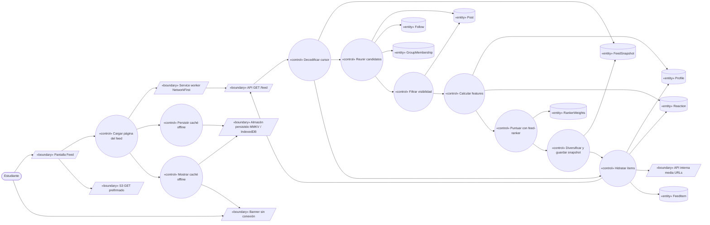
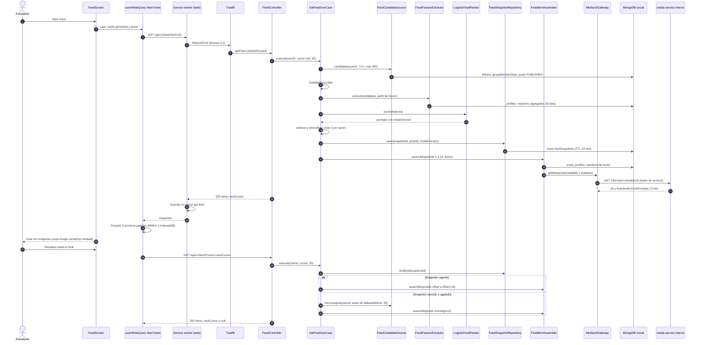
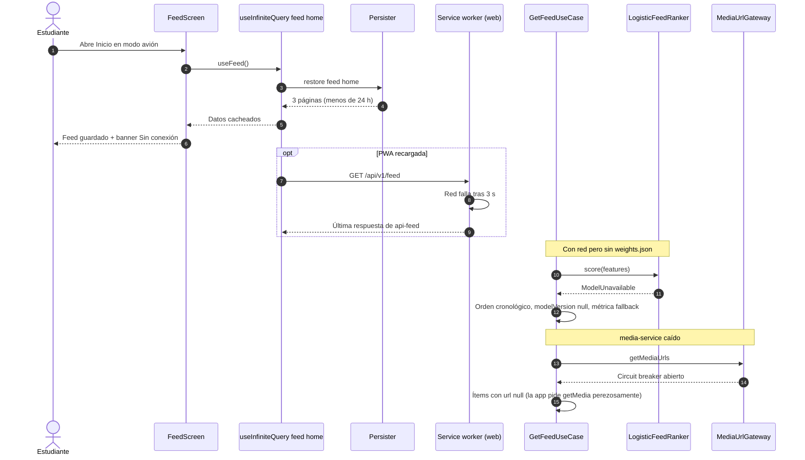

# UC-06 — Ver feed personalizado

| Campo | Valor |
|---|---|
| Paquete | Social |
| Actor principal | Estudiante |
| Actores secundarios | Modelo de ML `feed-ranker` (en social-service), `media-service` (URLs prefirmadas), S3/MinIO, service worker de la PWA |
| Prioridad (MoSCoW) | Must |
| Requisitos | RF-09, RNF-01, RNF-03, RNF-08, RNF-09, RNF-10 |
| Tecnologías de la cátedra que demuestra | **T7** (PWA / offline), **T9** (ML clásico: `feed-ranker`), T4 |
| Servicios involucrados | social-service (Clean, NestJS 11, Mongo `social`), media-service, bandadau-frontend (Expo SDK 57 nativo + web PWA) |
| Estado ICONIX | Secuencia (pendiente CDR) |

Detalle del modelo en `bandadau-docs/docs/03-arquitectura/ml-dl.md` §3.6 y de la caché offline en `bandadau-docs/docs/03-arquitectura/ia-local-y-offline.md` §3 y §8.3; este UC los respeta.

---

## 1. Narrativa (fase de requisitos)

### Precondiciones

- El estudiante tiene sesión (UC-02) o una sesión guardada en el dispositivo.
- `social-service` cargó `models/feed-ranker/<versión>/weights.json` desde S3 al arrancar (o está en modo *fallback* cronológico).

### Disparador

El estudiante abre la app (pestaña **Inicio**), hace *pull-to-refresh* o se desplaza hasta el final de la lista (scroll infinito).

### Curso básico

1. La app muestra la **pantalla Feed** con los datos persistidos de `['feed','home']` si existen (pintado inmediato) y lanza la consulta de la primera página (`getFeed`, sin cursor, `limit = 20`).
2. `social-service` reúne los **candidatos** (máx. 300) de las últimas 72 h:
   - posts `PUBLISHED` de usuarios que el estudiante sigue (`Follow`);
   - posts `PUBLISHED` de grupos donde tiene `GroupMembership` `ACTIVE`;
   - posts `PUBLIC` "populares en tu carrera" (misma universidad y `career`, ordenados por interacciones).
3. El sistema **filtra por visibilidad**: `PUBLIC` siempre; `FOLLOWERS` solo si sigue al autor (o es el autor); `GROUP` solo si es miembro `ACTIVE`. Excluye posts `HIDDEN`/`REMOVED`/`PENDING_MEDIA` y autores `SUSPENDED` (proyección local de `bandada.identity.user.suspended.v1`).
4. El sistema calcula las **features** de cada candidato sin llamar a otros servicios (`followsAuthor`, `sameCareer`, `sameGroup`, `logAgeHours`, `logReactions`, `logComments`, `hasMedia`, `interestOverlap`, `authorAffinity`).
5. El sistema puntúa cada candidato con `feed-ranker` (`scoreItem`: regresión logística con medias, desviaciones y coeficientes de `weights.json`), ordena por puntaje descendente y **diversifica** (máx. 2 posts seguidos del mismo autor).
6. El sistema guarda el orden calculado como **snapshot** (`feedSnapshots`, TTL 10 min) con `snapshotId`, la lista de `postId`, `modelVersion` y `createdAt`.
7. El sistema arma la página (offset 0–19) **hidratando** cada ítem: autor (`displayName`, `avatarMediaId` desde `profiles`), contadores (`commentsCount`, `reactionCounts`), `myReaction` y medios con URL prefirmada (15 min) obtenidas de media-service en un solo lote.
8. El sistema responde `{ items: FeedItem[], nextCursor }` donde `nextCursor` codifica `snapshotId` + `offset` + `fallbackBefore` (base64url, opaco para el cliente).
9. La app muestra la lista (FlashList/FlatList virtualizada); las imágenes se cargan con `expo-image` usando `cacheKey = mediaId` (la URL firmada cambia, el objeto no) y caché en disco.
10. TanStack Query persiste las **3 primeras páginas** de `['feed','home']` (MMKV en nativo, IndexedDB en web; `maxAge` 24 h, `buster` = versión de la app). En web, el service worker además guarda la respuesta en la caché `api-feed` (estrategia **NetworkFirst**, timeout 3 s) y los medios en `media` (**StaleWhileRevalidate**, clave normalizada sin query string).
11. Al llegar al final de la lista, la app pide la siguiente página con `nextCursor`; el sistema lee el snapshot y devuelve el siguiente tramo (pasos 7–8) **sin recalcular** el ranking, por lo que no hay duplicados ni saltos entre páginas.
12. Al agotarse el snapshot, el sistema continúa en orden **cronológico** con posts candidatos de `_id < fallbackBefore` (UUIDv7 ordena por tiempo) hasta que no queden más (`nextCursor = null`).

### Cursos alternos

- **1a. Sin conexión (nativo):** la consulta falla por red; TanStack Query (`networkMode: 'offlineFirst'`) mantiene los datos persistidos. La app muestra un banner "Sin conexión · mostrando lo guardado hace {tiempo}" (i18n, `formatRelative`). Las imágenes ya vistas salen de la caché en disco de `expo-image`; las no cacheadas muestran el placeholder con el color de token `color.bg.surface`.
- **1b. Sin conexión (PWA):** el SW aplica NetworkFirst: tras 3 s sin respuesta devuelve la última respuesta de `api-feed`. Si la PWA se recargó sin JS cargado aún, el shell sale del precache y el feed se reconstruye con el persister de IndexedDB.
- **1c. Sin conexión y sin nada guardado** (primer uso offline): estado vacío "Conéctate para ver tu feed" con botón "Reintentar".
- **1d. Posts propios pendientes:** los `OfflineMutation` `CREATE_POST` (UC-05) se muestran arriba como tarjetas "Pendiente de envío" o "Enviando…"; no vienen del servidor sino del caché local con `pendingSync: true`.
- **2a. Estudiante nuevo sin seguidos ni grupos** (*cold start*): los candidatos son solo "populares en tu carrera" (y, si no hay carrera en el perfil, populares de su universidad). La app muestra arriba una tarjeta con sugerencias de UC-08 (`getFollowSuggestions`).
- **5a. `weights.json` no disponible o corrupto** (S3 caído al arrancar, versión inválida): el sistema usa **orden cronológico** (degradación elegante), incrementa `feed_ranker_fallback_total` y responde `modelVersion: null`. La recarga horaria intentará de nuevo.
- **5b. Recarga horaria del modelo:** si hay nueva versión, se cambia atómicamente la referencia en memoria; los snapshots vigentes mantienen su orden (llevan su `modelVersion`).
- **7a. media-service lento o caído** (circuit breaker abierto, timeout 300 ms): los ítems se devuelven con `media[].url = null` y `status` desconocido; la app pide cada medio visible con `getMedia` cuando se muestra (carga perezosa) o usa su caché local. El feed **no** falla (RNF-03).
- **7b. URL prefirmada vencida** (el estudiante dejó la app abierta > 15 min): la carga de la imagen da `403`; la app invalida la página afectada y la vuelve a pedir con el mismo cursor (`refetchPage`), obteniendo URLs nuevas. Con `cacheKey = mediaId`, una imagen ya descargada se sigue mostrando desde disco.
- **11a. Snapshot vencido** (> 10 min entre páginas): el sistema no encuentra el `snapshotId` y continúa con el modo cronológico desde `fallbackBefore` (el post más antiguo ya entregado). No hay error para el usuario.
- **11b. Cursor manipulado o inválido:** `400 INVALID_CURSOR`; la app reinicia el feed desde la primera página.
- **11c. Un post del snapshot fue ocultado o borrado después de calcular el ranking** (UC-10, UC-18, `post.deleted`): al hidratar la página se vuelve a filtrar por `status = PUBLISHED` y se omite; la página puede venir con menos de 20 ítems y eso es válido.
- **Pull-to-refresh:** la app llama `getFeed` sin cursor → snapshot nuevo; se reemplaza `['feed','home']` (no se mezcla con el anterior).
- **Logout:** se limpian el persister, `['feed','home']` y las cachés `api-feed`/`api-read` del SW (`postMessage({ type: 'LOGOUT' })`), para no mostrar el feed de un usuario a otro en el mismo dispositivo.

### Postcondiciones

- El estudiante ve un feed ordenado por relevancia, con solo contenido visible para él.
- Existe un snapshot de ranking (efímero, 10 min) y una copia offline de hasta 3 páginas por 24 h.
- No hay efectos de negocio (operación de solo lectura; no publica eventos).

### Reglas de negocio

| ID | Regla |
|---|---|
| RN-06.1 | Solo posts `PUBLISHED` y visibles para el lector (visibilidad + membresía + seguimiento) (RF-09). |
| RN-06.2 | Paginación **por cursor** opaco; `limit` 1–50, por defecto 20; respuesta `{ items, nextCursor }` sin envoltorio. |
| RN-06.3 | Candidatos: ventana de 72 h, máx. 300; diversificación: máx. 2 posts consecutivos del mismo autor (ml-dl §3.6). |
| RN-06.4 | Si el ranker falla, el feed se sirve en orden cronológico; nunca devuelve error por culpa del modelo. |
| RN-06.5 | Las URLs de medios son prefirmadas de 15 min (RNF-08); social no guarda URLs. |
| RN-06.6 | El feed offline se conserva máx. 24 h y se descarta al cambiar la versión de la app o al cerrar sesión. |
| RN-06.7 | `p95 < 300 ms` para `getFeed` con 100 usuarios concurrentes (RNF-01); el snapshot evita recalcular por página. |
| RN-06.8 | El contenido de usuarios no se traduce (D14); solo las etiquetas y fechas relativas de la UI. |

---

## 2. Diagrama de robustez (fase de análisis)



| Objeto | Tipo | Componente real |
|---|---|---|
| Pantalla Feed | Boundary | `bandadau-frontend/app/(tabs)/index.tsx` + `src/features/feed/feed-list.tsx` |
| Banner sin conexión | Boundary | `src/features/feed/offline-banner.tsx` (NetInfo) |
| Service worker NetworkFirst | Boundary | `bandadau-frontend/src/sw/service-worker.ts` (solo web; caché `api-feed`) |
| API `GET /feed` | Boundary | social-service `FeedController#getFeed` |
| API interna media URLs | Boundary | media-service `GET /internal/v1/media/urls` (`getMediaUrls`, PROPUESTA UC-04) |
| Almacén persistido | Boundary | `persister.native.ts` (`react-native-mmkv`), `persister.web.ts` (IndexedDB) |
| S3 GET prefirmado | Boundary | MinIO / S3 (vía `expo-image`; en web, caché SW `media`) |
| Cargar página del feed | Control | `useFeed()` (`useInfiniteQuery` con `queryKey ['feed','home']`, `meta.persist`) |
| Decodificar cursor | Control | `FeedCursorCodec` |
| Reunir candidatos / Filtrar visibilidad | Control | `GetFeedUseCase` + `FeedCandidateSource` + `VisibilityPolicy` (dominio) |
| Calcular features | Control | `FeedFeatureExtractor` |
| Puntuar con feed-ranker | Control | `FeedRanker` (puerto) → `LogisticFeedRanker` (`scoreItem`) |
| Diversificar y guardar snapshot | Control | `FeedDiversifier` + `FeedSnapshotRepository` |
| Hidratar ítems | Control | `FeedItemAssembler` + `MediaUrlGateway` |
| Persistir / Mostrar caché offline | Control | `PersistQueryClientProvider` (TanStack Query) |
| Post, Follow, GroupMembership, Profile, Reaction | Entity | Mongo `social.posts`, `follows`, `groupMemberships`, `profiles`, `reactions` |
| FeedSnapshot | Entity | Mongo `social.feedSnapshots` (índice TTL 10 min sobre `createdAt`) |
| RankerWeights | Entity | `models/feed-ranker/<versión>/weights.json` cargado en memoria |
| FeedItem | Entity | Proyección de respuesta (glosario: `FeedItem`) |

---

## 3. Diagrama de secuencia (fase de diseño)

### 3.1 Primera página y páginas siguientes (curso básico)



### 3.2 Alternos: sin conexión, ranker caído y media caído



---

## 4. Clases / contratos involucrados

### social-service (Clean — `bandadau-backend/services/social-service/src`)

| Capa | Clases |
|---|---|
| `domain/entities` | `Post`, `FeedSnapshot`, `FeedItem` (proyección) |
| `domain/services` | `VisibilityPolicy`, `FeedDiversifier`, `scoreItem()` (función pura del ranker, ml-dl §3.6), `FeedFeatureExtractor` |
| `domain/value-objects` | `FeedCursor` (`snapshotId`, `offset`, `fallbackBefore`), `RankerWeights`, `FeedReason` (`FOLLOWING`, `GROUP`, `RECOMMENDED`) |
| `application/use-cases` | `GetFeedUseCase` |
| `application/ports` | `FeedCandidateSource`, `FeedSnapshotRepository`, `FeedRanker`, `ProfileRepository`, `ReactionRepository`, `MediaUrlGateway`, `RankerWeightsLoader`, `Clock` |
| `interface-adapters/http` | `FeedController`, `FeedCursorCodec` (base64url + HMAC para detectar manipulación → `400 INVALID_CURSOR`) |
| `infrastructure` | `MongoFeedCandidateSource` (índices `{authorId:1, status:1, publishedAt:-1}`, `{groupId:1, status:1, publishedAt:-1}`), `MongoFeedSnapshotRepository`, `LogisticFeedRanker`, `S3RankerWeightsLoader` (carga al arrancar, recarga cada hora), `HttpMediaUrlGateway` (timeout 300 ms, circuit breaker) |

Prueba de arquitectura (dependency-cruiser): `domain/**` no importa `@nestjs/*`, `mongodb` ni `@aws-sdk/*`.

### bandadau-frontend

`FeedScreen`, `FeedList`, `FeedItemCard`, `PendingPostCard`, `OfflineBanner`, `useFeed` (`useInfiniteQuery`, `getNextPageParam: last => last.nextCursor`, `meta: { persist: true }`), `query-keys.ts` (`['feed','home']`), `persister.native.ts`, `persister.web.ts`, `service-worker.ts` (`NetworkFirst` para `/api/v1/feed*`, `StaleWhileRevalidate` para medios con plugin `cacheKeyWillBeUsed` que elimina la query string).

### Contratos

| Tipo | Identificador | Detalle |
|---|---|---|
| OpenAPI social | `getFeed` 🔑 | `GET /api/v1/feed?cursor&limit` → `200 { items: FeedItem[], nextCursor: string \| null }`; `400 INVALID_CURSOR` |
| OpenAPI media | `getMedia` | carga perezosa de un medio cuando el feed vino sin URL (7a) |
| OpenAPI media (interno) | `getMediaUrls` | **PROPUESTA** (ver UC-04): `GET /internal/v1/media/urls?ids=` → `[{ mediaId, kind, status, url, thumbnailUrl }]` |
| OpenAPI social | `getFollowSuggestions` | tarjeta de *cold start* (2a, UC-08) |

Esquema `FeedItem`:

```json
{
  "post": { "id": "…", "authorId": "…", "text": "…", "hashtags": ["calculo"], "visibility": "PUBLIC",
            "groupId": null, "publishedAt": "2026-10-14T15:04:05Z" },
  "author": { "userId": "…", "displayName": "Lucía Pérez", "avatarUrl": "https://…" },
  "media": [ { "mediaId": "…", "kind": "IMAGE", "url": "https://…", "thumbnailUrl": "https://…" } ],
  "stats": { "commentsCount": 3, "reactionCounts": { "LIKE": 10, "HELPFUL": 2, "FUNNY": 0, "SUPPORT": 1 } },
  "myReaction": "LIKE",
  "reason": "FOLLOWING",
  "score": 0.71,
  "modelVersion": "1.0.0"
}
```

No se publican eventos (lectura pura). Métricas OTel: `feed_request_duration_seconds`, `feed_candidates_count`, `feed_ranker_fallback_total`, `feed_snapshot_miss_total`.

---

## 5. Pruebas de aceptación

| ID | Escenario |
|---|---|
| AT-06-01 | **Given** Lucía sigue a Beto y es miembro del grupo "Cálculo II" **When** pide `getFeed` **Then** recibe posts `PUBLISHED` de Beto y del grupo, con `reason` correcto, y `nextCursor` no nulo si hay más de 20. |
| AT-06-02 | **Given** un post `FOLLOWERS` de Carla (a quien Lucía no sigue) **When** Lucía pide el feed **Then** el post no aparece. |
| AT-06-03 | **Given** un post `GROUP` de un grupo privado sin membresía **When** pide el feed **Then** no aparece. |
| AT-06-04 | **Given** posts `HIDDEN` y `PENDING_MEDIA` **When** pide el feed **Then** ninguno aparece. |
| AT-06-05 | **Given** 60 candidatos **When** recorre 3 páginas con el cursor **Then** recibe 60 posts distintos, sin duplicados y en el orden del snapshot. |
| AT-06-06 | **Given** un snapshot borrado (simula > 10 min) **When** pide la página 2 **Then** recibe `200` con posts cronológicamente anteriores a `fallbackBefore`, sin duplicar la página 1. |
| AT-06-07 | **Given** `weights.json` inaccesible **When** pide el feed **Then** `200` en orden cronológico, `modelVersion = null` y `feed_ranker_fallback_total` se incrementa. |
| AT-06-08 | **Given** media-service detenido **When** pide el feed **Then** `200` con `media[].url = null` en < 600 ms. |
| AT-06-09 | **Given** el ranker con pesos fijos de prueba **When** se puntúan dos candidatos (seguido reciente vs. desconocido antiguo) **Then** el seguido reciente puntúa más (prueba unitaria de `scoreItem`). |
| AT-06-10 | **Given** 5 posts consecutivos del mismo autor con puntajes máximos **When** se diversifica **Then** nunca hay más de 2 seguidos del mismo autor. |
| AT-06-11 | **Given** el feed cargado con red **When** el teléfono pasa a modo avión y la app se cierra y reabre **Then** se ven las 3 primeras páginas y el banner "Sin conexión". |
| AT-06-12 (PWA) | **Given** la PWA instalada con feed visitado **When** se recarga sin red **Then** el shell carga desde precache y el feed desde `api-feed`/IndexedDB; las imágenes vistas se muestran desde la caché `media`. |
| AT-06-13 | **Given** una URL prefirmada vencida **When** la imagen falla con `403` **Then** la app vuelve a pedir la página y la imagen se muestra con URL nueva. |
| AT-06-14 | **Given** un cursor alterado a mano **When** se envía **Then** `400 INVALID_CURSOR` y la app reinicia el feed. |
| AT-06-15 | **Given** un estudiante sin seguidos ni grupos **When** pide el feed **Then** recibe populares de su carrera y la tarjeta de sugerencias. |
| AT-06-16 | **Given** logout **When** otro usuario inicia sesión en el mismo dispositivo **Then** no ve el feed del anterior (persister y cachés del SW vacíos). |
| AT-06-17 (carga) | **Given** 100 usuarios concurrentes (k6) **When** piden feed y paginan **Then** p95 < 300 ms (RNF-01). |

---

## 6. Trazabilidad

| Requisito | Paso UC | Endpoint | Clases | Pruebas |
|---|---|---|---|---|
| RF-09 (combinar seguidos, grupos y recomendados) | 2–3, 2a | `getFeed` | `FeedCandidateSource`, `VisibilityPolicy` | AT-06-01 – AT-06-04, AT-06-15 |
| RF-09 (paginado por cursor) | 6, 8, 11, 12, 11a, 11b | `getFeed` | `FeedCursorCodec`, `FeedSnapshotRepository` | AT-06-05, AT-06-06, AT-06-14 |
| RF-09 / T9 (ML) | 4–5, 5a, 5b | — | `FeedFeatureExtractor`, `LogisticFeedRanker`, `scoreItem`, `FeedDiversifier`, `S3RankerWeightsLoader` | AT-06-07, AT-06-09, AT-06-10 |
| RF-09 / T7 / RNF-09 (offline) | 10, 1a–1d | SW `NetworkFirst`, persister | `useFeed`, `persister.*`, `service-worker.ts` | AT-06-11, AT-06-12, AT-06-16 |
| RNF-08 | 7, 7b | `getMediaUrls` (PROPUESTA), `getMedia` | `HttpMediaUrlGateway`, `FeedItemCard` | AT-06-13 |
| RNF-03 | 7a, 5a | — | circuit breaker de `HttpMediaUrlGateway`, fallback del ranker | AT-06-07, AT-06-08 |
| RNF-01 | RN-06.7 | `getFeed` | snapshot + índices Mongo | AT-06-17 |

**PROPUESTAS derivadas** (no aplicadas en normativos):

1. *D1 media-service (interno):* `GET /internal/v1/media/urls?ids=` (`getMediaUrls`), compartida con UC-04. **PROPUESTA: agregar a decisiones-clave.md D1.**
2. *Glosario / modelo de dominio:* formalizar `FeedItem` (esquema de §4), `FeedSnapshot` y el enum `FeedReason` (`FOLLOWING`, `GROUP`, `RECOMMENDED`); usar el `Post.stats { commentsCount, reactionCounts }` propuesto en UC-07.
3. *social-service:* proyección local del estado de usuarios suspendidos desde `bandada.identity.user.suspended.v1` (ya cubierto por el binding `bandada.identity.user.#`) para excluir sus posts del feed.
4. *Telemetría para reentrenar `feed-ranker`:* ml-dl §3.6 usa impresiones como etiqueta, pero no existe un evento de impresión; hoy se usan datos sintéticos. Si se quieren datos reales, se necesita un nuevo evento (p. ej. `bandada.social.feed.impressions-recorded.v1`) — **PROPUESTA: agregar a decisiones-clave.md D12** (fuera del MVP).
