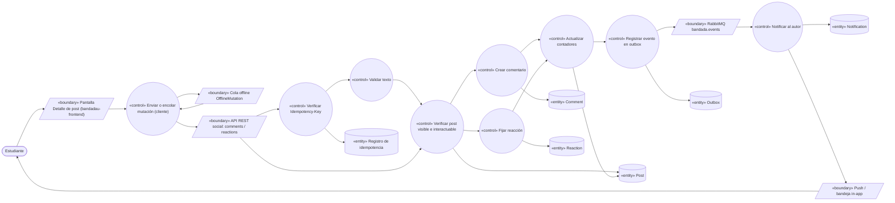
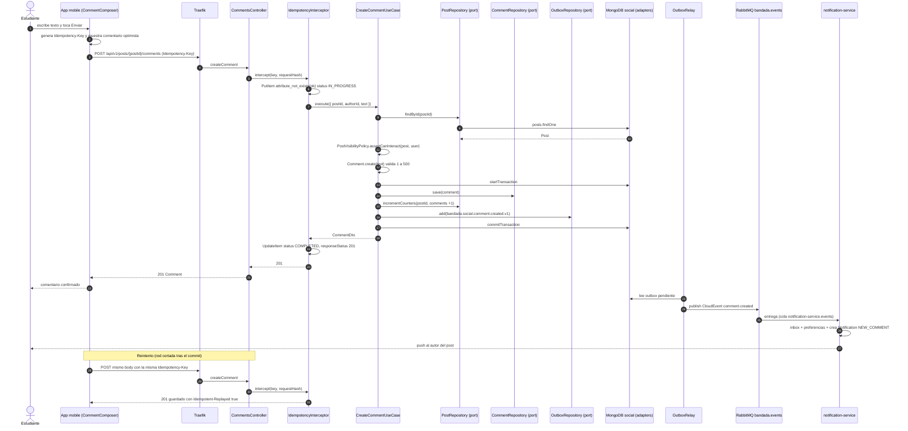
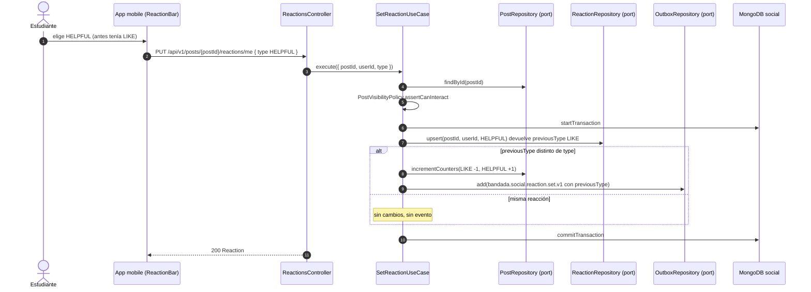

# UC-07 — Comentar y reaccionar a una publicación

| Campo | Valor |
|---|---|
| Paquete | Social |
| Actor principal | Estudiante |
| Actores secundarios | `notification-service` (avisa al autor), `insights-service` (métricas), cola offline de la app |
| Prioridad (MoSCoW) | Must |
| Requisitos | RF-10, RNF-01, RNF-05, RNF-09 |
| Tecnologías de la cátedra que demuestra | T4 (REST), T8 (idempotencia: `Idempotency-Key` + `PUT` idempotente por naturaleza) |
| Servicios involucrados | `social-service` (NestJS · Clean · MongoDB `social`), `notification-service` (Laravel · Clean · DynamoDB), `bandadau-frontend` |
| Estado ICONIX | Implementado (fase 1, 2026-10-15) — evidencia en `../07-trazabilidad.md` |

## 1. Narrativa

### Precondiciones

1. El Estudiante tiene sesión activa (JWT con rol `STUDENT`, `UserStatus = ACTIVE`).
2. Existe un `Post` en estado `PUBLISHED` que el Estudiante puede ver según su `visibility`
   (`PUBLIC`; `FOLLOWERS` si sigue al autor; `GROUP` si tiene `GroupMembership` `ACTIVE` en `groupId`).

### Disparador

El Estudiante toca la acción de comentar (`social.post.actions.comment`) o mantiene presionado el botón de reacción de una publicación en el feed (UC-06) o en el detalle del post.

### Curso básico A — Comentar

1. El Estudiante abre el detalle de la publicación; la app solicita los comentarios (`GET /api/v1/posts/{postId}/comments?cursor&limit`) y los muestra paginados por cursor.
2. El Estudiante escribe el texto del `Comment` y toca la acción de enviar (`common.actions.send`).
3. La app genera una `Idempotency-Key` (UUID) para la mutación, muestra el comentario de forma optimista con el estado `social.comment.sending` y envía `POST /api/v1/posts/{postId}/comments` (`createComment`) con `{ text }`.
4. El sistema verifica la `Idempotency-Key` en `bandada-idempotency` (`pk = social-service#<key>`).
5. El sistema valida el texto (1–500 caracteres tras recortar espacios).
6. El sistema carga el `Post`, verifica que esté `PUBLISHED` y que sea visible para el Estudiante.
7. El sistema crea el `Comment` (UUIDv7) y, **en la misma transacción Mongo**, incrementa el contador de comentarios del post y escribe en `outbox` el evento `bandada.social.comment.created.v1`.
8. El sistema responde `201 Created` con el `Comment` y guarda la respuesta en la tabla de idempotencia (`COMPLETED`).
9. El relay del outbox publica el evento en `bandada.events`; `notification-service` lo consume (inbox) y crea una `Notification` `NEW_COMMENT` para el autor del post (si no es el mismo Estudiante y sus `NotificationPreference` lo permiten), con push vía Expo renderizado con la plantilla del `locale` del destinatario (D14).
10. La app reemplaza el comentario optimista por el confirmado.

### Curso básico B — Reaccionar

1. El Estudiante elige un `ReactionType` (`LIKE`, `HELPFUL`, `FUNNY`, `SUPPORT`).
2. La app actualiza el contador de forma optimista y envía `PUT /api/v1/posts/{postId}/reactions/me` (`setReaction`) con `{ type }`.
3. El sistema verifica que el `Post` esté `PUBLISHED` y sea visible.
4. El sistema hace *upsert* de la `Reaction` única por (`postId`, `userId`).
5. Si la reacción es nueva o cambió de tipo, el sistema ajusta los contadores por tipo y escribe `bandada.social.reaction.set.v1` en el `outbox` en la misma transacción.
6. El sistema responde `200 OK` con la `Reaction` vigente.
7. `notification-service` crea una `Notification` `NEW_REACTION` para el autor (agrupable; nunca para auto-reacciones).

### Cursos alternos

- **A3a. Sin conexión**: la app guarda la mutación como `OfflineMutation` (con su `idempotencyKey`) en `expo-sqlite`/IndexedDB y la marca con el estado `common.offline.pending`; al recuperar red la cola se drena con *backoff* reutilizando **la misma** `Idempotency-Key`. Si el servidor ya la había procesado, devuelve la respuesta guardada con `Idempotent-Replayed: true` y no se duplica el comentario.
- **A4a. Reintento con la misma clave y mismo cuerpo**: se devuelve el `201` original (`Idempotent-Replayed: true`).
- **A4b. Misma clave, cuerpo distinto**: `422 IDEMPOTENCY_KEY_REUSED`.
- **A4c. Petición original aún en curso** (doble toque): `409 IDEMPOTENCY_IN_PROGRESS`; la app espera y reintenta.
- **A5a. Texto vacío o > 500 caracteres**: `400` Problem Details con `errors[]` por campo; la app conserva el borrador.
- **A6a. Post inexistente, no visible para el Estudiante o `REMOVED`**: `404 POST_NOT_FOUND` (no se revela la existencia de posts privados).
- **A6b. Post `HIDDEN` o `PENDING_MEDIA`**: `409 POST_NOT_INTERACTABLE`; la app deshabilita el cuadro de comentario.
- **A9a. `notification-service` caído**: el evento queda en RabbitMQ; el comentario ya está confirmado (RNF-03). La notificación llega al recuperarse el servicio.
- **B4a. Misma reacción repetida**: el *upsert* no cambia nada; responde `200` sin evento ni notificación (idempotente por naturaleza; no requiere `Idempotency-Key`).
- **B4b. Cambio de tipo** (`LIKE` → `HELPFUL`): se actualiza la `Reaction`, se decrementa el contador anterior y se incrementa el nuevo; se publica `reaction.set.v1` con `previousType`.
- **B8. Quitar reacción**: el Estudiante toca de nuevo su reacción → `DELETE /api/v1/posts/{postId}/reactions/me` → `204` (también si no existía); se ajustan contadores; no se publica evento de dominio ni notificación.

> **i18n (D14):** todos los errores se devuelven como Problem Details con `code` estable; la app
> muestra el texto traduciendo `errors.<code>` de `@bandada/i18n` (`es`/`en`); `title`/`detail`
> vienen localizados según `Accept-Language`. Las etiquetas de `ReactionType` salen de
> `enums.ReactionType.<valor>`. El texto de los comentarios (contenido de usuario) no se traduce.

### Postcondiciones

- Éxito A: existe exactamente un `Comment` por `Idempotency-Key`; el autor fue notificado (eventual).
- Éxito B: existe a lo sumo una `Reaction` por (`postId`, `userId`); los contadores del post son coherentes con la colección `reactions`.

### Reglas de negocio

- RN-07.1 Un comentario tiene 1–500 caracteres; no se edita (fuera de alcance), el autor puede borrarlo (fuera de alcance de este UC).
- RN-07.2 Una reacción por usuario y post, cambiable (RF-10).
- RN-07.3 No se notifica al usuario por sus propias acciones.
- RN-07.4 Solo se interactúa con posts `PUBLISHED` visibles para el actor.

## 2. Diagrama de robustez

| Objeto | Tipo | Componente real |
|---|---|---|
| Pantalla Detalle de post | Boundary | `bandadau-frontend` (expo-router), componente `CommentComposer` + `ReactionBar` |
| Cola offline | Boundary | `OfflineMutation` en `expo-sqlite` (nativo) / IndexedDB (web) |
| API REST social | Boundary | `social-service` · `CommentsController`, `ReactionsController` (capa *interface adapters*) |
| RabbitMQ | Boundary | exchange `bandada.events`, cola `notification-service.events` (binding `bandada.social.#`) |
| Push / bandeja | Boundary | `notification-service` → Expo Push / `GET /notifications` |
| Enviar o encolar mutación | Control | `bandadau-frontend`: `useCreateComment` / `useSetReaction` (TanStack Query) + `OfflineQueue.drain()` |
| Verificar Idempotency-Key | Control | `IdempotencyInterceptor` de `@bandada/idempotency-ts` |
| Validar texto | Control | `CreateCommentDto` (class-validator) + regla en `Comment.create()` |
| Verificar post visible | Control | `PostVisibilityPolicy` (dominio) usada por los casos de uso |
| Crear comentario | Control | `CreateCommentUseCase` |
| Fijar reacción | Control | `SetReactionUseCase` / `RemoveReactionUseCase` |
| Actualizar contadores | Control | `PostRepository.incrementCounters()` dentro de la transacción |
| Registrar evento en outbox | Control | `OutboxRepository.add()` (`@bandada/messaging-ts`) + `OutboxRelay` |
| Notificar al autor | Control | `notification-service` · `HandleSocialEventUseCase` |
| Post / Comment / Reaction | Entity | colecciones Mongo `posts`, `comments`, `reactions` |
| Registro de idempotencia | Entity | DynamoDB `bandada-idempotency` |
| Outbox | Entity | colección `outbox` en `social` |
| Notification | Entity | DynamoDB `bandada-notifications` (`USER#<userId>` / `NOTIF#<uuidv7>`) |

## 3. Diagrama de secuencia

### 3.1 Comentar (curso básico A + reintento offline)

### 3.2 Reaccionar y cambiar reacción (curso básico B, alterno B4b)

## 4. Clases / contratos involucrados

### social-service (Clean Architecture, `bandadau-backend/services/social-service/src/`)

| Capa | Clases |
|---|---|
| Domain (entities) | `Post` (`status`, `visibility`, `groupId`), `Comment` (`create(text)` con invariante de longitud), `Reaction`, `ReactionType`, `PostVisibilityPolicy` |
| Application (use cases + ports) | `CreateCommentUseCase`, `ListCommentsUseCase`, `SetReactionUseCase`, `RemoveReactionUseCase`; puertos `PostRepository`, `CommentRepository`, `ReactionRepository`, `FollowRepository` (visibilidad `FOLLOWERS`), `GroupMembershipRepository` (visibilidad `GROUP`), `OutboxRepository`, `UnitOfWork`, `Clock`, `IdGenerator` |
| Interface adapters | `CommentsController`, `ReactionsController`, DTOs `CreateCommentDto`, `SetReactionDto`, `CommentResponse` |
| Frameworks & drivers | `MongoCommentRepository`, `MongoReactionRepository`, `MongoPostRepository`, `MongoOutboxRepository`, `OutboxRelay` (`@bandada/messaging-ts`), `IdempotencyInterceptor` (`@bandada/idempotency-ts`) |

Índices Mongo: `comments { postId: 1, _id: -1 }` (paginación por cursor UUIDv7), `reactions { postId: 1, userId: 1 }` **único**.

### Contratos

| Tipo | Identificador |
|---|---|
| OpenAPI | `createComment` (`POST /posts/{postId}/comments` ♻️), `GET /posts/{postId}/comments`, `setReaction` (`PUT /posts/{postId}/reactions/me`), `DELETE /posts/{postId}/reactions/me` |
| AsyncAPI | `bandada.social.comment.created.v1` (`data: { commentId, postId, postAuthorId, authorId, createdAt }`), `bandada.social.reaction.set.v1` (`data: { postId, postAuthorId, userId, type, previousType? }`) |
| Notificación | `NotificationType.NEW_COMMENT`, `NotificationType.NEW_REACTION` |
| Errores | `400` validación, `404 POST_NOT_FOUND`, `409 POST_NOT_INTERACTABLE`, `409 IDEMPOTENCY_IN_PROGRESS`, `422 IDEMPOTENCY_KEY_REUSED` |

> **PROPUESTA: agregar a decisiones-clave.md D1** los `operationId` faltantes:
> `listComments` (`GET /posts/{postId}/comments`) y `removeReaction` (`DELETE /posts/{postId}/reactions/me`).
> **PROPUESTA (modelo de dominio):** agregar a `Post` el campo desnormalizado `stats { commentsCount, reactionCounts }` usado por el feed.

## 5. Pruebas de aceptación

| ID | Escenario |
|---|---|
| AT-07.1 | **Given** un post `PUBLIC` publicado de Ana **When** Beto envía un comentario válido con una `Idempotency-Key` nueva **Then** recibe `201`, el comentario aparece en `GET /posts/{postId}/comments` y Ana recibe una `Notification` `NEW_COMMENT`. |
| AT-07.2 | **Given** que Beto ya envió el comentario con la clave K **When** reenvía la misma petición con K (drenado de cola offline) **Then** recibe `201` con `Idempotent-Replayed: true` y existe un solo comentario. |
| AT-07.3 | **Given** la clave K usada con texto "hola" **When** se reenvía K con texto "chau" **Then** `422 IDEMPOTENCY_KEY_REUSED`. |
| AT-07.4 | **Given** un texto de 501 caracteres **When** se envía **Then** `400` con error en `text` y no se crea comentario. |
| AT-07.5 | **Given** un post `FOLLOWERS` de Ana y Beto no la sigue **When** Beto comenta **Then** `404 POST_NOT_FOUND`. |
| AT-07.6 | **Given** un post `HIDDEN` **When** se intenta reaccionar **Then** `409 POST_NOT_INTERACTABLE`. |
| AT-07.7 | **Given** Beto sin reacción **When** hace `PUT` `LIKE` dos veces **Then** ambas responden `200`, hay 1 `Reaction` y se publicó un solo `reaction.set.v1`. |
| AT-07.8 | **Given** Beto con `LIKE` **When** hace `PUT` `HELPFUL` **Then** `reactionCounts.LIKE` baja 1, `HELPFUL` sube 1 y el evento lleva `previousType = LIKE`. |
| AT-07.9 | **Given** Ana comenta su propio post **Then** no se crea `Notification`. |
| AT-07.10 | **Given** `notification-service` detenido **When** Beto comenta **Then** recibe `201`; al levantar el servicio Ana recibe la notificación una sola vez (inbox). |

Ubicación: `bandadau-backend/services/social-service/test/e2e/uc-07-comments-reactions.e2e-spec.ts` (Testcontainers Mongo rs0 + DynamoDB Local).

## 6. Trazabilidad

| RF/RNF | Paso UC | Endpoint / evento | Clases | Pruebas |
|---|---|---|---|---|
| RF-10 (comentar) | A2–A8 | `createComment`, `comment.created.v1` | `CreateCommentUseCase`, `Comment` | AT-07.1, 07.4, 07.5 |
| RF-10 (una reacción cambiable) | B1–B6, B4a, B4b | `setReaction`, `reaction.set.v1` | `SetReactionUseCase`, índice único `reactions` | AT-07.7, 07.8 |
| RF-10 (notificar al autor) | A9, B7 | cola `notification-service.events` | `HandleSocialEventUseCase` (notification) | AT-07.1, 07.9 |
| RNF-05 / T8 | A3a, A4a–A4c | `Idempotency-Key`, `bandada-idempotency` | `IdempotencyInterceptor` | AT-07.2, 07.3 |
| RNF-09 | A3a | `OfflineMutation` | cola offline de `bandadau-frontend` | AT-07.2 |
| RNF-03 | A9a | outbox + RabbitMQ | `OutboxRelay` | AT-07.10 |
