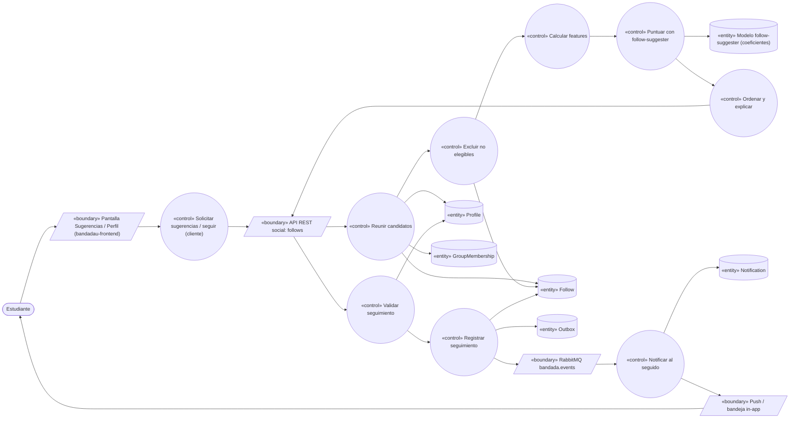
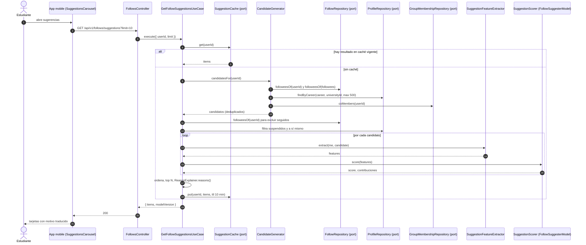
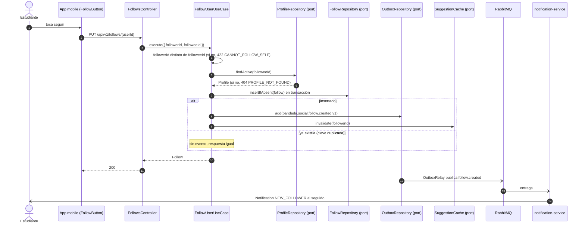

# UC-08 — Seguir estudiantes y ver sugerencias

| Campo | Valor |
|---|---|
| Paquete | Social |
| Actor principal | Estudiante |
| Actores secundarios | Modelo de IA (`follow-suggester`, ML clásico), `notification-service` |
| Prioridad (MoSCoW) | Should |
| Requisitos | RF-11, RNF-01, RNF-05, RNF-12 (versionado del modelo) |
| Tecnologías de la cátedra que demuestra | T9 (ML clásico: filtrado colaborativo / Jaccard + carrera), T4 |
| Servicios involucrados | `social-service` (NestJS · Clean · MongoDB `social`), `notification-service`, `bandadau-frontend`, `bandadau-ml/` (entrenamiento) |
| Estado ICONIX | Implementado (fase 1, 2026-10-15) — evidencia en `../07-trazabilidad.md` |

## 1. Narrativa

### Precondiciones

1. El Estudiante tiene sesión activa y un `Profile` (creado al consumir `bandada.identity.user.registered.v1`).
2. El artefacto del modelo `follow-suggester` (coeficientes JSON exportados por `bandadau-ml/notebooks/04-suggestions.ipynb`) está cargado en `social-service` con su `modelVersion`.

### Disparador

El Estudiante abre la sección de sugerencias ("Personas que quizá conozcas", clave `social.suggestions.title`) o visita el perfil de otro estudiante.

### Curso básico A — Ver sugerencias

1. La app solicita `GET /api/v1/follows/suggestions?limit=10` (`getFollowSuggestions`).
2. El sistema reúne **candidatos** para el Estudiante:
   a) seguidos de sus seguidos (2 saltos en el grafo `follows`);
   b) estudiantes con la misma `career` (y misma universidad, del claim del JWT);
   c) miembros `ACTIVE` de sus mismos `Group`.
3. El sistema excluye: a sí mismo, a quienes ya sigue y a perfiles de usuarios suspendidos.
4. El sistema calcula para cada candidato los *features*: `jaccardFollowees` (|A∩B| / |A∪B| de seguidos), `sameCareer` (0/1), `sharedGroups` (conteo normalizado), `semesterDistance` y `sharedInterests` (Jaccard de `interests`).
5. El sistema aplica el modelo `follow-suggester` (combinación logística de los *features* con coeficientes del JSON) y obtiene un `score` ∈ [0,1].
6. El sistema ordena por `score`, toma los `limit` primeros y adjunta `reasons[]` explicables (los *features* que más aportaron).
7. El sistema responde `200 { items: [{ userId, displayName, career, semester, avatarUrl, score, reasons }], modelVersion }`.
8. La app muestra las tarjetas con el motivo traducido (`social.suggestions.reason.<REASON>`).

### Curso básico B — Seguir

1. El Estudiante toca la acción de seguir (`social.follow.actions.follow`) en una tarjeta o en un perfil.
2. La app envía `PUT /api/v1/follows/{userId}` (idempotente por naturaleza).
3. El sistema verifica que `userId` no sea el propio y que exista un `Profile` activo para él.
4. El sistema inserta el `Follow` (`followerId`, `followeeId`) con índice único y, en la misma transacción, escribe `bandada.social.follow.created.v1` en el `outbox`.
5. El sistema responde `200` con el `Follow`.
6. `notification-service` crea una `Notification` `NEW_FOLLOWER` para el seguido (plantilla según su `locale`).
7. A partir de ahora el feed del Estudiante (UC-06) incluye los posts `PUBLIC`/`FOLLOWERS` del seguido.

### Cursos alternos

- **A2a. Arranque en frío** (el Estudiante no sigue a nadie ni pertenece a grupos): los candidatos se toman por `career` y por popularidad (número de seguidores) dentro de su universidad; `jaccardFollowees = 0`.
- **A2b. Sin candidatos**: `200 { items: [] }`; la app muestra el estado vacío `social.suggestions.empty` con enlace a buscar grupos (UC-09).
- **A5a. Modelo no cargado o JSON inválido al arrancar**: el servicio falla al iniciar (*fail fast*); si la recarga en caliente de una nueva versión falla, se conserva la versión anterior y se registra un log `event=model.reload.failed`.
- **A5b. Latencia**: la lista de candidatos se limita a 500 por petición para cumplir RNF-01 (p95 < 300 ms); el resultado se cachea 10 min por usuario (se invalida al seguir a alguien).
- **B3a. Seguirse a sí mismo**: `422 CANNOT_FOLLOW_SELF`.
- **B3b. Usuario inexistente o suspendido**: `404 PROFILE_NOT_FOUND`.
- **B4a. Ya lo seguía**: no se inserta nada ni se publica evento; `200` con el `Follow` existente (reintentos y doble toque no duplican).
- **B8. Dejar de seguir**: `DELETE /api/v1/follows/{userId}` → `204` (también si no lo seguía). No se notifica al afectado.
- **B2a. Sin conexión**: la mutación se guarda como `OfflineMutation` y se reenvía al recuperar red; al ser `PUT`/`DELETE` idempotentes, reintentar no tiene efectos dobles.

### Postcondiciones

- A: el Estudiante ve hasta `limit` sugerencias puntuadas, con `modelVersion` registrado en el log de la petición.
- B: existe a lo sumo un `Follow` por par; el seguido fue notificado una vez.

### Reglas de negocio

- RN-08.1 El grafo es dirigido (seguir no requiere aprobación).
- RN-08.2 No se sugiere a quien ya se sigue, ni a sí mismo, ni a usuarios suspendidos.
- RN-08.3 Las sugerencias deben ser explicables (`reasons`), sin exponer datos privados de terceros (solo datos públicos de `Profile`).

## 2. Diagrama de robustez

| Objeto | Tipo | Componente real |
|---|---|---|
| Pantalla Sugerencias / Perfil | Boundary | `bandadau-frontend`: `SuggestionsCarousel`, `ProfileScreen`, botón `FollowButton` |
| API REST social | Boundary | `FollowsController` (`social-service`) |
| RabbitMQ | Boundary | `bandada.events` → cola `notification-service.events` |
| Solicitar sugerencias / seguir | Control | `bandadau-frontend`: `useFollowSuggestions`, `useFollow` (TanStack Query + cola offline) |
| Reunir candidatos | Control | `CandidateGenerator` (servicio de aplicación) sobre `FollowRepository`, `ProfileRepository`, `GroupMembershipRepository` |
| Excluir no elegibles | Control | `GetFollowSuggestionsUseCase` (filtro) |
| Calcular features | Control | `SuggestionFeatureExtractor` (dominio, funciones puras) |
| Puntuar con follow-suggester | Control | `FollowSuggesterModel` (implementa el puerto `SuggestionScorer`), JS puro |
| Ordenar y explicar | Control | `GetFollowSuggestionsUseCase` + `ReasonExplainer` |
| Validar / Registrar seguimiento | Control | `FollowUserUseCase`, `UnfollowUserUseCase` |
| Notificar al seguido | Control | `notification-service` · `HandleSocialEventUseCase` |
| Follow / Profile / GroupMembership | Entity | colecciones `follows`, `profiles`, `groupMemberships` |
| Modelo follow-suggester | Entity | artefacto JSON versionado en MinIO/S3 `models/follow-suggester/<versión>/` (ver D7) |
| Outbox / Notification | Entity | colección `outbox`; DynamoDB `bandada-notifications` |

## 3. Diagrama de secuencia

### 3.1 Obtener sugerencias (curso básico A)

### 3.2 Seguir (curso básico B y alterno B4a)

## 4. Clases / contratos involucrados

### social-service (Clean Architecture)

| Capa | Clases |
|---|---|
| Domain | `Follow`, `Profile`, `GroupMembership`, `SuggestionFeatureExtractor` (puro), `SuggestionFeatures` (VO), `SuggestionReason` |
| Application | `GetFollowSuggestionsUseCase`, `FollowUserUseCase`, `UnfollowUserUseCase`, `CandidateGenerator`, `ReasonExplainer`; puertos `FollowRepository`, `ProfileRepository`, `GroupMembershipRepository`, `SuggestionScorer`, `SuggestionCache`, `OutboxRepository` |
| Interface adapters | `FollowsController`, `FollowSuggestionResponse` |
| Frameworks & drivers | `MongoFollowRepository` (índice único `follows { followerId: 1, followeeId: 1 }` + índice `{ followeeId: 1 }`), `FollowSuggesterModel` (lee `coefficients`, `intercept`, `featureOrder`, `modelVersion` del JSON desde S3/MinIO al arrancar), `InMemorySuggestionCache` |

### bandadau-ml/

`bandadau-ml/notebooks/04-suggestions.ipynb`: genera pares (usuario, candidato) desde un *snapshot* anonimizado del grafo; etiqueta positiva = el usuario terminó siguiendo al candidato; entrena regresión logística (scikit-learn) sobre los *features* del paso A4; reporta AUC/precision@10; exporta JSON `{ modelVersion, featureOrder, coefficients, intercept }`.

### Contratos

| Tipo | Identificador |
|---|---|
| OpenAPI | `getFollowSuggestions` (`GET /follows/suggestions`), `PUT /follows/{userId}`, `DELETE /follows/{userId}` |
| AsyncAPI | `bandada.social.follow.created.v1` (`data: { followerId, followeeId, createdAt }`) |
| Notificación | `NotificationType.NEW_FOLLOWER` |
| Errores | `404 PROFILE_NOT_FOUND`, `422 CANNOT_FOLLOW_SELF` |

> **PROPUESTA: agregar a decisiones-clave.md D1** los `operationId` `followUser` (`PUT /follows/{userId}`) y `unfollowUser` (`DELETE /follows/{userId}`).
> **PROPUESTA (glosario/modelo de dominio):** enum `SuggestionReason` = `MUTUAL_FOLLOWS`, `SAME_CAREER`, `SHARED_GROUPS`, `SHARED_INTERESTS`.
> Nota: dejar de seguir **no** publica evento (no existe en D12); si `insights-service` necesitara contar *unfollows*, PROPUESTA: agregar `bandada.social.follow.deleted.v1` a D12.

## 5. Pruebas de aceptación

| ID | Escenario |
|---|---|
| AT-08.1 | **Given** Ana sigue a Beto y Beto sigue a Carla (misma carrera que Ana) **When** Ana pide sugerencias **Then** Carla aparece con `reasons` ⊇ {`MUTUAL_FOLLOWS`, `SAME_CAREER`} y la respuesta incluye `modelVersion`. |
| AT-08.2 | **Given** Ana ya sigue a Carla **When** pide sugerencias **Then** Carla no aparece, ni Ana misma. |
| AT-08.3 | **Given** Dani suspendido **When** Ana pide sugerencias **Then** Dani no aparece. |
| AT-08.4 | **Given** Ana sin seguidos ni grupos **When** pide sugerencias **Then** recibe estudiantes de su carrera ordenados por popularidad (arranque en frío). |
| AT-08.5 | **Given** Ana no sigue a Beto **When** hace `PUT /follows/{beto}` dos veces **Then** ambas `200`, existe 1 `Follow` y Beto recibe 1 `NEW_FOLLOWER`. |
| AT-08.6 | **When** Ana hace `PUT /follows/{ana}` **Then** `422 CANNOT_FOLLOW_SELF`. |
| AT-08.7 | **Given** Ana sigue a Beto **When** `DELETE /follows/{beto}` dos veces **Then** ambas `204` y Beto no aparece como seguido. |
| AT-08.8 | **Given** el JSON de coeficientes de prueba **When** se puntúan *features* conocidos **Then** el `score` coincide con el calculado en el notebook (tolerancia 1e-6). |
| AT-08.9 | **Given** 10 000 perfiles sembrados **When** se piden sugerencias con 100 usuarios concurrentes **Then** p95 < 300 ms (k6). |

Ubicación: `bandadau-backend/services/social-service/test/unit/follow-suggester.spec.ts`, `test/e2e/uc-08-follows.e2e-spec.ts`, `bandadau-infra/load/uc-08-suggestions.js`.

## 6. Trazabilidad

| RF/RNF | Paso UC | Endpoint / evento | Clases | Pruebas |
|---|---|---|---|---|
| RF-11 (seguir / dejar de seguir) | B1–B8 | `PUT`/`DELETE /follows/{userId}`, `follow.created.v1` | `FollowUserUseCase`, `UnfollowUserUseCase` | AT-08.5–08.7 |
| RF-11 (sugerir por carrera, grupos, grafo) | A1–A8 | `getFollowSuggestions` | `CandidateGenerator`, `SuggestionFeatureExtractor`, `FollowSuggesterModel` | AT-08.1–08.4 |
| T9 (ML clásico) | A5 | modelo `follow-suggester` (D7) | `FollowSuggesterModel`, `bandadau-ml/notebooks/04-suggestions.ipynb` | AT-08.8 |
| RNF-01 | A5b | — | `SuggestionCache` | AT-08.9 |
| RNF-05 | B4a, B8 | `PUT`/`DELETE` idempotentes | índice único `follows` | AT-08.5, 08.7 |
