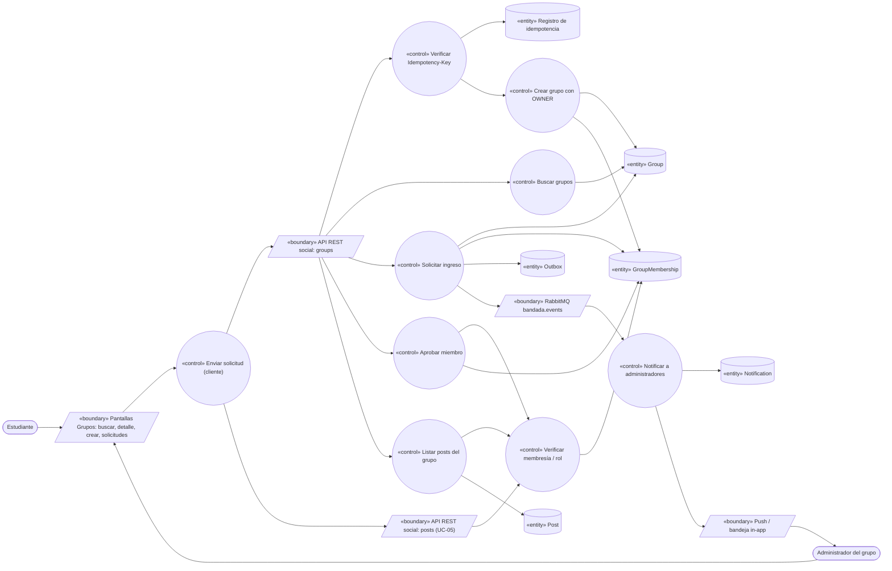
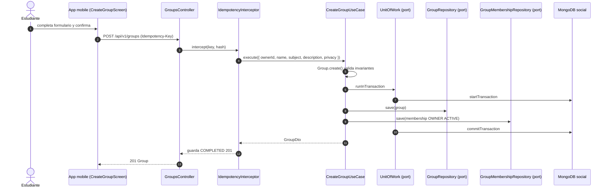
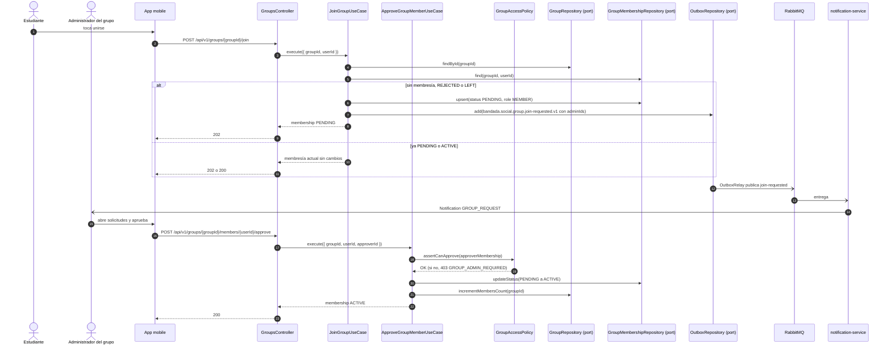

# UC-09 — Crear y participar en un grupo de estudio

| Campo | Valor |
|---|---|
| Paquete | Social |
| Actor principal | Estudiante |
| Actores secundarios | Dueño/administrador del grupo (Estudiante con `GroupMembership.role` `OWNER`/`ADMIN`), `notification-service`, n8n (`wf-01-bienvenida` sugiere grupos) |
| Prioridad (MoSCoW) | Must |
| Requisitos | RF-12, RF-06 (publicar con `visibility = GROUP`), RNF-05 |
| Tecnologías de la cátedra que demuestra | T4 (REST), T8 (`Idempotency-Key` en `POST /groups`) |
| Servicios involucrados | `social-service` (NestJS · Clean · MongoDB `social`), `notification-service`, `bandadau-frontend` |
| Estado ICONIX | Secuencia (pendiente CDR) |

## 1. Narrativa

### Precondiciones

1. El Estudiante tiene sesión activa (`STUDENT`, `ACTIVE`).

### Disparador

El Estudiante entra a la pestaña de grupos de la app para buscar un grupo o crear uno nuevo.

### Curso básico A — Crear grupo

1. El Estudiante toca la acción de crear grupo (`social.groups.actions.create`) y completa `name`, `subject` (materia/tema), `description` y `privacy` (`PUBLIC` | `PRIVATE`).
2. La app envía `POST /api/v1/groups` con `Idempotency-Key`.
3. El sistema verifica la clave en `bandada-idempotency` (`pk = social-service#<key>`).
4. El sistema valida los datos (`name` 3–80, `subject` 2–80, `description` ≤ 500, `privacy` válido).
5. El sistema crea el `Group` (UUIDv7) y, en la **misma transacción Mongo**, la `GroupMembership` del creador con `role = OWNER`, `status = ACTIVE`.
6. El sistema responde `201` con el `Group` (incluye `membersCount = 1` y `myMembership`).

### Curso básico B — Buscar y unirse a un grupo público

1. El Estudiante busca: la app llama `GET /api/v1/groups?query=<texto>&cursor&limit`.
2. El sistema busca por índice de texto sobre `name` y `subject` y devuelve `{ items, nextCursor }` con `privacy`, `membersCount` y `myMembership` (si existe).
3. El Estudiante abre un grupo (`GET /api/v1/groups/{groupId}`) y toca la acción de unirse (`social.groups.actions.join`).
4. La app envía `POST /api/v1/groups/{groupId}/join`.
5. Como el grupo es `PUBLIC`, el sistema crea la `GroupMembership` con `role = MEMBER`, `status = ACTIVE` e incrementa `membersCount`.
6. El sistema responde `200` con la membresía; la app muestra el muro del grupo (`GET /api/v1/groups/{groupId}/posts`).

### Curso básico C — Publicar dentro del grupo

1. Un miembro `ACTIVE` crea un post desde el muro del grupo; la app envía `POST /api/v1/posts` (`createPost`, UC-05) con `visibility = GROUP` y `groupId`.
2. El sistema verifica que el autor tenga `GroupMembership` `ACTIVE` en `groupId` (regla compartida con UC-05) y continúa el flujo de UC-05 (moderación de medios incluida).
3. El post aparece en `GET /groups/{groupId}/posts` y en el feed (UC-06) de los miembros.

### Cursos alternos

- **A3a. Reintento con la misma `Idempotency-Key`**: se devuelve el `201` guardado (`Idempotent-Replayed: true`); no se crean dos grupos.
- **A4a. Datos inválidos**: `400` Problem Details con `errors[]`; la app traduce por `code` (D14).
- **B2a. Sin resultados**: `200 { items: [] }`; la app ofrece crear un grupo con ese nombre.
- **B5a. Grupo `PRIVATE` (solicitud de ingreso)**:
  1. El sistema crea la `GroupMembership` con `status = PENDING` y escribe `bandada.social.group.join-requested.v1` en el `outbox`.
  2. Responde `202` con la membresía `PENDING`; la app muestra el estado `social.groups.membership.PENDING`.
  3. `notification-service` crea una `Notification` `GROUP_REQUEST` para cada `OWNER`/`ADMIN` del grupo.
  4. El administrador abre la lista de solicitudes y toca aprobar → `POST /api/v1/groups/{groupId}/members/{userId}/approve`.
  5. El sistema verifica que quien aprueba sea `OWNER`/`ADMIN` `ACTIVE`, pasa la membresía a `ACTIVE`, incrementa `membersCount` y responde `200`.
- **B5b. Ya es miembro `ACTIVE` o tiene solicitud `PENDING`**: `200`/`202` con la membresía actual, sin duplicar (índice único `groupMemberships { groupId, userId }`) ni volver a notificar.
- **B5c. Membresía previa `REJECTED` o `LEFT`**: se reutiliza el documento y vuelve a `ACTIVE` (público) o `PENDING` (privado).
- **B5d. Aprobación por quien no es `OWNER`/`ADMIN`**: `403 GROUP_ADMIN_REQUIRED`.
- **B5e. Aprobar una solicitud inexistente o ya resuelta**: `404 MEMBERSHIP_NOT_FOUND` / `200` idempotente si ya está `ACTIVE`.
- **B6a. Ver posts de un grupo `PRIVATE` sin ser miembro `ACTIVE`**: `403 GROUP_MEMBERSHIP_REQUIRED` (sí se ven `name`, `subject`, `description` y `membersCount`).
- **C2a. Publicar en un grupo sin membresía `ACTIVE`**: `403 GROUP_MEMBERSHIP_REQUIRED` (lo devuelve `createPost`).

### Postcondiciones

- A: existe el `Group` con exactamente un `OWNER`.
- B: existe a lo sumo una `GroupMembership` por (`groupId`, `userId`); `membersCount` = membresías `ACTIVE`.
- C: el post del grupo solo es visible para miembros `ACTIVE` (si el grupo es `PRIVATE`) o para todos (si es `PUBLIC`).

### Reglas de negocio

- RN-09.1 `GroupPrivacy`: `PUBLIC` = ingreso inmediato; `PRIVATE` = requiere aprobación.
- RN-09.2 Roles de membresía: `OWNER`, `ADMIN`, `MEMBER`; solo `OWNER`/`ADMIN` aprueban.
- RN-09.3 Solo miembros `ACTIVE` publican con `visibility = GROUP`.
- RN-09.4 Un grupo siempre tiene al menos un `OWNER` (la salida/transferencia de propiedad queda fuera de este UC).

## 2. Diagrama de robustez

| Objeto | Tipo | Componente real |
|---|---|---|
| Pantallas Grupos | Boundary | `bandadau-frontend`: `GroupsSearchScreen`, `GroupDetailScreen`, `CreateGroupScreen`, `GroupRequestsScreen` |
| API REST groups / posts | Boundary | `GroupsController`, `PostsController` (`social-service`) |
| RabbitMQ | Boundary | `bandada.events` → `notification-service.events` |
| Enviar solicitud (cliente) | Control | `bandadau-frontend`: hooks `useGroups`, `useJoinGroup`, `useCreatePost` |
| Verificar Idempotency-Key | Control | `IdempotencyInterceptor` (`@bandada/idempotency-ts`) |
| Crear grupo con OWNER | Control | `CreateGroupUseCase` |
| Buscar grupos | Control | `SearchGroupsUseCase` |
| Solicitar ingreso | Control | `JoinGroupUseCase` |
| Aprobar miembro | Control | `ApproveGroupMemberUseCase` |
| Verificar membresía / rol | Control | `GroupAccessPolicy` (dominio) |
| Listar posts del grupo | Control | `ListGroupPostsUseCase` |
| Notificar a administradores | Control | `notification-service` · `HandleSocialEventUseCase` (resuelve destinatarios con los `adminIds` del evento) |
| Group / GroupMembership / Post | Entity | colecciones `groups` (índice de texto `name`,`subject`), `groupMemberships` (único `groupId`+`userId`), `posts` |
| Registro de idempotencia / Outbox / Notification | Entity | `bandada-idempotency`, `outbox`, `bandada-notifications` |

## 3. Diagrama de secuencia

### 3.1 Crear grupo (curso básico A)

### 3.2 Unirse a grupo privado y aprobación (alterno B5a)

## 4. Clases / contratos involucrados

### social-service (Clean Architecture)

| Capa | Clases |
|---|---|
| Domain | `Group` (`privacy`, `membersCount`), `GroupMembership` (`role`, `status`, transiciones `request()`, `approve()`, `reject()`), `GroupPrivacy`, `MembershipStatus`, `GroupAccessPolicy` |
| Application | `CreateGroupUseCase`, `SearchGroupsUseCase`, `GetGroupUseCase`, `JoinGroupUseCase`, `ApproveGroupMemberUseCase`, `ListGroupPostsUseCase`; puertos `GroupRepository`, `GroupMembershipRepository`, `PostRepository`, `OutboxRepository`, `UnitOfWork` |
| Interface adapters | `GroupsController`, `CreateGroupDto`, `GroupResponse`, `MembershipResponse` |
| Frameworks & drivers | `MongoGroupRepository`, `MongoGroupMembershipRepository`, `MongoUnitOfWork` (sesión del replica set `rs0`) |

### Contratos

| Tipo | Identificador |
|---|---|
| OpenAPI | `POST /groups` ♻️, `GET /groups?query`, `GET /groups/{groupId}`, `POST /groups/{groupId}/join`, `POST /groups/{groupId}/members/{userId}/approve`, `GET /groups/{groupId}/posts`; `createPost` (UC-05) con `visibility = GROUP` |
| AsyncAPI | `bandada.social.group.join-requested.v1` (`data: { groupId, groupName, userId, adminIds[], requestedAt }`) |
| Notificación | `NotificationType.GROUP_REQUEST` |
| Errores | `400`, `403 GROUP_ADMIN_REQUIRED`, `403 GROUP_MEMBERSHIP_REQUIRED`, `404 GROUP_NOT_FOUND`, `404 MEMBERSHIP_NOT_FOUND` |
| n8n | `wf-01-bienvenida` consulta `GET /groups?query=<career>` para sugerir grupos al nuevo usuario |

> **Resuelto (ADR-0016/D15)**: los `operationId` quedaron en `social-service.yaml` como `createGroup`, `listGroups` (búsqueda), `getGroup`, `joinGroup`, `approveGroupMember`, `rejectGroupMember`, `leaveGroup`, `listGroupMembers` y `listGroupPosts`. Propuesta original: agregar a D1 `createGroup`, `searchGroups`, `getGroup`, `joinGroup`, `approveGroupMember`, `listGroupPosts`; y el endpoint faltante `POST /groups/{groupId}/members/{userId}/reject` (`rejectGroupMember`) para pasar la solicitud a `REJECTED` (el enum `MembershipStatus` ya lo contempla). Salir del grupo (`LEFT`) también carece de endpoint: PROPUESTA `POST /groups/{groupId}/leave` (`leaveGroup`).
> **PROPUESTA (modelo de dominio):** agregar `description` y `membersCount` a `Group`, y `role` (`GroupMembershipRole`: `OWNER`, `ADMIN`, `MEMBER`) como enum explícito en la tabla de enumeraciones.

## 5. Pruebas de aceptación

| ID | Escenario |
|---|---|
| AT-09.1 | **Given** Ana autenticada **When** crea un grupo `PUBLIC` "Cálculo II" **Then** `201`, el grupo existe y Ana es `OWNER` `ACTIVE` con `membersCount = 1`. |
| AT-09.2 | **Given** la misma `Idempotency-Key` **When** Ana reenvía la creación **Then** `201` con `Idempotent-Replayed: true` y existe un solo grupo. |
| AT-09.3 | **Given** un grupo `PUBLIC` **When** Beto hace `join` **Then** `200`, membresía `ACTIVE`, `membersCount = 2`. |
| AT-09.4 | **Given** un grupo `PRIVATE` de Ana **When** Beto hace `join` **Then** `202` `PENDING`, se publica `group.join-requested.v1` y Ana recibe `GROUP_REQUEST`. |
| AT-09.5 | **Given** la solicitud `PENDING` de Beto **When** Ana aprueba **Then** `200`, membresía `ACTIVE`. |
| AT-09.6 | **Given** la solicitud de Beto **When** Carla (`MEMBER`) intenta aprobar **Then** `403 GROUP_ADMIN_REQUIRED`. |
| AT-09.7 | **Given** Beto `PENDING` **When** vuelve a hacer `join` **Then** `202` sin evento nuevo. |
| AT-09.8 | **Given** grupo `PRIVATE` y Dani no miembro **When** pide `GET /groups/{id}/posts` **Then** `403 GROUP_MEMBERSHIP_REQUIRED`; `GET /groups/{id}` sí responde `200`. |
| AT-09.9 | **Given** Dani no miembro **When** crea un post con `visibility = GROUP` y ese `groupId` **Then** `403 GROUP_MEMBERSHIP_REQUIRED`. |
| AT-09.10 | **Given** grupos "Cálculo II" y "Física" **When** se busca `query=calc` **Then** solo aparece "Cálculo II". |

Ubicación: `bandadau-backend/services/social-service/test/e2e/uc-09-groups.e2e-spec.ts`.

## 6. Trazabilidad

| RF/RNF | Paso UC | Endpoint / evento | Clases | Pruebas |
|---|---|---|---|---|
| RF-12 (crear público/privado) | A1–A6 | `POST /groups` ♻️ | `CreateGroupUseCase`, `Group` | AT-09.1, 09.2 |
| RF-12 (solicitar/aceptar ingreso) | B1–B6, B5a–B5e | `join`, `approve`, `group.join-requested.v1` | `JoinGroupUseCase`, `ApproveGroupMemberUseCase`, `GroupAccessPolicy` | AT-09.3–09.7 |
| RF-12 (publicar dentro del grupo) | C1–C3, C2a | `createPost`, `GET /groups/{id}/posts` | `GroupAccessPolicy`, `ListGroupPostsUseCase` | AT-09.8, 09.9 |
| RNF-05 / T8 | A3a, B5b | `Idempotency-Key`, índice único `groupMemberships` | `IdempotencyInterceptor` | AT-09.2, 09.7 |
