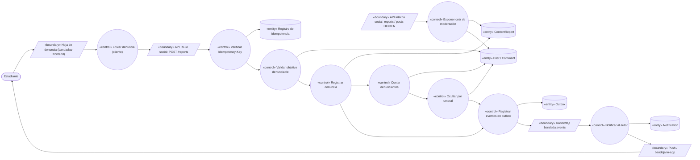
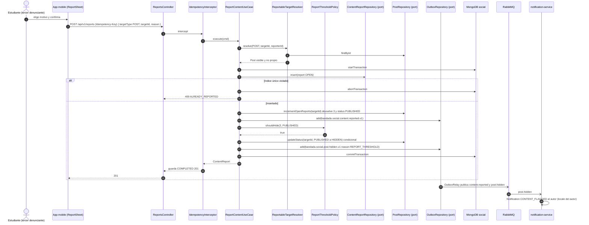
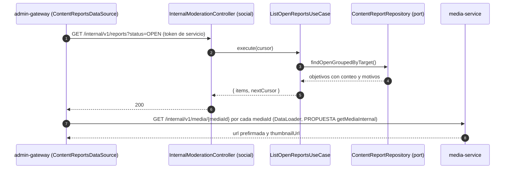

# UC-10 — Denunciar contenido

| Campo | Valor |
|---|---|
| Paquete | Social |
| Actor principal | Estudiante |
| Actores secundarios | Moderador (resuelve en UC-18), `notification-service`, `insights-service`, `media-service` (vista previa de medios en la cola) |
| Prioridad (MoSCoW) | Should |
| Requisitos | RF-13, RF-22 (alimenta la cola), RNF-05 |
| Tecnologías de la cátedra que demuestra | T4 (REST), T8 (`Idempotency-Key` + restricción única de negocio) |
| Servicios involucrados | `social-service` (NestJS · Clean · MongoDB `social`), `media-service` (lectura de medios en UC-18), `notification-service`, `admin-gateway` (consulta en UC-18) |
| Estado ICONIX | Secuencia (pendiente CDR) |

## 1. Narrativa

### Precondiciones

1. El Estudiante tiene sesión activa.
2. El contenido objetivo (`Post` o `Comment`) existe, es visible para él y no es de su autoría.

### Disparador

El Estudiante abre el menú contextual de un post o comentario y elige la acción de denunciar (`social.report.actions.open`).

### Curso básico

1. La app muestra la hoja de denuncia con los motivos (`social.report.reason.<REASON>`) y un campo opcional de detalle.
2. El Estudiante elige un motivo y confirma.
3. La app envía `POST /api/v1/reports` (`reportContent`) con `Idempotency-Key` y `{ targetType: POST|COMMENT, targetId, reason, details? }`.
4. El sistema verifica la `Idempotency-Key` (`pk = social-service#<key>`).
5. El sistema carga el objetivo, comprueba que existe, es visible para el denunciante y que no es su propio contenido.
6. El sistema, **en una transacción Mongo**:
   a) inserta el `ContentReport` con `status = OPEN` (índice único `targetType`+`targetId`+`reporterId`);
   b) incrementa atómicamente el contador `openReportsCount` del objetivo y obtiene el nuevo valor;
   c) escribe en `outbox` `bandada.social.content.reported.v1`.
7. El sistema responde `201` con el `ContentReport`; la app confirma con `social.report.submitted` y oculta el contenido **solo para el denunciante**.
8. Si `openReportsCount` alcanzó el umbral (3 denunciantes distintos, `REPORT_HIDE_THRESHOLD=3`) y el objetivo estaba `PUBLISHED`, el sistema, **en la misma transacción** del paso 6, cambia su estado a `HIDDEN` y escribe `bandada.social.post.hidden.v1` (`reason = REPORT_THRESHOLD`) en el `outbox`.
9. El post oculto deja de aparecer en feeds, perfiles y grupos (UC-06) y entra a la cola de moderación (`GET /internal/v1/reports?status=OPEN` y `GET /internal/v1/posts?status=HIDDEN`), que `admin-gateway` expone como `contentReports` / `moderationQueue` (UC-18); los medios del post se previsualizan vía `media-service` (URL prefirmada; ver PROPUESTA `getMediaInternal` en §4).
10. `notification-service` consume `post.hidden.v1` y crea una `Notification` `CONTENT_FLAGGED` para el autor (plantilla en su `locale`).

### Cursos alternos

- **4a. Reintento con la misma clave**: `201` guardado con `Idempotent-Replayed: true`; el contador no vuelve a subir.
- **5a. Objetivo inexistente o no visible**: `404 CONTENT_NOT_FOUND`.
- **5b. Denunciar contenido propio**: `422 CANNOT_REPORT_OWN_CONTENT`.
- **6a. El mismo Estudiante ya denunció ese objetivo** (otra `Idempotency-Key`): la inserción viola el índice único → `409 ALREADY_REPORTED`; el contador no cambia (así el umbral cuenta **denunciantes distintos**).
- **6b. Denuncias concurrentes** (dos estudiantes casi a la vez): el `$inc` atómico con `findOneAndUpdate` y la transacción garantizan que exactamente una de ellas observa `openReportsCount = 3` y realiza la transición a `HIDDEN`; la otra ve 3 o 4 con estado ya `HIDDEN` y no publica de nuevo.
- **8a. Objetivo ya `HIDDEN` o `REMOVED`**: se registra la denuncia (sirve como evidencia en UC-18) pero no hay transición ni evento `hidden`.
- **8b. Objetivo `Comment`**: igual que el post, pero el comentario pasa a oculto y se publica el evento de comentario oculto (ver PROPUESTA).
- **9a. Resolución por el moderador (UC-18, `resolveContentReport`)**: `RESOLVED_KEPT` → el post vuelve a `PUBLISHED`, `openReportsCount = 0` y las denuncias quedan resueltas; `RESOLVED_REMOVED` → el post pasa a `REMOVED` y se publica `bandada.social.post.deleted.v1` (que `media-service` consume para borrar los medios).
- **10a. `notification-service` caído**: la ocultación ya ocurrió; la notificación se entrega al recuperarse (RNF-03).

### Postcondiciones

- Existe un `ContentReport` `OPEN` por denunciante y objetivo.
- Con 3 denunciantes distintos el contenido está `HIDDEN` y en la cola de moderación; el autor fue notificado.

### Reglas de negocio

- RN-10.1 Umbral de ocultación automática: 3 denuncias `OPEN` de usuarios distintos (configurable).
- RN-10.2 Una denuncia por usuario y objetivo; no se denuncia contenido propio.
- RN-10.3 La ocultación es provisional: solo un moderador elimina definitivamente (UC-18).
- RN-10.4 El denunciante es anónimo para el autor.

## 2. Diagrama de robustez

| Objeto | Tipo | Componente real |
|---|---|---|
| Hoja de denuncia | Boundary | `bandadau-frontend`: `ReportSheet` |
| API REST `POST /reports` | Boundary | `ReportsController` (`social-service`) |
| API interna | Boundary | `InternalModerationController` (`/internal/v1/reports`, `/internal/v1/posts`), consumida por `admin-gateway` |
| RabbitMQ | Boundary | `bandada.events` → `notification-service.events`, `insights-service.analytics` |
| Enviar denuncia (cliente) | Control | `bandadau-frontend`: `useReportContent` (genera `Idempotency-Key`) |
| Verificar Idempotency-Key | Control | `IdempotencyInterceptor` |
| Validar objetivo denunciable | Control | `ReportableTargetResolver` (resuelve `Post`/`Comment`) + `PostVisibilityPolicy` |
| Registrar denuncia | Control | `ReportContentUseCase` |
| Contar denunciantes / Ocultar por umbral | Control | `ReportThresholdPolicy` (dominio) aplicada por `ReportContentUseCase` |
| Registrar eventos en outbox | Control | `OutboxRepository` |
| Notificar al autor | Control | `notification-service` · `HandleSocialEventUseCase` |
| Exponer cola de moderación | Control | `ListOpenReportsUseCase`, `ListPostsByStatusUseCase` |
| Post / Comment / ContentReport | Entity | colecciones `posts`, `comments`, `contentReports` |
| Idempotencia / Outbox / Notification | Entity | `bandada-idempotency`, `outbox`, `bandada-notifications` |

## 3. Diagrama de secuencia

### 3.1 Tercera denuncia que oculta el post (curso básico con paso 8)

### 3.2 Consulta de la cola por el panel (enlace con UC-18)

## 4. Clases / contratos involucrados

### social-service (Clean Architecture)

| Capa | Clases |
|---|---|
| Domain | `ContentReport` (`targetType`, `targetId`, `reporterId`, `reason`, `status`), `ReportStatus`, `ReportThresholdPolicy` (umbral inyectado), `Post.hide(reason)`, `Comment` |
| Application | `ReportContentUseCase`, `ListOpenReportsUseCase`, `ListPostsByStatusUseCase`, `ResolveContentReportUseCase` (UC-18); puertos `ContentReportRepository`, `PostRepository`, `CommentRepository`, `OutboxRepository`, `UnitOfWork` |
| Interface adapters | `ReportsController`, `InternalModerationController`, `ReportContentDto` |
| Frameworks & drivers | `MongoContentReportRepository` (índice único `{ targetType: 1, targetId: 1, reporterId: 1 }`, índice `{ status: 1, targetId: 1 }`), `MongoPostRepository.incrementOpenReports()` con `findOneAndUpdate({ $inc })` |

### Contratos

| Tipo | Identificador |
|---|---|
| OpenAPI | `reportContent` (`POST /reports` ♻️); internos `GET /internal/v1/reports?status=OPEN`, `GET /internal/v1/posts?status=HIDDEN`, `PATCH /internal/v1/posts/{id}/status` |
| AsyncAPI | `bandada.social.content.reported.v1` (`data: { reportId, targetType, targetId, authorId, reason, openReportsCount }`), `bandada.social.post.hidden.v1` (`data: { postId, authorId, reason }`), `bandada.social.post.deleted.v1` (resolución en UC-18) |
| GraphQL (UC-18) | `contentReports`, `moderationQueue`, `resolveContentReport` |
| Notificación | `NotificationType.CONTENT_FLAGGED` |
| Errores | `404 CONTENT_NOT_FOUND`, `409 ALREADY_REPORTED`, `422 CANNOT_REPORT_OWN_CONTENT`, `409 IDEMPOTENCY_IN_PROGRESS`, `422 IDEMPOTENCY_KEY_REUSED` |

> **PROPUESTA (modelo de dominio/glosario):**
> - enum `ReportTargetType` = `POST`, `COMMENT`; enum `ReportReason` = `SPAM`, `HARASSMENT`, `HATE`, `NSFW`, `VIOLENCE`, `MISINFORMATION`, `OTHER`;
> - campo desnormalizado `openReportsCount` en `Post` y `Comment`;
> - `Comment.status` (`CommentStatus` = `VISIBLE`, `HIDDEN`, `REMOVED`), hoy `Comment` no tiene estado y RF-13 exige ocultar comentarios.
> **PROPUESTA: agregar a decisiones-clave.md D1** (media-service, interno) `GET /internal/v1/media/{mediaId}` (`getMediaInternal`) para que `admin-gateway` obtenga la vista previa con token de servicio (hoy solo existe `listFlaggedMedia`). Misma propuesta que UC-11.
> **PROPUESTA: agregar a decisiones-clave.md D12** `bandada.social.comment.hidden.v1` (ocultación de comentario por umbral).

## 5. Pruebas de aceptación

| ID | Escenario |
|---|---|
| AT-10.1 | **Given** un post `PUBLISHED` de Ana **When** Beto lo denuncia con motivo `SPAM` **Then** `201`, `ContentReport` `OPEN`, `openReportsCount = 1`, el post sigue `PUBLISHED`. |
| AT-10.2 | **Given** 2 denuncias de Beto y Carla **When** Dani denuncia **Then** el post pasa a `HIDDEN`, se publica `post.hidden.v1` una vez y Ana recibe `CONTENT_FLAGGED`. |
| AT-10.3 | **Given** Beto ya denunció **When** denuncia otra vez con otra clave **Then** `409 ALREADY_REPORTED` y el contador sigue igual. |
| AT-10.4 | **Given** la misma `Idempotency-Key` **When** Beto reintenta **Then** `201` con `Idempotent-Replayed: true` y el contador no cambia. |
| AT-10.5 | **When** Ana denuncia su propio post **Then** `422 CANNOT_REPORT_OWN_CONTENT`. |
| AT-10.6 | **Given** 2 denuncias **When** llegan 2 denuncias concurrentes de usuarios distintos **Then** el post queda `HIDDEN` y hay exactamente un `post.hidden.v1` en el outbox. |
| AT-10.7 | **Given** un post `HIDDEN` **When** se consulta el feed **Then** no aparece; **And** aparece en `GET /internal/v1/posts?status=HIDDEN`. |
| AT-10.8 | **Given** un post `HIDDEN` por denuncias **When** el moderador resuelve `RESOLVED_KEPT` (UC-18) **Then** vuelve a `PUBLISHED` con `openReportsCount = 0`. |
| AT-10.9 | **Given** un comentario con 3 denunciantes **Then** el comentario no aparece en `GET /posts/{postId}/comments`. |

Ubicación: `bandadau-backend/services/social-service/test/e2e/uc-10-reports.e2e-spec.ts`, `test/unit/report-threshold.policy.spec.ts`.

## 6. Trazabilidad

| RF/RNF | Paso UC | Endpoint / evento | Clases | Pruebas |
|---|---|---|---|---|
| RF-13 (denunciar con motivo) | 1–7 | `reportContent`, `content.reported.v1` | `ReportContentUseCase`, `ContentReport` | AT-10.1, 10.5 |
| RF-13 (3 denuncias ocultan) | 6b, 8 | `post.hidden.v1` | `ReportThresholdPolicy`, `Post.hide()` | AT-10.2, 10.6, 10.7, 10.9 |
| RF-22 (alimenta cola) | 9, 9a | `/internal/v1/reports`, GraphQL `contentReports` | `ListOpenReportsUseCase` | AT-10.7, 10.8 |
| RNF-05 / T8 | 4a, 6a | `Idempotency-Key`, índice único `contentReports` | `IdempotencyInterceptor`, `MongoContentReportRepository` | AT-10.3, 10.4 |
