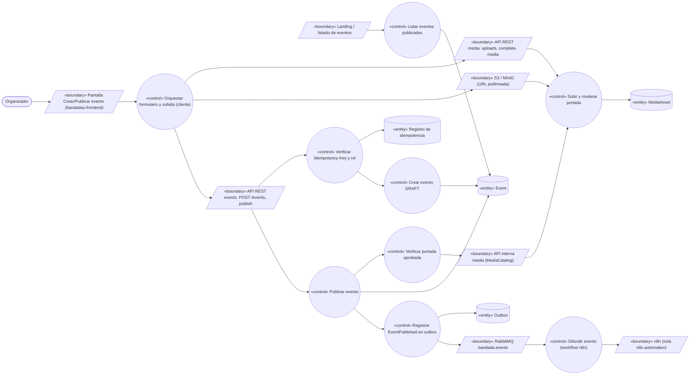
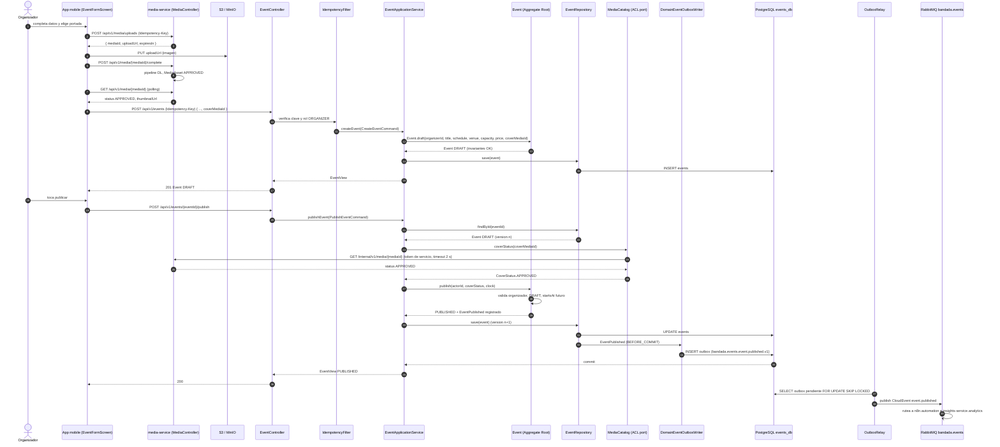
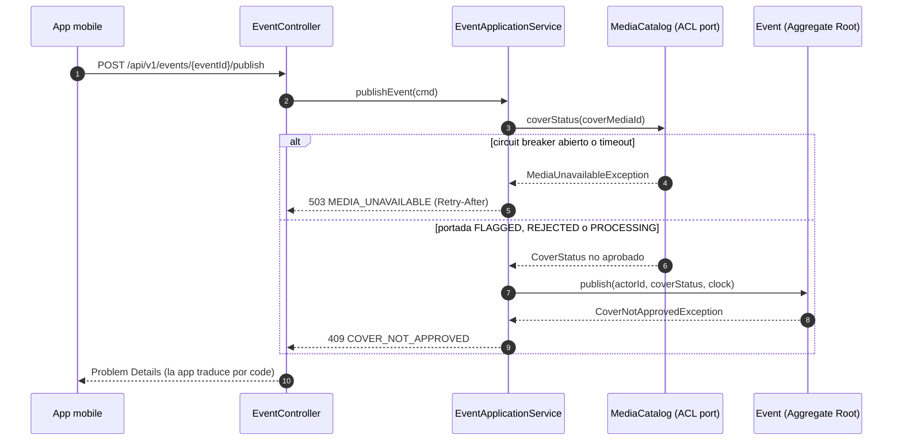

# UC-11 — Publicar evento

| Campo | Valor |
|---|---|
| Paquete | Eventos |
| Actor principal | Organizador (rol `ORGANIZER`) |
| Actores secundarios | `media-service` (portada + moderación DL), n8n (`n8n.automation`), `insights-service`, Landing (lista pública) |
| Prioridad (MoSCoW) | Must |
| Requisitos | RF-14, RF-07 (moderación de la portada), RNF-05, RNF-08 |
| Tecnologías de la cátedra que demuestra | T4 (REST), T10 (n8n consume `event.published`), T9 (portada moderada), C5 (DDD táctico) |
| Servicios involucrados | `events-service` (Spring Boot 4 · **DDD** · PostgreSQL `events_db`), `media-service` (NestJS · Clean · MongoDB `media` + S3), n8n, `bandadau-frontend`, `bandadau-landing` |
| Estado ICONIX | Secuencia (pendiente CDR) |

## 1. Narrativa

### Precondiciones

1. El Organizador tiene sesión activa y su JWT incluye `ORGANIZER` en `roles`.

### Disparador

El Organizador abre la sección de organizador de la app y elige crear evento (`events.organizer.actions.create`).

### Curso básico

1. El Organizador completa `title`, `description`, `startsAt`, `endsAt`, `venue`, `capacity` y `priceCredits` (0 = gratuito) y elige una imagen de portada.
2. La app ejecuta el pre-chequeo on-device de la imagen (`nsfw-mobile`, D6) y pide `POST /api/v1/media/uploads` (`createUpload`, `Idempotency-Key`) → `{ mediaId, uploadUrl, expiresIn }`.
3. La app sube la imagen con `PUT` a la `uploadUrl` prefirmada (S3/MinIO) y llama `POST /api/v1/media/{mediaId}/complete` (`completeUpload`).
4. `media-service` ejecuta el pipeline DL (`nsfw-classifier`, `violence-classifier`, `clip-zero-shot`) y deja el `MediaAsset` en `APPROVED` (score < 0.5). La app consulta `GET /api/v1/media/{mediaId}` (`getMedia`) hasta ver `APPROVED` y muestra la miniatura.
5. La app envía `POST /api/v1/events` (`createEvent`) con `Idempotency-Key` y los datos + `coverMediaId`.
6. `events-service` verifica la clave en `bandada-idempotency` (`pk = events-service#<key>`) y el rol `ORGANIZER`.
7. `EventApplicationService` construye el agregado `Event` mediante su fábrica, que valida las invariantes (ver reglas) y lo deja en `DRAFT` con `seatsTaken = 0`.
8. El sistema persiste el `Event` (`events`) y responde `201` con el evento `DRAFT`.
9. El Organizador revisa la vista previa y toca publicar (`events.organizer.actions.publish`); la app envía `POST /api/v1/events/{eventId}/publish`.
10. `EventApplicationService` carga el agregado y consulta a `media-service`, a través del puerto anticorrupción `MediaCatalog`, el estado de `coverMediaId`.
11. El agregado ejecuta `publish()`: verifica que el actor sea el `organizerId`, que el estado sea `DRAFT`, que `startsAt` siga en el futuro y que la portada esté `APPROVED`; pasa a `PUBLISHED`, fija `publishedAt` y registra el evento de dominio `EventPublished`.
12. En la misma transacción JPA se guarda el agregado y se escribe en `outbox` el mensaje `bandada.events.event.published.v1`.
13. El sistema responde `200` con el `Event` `PUBLISHED`.
14. El relay del outbox publica el mensaje en `bandada.events`; lo consumen `n8n.automation` (difusión, ver PROPUESTA) e `insights-service.analytics` (métricas).
15. El evento aparece en `GET /api/v1/events` (`listEvents`) de la app y en la landing (`GET /api/v1/events?public=true`), y queda disponible para inscripciones (UC-12).

### Cursos alternos

- **2a. Pre-chequeo on-device con puntaje alto**: la app advierte (`media.precheck.warning`) y permite elegir otra imagen; la decisión final es del servidor.
- **4a. Portada `FLAGGED` o `REJECTED`**: la app informa (`errors.COVER_NOT_APPROVED`) y pide otra imagen; el evento puede crearse en `DRAFT` igualmente, pero no publicarse (ver 11b).
- **4b. Sin portada**: se permite crear y publicar sin `coverMediaId` (la app usa una portada por defecto basada en tokens de tema, D13).
- **6a. Usuario sin rol `ORGANIZER`**: `403 ORGANIZER_ROLE_REQUIRED`.
- **6b. Reintento con la misma `Idempotency-Key`**: `201` guardado con `Idempotent-Replayed: true`; no se duplica el evento.
- **7a. Invariantes violadas** (`startsAt` en el pasado o a menos de 1 h, `endsAt ≤ startsAt`, `capacity < 1`, `priceCredits < 0`, título vacío): `400`/`422` Problem Details con `code` por campo; la app traduce por `code` (D14).
- **10a. `media-service` no responde** (timeout 2 s, *circuit breaker* abierto): `503 MEDIA_UNAVAILABLE` con `Retry-After`; el evento sigue en `DRAFT`; el Organizador reintenta.
- **11a. Actor distinto del `organizerId`**: `403 NOT_EVENT_ORGANIZER`.
- **11b. Portada `PROCESSING`, `FLAGGED` o `REJECTED`**: `409 COVER_NOT_APPROVED`; sin cambios.
- **11c. Evento ya `PUBLISHED`**: `200` con el evento actual (publicar es idempotente; no se emite un segundo `event.published`).
- **11d. Evento `CANCELLED` o `FINISHED`**: `409 EVENT_NOT_PUBLISHABLE`.
- **12a. Conflicto de versión** (dos publicaciones concurrentes): `OptimisticLockException` → se recarga y se re-evalúa; la segunda cae en 11c.
- **14a. RabbitMQ caído**: el mensaje permanece en `outbox` y el relay lo publica al reconectar; el evento ya es visible en la API (consistencia eventual).

### Postcondiciones

- El `Event` existe en `PUBLISHED` con `seatsTaken = 0`, portada `APPROVED` (si tiene) y un único `bandada.events.event.published.v1` emitido.

### Reglas de negocio (invariantes del agregado `Event`)

- RN-11.1 `capacity ≥ 1`; `0 ≤ seatsTaken ≤ capacity` (invariante 1 del dominio).
- RN-11.2 `priceCredits` entero `≥ 0`; `0` = gratuito (la SAGA de UC-12 salta el débito).
- RN-11.3 `startsAt` al menos 1 h en el futuro al crear y al publicar; `endsAt > startsAt`.
- RN-11.4 Solo el `organizerId` publica; solo se publica desde `DRAFT`.
- RN-11.5 La portada, si existe, debe estar `APPROVED` por `media-service` (RF-07).
- RN-11.6 Fechas en UTC; la UI las presenta en `America/La_Paz` con el locale del usuario (D14).

## 2. Diagrama de robustez

> Nota de robustez: el control "Difundir evento" es el workflow de n8n que consume la cola
> `n8n.automation` (ver PROPUESTA `wf-06-difusion-evento` en §4); su detalle vive en `automatizacion-n8n.md`.

| Objeto | Tipo | Componente real |
|---|---|---|
| Pantalla Crear/Publicar evento | Boundary | `bandadau-frontend` (sección organizador): `EventFormScreen`, `EventPreviewScreen` |
| API REST media / S3 | Boundary | `MediaController` (`media-service`), bucket privado MinIO/S3 |
| API REST events | Boundary | `EventController` (`events-service`, capa `interfaces.rest`) |
| API interna media (MediaCatalog) | Boundary | `media-service` `GET /internal/v1/media/{mediaId}` (PROPUESTA) |
| RabbitMQ / n8n | Boundary | exchange `bandada.events`, colas `n8n.automation`, `insights-service.analytics` |
| Landing / listado | Boundary | `bandadau-landing` (static export), pantalla de eventos de la app |
| Orquestar formulario y subida | Control | `bandadau-frontend`: `useCreateEvent`, `useMediaUpload` (presigned PUT + polling `getMedia`) |
| Difundir evento | Control | workflow n8n (PROPUESTA `wf-06-difusion-evento`) |
| Subir y moderar portada | Control | `media-service`: `CreateUploadUseCase`, `CompleteUploadUseCase`, `ModerateMediaUseCase` |
| Verificar Idempotency-Key y rol | Control | `IdempotencyFilter` (Spring, DynamoDB) + `@PreAuthorize("hasRole('ORGANIZER')")` |
| Crear evento DRAFT | Control | `EventApplicationService.createEvent()` + `Event.draft(...)` (fábrica) |
| Verificar portada aprobada | Control | puerto de dominio `MediaCatalog` → `MediaServiceClient` (ACL, Resilience4j) |
| Publicar evento | Control | `EventApplicationService.publishEvent()` + `Event.publish()` |
| Registrar EventPublished | Control | `DomainEventOutboxWriter` (listener transaccional de eventos de dominio) |
| Listar eventos publicados | Control | `EventQueryService.listEvents()` |
| Event | Entity | agregado `Event` · tabla `events` (`events_db`) |
| MediaAsset | Entity | colección `mediaAssets` (`media`) |
| Registro de idempotencia / Outbox | Entity | `bandada-idempotency`; tabla `outbox` de `events_db` |

## 3. Diagrama de secuencia

### 3.1 Crear y publicar (curso básico)

### 3.2 Alterno 11b/10a — portada no aprobada o media-service no disponible

## 4. Clases / contratos involucrados

### events-service (DDD táctico, paquete `com.bandadau.events`)

| Capa | Clases |
|---|---|
| `domain.event` | **Aggregate root** `Event` (`id`, `organizerId`, `title`, `description`, `schedule`, `venue`, `capacity`, `seatsTaken`, `priceCredits`, `coverMediaId`, `status`, `version`); fábrica `Event.draft(...)`; comportamiento `publish(actorId, CoverStatus, Clock)`, `reserveSeat()` / `releaseSeat()` (UC-12); value objects `EventId`, `OrganizerId`, `EventSchedule(startsAt, endsAt)`, `Venue`, `Capacity`, `Credits`, `MediaId`; enum `EventStatus`; domain event `EventPublished`; excepciones `CoverNotApprovedException`, `EventNotPublishableException` |
| `domain.event` (puertos) | `EventRepository` (interfaz de repositorio del agregado), `MediaCatalog` (servicio de dominio/ACL, devuelve `CoverStatus`) |
| `application` | `EventApplicationService` (`createEvent`, `publishEvent`), comandos `CreateEventCommand`, `PublishEventCommand`; `EventQueryService` (lecturas, CQRS ligero) |
| `infrastructure` | `JpaEventRepository` (`@Version` para bloqueo optimista), `MediaServiceClient` (RestClient + Resilience4j), `DomainEventOutboxWriter`, `OutboxRelay` (`@Scheduled`), `IdempotencyFilter` (DynamoDB SDK v2) |
| `interfaces.rest` | `EventController`, `CreateEventRequest`, `EventResponse` |

Regla ArchUnit: `..domain..` no depende de `org.springframework..`, `jakarta.persistence..` ni de `..infrastructure..`.

### Contratos

| Tipo | Identificador |
|---|---|
| OpenAPI events | `createEvent` (`POST /events` ♻️), `POST /events/{eventId}/publish`, `listEvents` (`GET /events?from&to&cursor&public`), `GET /events/{eventId}` |
| OpenAPI media | `createUpload`, `completeUpload`, `getMedia` |
| AsyncAPI | `bandada.events.event.published.v1` (`subject = eventId`, `data: { eventId, organizerId, title, startsAt, endsAt, venue, capacity, priceCredits, coverMediaId, publishedAt }`) |
| Errores | `403 ORGANIZER_ROLE_REQUIRED`, `403 NOT_EVENT_ORGANIZER`, `409 COVER_NOT_APPROVED`, `409 EVENT_NOT_PUBLISHABLE`, `503 MEDIA_UNAVAILABLE`, `400/422` validación |

> **PROPUESTA: agregar a decisiones-clave.md D1**: `operationId` `publishEvent` (`POST /events/{eventId}/publish`) y `getEvent` (`GET /events/{eventId}`); endpoint interno de media-service `GET /internal/v1/media/{mediaId}` (`getMediaInternal`, token de servicio) para que `events-service` verifique la portada sin el JWT del usuario.
> **PROPUESTA (modelo de dominio):** agregar a `Event` los atributos `description`, `endsAt`, `coverMediaId`, `publishedAt`, `version` (RF-14 los exige y no figuran en el diagrama).
> **PROPUESTA (D10):** el catálogo ya enlaza `bandada.events.event.published.v1` a la cola `n8n.automation`, pero D10 no define el workflow que lo consume. Propuesta: `wf-06-difusion-evento` — al publicarse un evento, anunciarlo por notificación a los miembros de grupos de la misma carrera/tema (REST social + notification interna).

## 5. Pruebas de aceptación

| ID | Escenario |
|---|---|
| AT-11.1 | **Given** un `ORGANIZER` con portada `APPROVED` **When** crea el evento **Then** `201` en `DRAFT` con `seatsTaken = 0`; **When** lo publica **Then** `200` `PUBLISHED` y hay un `event.published.v1` en el outbox. |
| AT-11.2 | **Given** un `STUDENT` sin rol `ORGANIZER` **When** `POST /events` **Then** `403 ORGANIZER_ROLE_REQUIRED`. |
| AT-11.3 | **Given** la misma `Idempotency-Key` **When** se reenvía `createEvent` **Then** `201` replay y existe un solo evento. |
| AT-11.4 | **Given** `startsAt` en el pasado o `capacity = 0` **When** se crea **Then** `400/422` con el `code` del campo. |
| AT-11.5 | **Given** portada `FLAGGED` **When** se publica **Then** `409 COVER_NOT_APPROVED` y el evento sigue `DRAFT`. |
| AT-11.6 | **Given** `media-service` detenido **When** se publica **Then** `503 MEDIA_UNAVAILABLE` con `Retry-After`. |
| AT-11.7 | **Given** un evento `PUBLISHED` **When** se publica de nuevo **Then** `200` y no hay un segundo mensaje en outbox. |
| AT-11.8 | **Given** otro organizador **When** intenta publicar el evento ajeno **Then** `403 NOT_EVENT_ORGANIZER`. |
| AT-11.9 | **Given** el evento publicado **When** la landing pide `GET /events?public=true` **Then** aparece; un evento `DRAFT` no. |
| AT-11.10 | **Given** RabbitMQ detenido al publicar **When** se levanta **Then** n8n recibe `event.published.v1` exactamente una vez (inbox de n8n por `id`). |
| AT-11.11 | (Unitaria de dominio) `Event.publish()` lanza `EventNotPublishableException` desde `CANCELLED` y registra `EventPublished` solo desde `DRAFT`. |

Ubicación: `bandadau-backend/services/events-service/src/test/java/com/bandadau/events/domain/EventTest.java`, `.../application/PublishEventIT.java` (Testcontainers Postgres + WireMock para media).

## 6. Trazabilidad

| RF/RNF | Paso UC | Endpoint / evento | Clases | Pruebas |
|---|---|---|---|---|
| RF-14 (datos del evento) | 1, 5–8, 7a | `createEvent` | `Event.draft()`, `EventApplicationService` | AT-11.1, 11.4 |
| RF-14 (portada) / RF-07 | 2–4, 10–11, 11b | `createUpload`, `completeUpload`, `getMedia`, `getMediaInternal` (PROPUESTA) | `MediaCatalog`, `MediaServiceClient` | AT-11.5, 11.6 |
| RF-14 (publicar) | 9–15 | `POST /events/{eventId}/publish`, `event.published.v1` | `Event.publish()`, `DomainEventOutboxWriter` | AT-11.1, 11.7, 11.8, 11.11 |
| T10 | 14 | cola `n8n.automation` | `OutboxRelay` | AT-11.10 |
| RNF-05 / T8 | 6b, 11c | `Idempotency-Key` | `IdempotencyFilter` | AT-11.3, 11.7 |
| C5 (DDD) | 7, 11 | — | agregado `Event`, ArchUnit | AT-11.11 |
