# UC-12 — Inscribirse a un evento pagado

| Campo | Valor |
|---|---|
| Paquete | Eventos |
| Actor principal | Estudiante |
| Actores secundarios | `wallet-service` (débito/reembolso), `ticketing-service` (emisión/anulación de ticket), `notification-service` (push de resultado), n8n e `insights-service` (consumidores de `registration.confirmed`), Reloj (`SagaTimeoutScheduler`) |
| Prioridad (MoSCoW) | Must |
| Requisitos | RF-15, RF-16, RNF-02, RNF-03, RNF-04, RNF-05, RNF-13 |
| Tecnologías de la cátedra que demuestra | **C1** (3 microservicios en una acción + SAGA con rollback), **T8** (idempotencia: `Idempotency-Key`, índice parcial único, inbox, `operationRef`), C2 (3 lenguajes), C4 (2 motores: PostgreSQL ×2 + DynamoDB) |
| Servicios involucrados | `events-service` (Java 25 · Spring Boot 4 · **DDD** · PostgreSQL `events_db`, **orquestador**) → `wallet-service` (PHP 8.4 · Laravel 12 · **Hexagonal** · PostgreSQL `wallet_db`) → `ticketing-service` (TypeScript · NestJS 11 · **Clean** · DynamoDB `bandada-ticketing`); `notification-service`; `bandadau-frontend` |
| Estado ICONIX | Implementado (fase 1, 2026-10-15) — evidencia en `../07-trazabilidad.md` |

Relaciones: «include» consulta de saldo (UC-16, parcial: `getMyWallet`) · «extend» **UC-15 Recargar créditos** en el punto de extensión *Recargar y continuar* (saldo insuficiente) · UC-13 reutiliza las compensaciones de esta SAGA.
Documento de diseño asociado: `bandadau-docs/docs/03-arquitectura/saga-inscripcion-evento.md` (detalle de D2).

---

## 1. Narrativa

### Precondiciones

1. El Estudiante tiene sesión activa (`STUDENT`, `ACTIVE`).
2. Existe un `Event` en `PUBLISHED` cuyo `startsAt` es futuro (UC-11).
3. El Estudiante tiene `Wallet` (creada al consumir `bandada.identity.user.registered.v1` en `wallet-service`).

### Disparador

El Estudiante, en el detalle del evento, toca la acción de inscribirse (`events.registration.actions.register`).

### Curso básico

**Fase A — Admisión síncrona (HTTP, `events-service`)**

1. La app muestra el detalle del evento con `priceCredits`, cupos disponibles (`capacity − seatsTaken`) y el saldo del Estudiante obtenido con `GET /api/v1/wallet/me` (`getMyWallet`, «include» UC-16).
2. El Estudiante confirma la inscripción en el diálogo de confirmación (`events.registration.confirm.title`, que muestra el precio con `formatCredits`).
3. La app genera una `Idempotency-Key` (UUID) **asociada a este intento** y la guarda junto al `eventId` (sobrevive a reinicios de la app) y envía `POST /api/v1/events/{eventId}/registrations` (`registerToEvent`).
4. `events-service` registra la clave en `bandada-idempotency` (`pk = events-service#<key>`, `PutItem` con `attribute_not_exists(pk)`, `status = IN_PROGRESS`, `requestHash`).
5. `RegistrationApplicationService` abre **una transacción local** en `events_db` y carga el agregado `Event` (con `version` para bloqueo optimista).
6. El agregado `Event` ejecuta `reserveSeat()`: verifica `PUBLISHED`, `startsAt` futuro y `seatsTaken < capacity`; incrementa `seatsTaken` (**paso 1 de la SAGA**).
7. El sistema crea la `Registration` en `PENDING` (UUIDv7, con `priceCredits` congelado) — el índice parcial único `ux_registrations_active` garantiza una sola inscripción activa por (`event_id`, `user_id`).
8. `RegistrationSagaOrchestrator.start()` crea la `SagaInstance` (`type = REGISTRATION`, `status = STARTED`) y, como `priceCredits > 0`, la avanza a `AWAITING_DEBIT` (`step = DEBIT_CREDITS`, `deadlineAt = now + 30 s`), escribiendo en `outbox` el comando `bandada.wallet.cmd.debit-credits.v1` con `idempotencyKey = <sagaId>:DEBIT_CREDITS` y `operationRef = DEBIT:<registrationId>`.
9. La transacción hace *commit* (Event + Registration + SagaInstance + outbox: todo o nada).
10. El sistema responde **`202 Accepted`** `{ registrationId, status: PENDING }` con `Location: /api/v1/registrations/{registrationId}` y `Retry-After: 1`, y marca la clave como `COMPLETED` guardando esa respuesta.
11. La app muestra el estado `enums.RegistrationStatus.PENDING` y comienza el **polling** de `GET /api/v1/registrations/{registrationId}` (`getRegistration`): cada 1 s durante 5 s, luego cada 2 s hasta 60 s.

**Fase B — Débito de créditos (`wallet-service`, paso 2)**

12. `OutboxRelay` de `events-service` publica el comando en `bandada.commands` (routing key `bandada.wallet.cmd.debit-credits.v1`), que llega a la cola `wallet-service.commands`.
13. `wallet-service`, en **una transacción** de `wallet_db`: registra el `id` del mensaje en `processed_messages` (inbox), bloquea la `Wallet` del `userId`, verifica `balanceCredits ≥ amountCredits`, inserta el `LedgerEntry` `DEBIT` con `operationRef = DEBIT:<registrationId>` (único), descuenta el saldo (incrementa `version`) y escribe en su `outbox` la respuesta `bandada.wallet.credits-debited.v1`.
14. El relay de `wallet-service` publica la respuesta en `bandada.events`; llega a `events-service.saga-replies`.

**Fase C — Emisión del ticket (`ticketing-service`, paso 3)**

15. `events-service` (`SagaReplyListener`), en una transacción: registra el mensaje en su inbox `processed_messages`, carga la `SagaInstance` (que debe estar en `AWAITING_DEBIT`), el orquestador la avanza a `AWAITING_TICKET` (`step = ISSUE_TICKET`, nuevo `deadlineAt`) y escribe en `outbox` `bandada.ticketing.cmd.issue-ticket.v1` (`idempotencyKey = <sagaId>:ISSUE_TICKET`).
16. El comando llega a `ticketing-service.commands`. `ticketing-service` ejecuta una **`TransactWriteItems`** en `bandada-ticketing`: (a) ítem de inbox por `messageId` con `attribute_not_exists`, (b) ítem guarda por `registrationId` con `attribute_not_exists` (un ticket por inscripción), (c) el `Ticket` (`pk = TICKET#<ticketId>`, `sk = META`, GSI1 `USER#<userId>`/`EVENT#<eventId>`, GSI2 `REG#<registrationId>`) en `ISSUED` con `qrPayload` firmado, y (d) el mensaje de salida `bandada.ticketing.ticket-issued.v1` en su outbox.
17. La respuesta llega a `events-service.saga-replies`.

**Fase D — Confirmación**

18. `events-service`, en una transacción: inbox; `SagaInstance` → `COMPLETED`; `Registration` → `CONFIRMED` (guarda `ticketId`); outbox `bandada.events.registration.confirmed.v1`.
19. El siguiente `GET /registrations/{registrationId}` devuelve `CONFIRMED` con `ticketId`; la app detiene el polling y muestra el ticket con su QR (`GET /api/v1/tickets/{ticketId}`, `getTicket`).
20. `notification-service` consume `registration.confirmed.v1` y envía la notificación `REGISTRATION_CONFIRMED` (push + in-app) en el `locale` del Estudiante; n8n (recordatorio 24 h, UC-23) e `insights-service` también la consumen.

### Cursos alternos

**Admisión (fase A)**

- **1a. Saldo visiblemente insuficiente antes de inscribirse**: si `balanceCredits < priceCredits`, la app ofrece directamente *Recargar y continuar* (ver 13a, paso 3 en adelante) en vez de lanzar una SAGA destinada a fallar. Es una ayuda de UX; la verificación autoritativa la hace `wallet-service` en el paso 13.
- **3a. Doble toque / reintento por red**: la app reutiliza **la misma** `Idempotency-Key`. Si la primera petición terminó, se devuelve el mismo `202` (`Idempotent-Replayed: true`, mismo `registrationId`); si sigue en curso, `409 IDEMPOTENCY_IN_PROGRESS` y la app reintenta tras 500 ms.
- **3b. Misma clave, cuerpo distinto**: `422 IDEMPOTENCY_KEY_REUSED`.
- **3c. Dos peticiones con claves distintas** (dos dispositivos): la segunda transacción viola `ux_registrations_active` → `409 ALREADY_REGISTERED` (RF-16). El cupo reservado por la segunda transacción se revierte con el *rollback*.
- **6a. Evento lleno**: `409 EVENT_FULL`; no se crea nada. La app muestra `errors.EVENT_FULL` (D14).
- **6b. Evento no `PUBLISHED` o ya iniciado**: `409 EVENT_NOT_OPEN`.
- **6c. Conflicto de versión del agregado** (inscripciones simultáneas): `ObjectOptimisticLockingFailureException` → la transacción se reintenta hasta 3 veces con *jitter*; si persiste, `409 EVENT_BUSY` con `Retry-After: 1`.
- **7a. Ya inscrito** (inscripción `PENDING` o `CONFIRMED` existente): `409 ALREADY_REGISTERED` con `registrationId` existente en `extensions` para que la app navegue a ella.
- **8a. Evento gratuito** (`priceCredits = 0`): el orquestador **salta el paso 2** y pasa de `STARTED` directo a `AWAITING_TICKET`, emitiendo `issue-ticket` en el mismo *commit*; se continúa en el paso 16.

**Débito (fase B)**

- **13a. Saldo insuficiente** — ver secuencia 3.3:
  1. `wallet-service` no crea `LedgerEntry`; registra el inbox y emite `bandada.wallet.credits-debit-failed.v1` con `reason = INSUFFICIENT_FUNDS`, `balanceCredits` y `requiredCredits`.
  2. `events-service` (compensación local del paso 1): `Event.releaseSeat()` (`seatsTaken--`), `Registration` → `FAILED` (`failureReason = INSUFFICIENT_FUNDS`), `SagaInstance` → `FAILED`; outbox `bandada.events.registration.failed.v1` (`reason = INSUFFICIENT_FUNDS`).
  3. El polling devuelve `FAILED / INSUFFICIENT_FUNDS`; la app muestra `errors.INSUFFICIENT_FUNDS` y la acción **Recargar y continuar** (`events.registration.actions.topUpAndContinue`).
  4. **Punto de extensión → UC-15**: la app abre la recarga con `returnTo = eventId` y preselecciona el paquete mínimo (20/50/100) que cubre `requiredCredits − balanceCredits`.
  5. Al quedar la recarga `PAID` (polling de `GET /wallet/me` o push `TOPUP_PAID`), la app vuelve al evento y repite `registerToEvent` con una **nueva** `Idempotency-Key` (la anterior está ligada a la inscripción `FAILED`). Como la inscripción previa está `FAILED`, el índice parcial único permite la nueva.
  6. Si en el intervalo el evento se llenó, aplica 6a (el cupo se liberó en 13a.2 y no se retiene durante la recarga).
- **13b. Billetera inexistente**: `credits-debit-failed.v1` con `reason = WALLET_NOT_FOUND` → igual que 13a.2 con ese motivo; la app muestra `errors.WALLET_NOT_FOUND` (sin opción de recarga).
- **13c. Comando duplicado** (redelivery del broker): el `id` ya está en `processed_messages` → se descarta sin efectos (ack).
- **13d. Comando reintentado** por el orquestador (nuevo `id`, misma `idempotencyKey`/`operationRef`): la inserción del `LedgerEntry` viola `operation_ref` único → no se debita otra vez y se **re-emite** `credits-debited.v1` con los datos del asiento existente.
- **13e. Inscripción ya compensada** (llega un débito tardío después de un reembolso por *timeout*): existe `REFUND:<registrationId>` → no se debita y se responde `credits-debit-failed.v1` con `reason = ALREADY_COMPENSATED` (ver PROPUESTA), que `events-service` ignora por estar la SAGA en estado terminal.

**Ticket (fase C)**

- **16a. Fallo al emitir el ticket** (error de negocio, DynamoDB no disponible tras reintentos, o `CHAOS_TICKETING_FAIL=true` en la demo) — ver secuencia 3.4:
  1. `ticketing-service` emite `bandada.ticketing.ticket-issue-failed.v1` (`reason`).
  2. `events-service`: `SagaInstance` → `COMPENSATING` (`step = REFUND_CREDITS`); outbox `bandada.wallet.cmd.refund-credits.v1` (`idempotencyKey = <sagaId>:REFUND_CREDITS`, `operationRef = REFUND:<registrationId>`).
  3. `wallet-service` (inbox + `operationRef` único): inserta `LedgerEntry` `REFUND` por el mismo monto, devuelve el saldo y emite `bandada.wallet.credits-refunded.v1`.
  4. `events-service`: `Event.releaseSeat()`; `Registration` → `FAILED` (`failureReason = TICKET_ISSUE_FAILED`); `SagaInstance` → `COMPENSATED`; outbox `registration.failed.v1`.
  5. La app muestra `errors.TICKET_ISSUE_FAILED` e informa que los créditos fueron devueltos; el Estudiante puede reintentar con una nueva clave.
- **16b. Evento gratuito y fallo de ticket**: no hay débito que reembolsar → se libera el cupo; `Registration` → `FAILED`, `SagaInstance` → `FAILED`.
- **16c. Comando duplicado o reintentado**: la condición sobre el ítem de inbox o sobre el ítem guarda por `registrationId` falla (`TransactionCanceledException` con `ConditionalCheckFailed`) → no se crea un segundo ticket; se lee el ticket existente vía GSI2 y se **re-emite** `ticket-issued.v1`.
- **16d. Ticket ya anulado** (anulación por *timeout* antes de que llegue la emisión): el ítem guarda está en `VOIDED` → se responde `ticket-issue-failed.v1` con `reason = ALREADY_VOIDED` (ver PROPUESTA), que el orquestador ignora.

**Timeouts (Reloj)** — ver secuencia 3.5

- **T1. Sin respuesta de `wallet-service`** (`AWAITING_DEBIT` y `now > deadlineAt`): el `SagaTimeoutScheduler` (cada 5 s) re-publica el comando con la misma `idempotencyKey` hasta 3 veces con *backoff* (5 s, 10 s, 20 s, todos dentro de la ventana de 30 s del paso, `attempts++`). Agotados los reintentos, inicia la compensación: `COMPENSATING` → `refund-credits` (no se sabe si el débito se aplicó; el reembolso es idempotente y, si no hubo débito, `wallet-service` registra una compensación sin monto que bloquea un débito tardío, ver 13e) → `credits-refunded` → liberar cupo → `Registration FAILED (TIMEOUT)`, `SagaInstance COMPENSATED`.
- **T2. Sin respuesta de `ticketing-service`** (`AWAITING_TICKET` vencido): reintentos igual que T1; luego compensación completa **en orden inverso**: `void-ticket` → `ticket-voided` → `refund-credits` (si `priceCredits > 0`) → `credits-refunded` → liberar cupo → `FAILED (TIMEOUT)` / `COMPENSATED`.
- **T3. Compensación sin respuesta**: los comandos de compensación se reintentan indefinidamente con *backoff* exponencial (tope 60 s) porque son idempotentes; si una SAGA permanece en `COMPENSATING` más de 2 min, el `MonitoringAgent` (UC-20) levanta una alerta (`list_failed_sagas`).
- **T4. Respuesta tardía tras compensar**: el mensaje se registra en inbox y se ignora si la SAGA está en estado terminal; si es un `credits-debited.v1` tardío sobre una SAGA `COMPENSATED/FAILED`, el orquestador emite defensivamente `refund-credits` (idempotente por `operationRef`).

**Cliente**

- **11a. Polling agotado (60 s) sin estado final**: la app deja de consultar, muestra `events.registration.status.processing` y espera la notificación push o consulta `GET /api/v1/registrations/me` (`listMyRegistrations`) al volver a la pantalla. Por RNF-04 ninguna inscripción queda `PENDING` más de 2 min.
- **11b. App cerrada durante la SAGA**: al reabrir, la app lee la `Idempotency-Key`/`registrationId` guardados y reanuda el polling.
- **20a. `notification-service` caído**: la inscripción se confirma igual (RNF-03); la notificación se entrega al recuperarse.

> **i18n y temas (D13/D14):** la app nunca muestra literales; todos los errores síncronos (`EVENT_FULL`,
> `ALREADY_REGISTERED`, `EVENT_NOT_OPEN`, `IDEMPOTENCY_*`) llegan como Problem Details con `code` estable y
> se traducen con `errors.<code>` de `@bandada/i18n`; los `failureReason` asíncronos (`INSUFFICIENT_FUNDS`,
> `WALLET_NOT_FOUND`, `TICKET_ISSUE_FAILED`, `TIMEOUT`) usan la misma tabla de `errors.*`; el estado usa
> `enums.RegistrationStatus.<valor>`; precios y saldos se formatean con `formatCredits` (`es-BO`/`en-US`).
> Las notificaciones `REGISTRATION_CONFIRMED/FAILED` se renderizan en el `locale` del destinatario.
> Los colores de estado (pendiente/confirmado/fallido) salen de tokens semánticos `color.feedback.*`.

### Postcondiciones

- **Éxito**: `Registration CONFIRMED`, `SagaInstance COMPLETED`, cupo reservado, `LedgerEntry DEBIT` (si pagado) y `Ticket ISSUED`; un único `registration.confirmed.v1`.
- **Fracaso**: `Registration FAILED` con `failureReason`, cupo liberado, saldo **igual al inicial** (sin débito o con `DEBIT` + `REFUND` del mismo monto), ningún ticket `ISSUED` (no existe o está `VOIDED`); un único `registration.failed.v1`.
- **Siempre**: ningún estado intermedio dura más de 2 min (RNF-04); repetir la petición o los mensajes N veces produce el mismo efecto que 1 (RNF-05).

### Reglas de negocio

- RN-12.1 Máximo una `Registration` `PENDING`/`CONFIRMED` por (`eventId`, `userId`) (RF-16, invariante 2).
- RN-12.2 `seatsTaken ≤ capacity` (invariante 1); el cupo se reserva al admitir y se libera en toda compensación.
- RN-12.3 `balanceCredits ≥ 0` (invariante 3); un único `DEBIT:<registrationId>` y un único `REFUND:<registrationId>` (invariante 4).
- RN-12.4 Un `Ticket` por `Registration` (invariante 5).
- RN-12.5 El precio se congela en la `Registration` al admitir; cambios posteriores del evento no afectan la SAGA en curso.
- RN-12.6 Las compensaciones se ejecutan en orden inverso: anular ticket → reembolsar → liberar cupo (D2).

---

## 2. Diagramas de robustez

### 2.1 Curso básico

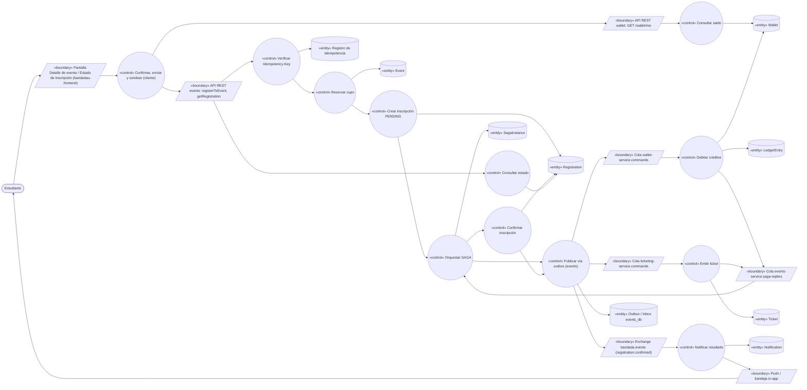

### 2.2 Alterno 13a — saldo insuficiente y extensión *Recargar y continuar*

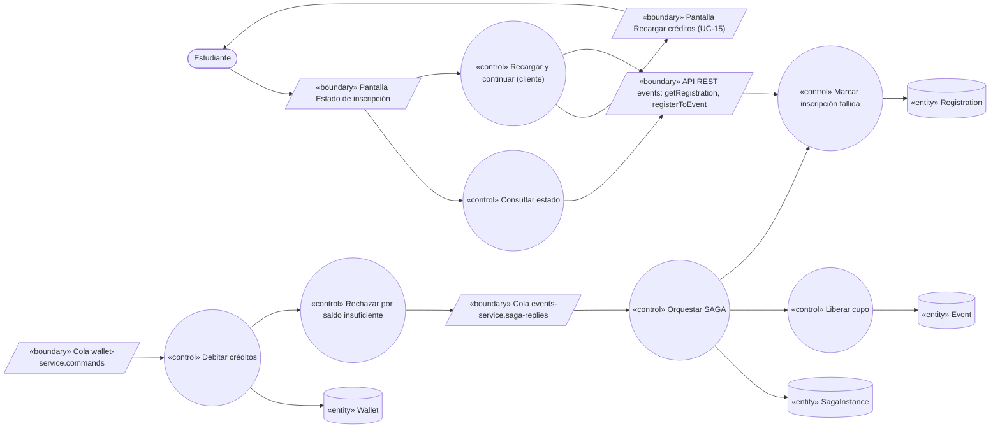

### 2.3 Alterno 16a — fallo en ticketing con compensación

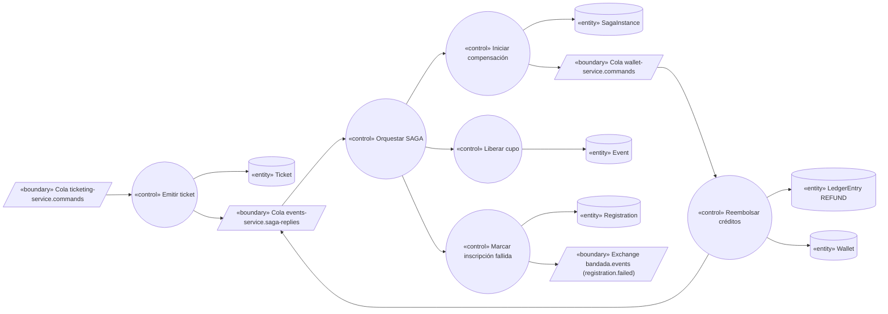

### 2.4 Alterno T1/T2 — timeout

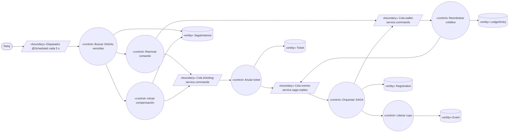

### 2.5 Objeto → tipo → componente real

| Objeto | Tipo | Componente real |
|---|---|---|
| Pantalla Detalle de evento / Estado de inscripción | Boundary | `bandadau-frontend`: `EventDetailScreen`, `RegistrationStatusScreen` |
| Pantalla Recargar créditos | Boundary | `bandadau-frontend`: `TopUpScreen` (UC-15) con parámetro `returnTo` |
| API REST events | Boundary | `RegistrationController` (`events-service`, `interfaces.rest`) |
| API REST wallet | Boundary | `WalletController` (`wallet-service`, adaptador de entrada HTTP) |
| Cola `wallet-service.commands` | Boundary | RabbitMQ, binding `bandada.wallet.cmd.#` en `bandada.commands` |
| Cola `ticketing-service.commands` | Boundary | RabbitMQ, binding `bandada.ticketing.cmd.#` |
| Cola `events-service.saga-replies` | Boundary | RabbitMQ, bindings de las 6 respuestas de D2 |
| Exchange `bandada.events` | Boundary | RabbitMQ (topic) → `notification-service.events`, `n8n.automation`, `insights-service.analytics` |
| Disparador `@Scheduled` | Boundary | `SagaTimeoutScheduler` (Spring `@Scheduled(fixedDelay = 5000)`) |
| Confirmar, enviar y sondear / Recargar y continuar | Control | `bandadau-frontend`: `useRegisterToEvent`, `useRegistrationPolling`, `TopUpAndContinueFlow` |
| Consultar saldo | Control | `wallet-service`: `GetMyWalletService` |
| Verificar Idempotency-Key | Control | `IdempotencyFilter` (`events-service`, DynamoDB `bandada-idempotency`) |
| Reservar cupo / Liberar cupo | Control | `Event.reserveSeat()` / `Event.releaseSeat()` invocados por `RegistrationApplicationService` / orquestador |
| Crear inscripción PENDING / Marcar fallida / Confirmar | Control | `Registration.request()`, `Registration.fail(reason)`, `Registration.confirm(ticketId)` |
| Orquestar SAGA / Iniciar compensación | Control | `RegistrationSagaOrchestrator` + `SagaInstance` (máquina de estados) |
| Publicar vía outbox (events) | Control | `SagaCommandOutboxWriter` + `OutboxRelay` |
| Buscar SAGAs vencidas / Reenviar comando | Control | `SagaTimeoutScheduler` → `RegistrationSagaOrchestrator.onDeadline()` |
| Consultar estado | Control | `RegistrationQueryService.getRegistration()` |
| Debitar / Rechazar / Reembolsar créditos | Control | `wallet-service`: `DebitCreditsService`, `RefundCreditsService` |
| Emitir / Anular ticket | Control | `ticketing-service`: `IssueTicketUseCase`, `VoidTicketUseCase` |
| Notificar resultado | Control | `notification-service`: `HandleRegistrationEventUseCase` |
| Event / Registration / SagaInstance | Entity | tablas `events`, `registrations`, `saga_instances` (`events_db`) |
| Outbox / Inbox events_db | Entity | tablas `outbox`, `processed_messages` (`events_db`) |
| Wallet / LedgerEntry | Entity | tablas `wallets`, `ledger_entries` (`wallet_db`) |
| Ticket | Entity | `bandada-ticketing` (`TICKET#<ticketId>` / `META`) |
| Registro de idempotencia | Entity | `bandada-idempotency` |
| Notification | Entity | `bandada-notifications` |

---

## 3. Diagramas de secuencia

### 3.1 Curso básico — Fase A: admisión síncrona (202)

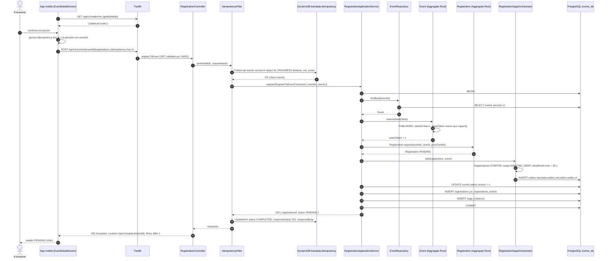

### 3.2 Curso básico — Fases B, C y D: débito, ticket, confirmación y polling

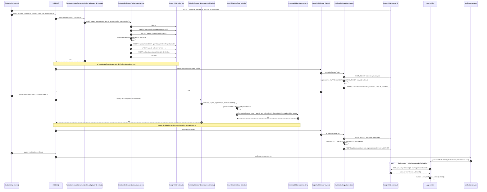

> Simplificación gráfica: el polling atraviesa `Traefik → RegistrationController → RegistrationQueryService → RegistrationRepository`; se dibuja directo a `events_db` para no repetir participantes.

### 3.3 Alterno 13a — saldo insuficiente + extensión *Recargar y continuar* (UC-15)

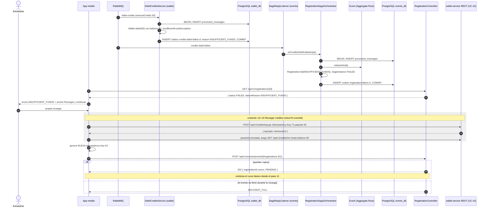

### 3.4 Alterno 16a — fallo en ticketing con compensación (refund + liberar cupo)

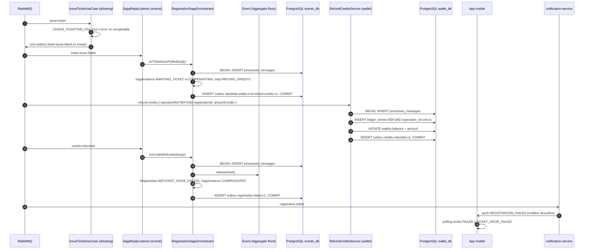

### 3.5 Alterno T2 — timeout esperando el ticket

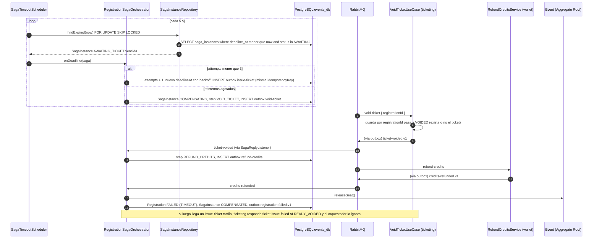

### 3.6 Idempotencia ante duplicados (doble clic y *redelivery*)

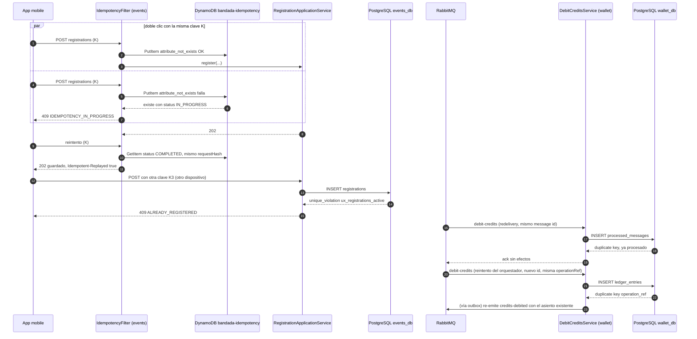

### 3.7 Diagramas de estados

#### `SagaInstance` (`type = REGISTRATION`)

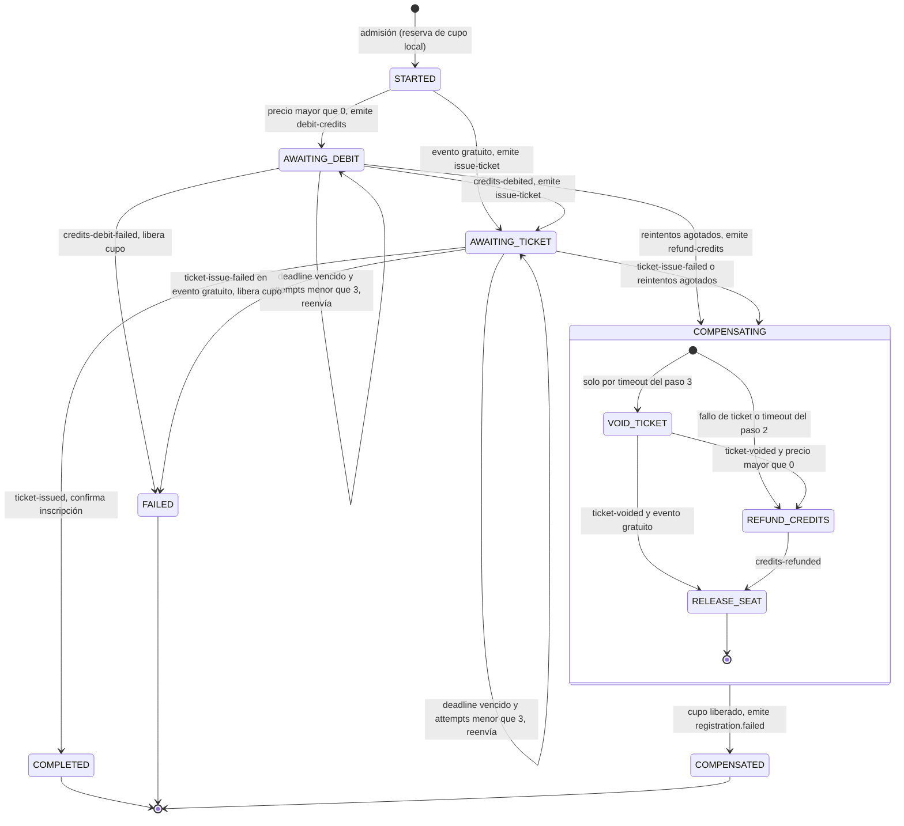

> `STARTED` es transitorio dentro de la transacción de admisión (se persiste ya avanzado a `AWAITING_*`
> junto con el comando en el outbox). Los sub-estados de `COMPENSATING` corresponden al campo `step`.

#### `Registration`

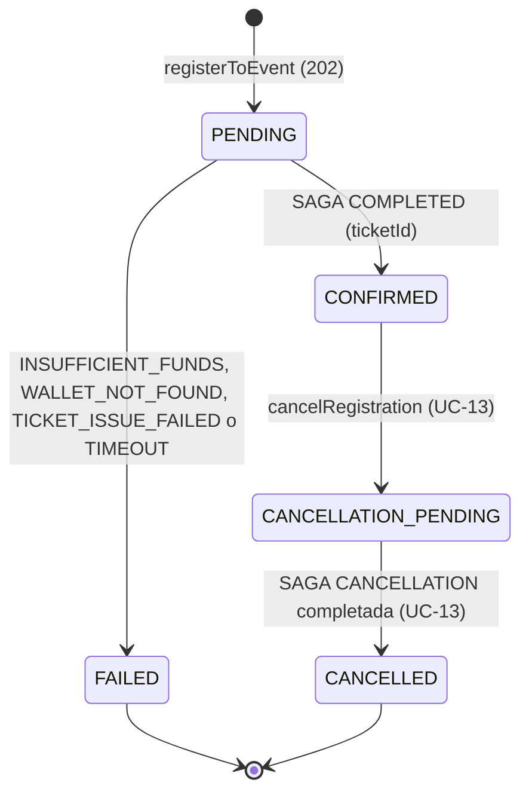

> Una `Registration` `FAILED` o `CANCELLED` queda fuera del índice parcial único, por lo que el
> Estudiante puede volver a inscribirse (nueva `Registration`, nueva SAGA, nueva `Idempotency-Key`).

---

## 4. Clases / contratos involucrados

### 4.1 events-service — DDD táctico (`com.bandadau.events`)

| Capa | Clases |
|---|---|
| `domain.event` | Agregado `Event`: `reserveSeat(Clock)`, `releaseSeat()`; `EventFullException`, `EventNotOpenException` |
| `domain.registration` | Agregado `Registration` (`id`, `eventId`, `userId`, `priceCredits`, `status`, `failureReason`, `ticketId`): `request(...)`, `confirm(TicketId)`, `fail(RegistrationFailureReason)`; enum `RegistrationStatus`; domain events `RegistrationConfirmed`, `RegistrationFailed`; `RegistrationRepository` |
| `domain.saga` | Agregado `SagaInstance` (`id`, `registrationId`, `type`, `step`, `status`, `deadlineAt`, `attempts`, `version`) con transiciones explícitas que lanzan `IllegalSagaTransitionException`; enums `SagaStatus`, `SagaType` (`REGISTRATION`, `CANCELLATION`), `SagaStep`; `SagaInstanceRepository` (`findExpired`) |
| `application` | `RegistrationApplicationService` (`register`), `RegistrationSagaOrchestrator` (process manager: `start`, `onCreditsDebited`, `onCreditsDebitFailed`, `onTicketIssued`, `onTicketIssueFailed`, `onTicketVoided`, `onCreditsRefunded`, `onDeadline`), `RegistrationQueryService` (`getRegistration`, `listMyRegistrations`); comandos de salida `DebitCreditsCommand`, `IssueTicketCommand`, `RefundCreditsCommand`, `VoidTicketCommand` |
| `infrastructure` | `JpaEventRepository`, `JpaRegistrationRepository`, `JpaSagaInstanceRepository`, `SagaCommandOutboxWriter`, `OutboxRelay`, `SagaReplyListener` (`@RabbitListener(queues = "events-service.saga-replies")`), `JdbcInboxRepository` (`processed_messages`), `SagaTimeoutScheduler`, `IdempotencyFilter`, `ChaosProperties` |
| `interfaces.rest` | `RegistrationController`, `RegisterResponse`, `RegistrationResponse` |

Excepción DDD documentada: la admisión modifica dos agregados (`Event` y `Registration`) y crea la
`SagaInstance` en **una** transacción, porque el invariante del cupo y el índice único deben
cumplirse atómicamente y los tres viven en el mismo contexto y la misma base (D2, paso 1).

DDL relevante (`events_db`, migración Flyway):

```sql
CREATE UNIQUE INDEX ux_registrations_active
    ON registrations (event_id, user_id)
    WHERE status IN ('PENDING', 'CONFIRMED');

CREATE INDEX ix_saga_instances_deadline
    ON saga_instances (deadline_at)
    WHERE status IN ('AWAITING_DEBIT', 'AWAITING_TICKET', 'COMPENSATING');

CREATE TABLE processed_messages (
    message_id   UUID PRIMARY KEY,
    processed_at TIMESTAMPTZ NOT NULL DEFAULT now()
);
```

### 4.2 wallet-service — Hexagonal (`Bandada\Wallet\`)

| Capa | Clases |
|---|---|
| `Domain` | `Wallet` (`debit(Credits)`, `refund(Credits)`, invariante `balance ≥ 0`), `LedgerEntry`, `LedgerEntryType`, `OperationRef` (VO: `DEBIT:<registrationId>`, `REFUND:<registrationId>`), `InsufficientFundsException` |
| `Application\Port\In` | `DebitCreditsUseCase`, `RefundCreditsUseCase`, `GetMyWalletUseCase` |
| `Application\Service` | `DebitCreditsService`, `RefundCreditsService`, `GetMyWalletService` |
| `Application\Port\Out` | `WalletRepository`, `LedgerRepository`, `InboxRepository`, `OutboxRepository`, `TransactionManager` |
| `Infrastructure\Adapter\In` | `RabbitCommandConsumer` (comando artisan `wallet:consume-commands`), `WalletController` |
| `Infrastructure\Adapter\Out` | `EloquentWalletRepository`, `EloquentLedgerRepository`, `DbInboxRepository`, `DbOutboxRepository`, `OutboxRelayCommand` |

Restricción: `ledger_entries.operation_ref` **UNIQUE**; `wallets.version` para concurrencia. Deptrac: `Domain` no depende de `Illuminate\*`.

### 4.3 ticketing-service — Clean Architecture

| Capa | Clases |
|---|---|
| Domain | `Ticket` (`ISSUED → USED / VOIDED`; un ticket `USED`/`VOIDED` no cambia), `TicketStatus`, `QrPayload` |
| Application | `IssueTicketUseCase`, `VoidTicketUseCase`; puertos `TicketRepository`, `QrPayloadSigner`, `OutboxRepository`, `Clock`, `IdGenerator` |
| Interface adapters | `TicketingCommandsConsumer` (cola `ticketing-service.commands`), `TicketsController` |
| Frameworks & drivers | `DynamoTicketRepository` (`TransactWriteItems` con `ConditionExpression`), `HmacQrPayloadSigner`, `DynamoOutboxRelay` (`@bandada/messaging-ts`), `ChaosConfig` (`CHAOS_TICKETING_FAIL`) |

### 4.4 Contratos

| Tipo | Identificador | Payload (`data`) / notas |
|---|---|---|
| OpenAPI events | `registerToEvent` `POST /events/{eventId}/registrations` ♻️ | → `202 { registrationId, status }`, `Location`; errores `409 EVENT_FULL`, `409 ALREADY_REGISTERED`, `409 EVENT_NOT_OPEN`, `409 IDEMPOTENCY_IN_PROGRESS`, `422 IDEMPOTENCY_KEY_REUSED` |
| OpenAPI events | `getRegistration` `GET /registrations/{registrationId}` | `{ registrationId, eventId, status, failureReason?, ticketId?, createdAt, updatedAt }`; 404 si no es del usuario |
| OpenAPI events | `listMyRegistrations` `GET /registrations/me` | `{ items, nextCursor }` |
| OpenAPI events (interno) | `listSagas` `GET /internal/v1/sagas?status=FAILED\|COMPENSATED&since` | consumido por `list_failed_sagas` (MCP) y GraphQL `sagas(status)` |
| OpenAPI wallet | `getMyWallet` `GET /wallet/me` | «include» UC-16 |
| OpenAPI wallet | `createTopUp` `POST /wallet/topups` ♻️ | «extend» UC-15 |
| OpenAPI ticketing | `getTicket` `GET /tickets/{ticketId}` | incluye `qrPayload` firmado |
| Comando | `bandada.wallet.cmd.debit-credits.v1` | `{ sagaId, registrationId, userId, amountCredits, operationRef, idempotencyKey }` |
| Comando | `bandada.ticketing.cmd.issue-ticket.v1` | `{ sagaId, registrationId, eventId, userId, idempotencyKey }` |
| Comando (compensación) | `bandada.wallet.cmd.refund-credits.v1` | `{ sagaId, registrationId, userId, amountCredits, operationRef, idempotencyKey }` |
| Comando (compensación) | `bandada.ticketing.cmd.void-ticket.v1` | `{ sagaId, registrationId, idempotencyKey }` |
| Respuesta | `bandada.wallet.credits-debited.v1` | `{ sagaId, registrationId, ledgerEntryId, amountCredits, balanceCredits }` |
| Respuesta | `bandada.wallet.credits-debit-failed.v1` | `{ sagaId, registrationId, reason: INSUFFICIENT_FUNDS\|WALLET_NOT_FOUND, balanceCredits?, requiredCredits? }` |
| Respuesta | `bandada.wallet.credits-refunded.v1` | `{ sagaId, registrationId, ledgerEntryId, amountCredits }` |
| Respuesta | `bandada.ticketing.ticket-issued.v1` | `{ sagaId, registrationId, ticketId }` |
| Respuesta | `bandada.ticketing.ticket-issue-failed.v1` | `{ sagaId, registrationId, reason }` |
| Respuesta | `bandada.ticketing.ticket-voided.v1` | `{ sagaId, registrationId, ticketId? }` |
| Evento | `bandada.events.registration.confirmed.v1` | `{ registrationId, eventId, userId, ticketId, priceCredits }` → notification, n8n, insights |
| Evento | `bandada.events.registration.failed.v1` | `{ registrationId, eventId, userId, reason }` → notification, insights |
| Notificación | `REGISTRATION_CONFIRMED`, `REGISTRATION_FAILED` | plantillas por `locale` (D14) |

Sobre de todos los mensajes: CloudEvents 1.0 con `id` UUIDv7 (único por envío), `source = /services/<servicio>`,
`subject = registrationId`, extensiones `sagaid`, `correlationid` (el `X-Correlation-Id` de la petición HTTP
original), `causationid` (`id` del mensaje que lo causó) y `traceparent` (traza de punta a punta en Grafana, RNF-13).

### 4.5 Resumen de mecanismos de idempotencia en este UC (D3)

| # | Mecanismo | Dónde | Protege contra |
|---|---|---|---|
| 1 | `Idempotency-Key` HTTP | `IdempotencyFilter` + `bandada-idempotency` (`events-service#<key>`) | doble clic, reintentos de red, cola offline |
| 2 | Inbox `processed_messages` | `events_db`, `wallet_db` (misma transacción); ítem de inbox con `attribute_not_exists` en `bandada-ticketing` | *redelivery* del broker (at-least-once) |
| 3 | Restricciones únicas de negocio | `ux_registrations_active`; `ledger_entries.operation_ref`; guarda por `registrationId` en tickets | inscripciones duplicadas con claves distintas; débito/reembolso/ticket doble ante reintentos del orquestador |
| 4 | `idempotencyKey = <sagaId>:<step>` en cada comando | todos los comandos | trazabilidad del reintento; clave lógica que se mapea a `operationRef` |
| 5 | Máquina de estados de `SagaInstance` | orquestador | respuestas tardías o fuera de orden (se ignoran en estados terminales) |

### 4.6 PROPUESTAS a documentos normativos

> **PROPUESTA: agregar a decisiones-clave.md D2/D12**
> - Motivo `ALREADY_COMPENSATED` en `bandada.wallet.credits-debit-failed.v1` (débito tardío tras reembolso) y semántica de "reembolso sin débito previo" = asiento `REFUND` de `amountCredits = 0` que actúa como lápida.
> - Motivo `ALREADY_VOIDED` en `bandada.ticketing.ticket-issue-failed.v1` (emisión tardía tras anulación) y semántica de `void-ticket` sin ticket previo (marca la guarda como `VOIDED` y responde `ticket-voided` sin `ticketId`).
> - Precisar la política de reintentos: 3 re-envíos con *backoff* 5/10/20 s **dentro** de la ventana de 30 s del paso (para cumplir RNF-04 < 2 min); compensaciones con reintento indefinido y alerta a los 2 min.
>
> **PROPUESTA (modelo de dominio / glosario):**
> - Enum `RegistrationFailureReason` = `INSUFFICIENT_FUNDS`, `WALLET_NOT_FOUND`, `TICKET_ISSUE_FAILED`, `TIMEOUT`.
> - Enum `SagaStep` = `RESERVE_SEAT`, `DEBIT_CREDITS`, `ISSUE_TICKET`, `VOID_TICKET`, `REFUND_CREDITS`, `RELEASE_SEAT`, `DONE`; enum `SagaType` = `REGISTRATION`, `CANCELLATION`.
> - Atributos `Registration.priceCredits` (precio congelado) y `Registration.ticketId`; `SagaInstance.attempts` y `version`.
>
> **PROPUESTA (catálogo §6, requiere ADR):** patrones de ítems técnicos en `bandada-ticketing`: inbox `pk = INBOX#<messageId>`, guarda `pk = REG#<registrationId>` / `sk = GUARD`, outbox `pk = OUTBOX#<messageId>`.
>
> **PROPUESTA (D3):** evaluar incluir `CANCELLATION_PENDING` en el predicado de `ux_registrations_active` para que no se pueda re-inscribir mientras una cancelación (UC-13) está en curso.
>
> **PROPUESTA (D1):** códigos de error `EVENT_NOT_OPEN` y `EVENT_BUSY`; `listSagas` con filtro `status=COMPENSATING&olderThan` para detectar compensaciones atascadas (UC-20).

---

## 5. Pruebas de aceptación

| ID | Escenario |
|---|---|
| AT-12.1 | **Given** un evento `PUBLISHED` con `capacity = 10`, `priceCredits = 50` y un Estudiante con saldo 80 **When** se inscribe **Then** recibe `202 PENDING`; en < 3 s (p95) `getRegistration` devuelve `CONFIRMED` con `ticketId`, el saldo es 30, existe 1 `LedgerEntry DEBIT` con `operationRef = DEBIT:<registrationId>`, 1 `Ticket ISSUED`, `seatsTaken = 1`, `SagaInstance COMPLETED` y un `registration.confirmed.v1`. |
| AT-12.2 | **Given** el escenario anterior **When** el Estudiante envía 5 veces la misma petición con la misma `Idempotency-Key` **Then** todas devuelven el mismo `registrationId` (`Idempotent-Replayed: true` a partir de la 2.ª) y hay 1 inscripción, 1 débito y 1 ticket. |
| AT-12.3 | **Given** una inscripción `CONFIRMED` **When** se envía otra con una clave distinta **Then** `409 ALREADY_REGISTERED`. |
| AT-12.4 | **Given** 2 peticiones concurrentes con claves distintas del mismo Estudiante **Then** exactamente una obtiene `202` y la otra `409 ALREADY_REGISTERED`; `seatsTaken` aumenta en 1. |
| AT-12.5 | **Given** `capacity = 1` y 20 estudiantes distintos concurrentes **Then** exactamente 1 `202` y 19 `409 EVENT_FULL`; `seatsTaken = 1`. |
| AT-12.6 | **Given** saldo 30 y precio 50 **When** se inscribe **Then** termina `FAILED / INSUFFICIENT_FUNDS`, saldo 30, sin `LedgerEntry`, `seatsTaken` vuelve al valor inicial, `SagaInstance FAILED`, sin ticket. |
| AT-12.7 | **Given** AT-12.6 **When** recarga 50 (UC-15) y reintenta con nueva clave **Then** `202` y luego `CONFIRMED`; saldo final 30. |
| AT-12.8 | **Given** `CHAOS_TICKETING_FAIL=true` y saldo 80 **When** se inscribe **Then** termina `FAILED / TICKET_ISSUE_FAILED`, existen `DEBIT 50` y `REFUND 50`, saldo final 80, `seatsTaken` inicial, `SagaInstance COMPENSATED`, ningún ticket `ISSUED`, y llega push `REGISTRATION_FAILED`. |
| AT-12.9 | **Given** `ticketing-service` detenido **When** se inscribe **Then** tras 3 reenvíos y el vencimiento del paso, se ejecutan `void-ticket` y `refund-credits` al volver el servicio; estado final `FAILED / TIMEOUT`, saldo inicial, cupo liberado y ninguna inscripción `PENDING` con más de 2 min. |
| AT-12.10 | **Given** `CHAOS_WALLET_DELAY_MS=40000` **When** se inscribe **Then** la SAGA compensa por timeout; el débito tardío es rechazado con `ALREADY_COMPENSATED` (o, si llegó antes del reembolso, queda neutralizado por el `REFUND`); saldo final = inicial. |
| AT-12.11 | **Given** un comando `debit-credits` reentregado por RabbitMQ con el mismo `id` **Then** `wallet-service` lo descarta (inbox) y no crea un segundo `LedgerEntry`. |
| AT-12.12 | **Given** un comando `issue-ticket` reintentado (nuevo `id`, mismo `registrationId`) **Then** no se crea un segundo ticket y se re-emite `ticket-issued.v1` con el `ticketId` existente. |
| AT-12.13 | **Given** un evento gratuito **When** se inscribe **Then** no se envía `debit-credits` y la inscripción queda `CONFIRMED`. |
| AT-12.14 | **Given** `notification-service` detenido **When** se inscribe **Then** la inscripción queda `CONFIRMED` (RNF-03) y la notificación llega al levantarlo, una sola vez. |
| AT-12.15 | **Given** una inscripción confirmada **Then** en Grafana existe una traza única con spans de `events-service`, `wallet-service` y `ticketing-service` enlazados por `traceparent` (RNF-13). |
| AT-12.16 | (Dominio) `SagaInstance` rechaza transiciones ilegales (p. ej., `COMPLETED → COMPENSATING`) y `Event.reserveSeat()` lanza `EventFullException` con `seatsTaken = capacity`. |

Ubicación:
`bandadau-backend/services/events-service/src/test/java/com/bandadau/events/domain/{EventTest,SagaInstanceTest}.java`,
`.../application/RegistrationSagaIT.java` (Testcontainers Postgres + RabbitMQ, *stubs* de wallet/ticketing);
`bandadau-backend/services/wallet-service/tests/Feature/DebitRefundCommandTest.php` (Pest);
`bandadau-backend/services/ticketing-service/test/e2e/issue-void-ticket.e2e-spec.ts`;
prueba de sistema `bandadau-infra/e2e/uc-12-saga.spec.ts` (todo el stack con `make up`, flags de caos).

---

## 6. Trazabilidad

| RF/RNF/Cátedra | Paso UC | Endpoint / mensaje | Clases | Pruebas |
|---|---|---|---|---|
| RF-15 (reservar cupo) | 5–9, 6a, 6c | `registerToEvent` | `Event.reserveSeat()`, `RegistrationApplicationService` | AT-12.1, 12.5, 12.16 |
| RF-15 (debitar créditos) | 12–14, 13a, 13b | `debit-credits.v1`, `credits-debited.v1`, `credits-debit-failed.v1` | `DebitCreditsService`, `Wallet.debit()` | AT-12.1, 12.6 |
| RF-15 (emitir ticket) | 15–17, 16a | `issue-ticket.v1`, `ticket-issued.v1`, `ticket-issue-failed.v1` | `IssueTicketUseCase`, `DynamoTicketRepository` | AT-12.1, 12.8 |
| RF-15 (todo o nada, SAGA) | 16a, T1–T4 | `refund-credits.v1`, `void-ticket.v1`, `registration.failed.v1` | `RegistrationSagaOrchestrator`, `SagaInstance`, `SagaTimeoutScheduler` | AT-12.8, 12.9, 12.10 |
| RF-16 (una inscripción activa) | 3a–3c, 7a | `ux_registrations_active`, `Idempotency-Key` | `IdempotencyFilter`, `JpaRegistrationRepository` | AT-12.2, 12.3, 12.4 |
| C1 (3 servicios + rollback) | Fases A–D, 16a | cola `events-service.saga-replies` | ver §4.1–4.3 | AT-12.8 |
| T8 (idempotencia) | 3a, 13c, 13d, 16c | §4.5 | inbox, `operationRef`, guarda de ticket | AT-12.2, 12.11, 12.12 |
| RNF-02 (< 3 s p95) | 1–19 | métrica `saga_duration_seconds` | `RegistrationSagaOrchestrator` | AT-12.1 |
| RNF-03 (degradación) | 20a | `registration.confirmed.v1` | outbox | AT-12.14 |
| RNF-04 (< 2 min intermedio) | T1–T3, 11a | `deadlineAt` | `SagaTimeoutScheduler` | AT-12.9, 12.10 |
| RNF-13 (trazas) | todos | `traceparent` en HTTP y CloudEvents | interceptores OTel | AT-12.15 |
| Extensión UC-15 | 1a, 13a.3–13a.6 | `createTopUp`, `getMyWallet` | `TopUpAndContinueFlow` | AT-12.7 |
