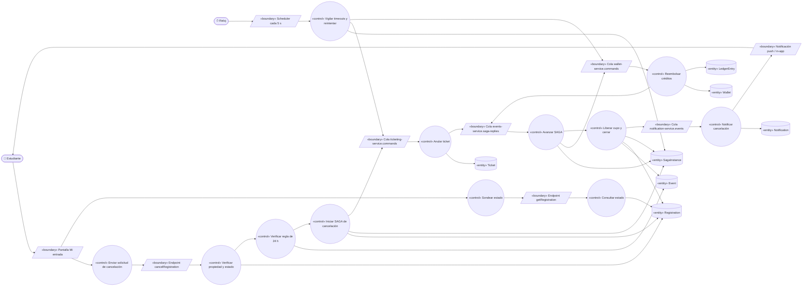
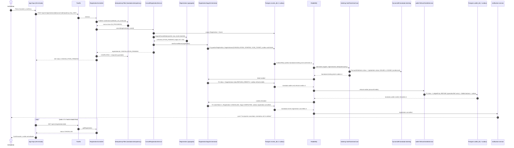
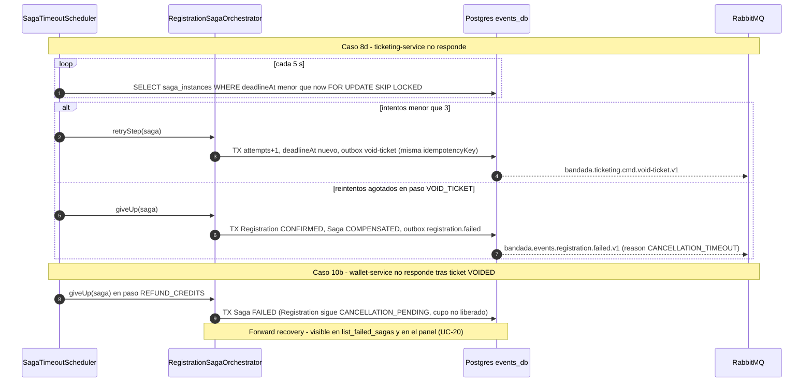

# UC-13 — Cancelar inscripción

| Campo | Valor |
|---|---|
| Paquete | Eventos |
| Actor principal | Estudiante |
| Actores secundarios | `ticketing-service`, `wallet-service`, `notification-service`, Reloj (scheduler de timeouts) |
| Prioridad (MoSCoW) | Must |
| Requisitos | RF-17, RNF-04, RNF-05, RNF-13 |
| Tecnologías de la cátedra que demuestra | **C1** (SAGA inversa con 3 servicios / 3 lenguajes / 2 motores), T8 (idempotencia), T4 |
| Servicios involucrados | `events-service` (orquestador), `ticketing-service`, `wallet-service`, `notification-service`, `bandadau-frontend` |
| Estado ICONIX | Secuencia (pendiente CDR) |

> Relación: reutiliza los comandos de compensación de la SAGA de UC-12
> (`bandada.ticketing.cmd.void-ticket.v1`, `bandada.wallet.cmd.refund-credits.v1`), pero
> los ejecuta como una SAGA **propia** de tipo `CANCELLATION` (D2), no como rollback.

## 1. Narrativa (fase de requisitos)

### Precondiciones

1. El estudiante tiene sesión activa (UC-02) con rol `STUDENT`.
2. Existe una `Registration` del estudiante en estado `CONFIRMED` (UC-12 completado), con su
   `Ticket` en estado `ISSUED` y, si el evento era pagado, un `LedgerEntry` `DEBIT` con
   `operationRef = DEBIT:<registrationId>`.
3. El `Event` está `PUBLISHED`.

### Disparador

El estudiante pulsa **"Cancelar inscripción"** en la pantalla *Mi entrada* de la app.

### Curso básico

1. El estudiante abre *Mi entrada* y pulsa "Cancelar inscripción".
2. La app muestra un diálogo de confirmación con el monto a reembolsar (`priceCredits`) y la
   fecha límite de cancelación (`startsAt − 24 h`, formateada en `America/La_Paz`).
3. El estudiante confirma. La app genera un `Idempotency-Key` (UUID) para esta intención y envía
   `POST /api/v1/registrations/{registrationId}/cancel` (`cancelRegistration`).
4. El sistema verifica que la `Registration` pertenece al estudiante y está `CONFIRMED`.
5. El sistema verifica la **regla de 24 h**: la hora actual del servidor es ≤ `Event.startsAt − 24 h`.
6. El sistema, en **una sola transacción local** (`events_db`): cambia la `Registration` a
   `CANCELLATION_PENDING`, crea una `SagaInstance` de tipo `CANCELLATION` en estado `STARTED`
   con paso `VOID_TICKET` y `deadlineAt = now + 30 s`, y escribe en el *outbox* el comando
   `bandada.ticketing.cmd.void-ticket.v1` (`idempotencyKey = <sagaId>:VOID_TICKET`).
7. El sistema responde **202** `{ registrationId, status: CANCELLATION_PENDING }`. La app muestra
   "Cancelando…" y consulta `GET /registrations/{registrationId}` (`getRegistration`) cada 1–2 s.
8. `ticketing-service` consume el comando, anula el `Ticket` (`ISSUED → VOIDED`) con escritura
   condicional en DynamoDB y publica `bandada.ticketing.ticket-voided.v1`.
9. El orquestador recibe la respuesta, avanza la SAGA al paso `REFUND_CREDITS` y emite
   `bandada.wallet.cmd.refund-credits.v1` (`idempotencyKey = <sagaId>:REFUND_CREDITS`,
   `amountCredits = priceCredits`).
10. `wallet-service` registra un `LedgerEntry` `REFUND` con `operationRef = REFUND:<registrationId>`
    (único), incrementa `Wallet.balanceCredits` y publica `bandada.wallet.credits-refunded.v1`.
11. El orquestador, en una transacción local, **libera el cupo** (`Event.seatsTaken--`), marca la
    `Registration` como `CANCELLED`, la `SagaInstance` como `COMPLETED` y escribe en el outbox
    `bandada.events.registration.cancelled.v1`.
12. `notification-service` consume el evento y envía al estudiante la notificación push/in-app
    "Tu inscripción fue cancelada y se reembolsaron N créditos" (en su `locale`).
13. La app detecta `status = CANCELLED` en el polling, muestra la confirmación y refresca *Mis
    entradas* y el saldo (UC-16).

### Cursos alternos

- **4a. Inscripción ajena o inexistente**: el sistema responde `404` (no revela existencia). Fin.
- **4b. Inscripción no cancelable** (`PENDING`, `FAILED`, `CANCELLED`): responde `409` con `code`
  `REGISTRATION_NOT_CANCELLABLE`; la app muestra el mensaje traducido por `code`. Fin.
- **4c. Ya está `CANCELLATION_PENDING`** (otro dispositivo o reintento con **otra** clave): responde
  `202` con el estado actual, sin crear otra SAGA. La app continúa en el paso 7.
- **3a. Doble clic / reintento de red con la misma `Idempotency-Key`**: la capa de idempotencia
  devuelve la respuesta guardada con `Idempotent-Replayed: true`; si la primera sigue en curso,
  `409 IDEMPOTENCY_IN_PROGRESS` y la app reintenta con backoff. No se crea una segunda SAGA.
- **5a. Fuera de plazo** (`now > startsAt − 24 h`): responde `422` con `code`
  `CANCELLATION_WINDOW_CLOSED`. La app explica la regla de 24 h. Fin.
- **6a. Conflicto de concurrencia** (bloqueo optimista de `Registration`): se reintenta la
  transacción hasta 3 veces; si persiste, `409` y la app ofrece reintentar.
- **8a. Evento gratuito** (`priceCredits = 0`): tras `ticket-voided` el orquestador **salta** el
  paso `REFUND_CREDITS` y va directo al paso 11.
- **8b. Ticket ya `VOIDED`** (comando repetido): `ticketing-service` detecta el mensaje en su inbox
  o la condición fallida con estado `VOIDED` y **vuelve a publicar** `ticket-voided` (respuesta
  idempotente). La SAGA continúa normalmente.
- **8c. Ticket `USED`** (entró al evento; solo posible por desfase de reloj o validación anticipada):
  `ticketing-service` no puede anularlo (invariante 5). PROPUESTA: responde
  `bandada.ticketing.ticket-void-failed.v1` (`reason: TICKET_ALREADY_USED`); el orquestador marca la
  SAGA `COMPENSATED` y devuelve la `Registration` a `CONFIRMED`.
- **8d. `ticketing-service` no responde** (caído, `deadlineAt` vencido): el scheduler
  (`@Scheduled` cada 5 s) reenvía el comando con la **misma** `idempotencyKey` hasta 3 veces con
  backoff (2 s, 4 s, 8 s). Si se agotan, como **nada cambió aún** se hace *backward recovery*:
  `Registration → CONFIRMED`, `SagaInstance → COMPENSATED`, se publica
  `bandada.events.registration.failed.v1` (`reason: CANCELLATION_TIMEOUT`) y la app muestra
  "No pudimos cancelar ahora, intenta en unos minutos".
- **10a. Reembolso ya existente** (`operationRef` duplicado): `wallet-service` no crea otro asiento y
  vuelve a publicar `credits-refunded` con el asiento original (idempotente).
- **10b. `wallet-service` no responde** tras los 3 reintentos: el ticket ya está `VOIDED` y **no
  puede volver** a `ISSUED`, así que no hay compensación hacia atrás: *forward recovery*. La SAGA
  queda `FAILED` con `step = REFUND_CREDITS` (cerrada en < 2 min, RNF-04), la `Registration` sigue
  `CANCELLATION_PENDING` y el cupo **no** se libera todavía. El `MonitoringAgent` la detecta con la
  herramienta MCP `list_failed_sagas` (UC-20) y un administrador la reimpulsa (PROPUESTA:
  `POST /internal/v1/sagas/{sagaId}/retry`, `retrySaga`), lo que reanuda desde `REFUND_CREDITS`.
- **12a. `notification-service` caído**: el evento queda en su cola; la cancelación ya está completa
  (degradación elegante, RNF-03).
- **13a. La app se cierra durante el polling**: al reabrir *Mis entradas*, `listMyRegistrations`
  muestra el estado actual (la SAGA corre en el servidor).

### Postcondiciones

- **Éxito**: `Registration.status = CANCELLED`; `Ticket.status = VOIDED`; un `LedgerEntry REFUND` por
  el monto debitado; `Event.seatsTaken` decrementado en 1; `SagaInstance(type=CANCELLATION).status = COMPLETED`;
  evento `bandada.events.registration.cancelled.v1` publicado una sola vez.
- **Fallo antes de anular**: todo queda como antes (`CONFIRMED`, ticket `ISSUED`).
- **Fallo después de anular**: SAGA `FAILED`, visible en el panel (`sagas(status)`) para reimpulso.

### Reglas de negocio

- **RN-13.1** Solo se cancela una inscripción `CONFIRMED` hasta 24 h antes de `Event.startsAt` (RF-17).
- **RN-13.2** Orden fijo de la SAGA inversa: anular ticket → reembolsar → liberar cupo. El cupo se
  libera **al final** para no revender un asiento cuyo reembolso no terminó.
- **RN-13.3** El reembolso es por el monto realmente debitado (100 %, sin penalidad en esta versión).
- **RN-13.4** Una sola SAGA `CANCELLATION` activa por `Registration`.
- **RN-13.5** Todos los comandos llevan `sagaId`, `registrationId` e `idempotencyKey = <sagaId>:<step>`.
- **RN-13.6** Tras `CANCELLED`, el estudiante puede volver a inscribirse (UC-12): el índice parcial
  único solo considera `PENDING` y `CONFIRMED` (D3).

## 2. Diagrama de robustez (fase de análisis)

> Las respuestas `C4 --> B6` y `C6 --> B6` representan la publicación de la respuesta de la SAGA
> en la cola del orquestador (control → boundary).

| Objeto | Tipo | Componente real |
|---|---|---|
| Pantalla Mi entrada | Boundary | `bandadau-frontend/app/(tabs)/tickets/[registrationId].tsx` |
| Enviar solicitud de cancelación, Sondear estado | Control | Hooks `useCancelRegistration` / `useRegistrationStatus` (TanStack Query) en `bandadau-frontend` |
| Scheduler cada 5 s | Boundary | Disparador `@Scheduled` de Spring en `events-service` |
| Endpoint cancelRegistration / getRegistration | Boundary | `events-service` → `RegistrationController` (Spring MVC) |
| Colas `*.commands` / `saga-replies` / `notification-service.events` | Boundary | RabbitMQ (exchanges `bandada.commands`, `bandada.events`) |
| Notificación push / in-app | Boundary | `notification-service` → Expo Push + `bandada-notifications` |
| Verificar propiedad y estado, Verificar regla de 24 h | Control | `Registration.requestCancellation(...)` + `CancellationPolicy` (dominio) |
| Iniciar SAGA de cancelación | Control | `CancelRegistrationService` (aplicación) + `RegistrationSagaOrchestrator.startCancellation` |
| Anular ticket | Control | `ticketing-service` → `VoidTicketUseCase` |
| Avanzar SAGA / Liberar cupo y cerrar | Control | `RegistrationSagaOrchestrator.onReply(...)` |
| Reembolsar créditos | Control | `wallet-service` → `RefundCreditsService` (puerto de entrada) |
| Vigilar timeouts y reintentar | Control | `SagaTimeoutScheduler` (`@Scheduled` cada 5 s) |
| Notificar cancelación | Control | `notification-service` → `SendNotificationUseCase` |
| Consultar estado | Control | `GetRegistrationQuery` |
| Registration, Event, SagaInstance | Entity | `events_db`: `registrations`, `events`, `saga_instances` |
| Ticket | Entity | DynamoDB `bandada-ticketing` (`TICKET#<ticketId>` / `META`, GSI2 `REG#<registrationId>`) |
| Wallet, LedgerEntry | Entity | `wallet_db`: `wallets`, `ledger_entries` |
| Notification | Entity | DynamoDB `bandada-notifications` |

## 3. Diagrama de secuencia (fase de diseño)

### 3.1 Curso básico (evento pagado)

### 3.2 Cursos alternos: timeout de ticketing (8d) y fallo de wallet (10b)

## 4. Clases / contratos involucrados

### events-service (Java 25 + Spring Boot 4, DDD táctico, `com.bandadau.events`)

| Capa | Clase | Responsabilidad |
|---|---|---|
| `domain.registration` | `Registration` (raíz de agregado) | `requestCancellation(userId, now, startsAt)` → valida dueño, estado y RN-13.1; `markCancelled()`; `revertToConfirmed()` |
| `domain.registration` | `CancellationPolicy` (value object / servicio de dominio) | `isWithinWindow(now, startsAt)` con `Duration.ofHours(24)` |
| `domain.event` | `Event` (raíz de agregado) | `releaseSeat()` (`seatsTaken--`, bloqueo optimista `@Version`) |
| `domain.saga` | `SagaInstance` | `type = CANCELLATION`, `step`, `status`, `attempts`, `deadlineAt` |
| `application` | `CancelRegistrationService` | Caso de uso transaccional del paso 4–6 |
| `application` | `RegistrationSagaOrchestrator` | `startCancellation`, `onReply(TicketVoided \| CreditsRefunded)`, `retryStep`, `giveUp` |
| `infrastructure.web` | `RegistrationController` | `cancelRegistration`, `getRegistration` |
| `infrastructure.messaging` | `SagaReplyListener`, `OutboxRelay`, `ProcessedMessageRepository` | Consumo idempotente (inbox) y publicación (outbox) |
| `infrastructure.scheduling` | `SagaTimeoutScheduler` | Timeouts y reintentos |

### ticketing-service (NestJS 11, Clean)

`VoidTicketCommandHandler` (adaptador RabbitMQ) → `VoidTicketUseCase` → `TicketRepository`
(puerto) → `DynamoTicketRepository` (busca por GSI2 `REG#<registrationId>`, `UpdateItem` con
`ConditionExpression: status = ISSUED`).

### wallet-service (PHP 8.4 + Laravel 12, Hexagonal, `Bandada\Wallet\`)

`Infrastructure\Messaging\RefundCreditsConsumer` → `Application\RefundCreditsService` (puerto de
entrada `RefundCredits`) → `Domain\Wallet::credit(amount, LedgerEntryType::REFUND, operationRef)` →
`Application\Port\WalletRepository` → `Infrastructure\Persistence\EloquentWalletRepository`.

### Contratos

| Tipo | Identificador | Contrato |
|---|---|---|
| REST | `cancelRegistration` — `POST /api/v1/registrations/{registrationId}/cancel` ♻️ → 202 | `bandadau-docs/contracts/openapi/events-service.yaml` |
| REST | `getRegistration`, `listMyRegistrations` | `bandadau-docs/contracts/openapi/events-service.yaml` |
| Comando | `bandada.ticketing.cmd.void-ticket.v1` | `bandadau-docs/contracts/asyncapi/bandada-events.yaml` |
| Respuesta | `bandada.ticketing.ticket-voided.v1` | ídem |
| Comando | `bandada.wallet.cmd.refund-credits.v1` | ídem |
| Respuesta | `bandada.wallet.credits-refunded.v1` | ídem |
| Evento | `bandada.events.registration.cancelled.v1`, `bandada.events.registration.failed.v1` | ídem |
| REST interno | `listSagas` (`GET /internal/v1/sagas?status=FAILED\|COMPENSATED`) | `bandadau-docs/contracts/openapi/events-service.yaml` |
| GraphQL | `sagas(status)` | `bandadau-docs/contracts/graphql/admin.graphql` |

Cuerpo del comando `void-ticket` (`data`): `{ sagaId, registrationId, idempotencyKey, reason: "CANCELLED_BY_USER" }`.
Cuerpo de `refund-credits`: `{ sagaId, registrationId, userId, amountCredits, idempotencyKey }`.
Problem Details: `REGISTRATION_NOT_CANCELLABLE` (409), `CANCELLATION_WINDOW_CLOSED` (422),
`IDEMPOTENCY_IN_PROGRESS` (409), `IDEMPOTENCY_KEY_REUSED` (422).

## 5. Pruebas de aceptación

| ID | Escenario (Given / When / Then) |
|---|---|
| AT-13-01 | **Given** una inscripción `CONFIRMED` a un evento de 30 créditos que empieza en 3 días **When** el estudiante la cancela **Then** recibe 202 `CANCELLATION_PENDING`, y en < 3 s la inscripción es `CANCELLED`, el ticket `VOIDED`, existe un `LedgerEntry REFUND` de 30 con `operationRef = REFUND:<registrationId>`, `seatsTaken` bajó en 1 y se publicó una vez `registration.cancelled.v1`. |
| AT-13-02 | **Given** un evento que empieza en 23 h **When** el estudiante intenta cancelar **Then** recibe 422 `CANCELLATION_WINDOW_CLOSED` y nada cambia. |
| AT-13-03 | **Given** una inscripción `PENDING` **When** se pide cancelar **Then** 409 `REGISTRATION_NOT_CANCELLABLE`. |
| AT-13-04 | **Given** una inscripción de otro usuario **When** se pide cancelar **Then** 404. |
| AT-13-05 | **Given** una petición de cancelación completada **When** se reenvía con la misma `Idempotency-Key` **Then** se devuelve la misma respuesta con `Idempotent-Replayed: true` y existe una sola `SagaInstance` `CANCELLATION`. |
| AT-13-06 | **Given** un evento gratuito **When** se cancela **Then** no se emite `refund-credits` y la inscripción termina `CANCELLED`. |
| AT-13-07 | **Given** el comando `void-ticket` entregado dos veces **When** ticketing lo procesa **Then** el ticket queda `VOIDED` una sola vez y ambas veces se responde `ticket-voided`. |
| AT-13-08 | **Given** el comando `refund-credits` entregado dos veces **When** wallet lo procesa **Then** existe un solo `LedgerEntry REFUND` y el saldo sube una sola vez. |
| AT-13-09 | **Given** `ticketing-service` detenido **When** se cancela **Then** tras 3 reintentos la SAGA queda `COMPENSATED`, la inscripción vuelve a `CONFIRMED` y el ticket sigue `ISSUED` (< 2 min). |
| AT-13-10 | **Given** `wallet-service` detenido después de anular el ticket **When** vencen los reintentos **Then** la SAGA queda `FAILED` en `REFUND_CREDITS`, aparece en `listSagas?status=FAILED` y el cupo no se liberó; **When** wallet vuelve y se reimpulsa **Then** termina `CANCELLED`. |
| AT-13-11 | **Given** una inscripción `CANCELLED` **When** el estudiante se inscribe otra vez (UC-12) **Then** se acepta (el índice único no la cuenta). |
| AT-13-12 | **Given** cualquier cancelación **When** se revisa Grafana **Then** la traza muestra `events → ticketing → wallet → events` bajo el mismo `traceparent` (RNF-13). |

## 6. Trazabilidad

| Requisito | UC | Endpoints / mensajes | Clases | Pruebas |
|---|---|---|---|---|
| RF-17 | UC-13 | `cancelRegistration`, `getRegistration`, `void-ticket`/`ticket-voided`, `refund-credits`/`credits-refunded`, `registration.cancelled.v1` | `Registration`, `CancellationPolicy`, `CancelRegistrationService`, `RegistrationSagaOrchestrator`, `VoidTicketUseCase`, `RefundCreditsService` | AT-13-01…04, 06, 11 |
| RNF-04 | UC-13 | timeouts `deadlineAt`, `registration.failed.v1` | `SagaTimeoutScheduler` | AT-13-09, 10 |
| RNF-05 / T8 | UC-13 | `Idempotency-Key`, inbox, `operationRef` único | `IdempotencyFilter`, `ProcessedMessageRepository` | AT-13-05, 07, 08 |
| RNF-13 | UC-13 | `traceparent` en CloudEvents | `OutboxRelay` | AT-13-12 |
| C1 | UC-12, UC-13 | SAGA de 3 servicios | ídem | AT-13-01, 09, 10 |

### PROPUESTAS (pendientes de aprobar; agregar a `decisiones-clave.md` / dominio)

1. Respuesta de fallo `bandada.ticketing.ticket-void-failed.v1` (`reason: TICKET_ALREADY_USED`) y su binding en `events-service.saga-replies`.
2. Enum `SagaStep` con valores `DEBIT_CREDITS`, `ISSUE_TICKET`, `VOID_TICKET`, `REFUND_CREDITS`, `RELEASE_SEAT`.
3. Cardinalidad `Registration "1" --> "1..2" SagaInstance` (una `REGISTRATION` y como máximo una `CANCELLATION`) en `02-modelo-dominio.md`.
4. Endpoint interno `POST /internal/v1/sagas/{sagaId}/retry` (`retrySaga`) para reimpulsar SAGAs `FAILED`.
5. Códigos de error `REGISTRATION_NOT_CANCELLABLE`, `CANCELLATION_WINDOW_CLOSED`, `CANCELLATION_TIMEOUT`.
6. `NotificationType.REGISTRATION_CANCELLED`.
7. Copia `Registration.priceCredits` (precio pagado) para no depender de cambios posteriores en `Event.priceCredits`.
