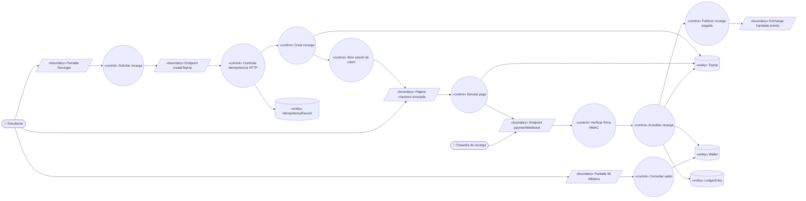
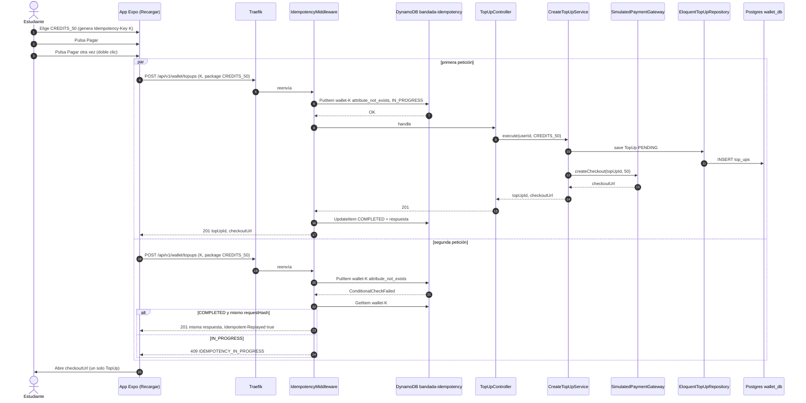
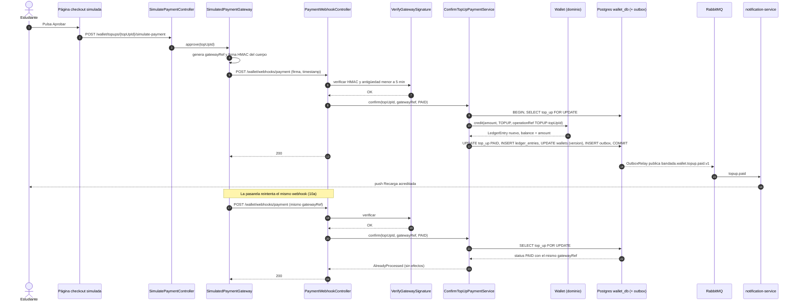

# UC-15 — Recargar créditos

| Campo | Valor |
|---|---|
| Paquete | Billetera |
| Actor principal | Estudiante |
| Actores secundarios | Pasarela de recarga (simulada), `notification-service`, `insights-service` |
| Prioridad (MoSCoW) | Must |
| Requisitos | RF-19, RNF-05, RNF-06, RNF-01 |
| Tecnologías de la cátedra que demuestra | **T8** (Idempotency-Key + webhook idempotente + `operationRef` único), T4, C2 (PHP) |
| Servicios involucrados | `wallet-service` (PHP 8.4 + Laravel 12, Hexagonal, `wallet_db`), `notification-service`, `bandadau-frontend` |
| Estado ICONIX | Secuencia (pendiente CDR) |

> Relación: «extend» de UC-12 ("Recargar y continuar" cuando el débito falla por
> `INSUFFICIENT_FUNDS`). Paso 4 del guion de la defensa: doble clic en "Pagar" → un solo cargo.

## 1. Narrativa (fase de requisitos)

### Precondiciones

1. El estudiante tiene sesión activa (UC-02).
2. Su `Wallet` existe o se crea perezosamente con saldo 0 en la primera operación de billetera
   (`wallet-service` no consume eventos de identidad; el `userId` sale del JWT).

### Disparador

El estudiante pulsa **"Recargar"** en la pantalla *Mi billetera* (o "Recargar y continuar" desde UC-12).

### Curso básico

1. El estudiante abre *Recargar* y la app muestra los paquetes `CREDITS_20`, `CREDITS_50`, `CREDITS_100` (20/50/100 créditos)
   con su precio referencial (1 crédito = 1 Bs), formateados con `formatCredits` (D14).
2. El estudiante elige un paquete. La app genera un `Idempotency-Key` (UUID) **al elegir el
   paquete** (una clave por intención de compra, no por clic) y la guarda en el estado de la pantalla.
3. El estudiante pulsa "Pagar". La app deshabilita el botón y envía
   `POST /api/v1/wallet/topups` (`createTopUp`) con `{ package }` y la clave.
4. El sistema registra la clave en `bandada-idempotency` (`pk = wallet#<key>`, `PutItem` con
   `attribute_not_exists(pk)`, estado `IN_PROGRESS`, `requestHash`).
5. El sistema crea un `TopUp` (`id` UUIDv7, `userId`, `package`, `amountCredits`, `status = PENDING`,
   `expiresAt = now + 30 min`) en `wallet_db` y solicita a la pasarela (puerto `PaymentGateway`)
   una sesión de cobro, que devuelve `checkoutUrl`.
6. El sistema guarda la respuesta en la tabla de idempotencia (`COMPLETED`) y responde **201**
   `{ topUpId, checkoutUrl }`.
7. La app abre `checkoutUrl` (`expo-web-browser` nativo / nueva pestaña en web). En el entorno de
   demo, la página simulada ofrece "Aprobar" / "Rechazar", que invoca
   `POST /api/v1/wallet/topups/{topUpId}/simulate-payment`.
8. La pasarela (simulada) genera un `gatewayRef` y envía el **webhook**
   `POST /api/v1/wallet/webhooks/payment` (`paymentWebhook`, sin JWT) con
   `{ gatewayRef, topUpId, status: PAID, amount }` y una firma **HMAC-SHA256** del cuerpo crudo +
   marca de tiempo, en cabecera.
9. El sistema verifica la firma con el secreto compartido (comparación en tiempo constante) y que la
   marca de tiempo tenga < 5 min (anti-replay).
10. El sistema, en **una transacción** de `wallet_db`:
    1. bloquea el `TopUp` (`SELECT … FOR UPDATE`) y comprueba que está `PENDING`;
    2. lo marca `PAID` con `gatewayRef` (columna con índice **único**);
    3. inserta `LedgerEntry` `TOPUP` con `amountCredits` y `operationRef = TOPUP:<topUpId>` (único);
    4. incrementa `Wallet.balanceCredits` (bloqueo optimista por `version`);
    5. escribe en el outbox `bandada.wallet.topup.paid.v1` (`topUpId`, `userId`, `amountCredits`, `gatewayRef`).
11. El sistema responde **200** al webhook.
12. El relay del outbox publica el evento; `notification-service` envía "Recarga de N créditos
    acreditada" (`NotificationType.TOPUP_PAID`) e `insights-service` lo proyecta en métricas.
13. La app, al cerrarse el navegador de pago, consulta `getMyWallet` (y escucha la notificación) y
    muestra el nuevo saldo. Si vino desde UC-12, ofrece "Continuar inscripción".

### Cursos alternos

- **3a. Doble clic en "Pagar"** (mismo `Idempotency-Key`): la segunda petición encuentra la clave:
  - si la primera terminó, el sistema devuelve la **misma** respuesta 201 (`topUpId`, `checkoutUrl`) con
    `Idempotent-Replayed: true`;
  - si la primera sigue en curso, responde `409 IDEMPOTENCY_IN_PROGRESS` y la app espera la primera.
  En ambos casos existe **un solo** `TopUp`.
- **3b. Reintento con la misma clave pero otro paquete**: `422 IDEMPOTENCY_KEY_REUSED`; la app genera
  una clave nueva al cambiar de paquete (paso 2).
- **3c. Paquete inválido**: `400` (validación del enum `TopUpPackage`).
- **5a. La pasarela no responde** al crear la sesión (timeout 5 s, circuit breaker): el `TopUp` queda
  `FAILED`, la entrada de idempotencia se elimina (para permitir reintento con la misma clave) y se
  responde `503` (`code: PAYMENT_GATEWAY_UNAVAILABLE`).
- **8a. Pago rechazado**: el webhook llega con `status: FAILED`; el `TopUp` pasa a `FAILED`, no se crea
  `LedgerEntry` y se responde 200. La app muestra "Pago rechazado".
- **9a. Firma HMAC inválida o marca de tiempo vieja**: `401` sin efectos; se registra en logs
  (sin el cuerpo) con `event = webhook.signature_invalid`.
- **10a. Webhook repetido** (la pasarela reintenta, mismo `gatewayRef`): el `TopUp` ya está `PAID` con
  ese `gatewayRef` → el sistema **no** crea otro `LedgerEntry` y responde **200** (D3 §5). Si dos
  copias llegan en paralelo, el `FOR UPDATE` serializa y la segunda ve `PAID`; como red de seguridad,
  el índice único de `operationRef` hace fallar cualquier segundo `TOPUP` → se trata como repetido.
- **10b. Webhook para un `TopUp` `EXPIRED` o `FAILED`** con `status: PAID`: se acredita igual (el dinero
  entró) registrando `TopUp.status = PAID` y un log de reconciliación `topup.late_payment`.
- **10c. `topUpId` desconocido**: 200 sin efectos + log de reconciliación (no se reintenta en bucle).
- **13a. El estudiante cierra el navegador sin pagar**: el `TopUp` sigue `PENDING`; un job
  (`schedule:run` cada minuto) lo marca `EXPIRED` al pasar `expiresAt`.
- **13b. `notification-service` caído**: el saldo ya fue acreditado; la notificación llega al recuperarse (RNF-03).

### Postcondiciones

- **Éxito**: `TopUp.status = PAID`; exactamente un `LedgerEntry TOPUP` con `operationRef = TOPUP:<topUpId>`;
  `Wallet.balanceCredits` aumentado en `amountCredits`; un evento `bandada.wallet.topup.paid.v1`.
- **Fallo**: `TopUp` `FAILED` o `EXPIRED`, saldo intacto.

### Reglas de negocio

- **RN-15.1** Paquetes cerrados: 20, 50 y 100 créditos (RF-19). Créditos siempre enteros.
- **RN-15.2** Acreditación **una sola vez por pago** aunque el webhook llegue N veces (RF-19, RNF-05).
- **RN-15.3** `Wallet.balanceCredits` = suma de `LedgerEntry` (invariante 3); el campo se mantiene
  denormalizado y se verifica con una consulta de reconciliación en pruebas.
- **RN-15.4** `simulate-payment` solo existe con `APP_ENV` `local` o `demo`; en otros entornos responde 404.
- **RN-15.5** El webhook no usa JWT; su autenticidad depende solo de la firma HMAC.

## 2. Diagrama de robustez (fase de análisis)

| Objeto | Tipo | Componente real |
|---|---|---|
| Pantalla Recargar / Mi billetera | Boundary | `bandadau-frontend/app/(tabs)/wallet/topup.tsx`, `wallet/index.tsx` |
| Endpoint createTopUp / paymentWebhook | Boundary | `Infrastructure\Http\TopUpController`, `PaymentWebhookController` |
| Página checkout simulada | Boundary | Vista Blade `wallet::checkout` servida por `wallet-service` (solo `local`/`demo`) |
| Exchange `bandada.events` | Boundary | RabbitMQ |
| Solicitar recarga | Control | Hook `useCreateTopUp` (app) |
| Controlar idempotencia HTTP | Control | Middleware `IdempotencyMiddleware` (adaptador DynamoDB) |
| Crear recarga | Control | `Application\CreateTopUpService` (puerto de entrada `CreateTopUp`) |
| Abrir sesión de cobro / Simular pago | Control | Puerto `PaymentGateway` → `SimulatedPaymentGateway` |
| Verificar firma HMAC | Control | `Infrastructure\Http\VerifyGatewaySignature` (middleware) |
| Acreditar recarga | Control | `Application\ConfirmTopUpPaymentService` |
| Publicar recarga pagada | Control | `Infrastructure\Messaging\OutboxRelay` (comando Artisan) |
| Consultar saldo | Control | `Application\GetMyWalletService` (UC-16) |
| IdempotencyRecord | Entity | DynamoDB `bandada-idempotency` (`wallet#<key>`) |
| TopUp, Wallet, LedgerEntry | Entity | `wallet_db`: `top_ups`, `wallets`, `ledger_entries` |

> La Pasarela de recarga es un actor de sistema; en la demo su lógica vive en el adaptador
> `SimulatedPaymentGateway`, pero el contrato (webhook firmado) es el mismo que con una pasarela real.

## 3. Diagrama de secuencia (fase de diseño)

### 3.1 Curso básico con doble clic (3a)

### 3.2 Pago y webhook repetido (10a)

## 4. Clases / contratos involucrados

### wallet-service (PHP 8.4 + Laravel 12, Hexagonal, `Bandada\Wallet\`)

| Capa | Clase | Responsabilidad |
|---|---|---|
| `Domain` | `Wallet` (agregado) | `credit(Credits, LedgerEntryType, OperationRef): LedgerEntry`; invariante `balance ≥ 0`; `version` |
| `Domain` | `LedgerEntry` | Asiento inmutable (`TOPUP`, `DEBIT`, `REFUND`) |
| `Domain` | `TopUp` (agregado) | `markPaid(GatewayRef)`, `markFailed()`, `expire(now)`; transición solo desde `PENDING` (salvo pago tardío 10b) |
| `Domain` | `TopUpPackage` (enum) | `CREDITS_20`, `CREDITS_50`, `CREDITS_100` → `credits()` |
| `Domain` | `OperationRef`, `GatewayRef`, `Credits` (value objects) | Formatos y enteros |
| `Application\Port\In` | `CreateTopUp`, `ConfirmTopUpPayment`, `ExpirePendingTopUps` | Puertos de entrada |
| `Application\Port\Out` | `WalletRepository`, `TopUpRepository`, `PaymentGateway`, `OutboxPort`, `Clock` | Puertos de salida |
| `Application` | `CreateTopUpService`, `ConfirmTopUpPaymentService`, `ExpirePendingTopUpsService` | Casos de uso |
| `Infrastructure\Http` | `TopUpController`, `SimulatePaymentController`, `PaymentWebhookController`, `IdempotencyMiddleware`, `VerifyGatewaySignature` | Adaptadores de entrada |
| `Infrastructure\Persistence` | `EloquentWalletRepository`, `EloquentTopUpRepository` | Adaptadores Postgres |
| `Infrastructure\Payment` | `SimulatedPaymentGateway` | Adaptador de pasarela |
| `Infrastructure\Messaging` | `OutboxRelay` | Publica CloudEvents a `bandada.events` |

Deptrac verifica que `Domain` no depende de `Illuminate\*` (RNF-14).

### Restricciones en `wallet_db`

- `ledger_entries.operation_ref` **UNIQUE** (D3 §3).
- `top_ups.gateway_ref` **UNIQUE** (nullable).
- `wallets.user_id` PK; `wallets.version` para bloqueo optimista; `CHECK (balance_credits >= 0)`.

### Contratos

| Tipo | Identificador | Contrato |
|---|---|---|
| REST | `createTopUp` — `POST /api/v1/wallet/topups` ♻️ → `{ topUpId, checkoutUrl }` | `bandadau-docs/contracts/openapi/wallet-service.yaml` |
| REST | `POST /api/v1/wallet/topups/{topUpId}/simulate-payment` (solo dev/demo) | ídem |
| REST | `paymentWebhook` — `POST /api/v1/wallet/webhooks/payment` (HMAC, idempotente por `gatewayRef`) | ídem |
| REST | `getMyWallet` | ídem (UC-16) |
| Evento | `bandada.wallet.topup.paid.v1` | `bandadau-docs/contracts/asyncapi/bandada-events.yaml` |
| Errores | `IDEMPOTENCY_IN_PROGRESS` (409), `IDEMPOTENCY_KEY_REUSED` (422), `PAYMENT_GATEWAY_UNAVAILABLE` (503), `INVALID_WEBHOOK_SIGNATURE` (401) | Problem Details |

## 5. Pruebas de aceptación

| ID | Escenario (Given / When / Then) |
|---|---|
| AT-15-01 | **Given** un estudiante con saldo 10 **When** recarga `CREDITS_50` y la pasarela aprueba **Then** el `TopUp` queda `PAID`, existe un `LedgerEntry TOPUP` de 50 con `operationRef = TOPUP:<topUpId>`, el saldo es 60 y se publicó una vez `topup.paid.v1`. |
| AT-15-02 | **Given** dos `createTopUp` simultáneos con la misma `Idempotency-Key` **When** se procesan **Then** existe un solo `TopUp`; una respuesta es 201 y la otra 201 replay o 409 `IDEMPOTENCY_IN_PROGRESS`. |
| AT-15-03 | **Given** una clave usada con `CREDITS_50` **When** se reenvía con `CREDITS_100` **Then** 422 `IDEMPOTENCY_KEY_REUSED`. |
| AT-15-04 | **Given** un `TopUp` ya `PAID` **When** el webhook llega 5 veces más con el mismo `gatewayRef` **Then** todas responden 200 y el saldo aumentó una sola vez. |
| AT-15-05 | **Given** dos webhooks idénticos en paralelo **When** se procesan **Then** hay un único `LedgerEntry TOPUP`. |
| AT-15-06 | **Given** un webhook con firma alterada **When** llega **Then** 401 y sin cambios. |
| AT-15-07 | **Given** un webhook firmado hace 10 min **When** llega **Then** 401 (anti-replay). |
| AT-15-08 | **Given** un pago rechazado **When** llega el webhook `FAILED` **Then** `TopUp FAILED`, saldo intacto. |
| AT-15-09 | **Given** un `TopUp PENDING` con `expiresAt` vencido **When** corre el job **Then** queda `EXPIRED`. |
| AT-15-10 | **Given** `APP_ENV=production` **When** se llama `simulate-payment` **Then** 404. |
| AT-15-11 | **Given** cualquier billetera tras las pruebas **When** se reconcilia **Then** `balanceCredits = Σ ledger_entries.amountCredits` (con signo). |

## 6. Trazabilidad

| Requisito | UC | Endpoints / mensajes | Clases | Pruebas |
|---|---|---|---|---|
| RF-19 | UC-15 | `createTopUp`, `simulate-payment`, `paymentWebhook`, `topup.paid.v1` | `TopUp`, `Wallet`, `CreateTopUpService`, `ConfirmTopUpPaymentService`, `SimulatedPaymentGateway` | AT-15-01, 08, 09, 10 |
| RNF-05 / T8 | UC-15 | `Idempotency-Key`, dedupe por `gatewayRef`, `operationRef` único | `IdempotencyMiddleware`, `EloquentTopUpRepository` | AT-15-02…05, 11 |
| RNF-06 | UC-15 | firma HMAC del webhook | `VerifyGatewaySignature` | AT-15-06, 07 |
| RF-15 (extend) | UC-12 → UC-15 | "Recargar y continuar" | — | AT-12 (en UC-12) |

### PROPUESTAS (pendientes de aprobar; agregar a `decisiones-clave.md` / contratos)

1. `GET /api/v1/wallet/topups/{topUpId}` (`getTopUp`) para que la app consulte el estado del `TopUp`
   tras cerrar el checkout (hoy solo puede inferirlo vía `getMyWallet`).
2. Nombre de cabeceras del webhook: `X-Signature` (`t=<epoch>,v1=<hex hmac>`) y tolerancia de 5 min.
3. Enum `TopUpPackage` (`CREDITS_20`, `CREDITS_50`, `CREDITS_100`) y campos `TopUp.amountCredits`, `TopUp.expiresAt` en el
   modelo de dominio; expiración a 30 min.
4. Códigos `PAYMENT_GATEWAY_UNAVAILABLE` e `INVALID_WEBHOOK_SIGNATURE`.
5. Creación perezosa de `Wallet` (saldo 0) en la primera operación, documentada en `wallet-service/AGENTS.md`.
