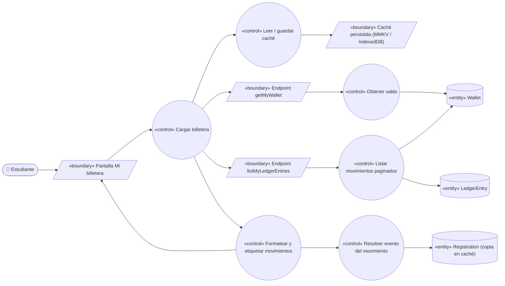
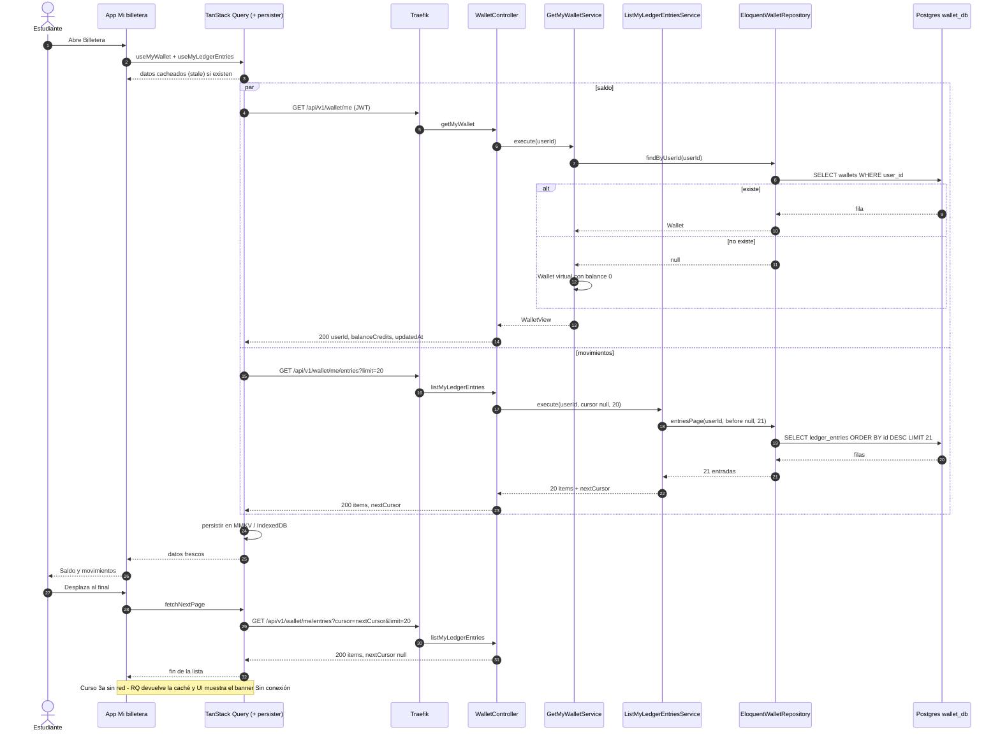

# UC-16 — Consultar saldo y movimientos

| Campo | Valor |
|---|---|
| Paquete | Billetera |
| Actor principal | Estudiante |
| Actores secundarios | — |
| Prioridad (MoSCoW) | Must |
| Requisitos | RF-20, RNF-01, RNF-09, RNF-17 |
| Tecnologías de la cátedra que demuestra | T4 (REST con paginación por cursor), T7 (lectura offline desde caché persistida), C2 (PHP) |
| Servicios involucrados | `wallet-service` (PHP 8.4 + Laravel 12, Hexagonal, `wallet_db`), `bandadau-frontend` |
| Estado ICONIX | Secuencia (pendiente CDR) |

> Relación: UC-12 lo «include» parcialmente (mostrar saldo antes de inscribirse); UC-13 y UC-15
> terminan refrescando esta vista.

## 1. Narrativa (fase de requisitos)

### Precondiciones

1. El estudiante tiene sesión activa (UC-02).

### Disparador

El estudiante abre la pestaña **Billetera** de la app (o vuelve a ella tras UC-13 / UC-15).

### Curso básico

1. El estudiante abre *Mi billetera*.
2. La app muestra de inmediato el saldo y la primera página de movimientos **desde la caché
   persistida** (TanStack Query + persister) si existe, marcados como "actualizando…".
3. La app solicita en paralelo `GET /api/v1/wallet/me` (`getMyWallet`) y
   `GET /api/v1/wallet/me/entries?limit=20` (`listMyLedgerEntries`).
4. El sistema identifica la `Wallet` por el `sub` del JWT. Si no existe, responde una billetera
   **virtual** con `balanceCredits = 0` (sin crearla; se crea en la primera escritura, UC-15).
5. El sistema devuelve `{ userId, balanceCredits, updatedAt }`.
6. El sistema lee los `LedgerEntry` de la billetera ordenados por `id` descendente (UUIDv7 ⇒ orden
   temporal), toma `limit + 1` filas para saber si hay más y devuelve
   `{ items: [{ id, type, amountCredits, operationRef, createdAt }], nextCursor }`.
7. La app muestra el saldo con `formatCredits` y la lista: icono y etiqueta por `type`
   (`TOPUP` "Recarga", `DEBIT` "Inscripción", `REFUND` "Reembolso", vía `@bandada/i18n`), monto con
   signo (+ verde para `TOPUP`/`REFUND`, − para `DEBIT`, usando tokens semánticos
   `color.feedback.*`) y fecha en `America/La_Paz`.
8. Para `DEBIT` y `REFUND`, la app resuelve el título del evento a partir del `registrationId`
   contenido en `operationRef` usando su caché de `listMyRegistrations` (`events-service`); si no lo
   tiene, muestra "Evento" y enlaza a la inscripción. `wallet-service` **no** conoce eventos.
9. El estudiante desplaza hasta el final; la app pide la siguiente página con
   `?cursor=<nextCursor>` hasta que `nextCursor` sea `null`.
10. La respuesta se guarda en la caché persistida para uso offline.

### Cursos alternos

- **2a. Primera vez, sin caché**: se muestra un *skeleton* hasta recibir la respuesta.
- **3a. Sin red** (RNF-09): la app muestra los datos cacheados con el banner "Sin conexión ·
  actualizado el dd/mm HH:mm" y deshabilita "Recargar". Sin caché, muestra estado vacío "Conéctate
  para ver tu billetera". Al volver la red (NetInfo) se refresca solo.
- **3b. Access token vencido**: el cliente HTTP renueva con `refreshToken` (UC-02) y reintenta una vez;
  si falla, lleva a iniciar sesión.
- **6a. Billetera sin movimientos**: `{ items: [], nextCursor: null }`; la app muestra
  "Aún no tienes movimientos" con acceso a "Recargar" (UC-15).
- **9a. Cursor inválido o manipulado**: `400` (`code: INVALID_CURSOR`); la app reinicia la lista
  desde la primera página.
- **9b. Llega un movimiento nuevo mientras se pagina** (p. ej. reembolso de UC-13): la paginación por
  *keyset* (`id < cursor`) no duplica ni salta filas; el nuevo aparece al refrescar (pull-to-refresh).
- **3c. Error 5xx / timeout**: se muestran los datos cacheados con aviso y botón "Reintentar".

### Postcondiciones

- No hay cambios de estado en el servidor (caso de solo lectura).
- La caché local contiene el último saldo y las páginas vistas.

### Reglas de negocio

- **RN-16.1** Un estudiante solo ve **su** billetera; no hay parámetro `userId` en las rutas públicas.
- **RN-16.2** `limit` por defecto 20, máximo 50.
- **RN-16.3** El saldo mostrado es `Wallet.balanceCredits`, que por invariante coincide con la suma de
  `LedgerEntry` (invariante 3); nunca se calcula en el cliente.
- **RN-16.4** El cursor es opaco (base64url del último `id`); el cliente no debe interpretarlo.
- **RN-16.5** El saldo offline se presenta siempre con su marca de tiempo para no inducir a error.

## 2. Diagrama de robustez (fase de análisis)

| Objeto | Tipo | Componente real |
|---|---|---|
| Pantalla Mi billetera | Boundary | `bandadau-frontend/app/(tabs)/wallet/index.tsx` (`FlashList` / `FlatList` con `onEndReached`) |
| Endpoint getMyWallet / listMyLedgerEntries | Boundary | `Infrastructure\Http\WalletController` |
| Caché persistida | Boundary | TanStack Query persister (MMKV / AsyncStorage nativo, IndexedDB web) — D6 |
| Cargar billetera | Control | Hooks `useMyWallet`, `useMyLedgerEntries` (`useInfiniteQuery`) |
| Obtener saldo | Control | `Application\GetMyWalletService` (puerto `GetMyWallet`) |
| Listar movimientos paginados | Control | `Application\ListMyLedgerEntriesService` (puerto `ListMyLedgerEntries`) |
| Formatear y etiquetar | Control | `LedgerEntryRow` + `formatCredits`/`formatDate` (`@bandada/i18n`) |
| Resolver evento del movimiento | Control | `useRegistrationLookup` (lee caché de `listMyRegistrations`) |
| Leer / guardar caché | Control | `PersistQueryClientProvider` |
| Wallet, LedgerEntry | Entity | `wallet_db`: `wallets`, `ledger_entries` |
| Registration (copia) | Entity | Caché local de `events-service` en el dispositivo (solo lectura) |

## 3. Diagrama de secuencia (fase de diseño)

## 4. Clases / contratos involucrados

### wallet-service (Hexagonal, `Bandada\Wallet\`)

| Capa | Clase | Responsabilidad |
|---|---|---|
| `Domain` | `Wallet`, `LedgerEntry`, `LedgerEntryType` | Modelo (compartido con UC-15/UC-12/UC-13) |
| `Application\Port\In` | `GetMyWallet`, `ListMyLedgerEntries` | Puertos de entrada (consultas) |
| `Application\Port\Out` | `WalletRepository` (`findByUserId`, `entriesPage(userId, ?beforeId, limit)`) | Puerto de salida |
| `Application` | `GetMyWalletService`, `ListMyLedgerEntriesService`, `LedgerCursor` (codifica/decodifica) | Casos de uso |
| `Infrastructure\Http` | `WalletController`, `WalletResource`, `LedgerEntryResource` | Adaptador de entrada + serialización `camelCase` |
| `Infrastructure\Persistence` | `EloquentWalletRepository` | Consulta *keyset* sobre índice `(wallet_id, id DESC)` |

### bandadau-frontend

`useMyWallet`, `useMyLedgerEntries` (`useInfiniteQuery`), `LedgerEntryRow`, `useRegistrationLookup`,
`OfflineBanner`. Textos en `locales/{es,en}/wallet.json`; etiquetas de `LedgerEntryType` en `@bandada/i18n`.

### Contratos

| Tipo | Identificador | Contrato |
|---|---|---|
| REST | `getMyWallet` — `GET /api/v1/wallet/me` → `{ userId, balanceCredits, updatedAt }` | `bandadau-docs/contracts/openapi/wallet-service.yaml` |
| REST | `listMyLedgerEntries` — `GET /api/v1/wallet/me/entries?cursor&limit` → `{ items, nextCursor }` | ídem |
| Errores | `INVALID_CURSOR` (400), `UNAUTHORIZED` (401) | Problem Details |

## 5. Pruebas de aceptación

| ID | Escenario (Given / When / Then) |
|---|---|
| AT-16-01 | **Given** una billetera con saldo 60 y 3 movimientos (TOPUP 50, DEBIT 30, TOPUP 40) **When** el estudiante abre Billetera **Then** ve saldo 60 y los 3 movimientos del más reciente al más antiguo. |
| AT-16-02 | **Given** 45 movimientos **When** pagina con `limit=20` **Then** recibe 20, 20 y 5, el último con `nextCursor = null`, sin duplicados. |
| AT-16-03 | **Given** un usuario sin billetera **When** llama `getMyWallet` **Then** 200 con `balanceCredits = 0` y no se crea fila. |
| AT-16-04 | **Given** un cursor alterado **When** se pide la página **Then** 400 `INVALID_CURSOR`. |
| AT-16-05 | **Given** datos cargados una vez **When** el dispositivo pasa a modo avión y se reabre la app **Then** se ve el saldo cacheado con el banner y la fecha de actualización (RNF-09). |
| AT-16-06 | **Given** dos usuarios A y B **When** A consulta **Then** nunca ve movimientos de B. |
| AT-16-07 | **Given** 100 usuarios concurrentes **When** consultan `getMyWallet` **Then** p95 < 300 ms (RNF-01). |
| AT-16-08 | **Given** la UI en `en` y tema oscuro **When** se muestra la lista **Then** las etiquetas y fechas están en inglés (`en-US`) y los colores cumplen contraste AA (RNF-17). |

## 6. Trazabilidad

| Requisito | UC | Endpoints / mensajes | Clases | Pruebas |
|---|---|---|---|---|
| RF-20 | UC-16 | `getMyWallet`, `listMyLedgerEntries` | `GetMyWalletService`, `ListMyLedgerEntriesService`, `EloquentWalletRepository`, `LedgerCursor` | AT-16-01…04, 06 |
| RNF-09 / T7 | UC-16 | caché persistida | `PersistQueryClientProvider`, `OfflineBanner` | AT-16-05 |
| RNF-01 | UC-16 | — | índice `(wallet_id, id DESC)` | AT-16-07 |
| RNF-17 / D13 / D14 | UC-16 | — | `LedgerEntryRow`, `@bandada/i18n` | AT-16-08 |

### PROPUESTAS (pendientes de aprobar)

1. Fijar en el contrato el esquema de `LedgerEntry` público: `{ id, type, amountCredits, operationRef, createdAt }`
   (`amountCredits` siempre positivo; el signo lo da `type`) y `limit` máx. 50.
2. Código de error `INVALID_CURSOR` en el catálogo de errores compartido (`@bandada/i18n`).
