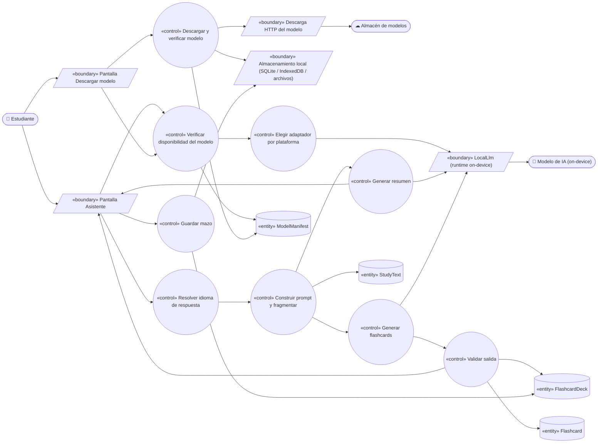
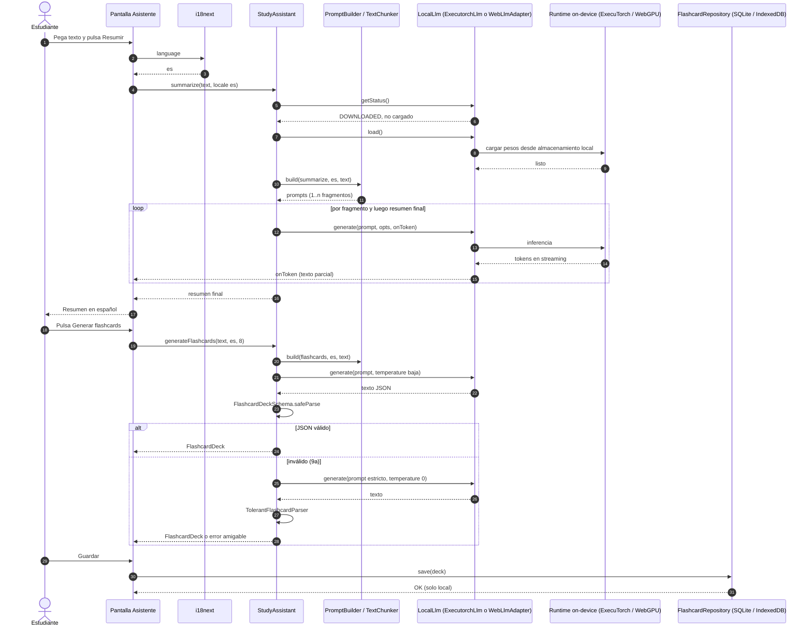
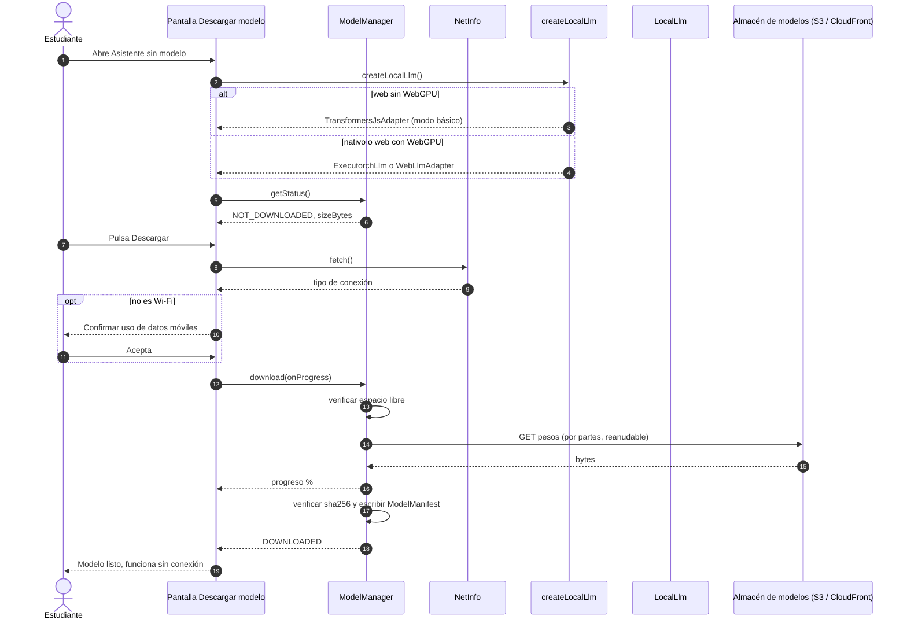

# UC-17 — Usar asistente de estudio offline

| Campo | Valor |
|---|---|
| Paquete | IA local |
| Actor principal | Estudiante |
| Actores secundarios | Modelo de IA (LLM on-device), almacenamiento de modelos (S3/CloudFront, solo para la descarga) |
| Prioridad (MoSCoW) | Must |
| Requisitos | RF-21, RNF-09, RNF-11, RNF-08, RNF-10 |
| Tecnologías de la cátedra que demuestra | **T6** (IA local en móvil y frontend web), **T7** (PWA / offline) |
| Servicios involucrados | `bandadau-frontend` únicamente (iOS, Android y web PWA). **Ningún servicio backend** en tiempo de uso |
| Estado ICONIX | Pendiente fase 2 (secuencia diseñada; sin implementar) |

## 1. Narrativa (fase de requisitos)

### Precondiciones

1. La app está instalada (nativa) o la PWA está instalada / en caché del service worker.
2. Para el curso básico, el modelo ya fue descargado (si no, aplica el curso alterno 2a).
3. No se requiere sesión ni red: el asistente funciona en modo avión (RNF-09).

### Disparador

El estudiante abre la pestaña **Asistente** y pega o escribe un texto de estudio (apuntes, párrafo de
un libro, transcripción), o elige uno de sus posts guardados en caché.

### Curso básico

1. El estudiante abre *Asistente*. La app consulta `LocalLlm.getStatus()` y muestra "Modelo listo
   (offline)" con el nombre del modelo y su tamaño.
2. El estudiante pega el texto (≤ 12 000 caracteres) y elige **"Resumir"**.
3. La app determina el **idioma de respuesta** = idioma actual de la UI (`es` o `en`, D14), no el
   idioma del texto de entrada.
4. La app (servicio `StudyAssistant`) carga el modelo en memoria si no está cargado
   (`LocalLlm.load()`), mostrando "Preparando modelo…".
5. `StudyAssistant` construye el prompt desde una plantilla versionada por idioma
   (`prompts/{es,en}/summarize.txt`) y, si el texto excede la ventana de contexto, lo divide en
   fragmentos (*map-reduce*: resume cada fragmento y luego resume los resúmenes).
6. La app llama `LocalLlm.generate(prompt, { maxTokens, temperature }, onToken)`; el modelo corre en el
   dispositivo y los tokens se muestran **en streaming** (primer token < 3 s en gama media, RNF-11).
7. El estudiante pulsa **"Generar flashcards"** sobre el mismo texto.
8. `StudyAssistant` usa la plantilla `flashcards` que pide al modelo una lista JSON
   `[{ "front": "...", "back": "..." }]` (5–10 tarjetas) en el idioma de la UI.
9. `StudyAssistant` valida la salida con un esquema (`FlashcardDeckSchema`); si es válida, crea un
   `FlashcardDeck` local.
10. La app muestra las tarjetas en modo "voltear" y permite guardarlas.
11. Al guardar, el mazo se persiste **solo en el dispositivo** (`expo-sqlite` nativo / IndexedDB web).
    Ningún texto ni resultado sale del dispositivo (RNF-08).

### Cursos alternos

- **1a. Dispositivo no compatible**:
  - *Nativo*: RAM insuficiente o arquitectura no soportada por `react-native-executorch` → mensaje
    "Tu dispositivo no puede ejecutar el asistente" y la función se oculta.
  - *Web sin WebGPU*: `WebLlmAdapter` no está disponible → la app usa el **fallback**
    `TransformersJsAdapter` (WASM) con un modelo de resumen más pequeño. Solo ofrece "Resumir";
    "Generar flashcards" usa una heurística extractiva (oraciones clave → pregunta/respuesta) y se
    marca como "modo básico".
- **2a. Modelo no descargado**: la app muestra *Descargar modelo* con tamaño (≤ 1.5 GB, RNF-11):
  1. Comprueba conectividad con NetInfo; si no es Wi-Fi, pide confirmación explícita ("Usará datos móviles").
  2. Comprueba espacio libre (tamaño × 1.2); si no alcanza, informa cuánto falta. Fin.
  3. Descarga con progreso, en segundo plano y **reanudable** (nativo: `expo-file-system`
     *resumable download*; web: Cache Storage / OPFS gestionados por WebLLM o transformers.js).
  4. Verifica el `sha256` del manifiesto del modelo; si no coincide, borra y reintenta.
  5. Marca el modelo como instalado (`ModelManifest` local con `id`, `version`, `sizeBytes`).
  Desde aquí, todo uso es offline.
- **2b. Descarga interrumpida** (pierde red o cierra la app): al volver, la app ofrece "Continuar
  descarga" desde el byte alcanzado.
- **2c. Sin red y sin modelo**: "Conéctate a Wi-Fi una vez para descargar el asistente". Fin.
- **2d. Texto vacío o > 12 000 caracteres**: validación en la pantalla (contador de caracteres).
- **4a. Fallo al cargar en memoria** (OOM): se libera (`unload`) y se reintenta con el modelo de
  respaldo más pequeño si está descargado; si no, mensaje de error.
- **6a. El estudiante pulsa "Detener"**: `LocalLlm.interrupt()`; se conserva el texto parcial.
- **6b. La app pasa a segundo plano**: se interrumpe la generación para liberar CPU/GPU; al volver,
  ofrece "Reanudar".
- **9a. Salida JSON inválida**: se reintenta una vez con una instrucción más estricta y
  `temperature = 0`; si vuelve a fallar, se aplica un parser tolerante (líneas `P:`/`R:`); si tampoco
  produce ≥ 3 tarjetas, se informa "No se pudieron generar tarjetas para este texto".
- **3a. Cambio de idioma de la UI durante la sesión**: las siguientes generaciones usan el nuevo
  idioma; los resultados ya generados no se traducen.
- **11a. Almacenamiento lleno al guardar**: se informa y no se pierde el mazo en pantalla.

### Postcondiciones

- **Éxito**: resumen mostrado; `FlashcardDeck` guardado localmente si el estudiante lo eligió.
- **Siempre**: cero peticiones de red durante la generación (verificable en modo avión).

### Reglas de negocio

- **RN-17.1** Toda inferencia ocurre en el dispositivo; el texto del estudiante nunca se envía a un
  servidor (RNF-08). La red solo se usa para descargar el modelo.
- **RN-17.2** La descarga es **bajo demanda** y por defecto solo en Wi-Fi (RNF-11).
- **RN-17.3** El asistente responde en el idioma de la UI (D14), con plantillas de prompt por idioma.
- **RN-17.4** Modelos admitidos: nativo **Llama 3.2 1B** o **Qwen 3 0.6B** cuantizados
  (`react-native-executorch`); web **WebLLM** (WebGPU) con modelo equivalente; fallback web
  `transformers.js` con modelo de resumen pequeño (D6). La elección concreta y sus URLs se fijan en
  `bandadau-docs/docs/03-arquitectura/ia-local-y-offline.md`.
- **RN-17.5** El asistente se presenta como ayuda de estudio; el texto generado lleva el aviso
  "Generado en tu dispositivo, puede contener errores".
- **RN-17.6** El estudiante puede borrar el modelo desde *Ajustes* para liberar espacio.

## 2. Diagrama de robustez (fase de análisis)



| Objeto | Tipo | Componente real |
|---|---|---|
| Pantalla Asistente / Descargar modelo | Boundary | `bandadau-frontend/app/(tabs)/assistant/index.tsx`, `assistant/model.tsx` |
| LocalLlm (runtime) | Boundary | Interfaz `LocalLlm` (`bandadau-frontend/src/ai/local-llm.ts`) con `.native.ts` (`ExecutorchLlm`) y `.web.ts` (`WebLlmAdapter` + `TransformersJsAdapter`) |
| Descarga HTTP del modelo | Boundary | `ModelDownloader` (`expo-file-system` nativo; caché del motor en web) |
| Almacenamiento local | Boundary | `expo-sqlite` (nativo), IndexedDB (web), sistema de archivos / Cache Storage para pesos |
| Verificar disponibilidad / Elegir adaptador | Control | `createLocalLlm()` (resolución por extensión `.native`/`.web` de Metro + detección de WebGPU) |
| Descargar y verificar modelo | Control | `ModelManager.download()` (NetInfo, espacio, `sha256`) |
| Resolver idioma | Control | `useTranslation()` / `i18next.language` (D14) |
| Construir prompt y fragmentar | Control | `PromptBuilder`, `TextChunker` |
| Generar resumen / flashcards | Control | `StudyAssistant.summarize()`, `StudyAssistant.generateFlashcards()` |
| Validar salida | Control | `FlashcardDeckSchema` (zod) + `TolerantFlashcardParser` |
| Guardar mazo | Control | `FlashcardRepository` |
| ModelManifest, StudyText, FlashcardDeck, Flashcard | Entity | Tipos locales de la app (no existen en el backend) |
| Modelo de IA | Actor (sistema) | Pesos cuantizados ejecutados por ExecuTorch / WebLLM / ONNX Runtime Web |

## 3. Diagrama de secuencia (fase de diseño)

### 3.1 Curso básico (modelo ya descargado, sin red)



### 3.2 Curso alterno 2a (descarga bajo demanda) y 1a (fallback web)



## 4. Clases / contratos involucrados

### Interfaz `LocalLlm` (`bandadau-frontend/src/ai/local-llm.ts`)

```ts
export type LocalLlmStatus = 'UNSUPPORTED' | 'NOT_DOWNLOADED' | 'DOWNLOADING' | 'DOWNLOADED' | 'LOADED';

export interface GenerateOptions {
  maxTokens: number;
  temperature: number;
  signal?: AbortSignal;
}

export interface LocalLlm {
  readonly backend: 'executorch' | 'webllm' | 'transformersjs';
  readonly capabilities: { chat: boolean; summarizeOnly: boolean };
  getStatus(): Promise<LocalLlmStatus>;
  download(onProgress: (ratio: number) => void): Promise<void>;
  load(): Promise<void>;
  generate(prompt: string, options: GenerateOptions, onToken?: (token: string) => void): Promise<string>;
  interrupt(): void;
  unload(): Promise<void>;
  remove(): Promise<void>;
}
```

| Archivo | Clase | Notas |
|---|---|---|
| `local-llm.native.ts` | `ExecutorchLlm` | Envuelve la API de `react-native-executorch` (verificar la API de la versión instalada antes de implementar, regla 8 de `AGENTS.md`) |
| `local-llm.web.ts` | `WebLlmAdapter` | `@mlc-ai/web-llm` (motor WebGPU; pesos en caché del navegador) |
| `local-llm.web.ts` | `TransformersJsAdapter` | `@huggingface/transformers` (`pipeline` de resumen, WASM) — fallback |
| `model-manager.ts` | `ModelManager` | Estado, descarga reanudable, `sha256`, borrado |
| `study-assistant.ts` | `StudyAssistant` | `summarize(text, locale)`, `generateFlashcards(text, locale, count)` |
| `prompt-builder.ts` | `PromptBuilder`, `TextChunker` | Plantillas `prompts/{es,en}/*.txt` |
| `flashcards.ts` | `FlashcardDeckSchema`, `TolerantFlashcardParser`, `FlashcardRepository` | Validación y persistencia local |

Pruebas de arquitectura (dependency-cruiser): las pantallas solo importan `StudyAssistant` y `ModelManager`,
nunca librerías de runtime directamente.

### Contratos

No hay contrato de API backend: es un caso de uso 100 % en el cliente. El único recurso remoto es el
**manifiesto del modelo** y sus pesos, servidos como archivos estáticos bajo la convención de D7
(`models/<nombre>/<versión>/…`) o desde el origen que defina el motor (WebLLM).

## 5. Pruebas de aceptación

| ID | Escenario (Given / When / Then) |
|---|---|
| AT-17-01 | **Given** el modelo descargado y el dispositivo en **modo avión** **When** el estudiante resume un texto de 3 000 caracteres **Then** obtiene un resumen en streaming y el inspector de red registra 0 peticiones. |
| AT-17-02 | **Given** un teléfono de gama media con el modelo cargado **When** pide un resumen **Then** el primer token aparece en < 3 s (RNF-11). |
| AT-17-03 | **Given** la UI en `en` y un texto en español **When** pide un resumen **Then** el resumen está en inglés (RN-17.3). |
| AT-17-04 | **Given** un texto de estudio **When** genera flashcards **Then** obtiene entre 5 y 10 tarjetas con `front` y `back` no vacíos, y puede guardarlas y verlas tras reiniciar la app sin red. |
| AT-17-05 | **Given** el modelo no descargado y conexión celular **When** pulsa Descargar **Then** se le pide confirmación antes de usar datos móviles. |
| AT-17-06 | **Given** una descarga al 40 % **When** se corta la red y vuelve **Then** la descarga continúa desde ~40 % y termina con `sha256` verificado. |
| AT-17-07 | **Given** un navegador sin WebGPU **When** abre el asistente en la PWA **Then** se usa `TransformersJsAdapter` y "Resumir" funciona offline. |
| AT-17-08 | **Given** una salida de flashcards con JSON roto (simulada) **When** se procesa **Then** se reintenta y, si persiste, se usa el parser tolerante o se muestra el error amigable. |
| AT-17-09 | **Given** el modelo instalado **When** el estudiante lo borra en Ajustes **Then** se libera el espacio y el estado vuelve a `NOT_DOWNLOADED`. |
| AT-17-10 | **Given** la PWA instalada **When** se ejecuta Lighthouse **Then** sigue siendo "installable" y rendimiento ≥ 80 (el modelo no se precachea en el shell, RNF-10). |

## 6. Trazabilidad

| Requisito | UC | Endpoints / mensajes | Clases | Pruebas |
|---|---|---|---|---|
| RF-21 | UC-17 | — (on-device) | `StudyAssistant`, `LocalLlm`, `ExecutorchLlm`, `WebLlmAdapter`, `TransformersJsAdapter` | AT-17-01, 03, 04, 07, 08 |
| RNF-11 | UC-17 | descarga del modelo | `ModelManager` | AT-17-02, 05, 06, 09 |
| RNF-09 / T7 | UC-17 | — | `FlashcardRepository` | AT-17-01, 04 |
| RNF-08 | UC-17 | — | (ausencia de llamadas de red) | AT-17-01 |
| RNF-10 | UC-17 | service worker | — | AT-17-10 |
| T6 | UC-17, UC-05 | — | `LocalLlm` | AT-17-01, 07 |
| D14 | UC-17 | — | `PromptBuilder` (plantillas por idioma) | AT-17-03 |

### PROPUESTAS (pendientes de aprobar)

1. Agregar al glosario los conceptos de cliente `FlashcardDeck`, `Flashcard` y `ModelManifest`
   (contexto "App", como `OfflineMutation`).
2. Límite de entrada del asistente: 12 000 caracteres (map-reduce por encima de la ventana de contexto).
3. Publicar los pesos del modelo nativo y su `manifest.json` (`id`, `version`, `sizeBytes`, `sha256`)
   en `models/llm-<nombre>/<versión>/` del bucket de modelos, servido por CloudFront.
