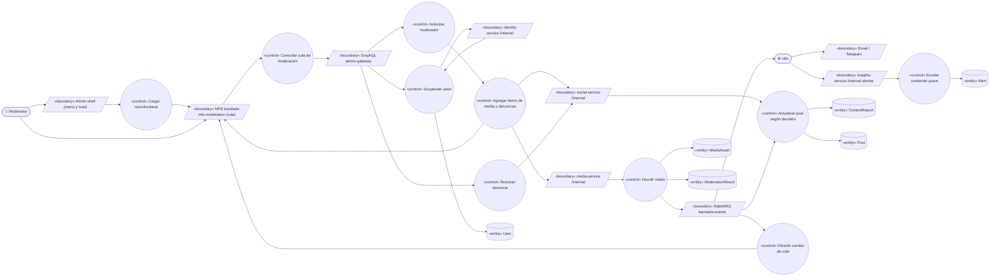
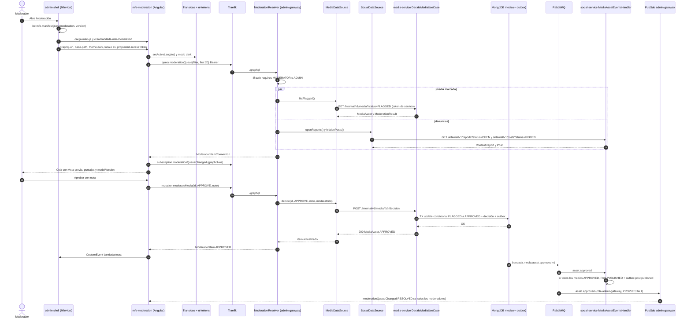
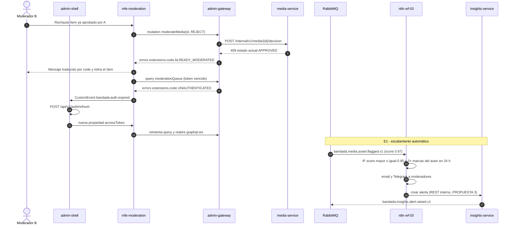

# UC-18 — Moderar contenido marcado por IA

| Campo | Valor |
|---|---|
| Paquete | Admin |
| Actor principal | Moderador (rol `MODERATOR`; el Administrador lo hereda) |
| Actores secundarios | Modelo de IA (clasificadores ONNX de `media-service`), n8n (`wf-03-escalamiento-moderacion`), `social-service`, `identity-service`, `insights-service` |
| Prioridad (MoSCoW) | Must |
| Requisitos | RF-22, RF-07, RF-13, RNF-08, RNF-17, RNF-12 |
| Tecnologías de la cátedra que demuestra | **T2** (microfrontend Angular como Web Component en shell Next.js), **T3** (GraphQL query/mutation/subscription), **T9** (puntajes DL), **T10** (n8n) |
| Servicios involucrados | `bandadau-admin/shell` (Next.js 16), `bandadau-admin/mfe-moderation` (Angular 21 + Angular Elements), `admin-gateway` (NestJS 11 + Apollo), `media-service`, `social-service`, `identity-service`, n8n |
| Estado ICONIX | Implementado (fase 1, 2026-10-15) (moderación manual desde el panel; sin ML) — evidencia en `../07-trazabilidad.md` |

> Relaciones: UC-05 «include» la moderación automática que **alimenta** esta cola (`MediaAsset`
> `FLAGGED`, `Post` `HIDDEN`); UC-10 aporta las denuncias (`ContentReport` `OPEN`); UC-03 da
> acceso al panel; UC-20 vigila el *backlog* de moderación.

## 1. Narrativa (fase de requisitos)

### Precondiciones

1. El moderador tiene sesión en el panel (`admin.bandada.localhost`), por login o por handoff desde
   la app (UC-03); su JWT incluye `MODERATOR` o `ADMIN` en `roles`.
2. Existen ítems pendientes: `MediaAsset` `FLAGGED` (puntaje `0.5–0.85`, decisión `REVIEW`, D7) y/o
   `ContentReport` `OPEN` (cuyo `Post` puede estar `HIDDEN` por 3 denuncias, RF-13).

### Disparador

El moderador abre **Moderación** en el menú del panel.

### Curso básico

1. El moderador abre *Moderación*. `admin-shell` lee `mfe-manifest.json`, obtiene la entrada
   `moderation` (`url`, `element: bandada-mfe-moderation`, `version`) y carga el script del MFE.
2. El shell crea el Web Component `<bandada-mfe-moderation>` y le pasa: atributos `graphql-url`,
   `base-path`, `theme` (`light|dark`, resuelto por el shell según D13) y `locale` (`es|en`, D14), y
   la **propiedad** `accessToken` (nunca como atributo).
3. El MFE (Angular 21 zoneless, Shadow DOM) inicializa **Transloco** con `locales/{es,en}` según
   `locale` y aplica los tokens semánticos de `@bandada/ui-tokens` (variables CSS heredadas a través
   del Shadow DOM, modo según `theme`).
4. El MFE ejecuta la query `moderationQueue(filter, after, first)` contra `admin-gateway` y abre la
   subscription `moderationQueueChanged` por `graphql-ws`.
5. `admin-gateway` autoriza con `@auth(requires: [MODERATOR, ADMIN])` y resuelve la cola agregando
   (DataLoader por servicio, token de servicio):
   - `media-service` `GET /internal/v1/media?status=FLAGGED` (`listFlaggedMedia`);
   - `social-service` `GET /internal/v1/reports?status=OPEN` y `GET /internal/v1/posts?status=HIDDEN`.
   Une los resultados en una `Connection` Relay de `ModerationItem` ordenada por puntaje y antigüedad.
6. El MFE muestra la cola: vista previa (URL prefirmada de 15 min, RNF-08), etiquetas y puntajes del
   modelo (`nsfw`, `violence`), `modelVersion`, número de denuncias, autor y post asociado.
7. El moderador selecciona un ítem de imagen marcada y elige **Aprobar** o **Rechazar** con una nota
   opcional.
8. El MFE ejecuta la mutation `moderateMedia(id, decision, note)`.
9. `admin-gateway` llama `POST /internal/v1/media/{id}/decision` (`decideMedia`, `APPROVE|REJECT`).
10. `media-service` aplica la transición `FLAGGED → APPROVED | REJECTED` de forma condicional, registra
    la decisión humana (moderador, nota, fecha) junto al `ModerationResult` y, en la misma
    transacción Mongo, escribe en el outbox `bandada.media.asset.approved.v1` o
    `bandada.media.asset.rejected.v1`.
11. `admin-gateway` devuelve el `ModerationItem` actualizado; el MFE lo retira de la lista y emite
    `bandada:toast` ("Contenido aprobado") hacia el shell.
12. `social-service` consume el evento (cola `social-service.events`, `bandada.media.asset.#`): si
    todos los medios del `Post` están `APPROVED`, lo pasa a `PUBLISHED` y publica
    `bandada.social.post.published.v1` (invariante 6); si alguno fue rechazado, lo pasa a `REMOVED`.
13. `admin-gateway` publica `moderationQueueChanged` (`{ itemId, change: RESOLVED }`) y los demás
    moderadores conectados ven el ítem desaparecer en vivo.

### Cursos alternos

- **1a. El MFE no carga** (script caído o versión incompatible): el shell muestra un panel de error
  "Módulo de moderación no disponible" con "Reintentar"; el resto del panel sigue funcionando.
- **4a. Access token vencido**: `admin-gateway` responde `UNAUTHENTICATED`; el MFE emite
  `bandada:auth-expired`; el shell renueva la sesión y vuelve a asignar la propiedad `accessToken`;
  el MFE reintenta y reabre el WebSocket.
- **5a. Rol insuficiente** (solo `STUDENT`/`ORGANIZER`): error `FORBIDDEN`; el shell ni siquiera muestra
  el menú (doble barrera: UI + directiva `@auth`).
- **5b. `media-service` o `social-service` no responde**: `admin-gateway` devuelve los datos parciales
  con un error en `errors[]` (`extensions.code: UPSTREAM_UNAVAILABLE`); el MFE muestra la parte
  disponible con un aviso traducido por `code` (circuit breaker + timeout).
- **7a. Ítem por denuncia** (`ContentReport`): el moderador elige **Mantener** o **Retirar**; el MFE
  ejecuta `resolveContentReport`; `admin-gateway` actualiza el post en `social-service`
  (`PATCH /internal/v1/posts/{id}/status` → `PUBLISHED` o `REMOVED`) y cierra la denuncia como
  `RESOLVED_KEPT` o `RESOLVED_REMOVED`.
- **7b. Suspender autor**: el moderador pulsa "Suspender autor" y confirma en un diálogo (acción
  destructiva). El MFE ejecuta `suspendUser`; `admin-gateway` llama a `identity-service`
  (`updateUserStatus` → `SUSPENDED`), que publica `bandada.identity.user.suspended.v1`.
- **10a. Otro moderador ya decidió el ítem**: la condición `status = FLAGGED` falla; `media-service`
  responde `409`; `admin-gateway` lo traduce a `extensions.code: ALREADY_MODERATED`; el MFE muestra
  "Otro moderador ya resolvió este contenido" (Transloco por `code`) y retira el ítem.
- **10b. Doble clic en Aprobar**: la segunda llamada encuentra el estado ya `APPROVED` con la **misma**
  decisión y `media-service` responde 200 idempotente (sin segundo evento).
- **12a. `social-service` caído**: el evento queda en su cola; el post se publica al recuperarse.
- **2a. Cambio de tema o idioma en el shell**: el shell actualiza los atributos `theme`/`locale`; el MFE
  re-renderiza sin recargar (Transloco `setActiveLang`; variables CSS del modo nuevo).
- **E1. Escalamiento automático (n8n `wf-03`)**, independiente del moderador: al llegar
  `bandada.media.asset.flagged.v1` a la cola `n8n.automation`, si `score ≥ 0.95` o el autor acumula
  3+ marcas en 24 h, n8n envía email/Telegram a los moderadores con enlace al ítem y crea una alerta
  en `insights-service`; la alerta llega al panel por `alertRaised` (UC-20).
- **E2. Nuevo ítem marcado** mientras el moderador trabaja: `moderationQueueChanged`
  (`change: ADDED`) inserta el ítem arriba con un indicador "nuevo".

### Postcondiciones

- **Éxito (aprobar)**: `MediaAsset.status = APPROVED`; el `Post` asociado `PUBLISHED` si todos sus medios
  están aprobados; ítem fuera de la cola de todos los moderadores.
- **Éxito (rechazar)**: `MediaAsset.status = REJECTED`; `Post.status = REMOVED`.
- **Denuncia**: `ContentReport.status ∈ { RESOLVED_KEPT, RESOLVED_REMOVED }`.
- Toda decisión queda auditada (quién, cuándo, nota, `modelVersion` del puntaje que la originó).

### Reglas de negocio

- **RN-18.1** Solo `MODERATOR` o `ADMIN` ven y resuelven la cola (RF-22).
- **RN-18.2** Una decisión humana es final para ese `MediaAsset` (transición única desde `FLAGGED`).
- **RN-18.3** Contenido `BLOCK` (`score ≥ 0.85`) se rechaza automáticamente y **no** entra en la cola;
  sí aparece en el historial para auditoría (D7).
- **RN-18.4** Suspender un autor requiere confirmación explícita (RNF-19 aplica también a humanos en
  acciones destructivas).
- **RN-18.5** Las vistas previas usan URLs prefirmadas de 15 min; el MFE nunca almacena medios.
- **RN-18.6** Textos del MFE solo vía Transloco (`locales/{es,en}/moderation.json`, ICU); errores
  traducidos por `extensions.code`, nunca mostrando `message` crudo del servidor.
- **RN-18.7** Estilos del MFE solo con tokens semánticos de `@bandada/ui-tokens`; contraste AA en
  ambos modos (RNF-17).

## 2. Diagrama de robustez (fase de análisis)

> Notas: `C4 --> B2` y `C9 --> B2` son la respuesta de la query y los mensajes de la subscription
> GraphQL hacia el MFE; n8n se modela como actor de sistema que invoca el endpoint interno de alertas
> de `insights-service` (`B9`, PROPUESTA 3).

| Objeto | Tipo | Componente real |
|---|---|---|
| Admin shell | Boundary | `bandadau-admin/shell` (Next.js 16 static) → `app/moderation/page.tsx` + `MfeHost` |
| MFE `bandada-mfe-moderation` | Boundary | `bandadau-admin/mfe-moderation` (Angular 21 + `@angular/elements`, zoneless, Shadow DOM) |
| GraphQL admin-gateway | Boundary | `admin-gateway` `/graphql` (HTTP + `graphql-ws`) |
| `/internal` de media, social, identity | Boundary | Controladores internos con token de servicio |
| RabbitMQ `bandada.events` | Boundary | Exchange topic |
| Email / Telegram | Boundary | Nodos de n8n |
| insights-service /internal alertas | Boundary | `POST /internal/v1/alerts` (PROPUESTA 3) |
| Cargar microfrontend | Control | `MfeLoader` del shell (lee `mfe-manifest.json`) |
| Consultar cola | Control | `ModerationQueueStore` (signals) + `ModerationApi` en el MFE |
| Autorizar moderador | Control | Directiva `@auth` + `AuthGuard` de `admin-gateway` |
| Agregar ítems | Control | `ModerationResolver` + `MediaDataSource` + `SocialDataSource` (DataLoader) |
| Decidir medio | Control | `media-service` → `DecideMediaUseCase` |
| Resolver denuncia / Actualizar post | Control | `social-service` → `ChangePostStatusUseCase`, `ResolveReportUseCase`, consumidor `MediaAssetEventsHandler` |
| Suspender autor | Control | `admin-gateway` `UserResolver.suspendUser` → `identity-service` `UpdateUserStatusService` |
| Difundir cambio de cola | Control | `ModerationEventsConsumer` + `PubSub` de `admin-gateway` (PROPUESTA 1) |
| Escalar contenido grave | Control | `wf-03-escalamiento-moderacion` → `insights-service` (alerta) |
| MediaAsset, ModerationResult | Entity | MongoDB `media` |
| ContentReport, Post | Entity | MongoDB `social` |
| User | Entity | `identity_db` |
| Alert | Entity | DynamoDB `bandada-insights` (`ALERT#<id>`) |

## 3. Diagrama de secuencia (fase de diseño)

### 3.1 Carga del MFE, consulta y decisión (curso básico)

### 3.2 Alternos: conflicto entre moderadores (10a), token vencido (4a) y escalamiento n8n (E1)

## 4. Clases / contratos involucrados

### bandadau-admin/shell (Next.js 16)

`MfeLoader` (lee `mfe-manifest.json`, inyecta `<script type="module">`, espera `customElements.whenDefined`),
`MfeHost` (crea el elemento, asigna atributos y la propiedad `accessToken`, escucha `bandada:navigate`,
`bandada:toast`, `bandada:auth-expired`), `ThemeProvider` (D13), `LocaleProvider` (D14).

### bandadau-admin/mfe-moderation (Angular 21 + Angular Elements)

| Clase | Responsabilidad |
|---|---|
| `ModerationElement` (registrado con `createCustomElement` como `bandada-mfe-moderation`) | Inputs `graphqlUrl`, `basePath`, `theme`, `locale`, `accessToken`; outputs a `CustomEvent` |
| `ModerationQueueComponent`, `ModerationItemCardComponent`, `DecisionDialogComponent` | UI (signals, zoneless, `ViewEncapsulation.ShadowDom`) |
| `ModerationApi` | Cliente GraphQL (HTTP + `graphql-ws`); operaciones tipadas generadas desde `bandadau-docs/contracts/graphql/admin.graphql` |
| `ModerationQueueStore` | Estado de la cola; aplica `moderationQueueChanged` |
| `ErrorTranslator` | Mapea `extensions.code` a claves Transloco `moderation.errors.<code>` |
| Transloco (`locales/es/moderation.json`, `locales/en/moderation.json`, plugin MessageFormat) | Textos ICU |
| `tokens.scss` de `@bandada/ui-tokens` | Variables semánticas; `:host([theme=dark])` |

### admin-gateway (NestJS 11 + Apollo Server, capas resolvers → data sources)

`ModerationResolver` (`moderationQueue`, `contentReports`, `moderateMedia`, `resolveContentReport`,
`moderationQueueChanged`), `UserResolver.suspendUser`, `MediaDataSource`, `SocialDataSource`,
`IdentityDataSource`, `ServiceTokenProvider` (`issueServiceToken`), `AuthDirective`,
`ModerationEventsConsumer` + `PubSub` (PROPUESTA 1).

### media-service (Clean) / social-service (Clean) / identity-service (Hexagonal)

- media: `InternalMediaController` → `ListFlaggedMediaUseCase`, `DecideMediaUseCase` → `MediaAssetRepository` (Mongo) + `Outbox`.
- social: `InternalPostsController`, `InternalReportsController`, `ChangePostStatusUseCase`,
  `ResolveReportUseCase`, `MediaAssetEventsHandler` (inbox).
- identity: `UpdateUserStatusService` (puerto de entrada) vía `/internal/v1/users`.

### Contratos

| Tipo | Identificador | Contrato |
|---|---|---|
| GraphQL Query | `moderationQueue(filter, after, first)`, `contentReports` | `bandadau-docs/contracts/graphql/admin.graphql` |
| GraphQL Mutation | `moderateMedia(id, decision, note)`, `resolveContentReport`, `suspendUser` | ídem |
| GraphQL Subscription | `moderationQueueChanged`, `alertRaised` | ídem |
| REST interno | `listFlaggedMedia` (`GET /internal/v1/media?status=FLAGGED`), `decideMedia` (`POST /internal/v1/media/{id}/decision`) | `bandadau-docs/contracts/openapi/media-service.yaml` |
| REST interno | `GET /internal/v1/reports?status=OPEN`, `GET /internal/v1/posts?status=HIDDEN`, `PATCH /internal/v1/posts/{id}/status` | `bandadau-docs/contracts/openapi/social-service.yaml` |
| REST interno | `updateUserStatus` | `bandadau-docs/contracts/openapi/identity-service.yaml` |
| Eventos | `bandada.media.asset.flagged.v1`, `bandada.media.asset.approved.v1`, `bandada.media.asset.rejected.v1`, `bandada.social.post.published.v1`, `bandada.identity.user.suspended.v1`, `bandada.insights.alert.raised.v1` | `bandadau-docs/contracts/asyncapi/bandada-events.yaml` |
| MFE | `mfe-manifest.json`; atributos `graphql-url`, `base-path`, `theme`, `locale`; propiedad `accessToken`; eventos `bandada:navigate`, `bandada:toast`, `bandada:auth-expired` | D5 / `microfrontends.md` |
| n8n | `bandadau-infra/n8n/workflows/wf-03-escalamiento-moderacion.json` | D10 |

## 5. Pruebas de aceptación

| ID | Escenario (Given / When / Then) |
|---|---|
| AT-18-01 | **Given** un moderador en el panel **When** abre Moderación **Then** el shell carga `bandada-mfe-moderation` desde el manifiesto y la cola muestra los `MediaAsset` `FLAGGED` y las denuncias `OPEN` con puntajes y `modelVersion`. |
| AT-18-02 | **Given** una imagen `FLAGGED` de un post con un solo medio **When** el moderador la aprueba **Then** `MediaAsset` queda `APPROVED`, se publica `asset.approved.v1` y el post pasa a `PUBLISHED`. |
| AT-18-03 | **Given** una imagen `FLAGGED` **When** se rechaza **Then** queda `REJECTED` y el post `REMOVED`. |
| AT-18-04 | **Given** dos moderadores con el mismo ítem abierto **When** A aprueba y luego B rechaza **Then** B recibe `ALREADY_MODERATED`, el estado final es `APPROVED` y solo hubo un evento. |
| AT-18-05 | **Given** dos moderadores conectados **When** A resuelve un ítem **Then** B lo ve desaparecer por `moderationQueueChanged` en < 2 s. |
| AT-18-06 | **Given** un post `HIDDEN` por 3 denuncias **When** el moderador elige Mantener **Then** el post vuelve a `PUBLISHED` y la denuncia queda `RESOLVED_KEPT`. |
| AT-18-07 | **Given** un usuario con rol `STUDENT` **When** ejecuta `moderationQueue` **Then** recibe `FORBIDDEN`. |
| AT-18-08 | **Given** un access token vencido **When** el MFE consulta **Then** emite `bandada:auth-expired`, el shell renueva y la consulta se completa sin intervención. |
| AT-18-09 | **Given** el panel en `en` y tema oscuro **When** se monta el MFE **Then** todos los textos del MFE están en inglés, los errores se traducen por `code` y el contraste cumple AA (RNF-17). |
| AT-18-10 | **Given** un `asset.flagged.v1` con `score = 0.97` **When** n8n lo procesa **Then** se envía email (Mailpit) a moderadores y se crea una alerta visible en el panel. |
| AT-18-11 | **Given** `social-service` detenido **When** se abre la cola **Then** se muestran los ítems de media con un aviso `UPSTREAM_UNAVAILABLE` para las denuncias. |
| AT-18-12 | **Given** el script del MFE inaccesible **When** se abre Moderación **Then** el shell muestra el error con "Reintentar" y el resto del panel funciona. |

## 6. Trazabilidad

| Requisito | UC | Endpoints / mensajes | Clases | Pruebas |
|---|---|---|---|---|
| RF-22 | UC-18 | `moderationQueue`, `moderateMedia`, `resolveContentReport`, `suspendUser`, `decideMedia`, `listFlaggedMedia` | `ModerationResolver`, `DecideMediaUseCase`, `ModerationQueueComponent` | AT-18-01…07 |
| RF-07 | UC-05, UC-18 | `asset.flagged/approved/rejected.v1` | `MediaAssetEventsHandler` | AT-18-02, 03 |
| RF-13 | UC-10, UC-18 | `/internal/v1/reports`, `/internal/v1/posts/{id}/status` | `ResolveReportUseCase` | AT-18-06 |
| T2 | UC-18 | `mfe-manifest.json`, Custom Element | `MfeLoader`, `MfeHost`, `ModerationElement` | AT-18-01, 08, 12 |
| T3 | UC-18 | query/mutation/subscription | `ModerationResolver`, `PubSub` | AT-18-04, 05 |
| T10 | UC-18 | `wf-03-escalamiento-moderacion` | — | AT-18-10 |
| RNF-17 / D13 / D14 | UC-18 | atributos `theme`, `locale` | Transloco, `ErrorTranslator`, `@bandada/ui-tokens` | AT-18-09 |
| RNF-03 | UC-18 | datos parciales | `SocialDataSource` (circuit breaker) | AT-18-11 |

### PROPUESTAS (pendientes de aprobar; agregar a `decisiones-clave.md` / catálogo con ADR)

1. **Resuelto (ADR-0016)** como cola `admin-gateway.subscriptions.<instanceId>` (catálogo §5). Propuesta original: **cola `admin-gateway.realtime`** (dueño `admin-gateway`) con bindings `bandada.media.asset.#`,
   `bandada.social.content.reported.v1`, `bandada.social.post.hidden.v1`, `bandada.insights.alert.raised.v1`,
   para alimentar `moderationQueueChanged` y `alertRaised`. Hoy el catálogo §5 no define cola para
   `admin-gateway` (sin ella, solo se podrían difundir los cambios hechos por el propio gateway).
   Requiere ADR por modificar el catálogo.
2. Firma de `resolveContentReport(id: ID!, resolution: ReportResolution!, note: String)` con
   `enum ReportResolution { RESOLVED_KEPT RESOLVED_REMOVED }`, y endpoint interno de social
   `PATCH /internal/v1/reports/{id}` (`resolveContentReport`). **Resuelto (ADR-0016/D15)**: ya en `social-service.yaml`.
3. Endpoint interno `POST /internal/v1/alerts` (`raiseAlert`) en `insights-service` para que n8n
   (`wf-03`) cree alertas por REST. **Resuelto (ADR-0016/D15)**: ya en `insights-service.yaml`.
4. Permitir `suspendUser` con `@auth(requires: [MODERATOR, ADMIN])` (RF-22 pide "suspender autor" a
   moderadores; D11 lo agrupa con gestión de usuarios de `ADMIN`).
5. Atributo `locale` en el contrato shell ↔ MFE de D5 (hoy D5 lista `graphql-url`, `access-token`,
   `base-path`, `theme`).
6. Tipo de `moderationQueueChanged`: `{ itemId: ID!, change: ModerationQueueChange! }` con
   `enum ModerationQueueChange { ADDED RESOLVED }`; enum GraphQL `MediaDecision { APPROVE REJECT }`.
7. Evento `bandada.social.post.removed.v1` (post retirado por moderación) para notificar al autor
   vía `notification-service`; y códigos de error GraphQL `ALREADY_MODERATED`, `UPSTREAM_UNAVAILABLE`.
