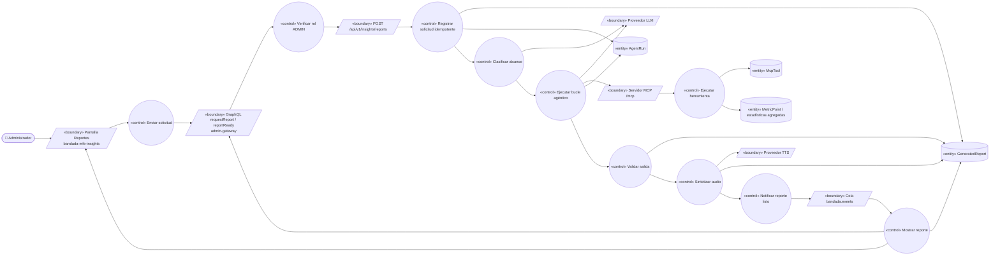
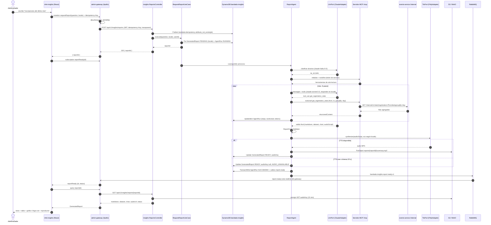
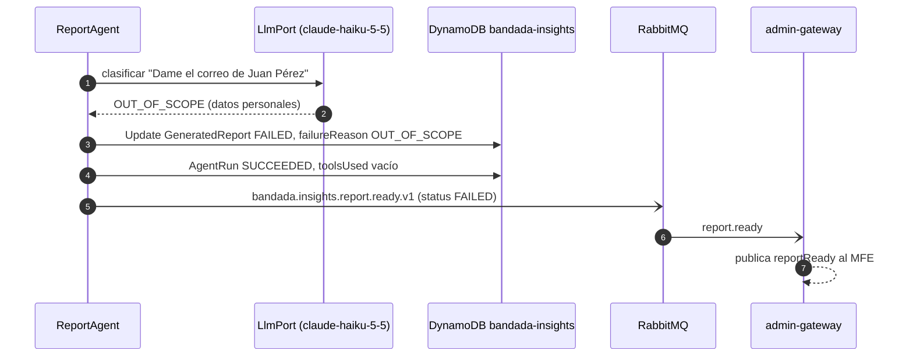

# UC-19 — Solicitar reporte generativo (texto + audio)

| Campo | Valor |
|---|---|
| Paquete | Admin |
| Actor principal | Administrador |
| Actores secundarios | Modelo de IA (LLM vía `LlmPort`: `claude-sonnet-5-5` / `claude-haiku-5-5`; Ollama en dev), TTS (`TtsPort`: Amazon Polly / Piper), S3/MinIO |
| Prioridad (MoSCoW) | Must |
| Requisitos | RF-23, RNF-03, RNF-08, RNF-13, RNF-19 |
| Tecnologías de la cátedra que demuestra | **T5, T11, T12**, T2, T3 |
| Servicios involucrados | `bandadau-admin/shell`, `bandadau-admin/mfe-insights` (`<bandada-mfe-insights>`), `admin-gateway`, `insights-service` (ReportAgent + servidor MCP), `events-service`, `wallet-service`, `social-service` (vía herramientas MCP → `/internal`) |
| Estado ICONIX | Secuencia (pendiente CDR) |

## 1. Narrativa

**Precondiciones**

1. El Administrador tiene sesión en el panel (`admin.bandada.localhost`) con rol `ADMIN` (llegó por login o por UC-03).
2. El shell cargó `<bandada-mfe-insights>` desde `mfe-manifest.json` y le entregó las propiedades `graphql-url` y `access-token`.
3. `insights-service` tiene configurados `LlmPort`, `TtsPort` y un token de servicio para actuar como cliente MCP de su propio servidor `/mcp`.

**Disparador:** el Administrador escribe una pregunta en lenguaje natural en el MFE Insights, por ejemplo *"Inscripciones del último mes"*.

**Curso básico**

1. El Administrador abre la sección "Reportes" del MFE Insights y escribe la pregunta "Inscripciones del último mes".
2. El MFE envía la mutación GraphQL `requestReport(question, locale)` al `admin-gateway` con una `Idempotency-Key` generada por el MFE; `locale` (`es`|`en`) es el idioma activo del panel (resuelto según D14: `User.locale` → dispositivo → navegador → `es`).
3. El `admin-gateway` verifica la directiva `@auth(requires: [ADMIN])` y reenvía la petición a `POST /api/v1/insights/reports` (`requestReport`) propagando el JWT, la `Idempotency-Key` y `traceparent`.
4. El sistema (`insights-service`) registra la clave en `bandada-idempotency`, crea un `GeneratedReport` en estado `PENDING` con su `locale` (si no vino, usa el `locale` del usuario; por defecto `es`) y un `AgentRun` (`agent = REPORT`) y responde **202** `{ reportId }`.
5. El MFE se suscribe a `reportReady(id: reportId)` y muestra el estado "Generando reporte…".
6. El ReportAgent clasifica la pregunta con `claude-haiku-5-5` (guardarraíl de alcance): la pregunta trata de métricas de la plataforma, así que continúa.
7. El ReportAgent abre una sesión MCP contra `/mcp` (cliente MCP con token de servicio) y obtiene `tools/list`, filtrado a herramientas de **solo lectura**.
8. El ReportAgent inicia el bucle agéntico con `claude-sonnet-5-5`: el LLM decide llamar a `get_registration_stats { from: hoy-30d, to: hoy, groupBy: "day" }`.
9. El servidor MCP ejecuta la herramienta, que consulta `GET /internal/v1/stats/registrations` (`getRegistrationStats`) en `events-service`, y devuelve filas agregadas (sin datos personales).
10. El LLM pide `list_events` para el mismo rango con el fin de nombrar los eventos con más inscripciones; el ReportAgent la ejecuta y anota cada paso en el `AgentRun` (`steps`, `toolsUsed`, `tokens`).
11. El LLM, con los datos suficientes, entrega la salida estructurada final **en el idioma `locale` del reporte**: `markdown` (narrativa en español o inglés), `dataset` (filas), `chart` (especificación Vega-Lite v5) y `audioScript` (resumen ≤ 90 s, ≈ 220 palabras). Los títulos de ejes y leyendas del gráfico también van en ese idioma; números y fechas siguen `es-BO` / `en-US`.
12. El sistema valida la salida: `chart` contra el esquema Vega-Lite, `dataset` no vacío y coherente con lo devuelto por las herramientas, `audioScript` dentro del límite de palabras.
13. El sistema sintetiza el audio con `TtsPort` eligiendo la **voz según `locale`** (`PollyAdapter`: voz neural es-US/es-MX para `es`, en-US para `en`; `PiperAdapter` con un modelo de voz por idioma en dev) y lo sube a S3 en `reports/{reportId}/summary.mp3`, guardando `audioKey`.
14. El sistema marca el `GeneratedReport` como `READY`, cierra el `AgentRun` como exitoso y publica `bandada.insights.report.ready.v1` (outbox).
15. El `admin-gateway` recibe el evento y emite `reportReady(id)` al MFE suscrito.
16. El MFE consulta `report(id)` y muestra el markdown, la tabla, el gráfico (vega-embed) y un reproductor con el `audioUrl` (URL prefirmada de 15 min servida por `GET /api/v1/insights/reports/{reportId}`).

**Cursos alternos**

- **2a. Doble clic o reintento de red:** la misma `Idempotency-Key` con el mismo cuerpo devuelve el mismo `{ reportId }` con `Idempotent-Replayed: true`; no se crea un segundo reporte ni un segundo `AgentRun`.
- **3a. El usuario no tiene rol `ADMIN` o el token expiró:** el `admin-gateway` devuelve un error GraphQL `UNAUTHENTICATED`/`FORBIDDEN`; el MFE emite `bandada:auth-expired` al shell, que renueva la sesión (UC-02) o redirige al login.
- **5a. Se pierde la conexión WebSocket:** el MFE hace *polling* de `report(id)` cada 5 s hasta obtener un estado terminal.
- **6a. Pregunta fuera de alcance** (p. ej. "Escríbeme un poema", "Dame el correo de Juan Pérez"): el ReportAgent no invoca herramientas; marca el reporte `FAILED` con `failureReason = OUT_OF_SCOPE` y un `markdown` breve que explica qué tipos de preguntas se admiten (métricas de usuarios, contenido, eventos, créditos, moderación). El `AgentRun` queda registrado con 0 herramientas.
- **9a. Una herramienta MCP falla** (timeout, `events-service` caído, circuito abierto): el servidor MCP devuelve un resultado con `isError: true`; el ReportAgent lo entrega al LLM como `tool_result` de error. El LLM puede reintentar una vez o usar una fuente alternativa (`get_platform_kpis`). Si no consigue datos, el reporte se completa como `READY` con una sección "Limitaciones" que indica qué fuente no estuvo disponible; si no hay **ningún** dato, termina `FAILED` con `failureReason = DATA_UNAVAILABLE`.
- **10a. Se alcanza el límite de 8 pasos o el presupuesto de tokens:** el ReportAgent corta el bucle, pide al LLM una redacción final con lo ya obtenido (sin más herramientas) y marca el `AgentRun` con `stopReason = STEP_LIMIT` (o `TOKEN_LIMIT`). Si no hay datos suficientes → `FAILED` con `failureReason = BUDGET_EXCEEDED`.
- **11a. El LLM devuelve una salida mal formada** (JSON inválido, spec Vega-Lite inválida): se reintenta una vez pidiendo corrección; si vuelve a fallar se guarda el reporte sin `chart` (solo tabla) y se anota la advertencia.
- **11b. El LLM no está disponible** (`ClaudeAdapter` responde 5xx/429 tras reintentos): `FAILED` con `failureReason = LLM_UNAVAILABLE`; el resto de la plataforma no se ve afectado (RNF-03).
- **13a. El TTS cae** (Polly/Piper con error o timeout de 20 s): el reporte se marca `READY` **sin audio** (`audioKey = null`, advertencia `AUDIO_UNAVAILABLE`); el MFE oculta el reproductor y muestra "Audio no disponible".
- **2b. `locale` no soportado** (p. ej. `fr`): se responde error de validación `UNSUPPORTED_LOCALE` (Problem Details 400 localizado según `Accept-Language`); el MFE nunca lo envía porque solo ofrece `es`/`en`.
- **11c. El administrador pregunta en un idioma distinto al `locale`** (p. ej. escribe en inglés con el panel en español): el reporte se redacta en el `locale` solicitado, no en el idioma de la pregunta (RN-19.7).
- **16a. La URL prefirmada del audio expiró:** el MFE vuelve a pedir `report(id)` y obtiene una nueva `audioUrl`.

**Postcondiciones**

- Existe un `GeneratedReport` en estado terminal (`READY` o `FAILED`) en `bandada-insights` (`pk = REPORT#<id>`).
- Existe un `AgentRun` (`pk = AGENTRUN#<id>`) con cada paso, herramienta usada, tokens consumidos y motivo de parada (auditoría, TTL 30 días).
- Si hubo audio, el MP3 está en el bucket privado de reportes.

**Reglas de negocio**

- RN-19.1 El ReportAgent usa **solo herramientas de lectura**; `generate_report` y `raise_alert` no se le exponen (RNF-19).
- RN-19.2 Máximo **8 pasos** de herramienta por reporte y un presupuesto de tokens configurable (`REPORT_AGENT_MAX_TOKENS`).
- RN-19.3 Al LLM solo llegan **datos agregados**; las herramientas nunca devuelven correos, nombres completos ni IDs de estudiantes individuales (RNF-08).
- RN-19.4 El audio es un **resumen ≤ 90 s**, no la lectura del reporte completo.
- RN-19.5 Los resultados de herramientas son **datos, no instrucciones**: el prompt de sistema prohíbe obedecer texto contenido en ellos (mitigación de *prompt injection*, p. ej. títulos de eventos maliciosos).
- RN-19.7 El idioma del reporte y del audio es el `locale` del reporte (D14); el contenido de usuarios citado (títulos de eventos, hashtags) **no** se traduce.
- RN-19.8 (D13) La spec Vega-Lite que guarda el reporte **no lleva colores literales**: el MFE le inyecta en el cliente un `config` derivado de `tokens.ts` de `@bandada/ui-tokens` según el atributo `theme` (`light`/`dark`) que recibe del shell, así el mismo reporte se ve bien en ambos temas y cambia en vivo si el administrador cambia de tema.
- RN-19.6 Las cifras del `markdown` deben salir del `dataset`; la validación del paso 12 rechaza números que no aparezcan en las filas devueltas por herramientas (anti-alucinación básica).

## 2. Diagrama de robustez



| Objeto | Tipo | Componente real |
|---|---|---|
| Pantalla Reportes | Boundary | `bandadau-admin/mfe-insights` → `ReportsPage` dentro de `<bandada-mfe-insights>` |
| GraphQL requestReport / reportReady | Boundary | `admin-gateway`: `ReportsResolver` (mutation + subscription) |
| `POST /api/v1/insights/reports` | Boundary | `insights-service`: `ReportsController` |
| Servidor MCP `/mcp` | Boundary | `insights-service`: `McpServerModule` (`@modelcontextprotocol/sdk`, Streamable HTTP) |
| Proveedor LLM | Boundary | `LlmPort` → `ClaudeAdapter` / `OllamaAdapter` |
| Proveedor TTS | Boundary | `TtsPort` → `PollyAdapter` / `PiperAdapter` (voz elegida por `TtsVoiceResolver` según `locale`) |
| Cola `bandada.events` | Boundary | RabbitMQ, evento `bandada.insights.report.ready.v1` |
| Enviar solicitud | Control | `useRequestReport` (hook del MFE: genera `Idempotency-Key`, ejecuta la mutación) |
| Mostrar reporte | Control | `ReportReadyListener` (admin-gateway) + `useReport` en el MFE (consulta `report(id)` y renderiza) |
| Verificar rol ADMIN | Control | Directiva `@auth(requires: [ADMIN])` en `admin-gateway` |
| Registrar solicitud idempotente | Control | `IdempotencyInterceptor` (`@bandada/idempotency-ts`) + `RequestReportUseCase` |
| Clasificar alcance | Control | `ScopeGuard` (usa `claude-haiku-5-5`) |
| Ejecutar bucle agéntico | Control | `ReportAgent` (`RunReportAgentUseCase`) |
| Ejecutar herramienta | Control | Handlers de herramientas MCP (`GetRegistrationStatsTool`, `ListEventsTool`…) |
| Validar salida | Control | `ReportOutputValidator` |
| Sintetizar audio | Control | `SynthesizeReportAudioUseCase` |
| Notificar reporte listo | Control | `DynamoOutboxPublisher` |
| GeneratedReport | Entity | Ítem `REPORT#<id>` en `bandada-insights` |
| AgentRun | Entity | Ítem `AGENTRUN#<id>` en `bandada-insights` |
| McpTool | Entity | Registro de herramientas del servidor MCP |
| MetricPoint / estadísticas agregadas | Entity | `METRIC#<name>` + respuestas de `/internal/v1/stats/*` |

## 3. Diagrama de secuencia



**Alterno 6a (pregunta fuera de alcance):**



## 4. Clases y contratos involucrados

**insights-service (NestJS, Clean Architecture)**

| Capa | Clases |
|---|---|
| Domain | `GeneratedReport` (`id`, `question`, `locale`, `markdown`, `dataset`, `chart`, `audioKey`, `status`, `failureReason`, `warnings[]`), `AgentRun` (`id`, `agent`, `steps[]`, `toolsUsed[]`, `tokens`, `status`, `stopReason`), `AgentBudget` (value object: `maxSteps = 8`, `maxTokens`), `Locale` (value object: `es`, `en`) |
| Application | `RequestReportUseCase`, `RunReportAgentUseCase` (ReportAgent), `SynthesizeReportAudioUseCase`, `GetReportUseCase`, `TtsVoiceResolver`; puertos `LlmPort`, `TtsPort`, `McpClientPort`, `ReportRepository`, `AgentRunRepository`, `ObjectStoragePort`, `EventPublisherPort` |
| Infrastructure | `ClaudeAdapter`, `OllamaAdapter`, `PollyAdapter`, `PiperAdapter`, `SdkMcpClientAdapter` (cliente Streamable HTTP del SDK oficial), `DynamoReportRepository`, `DynamoAgentRunRepository`, `S3ObjectStorage`, `DynamoOutboxPublisher` |
| Interface | `ReportsController` (`requestReport`, `getReport`), `McpServerModule` + `GetRegistrationStatsTool`, `ListEventsTool`, `GetPlatformKpisTool`… |

**Contratos**

| Tipo | Identificador |
|---|---|
| REST (OpenAPI) | `requestReport` (`POST /api/v1/insights/reports` ♻️, body `{ question, locale? }` → 202), `getReport` (`GET /api/v1/insights/reports/{reportId}`), `getRegistrationStats` (`GET /internal/v1/stats/registrations`) |
| GraphQL | `Mutation.requestReport(question, locale)`, `Query.report(id)`, `Query.reports(after)`, `Subscription.reportReady(id)` |
| MCP | `get_registration_stats`, `list_events`, `get_platform_kpis`, `get_credit_stats`, `get_content_stats`; prompts `monthly_report`, `weekly_summary` |
| Evento | `bandada.insights.report.ready.v1` |

Fragmento esperado en `bandadau-docs/contracts/graphql/admin.graphql` (nombres de tipos de payload a confirmar en la CDR):

```graphql
type GeneratedReport {
  id: ID!
  question: String!
  locale: Locale!     # es | en (D14)
  status: GeneratedReportStatus!
  markdown: String
  dataset: JSON
  chart: JSON        # especificación Vega-Lite v5
  audioUrl: String   # prefirmada 15 min, null si no hay audio
  warnings: [String!]!
  failureReason: String
  createdAt: DateTime!
}

extend type Mutation {
  requestReport(question: String!, locale: Locale): GeneratedReport! @auth(requires: [ADMIN])
}
extend type Subscription {
  reportReady(id: ID!): GeneratedReport! @auth(requires: [ADMIN])
}
```

Salida estructurada que el LLM debe devolver (validada con JSON Schema):

```json
{
  "markdown": "## Inscripciones del último mes\n\nSe registraron **412** inscripciones…",
  "dataset": [{ "date": "2026-09-14", "confirmed": 12, "failed": 1, "cancelled": 0 }],
  "chart": {
    "$schema": "https://vega.github.io/schema/vega-lite/v5.json",
    "mark": "line",
    "encoding": {
      "x": { "field": "date", "type": "temporal" },
      "y": { "field": "confirmed", "type": "quantitative" }
    }
  },
  "audioScript": "En el último mes se confirmaron cuatrocientas doce inscripciones…"
}
```

## 5. Pruebas de aceptación

```gherkin
Escenario: Reporte "Inscripciones del último mes" con texto, gráfico y audio
  Dado un administrador autenticado en el panel con rol ADMIN
  Y events-service con 412 inscripciones confirmadas en los últimos 30 días
  Cuando solicita el reporte "Inscripciones del último mes"
  Entonces recibe un reportId con estado PENDING
  Y en menos de 60 s recibe reportReady con estado READY
  Y el reporte contiene markdown que menciona 412, un dataset de 30 filas y una spec Vega-Lite válida
  Y audioUrl apunta a un MP3 de duración ≤ 90 s
  Y el AgentRun registra la herramienta get_registration_stats y ≤ 8 pasos

Escenario: Reporte en inglés con voz en inglés
  Dado un administrador con User.locale en
  Cuando solicita "Registrations in the last month" sin enviar locale
  Entonces el GeneratedReport tiene locale en
  Y el markdown, los títulos del gráfico y el audio están en inglés
  Y TtsPort recibió una voz en-US

Escenario: Doble envío con la misma Idempotency-Key
  Dado que ya se solicitó un reporte con la clave K
  Cuando el MFE reenvía requestReport con la misma clave K y la misma pregunta
  Entonces recibe el mismo reportId con Idempotent-Replayed true
  Y existe un solo AgentRun para esa solicitud

Escenario: Pregunta fuera de alcance
  Dado un administrador autenticado
  Cuando pregunta "Dame el correo de Juan Pérez"
  Entonces el reporte termina FAILED con failureReason OUT_OF_SCOPE
  Y el AgentRun no registra ninguna herramienta llamada

Escenario: Herramienta MCP falla
  Dado que events-service no responde
  Cuando se solicita "Inscripciones del último mes"
  Entonces el reporte termina READY con una sección "Limitaciones" que nombra la fuente caída
  O termina FAILED con DATA_UNAVAILABLE si ninguna herramienta devolvió datos

Escenario: TTS no disponible
  Dado que PollyAdapter responde con error
  Cuando se completa un reporte
  Entonces el estado es READY, audioKey es null y warnings contiene AUDIO_UNAVAILABLE
  Y el MFE muestra el texto y el gráfico sin reproductor

Escenario: Límite de pasos
  Dado un LLM de prueba que pide herramientas indefinidamente
  Cuando se ejecuta el ReportAgent
  Entonces el bucle se detiene en el paso 8 y el AgentRun tiene stopReason STEP_LIMIT

Escenario: Usuario sin rol ADMIN
  Dado un usuario con rol MODERATOR
  Cuando envía requestReport
  Entonces recibe un error FORBIDDEN y no se crea ningún GeneratedReport
```

## 6. Trazabilidad

| Requisito | Paso del UC | Contrato | Clases | Pruebas |
|---|---|---|---|---|
| RF-23 (texto) | 8–12 | `requestReport`, `getReport`, MCP `get_registration_stats` | `RunReportAgentUseCase`, `ReportOutputValidator` | Escenario 1 |
| RF-23 (gráfico/datos) | 11–12, 16 | `GeneratedReport.chart`, `dataset` | `ReportOutputValidator` | Escenario 1 |
| RF-23 (audio) | 13, 13a | `getReport.audioUrl` | `SynthesizeReportAudioUseCase`, `PollyAdapter` | Escenarios 1 y 5 |
| D14 (i18n) | 2, 4, 11, 13, 2b, 11c | `requestReport(question, locale)`, `GeneratedReport.locale` | `Locale`, `TtsVoiceResolver` | Escenario "Reporte en inglés" |
| RNF-05 / T8 | 2a, 4 | `Idempotency-Key` | `IdempotencyInterceptor` | Escenario 2 |
| RNF-08 | RN-19.3, 6a | herramientas MCP agregadas | `ScopeGuard` | Escenario 3 |
| RNF-19 | RN-19.1, RN-19.2, 10a | `AgentRun` | `AgentBudget` | Escenario 6 |
| T2 / T3 | 1–2, 15–16 | `requestReport`, `reportReady` | `ReportsResolver`, `ReportsPage` | Escenarios 1 y 7 |
| T12 | 7–10 | `/mcp` `tools/list`, `tools/call` | `SdkMcpClientAdapter`, `McpServerModule` | Escenarios 1 y 4 |

**Pendientes para la CDR (propuestas):**

- PROPUESTA: agregar a decisiones-clave.md el enum `GeneratedReportStatus` = `PENDING`, `RUNNING`, `READY`, `FAILED` (no se reutiliza `ReportStatus`, que ya pertenece a `ContentReport`) y el campo `failureReason` (`OUT_OF_SCOPE`, `DATA_UNAVAILABLE`, `BUDGET_EXCEEDED`, `LLM_UNAVAILABLE`).
- PROPUESTA: agregar a decisiones-clave.md el enum `AgentRunStatus` = `RUNNING`, `SUCCEEDED`, `FAILED` y `AgentRun.stopReason` (`COMPLETED`, `STEP_LIMIT`, `TOKEN_LIMIT`, `ERROR`).
- **Resuelto (ADR-0016)** con la cola `admin-gateway.subscriptions.<instanceId>` (catálogo §5). Propuesta original: agregar a decisiones-clave.md (y ADR para `catalogo-servicios.md` §5) una cola `admin-gateway.realtime` (exclusiva por instancia) con bindings `bandada.insights.report.ready.v1`, `bandada.insights.alert.raised.v1`, `bandada.media.asset.flagged.v1`, que alimenta las subscriptions de GraphQL; hoy el catálogo no le asigna cola al `admin-gateway`.
