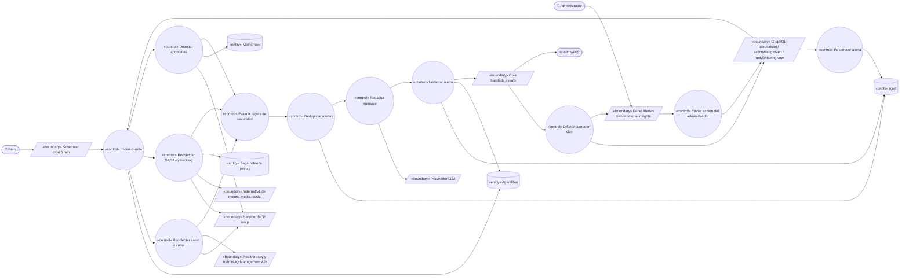
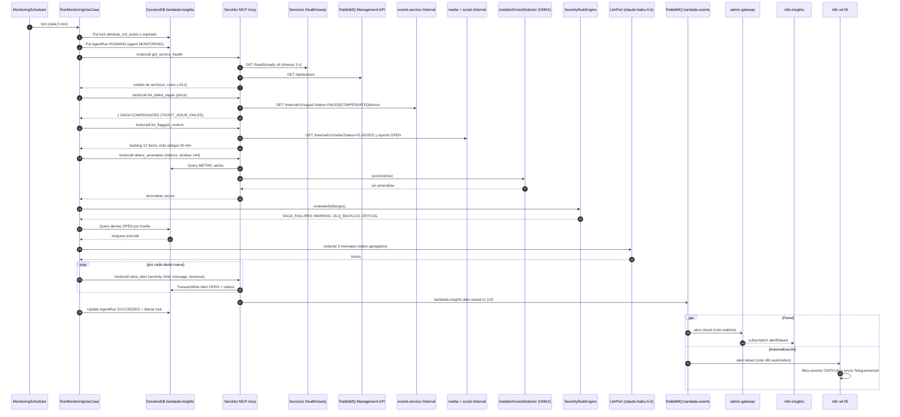
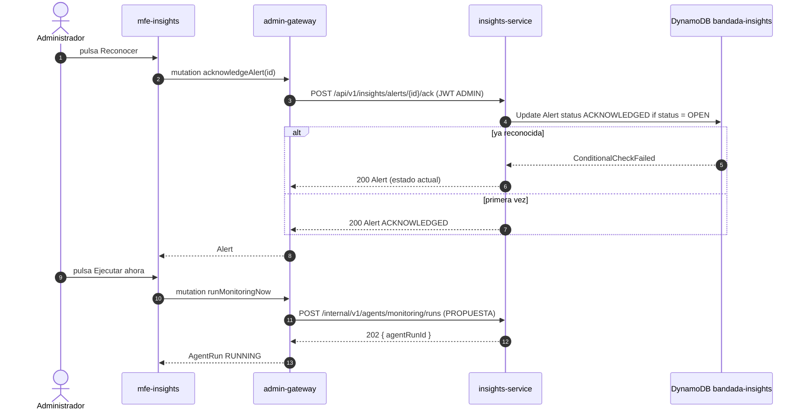

# UC-20 — Monitorear la plataforma con el agente

| Campo | Valor |
|---|---|
| Paquete | Admin |
| Actor principal | Reloj (scheduler del `MonitoringAgent`, cada 5 min) |
| Actores secundarios | Administrador (recibe y reconoce alertas, fuerza una corrida), Modelo de IA (`anomaly-detector` Isolation Forest ONNX; LLM `claude-haiku-5-5` para redactar), n8n (`wf-05-alerta-critica`), RabbitMQ Management API |
| Prioridad (MoSCoW) | Must |
| Requisitos | RF-24, RNF-03, RNF-04, RNF-13, RNF-19 |
| Tecnologías de la cátedra que demuestra | **T5, T3, T9**, T10, T2, T12 |
| Servicios involucrados | `insights-service` (MonitoringAgent + servidor MCP), `events-service`, `media-service`, `social-service` (vía `/internal`), todos los servicios (`/health/ready`), RabbitMQ, `admin-gateway`, `bandadau-admin/mfe-insights`, n8n, `notification-service` |
| Estado ICONIX | Implementado (fase 2): reglas deterministas + detector estadístico (sin ONNX de anomalías) |

## 1. Narrativa

**Precondiciones**

1. `insights-service` está en ejecución con el scheduler habilitado (`MONITORING_CRON = */5 * * * *`) y un token de servicio vigente para su cliente MCP.
2. El modelo `anomaly-detector` está cargado desde `models/anomaly-detector/<versión>/model.onnx` (MinIO/S3) en `onnxruntime-node`.
3. La proyección de métricas (`METRIC#<name>` / `<yyyy-mm-dd>`) se alimenta de la cola `insights-service.analytics` (`bandada.#`).

**Disparador:** el Reloj dispara la corrida programada cada 5 minutos (o el Administrador pulsa "Ejecutar ahora", ver 1a).

**Curso básico**

1. El Reloj dispara el `MonitoringAgent`; el sistema adquiere un candado de corrida (no se solapan dos corridas) y crea un `AgentRun` (`agent = MONITORING`).
2. El MonitoringAgent abre una sesión MCP contra `/mcp` con token de servicio.
3. El MonitoringAgent llama a `get_service_health`; el servidor MCP consulta `GET /health/ready` de los 9 servicios y la API de administración de RabbitMQ (profundidad de colas y de colas DLQ ligadas a `bandada.dlx`).
4. El MonitoringAgent llama a `list_failed_sagas { since: última corrida }`, que consulta `GET /internal/v1/sagas?status=FAILED|COMPENSATED&since` (`listSagas`) en `events-service`.
5. El MonitoringAgent llama a `list_flagged_content` para medir el *backlog* de moderación (cantidad y antigüedad del ítem más viejo) en `media-service` y `social-service`.
6. El MonitoringAgent llama a `detect_anomalies { metrics: [registrations, posts, topups, failedLogins], window: 14d }`; el sistema evalúa los `MetricPoint` con el Isolation Forest y devuelve los puntos con `anomalyScore` por encima del umbral.
7. El sistema evalúa las **reglas deterministas** de severidad sobre los hallazgos (tabla RN-20.2). En el ejemplo: hay 1 SAGA `COMPENSATED` nueva por `TICKET_ISSUE_FAILED` y la cola DLQ de `ticketing-service.commands` tiene 3 mensajes → hallazgos `SAGA_FAILURES` (WARNING) y `DLQ_BACKLOG` (CRITICAL).
8. Para cada hallazgo, el sistema calcula una huella (`kind` + recurso afectado) y comprueba que no exista ya una `Alert` abierta con esa huella (deduplicación).
9. El MonitoringAgent pide a `claude-haiku-5-5` un texto breve en lenguaje natural para cada alerta nueva (qué pasó, impacto, siguiente paso sugerido), usando solo los datos agregados de los hallazgos.
10. El MonitoringAgent llama a `raise_alert` (herramienta de escritura reservada a agentes internos) por cada hallazgo nuevo; el sistema guarda la `Alert` (`status = OPEN`) y, en la misma transacción DynamoDB, el mensaje de outbox.
11. El sistema publica `bandada.insights.alert.raised.v1` (`alertId`, `severity`, `kind`, `message`, `resource`, `agentRunId`).
12. El `admin-gateway` recibe el evento y emite la subscription `alertRaised` a los paneles conectados; el MFE Insights muestra la alerta en vivo (toast vía `bandada:toast` + lista "Alertas abiertas").
13. n8n (`wf-05-alerta-critica`) recibe el mismo evento en `n8n.automation`, filtra `severity = CRITICAL` y envía Telegram/email al equipo.
14. `notification-service` recibe el evento en `notification-service.events` y crea notificaciones in-app tipo `ALERT` para los administradores (ver UC-24).
15. El sistema cierra el `AgentRun` con `status = SUCCEEDED`, herramientas usadas, hallazgos y alertas creadas, y libera el candado.

**Cursos de reconocimiento y ejecución manual**

- **1a. El Administrador fuerza una corrida:** en el MFE Insights pulsa "Ejecutar ahora"; el MFE envía `runMonitoringNow`; el `admin-gateway` (con `@auth(requires: [ADMIN])`) lo reenvía a `insights-service`, que responde con el `agentRunId` y ejecuta los pasos 2–15. Si hay una corrida en curso, devuelve la corrida existente (no crea otra).
- **16. El Administrador reconoce una alerta:** pulsa "Reconocer"; el MFE envía `acknowledgeAlert(id)`; el `admin-gateway` llama a `POST /api/v1/insights/alerts/{id}/ack`; el sistema pasa la `Alert` a `ACKNOWLEDGED` con `acknowledgedBy` y `acknowledgedAt`. Reconocer dos veces es idempotente (devuelve el mismo estado).

**Cursos alternos**

- **1b. Una corrida anterior sigue en curso** (candado tomado): la nueva corrida se omite y se registra la métrica `monitoring_run_skipped_total`.
- **3a. Un servicio no responde a `/health/ready`** (timeout 3 s): el hallazgo es `SERVICE_DOWN` con severidad CRITICAL si falla en 2 corridas consecutivas (evita falsos positivos por un reinicio), WARNING en la primera.
- **3b. La propia herramienta MCP falla** (RabbitMQ Management API no disponible): el agente registra el paso con error, continúa con las demás herramientas y emite un hallazgo `MONITORING_DEGRADED` (WARNING). Una falla de una herramienta nunca aborta la corrida completa.
- **6a. No hay historia suficiente** (< 7 días de `MetricPoint`): `detect_anomalies` devuelve `insufficientData = true` y se omite la regla de anomalías.
- **8a. Ya existe una alerta abierta con la misma huella:** no se crea otra; se actualiza `lastSeenAt` y `occurrences` de la existente (sin nuevo evento). Si la severidad subió (WARNING → CRITICAL), se crea una alerta nueva con la severidad mayor.
- **8b. Un problema se resolvió** (la DLQ volvió a 0, el servicio responde): el agente marca la alerta abierta como `RESOLVED` automáticamente y registra el cambio en el `AgentRun`.
- **9a. El LLM no está disponible:** el mensaje se arma con una plantilla determinista en español (`"DLQ de {queue} con {count} mensajes"`). El monitoreo no depende del LLM.
- **10a. Se supera el límite de 8 pasos** (muchas herramientas o muchos hallazgos): se agrupan los hallazgos restantes en una única alerta resumen y se cierra la corrida con `stopReason = STEP_LIMIT`.
- **12a. Ningún panel está conectado:** la alerta queda `OPEN` y aparece al abrir el panel (`Query.alerts(status: OPEN)`).
- **13a. n8n está caído:** el mensaje queda en la cola `n8n.automation` y se procesa al volver; el panel y las notificaciones in-app no se ven afectados.

**Postcondiciones**

- Cada problema detectado tiene exactamente una `Alert` abierta (`ALERT#<id>` en `bandada-insights`).
- La corrida queda auditada en `AgentRun` (`AGENTRUN#<id>`, TTL 30 días).
- Las alertas CRITICAL llegaron al equipo por Telegram/email.

**Reglas de negocio**

- RN-20.1 El agente **no ejecuta acciones correctivas** (no reintenta SAGAs, no purga colas, no reinicia servicios): solo observa y alerta (RNF-19).
- RN-20.2 Reglas de severidad (valores iniciales, configurables por variable de entorno):

| `kind` | Condición | Severidad |
|---|---|---|
| `SERVICE_DOWN` | `/health/ready` falla 2 corridas seguidas | CRITICAL |
| `DLQ_BACKLOG` | cualquier DLQ con > 0 mensajes | CRITICAL |
| `SAGA_FAILURES` | ≥ 1 SAGA `FAILED`/`COMPENSATED` nueva (≥ 5 en 1 h → CRITICAL) | WARNING / CRITICAL |
| `MODERATION_BACKLOG` | > 50 ítems o el más antiguo > 2 h | WARNING |
| `QUEUE_BACKLOG` | cola principal con > 1 000 mensajes listos | WARNING |
| `METRIC_ANOMALY` | `anomalyScore` del Isolation Forest sobre el umbral | INFO / WARNING |
| `MONITORING_DEGRADED` | una herramienta de monitoreo falló | WARNING |

- RN-20.3 La severidad la deciden las reglas; el LLM solo redacta el texto (predecible y auditable).
- RN-20.5 (D14) Cada `Alert` guarda `kind` + `params` (códigos estables, sin idioma) y un `message` redactado en `es` (idioma fuente). El MFE muestra el título traducido por `kind` (`@bandada/i18n`, `insights.alerts.kind.*`) en el idioma del administrador; el texto libre del LLM se muestra como detalle. `notification-service` renderiza las notificaciones `ALERT` con su plantilla según el `locale` de cada destinatario (UC-24), y n8n wf-05 envía en `es`.
- RN-20.6 (D13) Los colores de severidad (`INFO`, `WARNING`, `CRITICAL`) del panel salen de los tokens semánticos `color.feedback.*` en ambos temas; nunca de colores literales.
- RN-20.4 Una sola corrida a la vez (candado con `ConditionExpression` sobre un ítem de candado, expira a los 4 min).

## 2. Diagrama de robustez



> Nota de notación: n8n se modela como actor secundario (sistema externo) que recibe de la *boundary* cola.

| Objeto | Tipo | Componente real |
|---|---|---|
| Scheduler cron 5 min | Boundary | `insights-service`: `MonitoringScheduler` (`@nestjs/schedule`, `@Cron`) |
| Servidor MCP `/mcp` | Boundary | `McpServerModule` de `insights-service` |
| `/health/ready` y RabbitMQ Management API | Boundary | Endpoints de salud de S1–S9; `http://rabbitmq:15672/api/queues` |
| `/internal/v1` | Boundary | `listSagas` (events), `listFlaggedMedia` (media), `GET /internal/v1/reports?status=OPEN` (social) |
| Cola `bandada.events` | Boundary | RabbitMQ, `bandada.insights.alert.raised.v1` |
| Panel Alertas | Boundary | `AlertsPage` en `<bandada-mfe-insights>` |
| GraphQL | Boundary | `admin-gateway`: `AlertsResolver`, `MonitoringResolver` |
| Proveedor LLM | Boundary | `LlmPort` → `ClaudeAdapter` (`claude-haiku-5-5`) / `OllamaAdapter` |
| Difundir alerta en vivo | Control | `RealtimeEventsConsumer` + PubSub de `graphql-ws` (admin-gateway) |
| Enviar acción del administrador | Control | Hooks del MFE (`useAcknowledgeAlert`, `useRunMonitoringNow`) |
| Iniciar corrida | Control | `RunMonitoringUseCase` + `RunLock` |
| Recolectar salud y colas | Control | Herramienta `get_service_health` (`ServiceHealthTool`) |
| Recolectar SAGAs y backlog | Control | Herramientas `list_failed_sagas`, `list_flagged_content` |
| Detectar anomalías | Control | Herramienta `detect_anomalies` → `IsolationForestDetector` (`onnxruntime-node`) |
| Evaluar reglas de severidad | Control | `SeverityRuleEngine` |
| Deduplicar alertas | Control | `AlertDeduplicator` |
| Redactar mensaje | Control | `AlertMessageComposer` (LLM con *fallback* a plantilla) |
| Levantar alerta | Control | Herramienta `raise_alert` → `RaiseAlertUseCase` |
| Reconocer alerta | Control | `AcknowledgeAlertUseCase` |
| AgentRun / Alert / MetricPoint | Entity | Ítems `AGENTRUN#`, `ALERT#`, `METRIC#` en `bandada-insights` |
| SagaInstance (vista) | Entity | DTO de `listSagas` (no se replica la tabla de events) |

## 3. Diagrama de secuencia



**Reconocimiento y ejecución manual (16 y 1a):**



## 4. Clases y contratos involucrados

**insights-service (NestJS, Clean Architecture)**

| Capa | Clases |
|---|---|
| Domain | `Alert` (`id`, `severity: AlertSeverity`, `kind`, `message`, `resource`, `status`, `fingerprint`, `occurrences`, `lastSeenAt`, `acknowledgedBy`), `AgentRun`, `MetricPoint`, `Finding` (value object), `SeverityRuleEngine` (servicio de dominio) |
| Application | `RunMonitoringUseCase` (MonitoringAgent), `RaiseAlertUseCase`, `AcknowledgeAlertUseCase`, `ListAlertsUseCase`; puertos `McpClientPort`, `AnomalyDetectorPort`, `LlmPort`, `AlertRepository`, `AgentRunRepository`, `RunLockPort`, `EventPublisherPort` |
| Infrastructure | `MonitoringScheduler`, `IsolationForestDetector` (`onnxruntime-node`), `RabbitManagementClient`, `DynamoAlertRepository`, `DynamoRunLock`, `DynamoOutboxPublisher`, `ClaudeAdapter` |
| Interface | `AlertsController` (`GET /insights/alerts?status`, `POST /insights/alerts/{id}/ack`), herramientas MCP `ServiceHealthTool`, `ListFailedSagasTool`, `ListFlaggedContentTool`, `DetectAnomaliesTool`, `RaiseAlertTool` |

**admin-gateway:** `AlertsResolver` (`alerts(status)`, `acknowledgeAlert(id)`, `alertRaised`), `MonitoringResolver` (`runMonitoringNow`, `agentRuns(after)`, `serviceHealth`), `InsightsDataSource`, `RealtimeEventsConsumer`.

**Contratos**

| Tipo | Identificador |
|---|---|
| MCP | `get_service_health`, `list_failed_sagas`, `list_flagged_content`, `detect_anomalies`, `raise_alert` (escritura, solo agentes internos); recurso `bandada://alerts/open` |
| REST | `GET /api/v1/insights/alerts?status`, `POST /api/v1/insights/alerts/{id}/ack`, `GET /api/v1/insights/agent-runs/{id}`, `listSagas`, `listFlaggedMedia` |
| GraphQL | `Query.alerts(status)`, `Query.agentRuns(after)`, `Query.serviceHealth`, `Mutation.acknowledgeAlert(id)`, `Mutation.runMonitoringNow`, `Subscription.alertRaised` |
| Evento | `bandada.insights.alert.raised.v1` |
| n8n | `wf-05-alerta-critica` |
| ML | `anomaly-detector` (`bandadau-ml/notebooks/05-anomalies.ipynb` → ONNX vía skl2onnx) |

Ejemplo de `data` del evento `bandada.insights.alert.raised.v1`:

```json
{
  "alertId": "0199e3a1-7c2f-7b10-9a51-3f4c1d2e8a01",
  "severity": "CRITICAL",
  "kind": "DLQ_BACKLOG",
  "resource": "ticketing-service.commands.dlq",
  "message": "La DLQ de ticketing-service.commands tiene 3 mensajes. Coincide con 1 SAGA compensada por TICKET_ISSUE_FAILED en los últimos 5 min. Revisar ticketing-service.",
  "agentRunId": "0199e3a1-6a00-7c33-8b2e-55aa10b2c4d7",
  "raisedAt": "2026-10-14T15:05:00Z"
}
```

## 5. Pruebas de aceptación

```gherkin
Escenario: SAGA fallida y DLQ generan alertas en vivo
  Dado CHAOS_TICKETING_FAIL=true y una inscripción que terminó COMPENSATED
  Y la DLQ de ticketing-service.commands con 3 mensajes
  Y un administrador con el panel de Alertas abierto
  Cuando se ejecuta la corrida de monitoreo
  Entonces se crean una alerta SAGA_FAILURES WARNING y una DLQ_BACKLOG CRITICAL
  Y el panel recibe ambas por alertRaised en menos de 5 s
  Y n8n wf-05 envía un mensaje solo por la alerta CRITICAL
  Y el AgentRun queda SUCCEEDED con las 5 herramientas registradas

Escenario: Deduplicación
  Dado una alerta DLQ_BACKLOG abierta para ticketing-service.commands.dlq
  Cuando la siguiente corrida vuelve a encontrar la DLQ con mensajes
  Entonces no se crea una alerta nueva ni se publica un evento
  Y occurrences de la alerta existente aumenta en 1

Escenario: Auto-resolución
  Dado una alerta DLQ_BACKLOG abierta
  Cuando la DLQ vuelve a 0 mensajes
  Entonces la alerta pasa a RESOLVED en la siguiente corrida

Escenario: Anomalía de métricas con Isolation Forest
  Dado 14 días de MetricPoint de registrations con un pico de 10x hoy
  Cuando se ejecuta detect_anomalies
  Entonces se crea una alerta METRIC_ANOMALY con anomalyScore sobre el umbral

Escenario: LLM caído
  Dado que LlmPort lanza error
  Cuando se detecta DLQ_BACKLOG
  Entonces la alerta se crea igual con el mensaje de plantilla

Escenario: Reconocer alerta dos veces
  Dado una alerta OPEN
  Cuando el administrador ejecuta acknowledgeAlert dos veces
  Entonces la alerta queda ACKNOWLEDGED con un único acknowledgedAt

Escenario: Ejecutar ahora mientras corre otra corrida
  Dado una corrida en curso
  Cuando el administrador ejecuta runMonitoringNow
  Entonces recibe el agentRunId de la corrida en curso y no se crea otra

Escenario: Alerta mostrada en el idioma del administrador
  Dado un administrador con User.locale en y el panel en tema DARK
  Cuando llega alertRaised con kind DLQ_BACKLOG
  Entonces el título de la alerta se muestra en inglés traducido por kind
  Y el color CRITICAL usa el token color.feedback.danger del tema oscuro

Escenario: El agente no puede actuar sobre la plataforma
  Dado el conjunto de herramientas visible para el MonitoringAgent
  Entonces solo contiene herramientas de lectura más raise_alert
```

## 6. Trazabilidad

| Requisito | Paso del UC | Contrato | Clases | Pruebas |
|---|---|---|---|---|
| RF-24 (servicios caídos, DLQ) | 3, 3a, 7 | MCP `get_service_health` | `ServiceHealthTool`, `SeverityRuleEngine` | Escenario 1 |
| RF-24 (SAGAs fallidas) | 4, 7 | MCP `list_failed_sagas`, `listSagas` | `ListFailedSagasTool` | Escenario 1 |
| RF-24 (backlog moderación) | 5 | MCP `list_flagged_content` | `ListFlaggedContentTool` | — (unitaria de regla) |
| RF-24 (picos anómalos) / T9 | 6, 6a | MCP `detect_anomalies` | `IsolationForestDetector` | Escenario 4 |
| RF-24 (alertas en vivo) / T3 | 10–12, 16 | `alertRaised`, `acknowledgeAlert`, `bandada.insights.alert.raised.v1` | `RaiseAlertUseCase`, `AlertsResolver` | Escenarios 1, 6 |
| T10 | 13 | `wf-05-alerta-critica` | — | Escenario 1 |
| RNF-19 | RN-20.1, 15 | `AgentRun` | `RunMonitoringUseCase` | Escenario 8 |
| RNF-03 | 9a, 13a | — | `AlertMessageComposer` | Escenario 5 |
| D13 / D14 | RN-20.5, RN-20.6 | `Alert.kind`, `params` | `AlertsPage` (i18next, tokens) | Escenario 9 |

**Pendientes para la CDR (propuestas):**

- PROPUESTA: agregar a decisiones-clave.md el endpoint interno `POST /internal/v1/agents/monitoring/runs` (`runMonitoringNow`) en insights-service; D1 no define cómo el `admin-gateway` dispara una corrida manual.
- PROPUESTA: agregar a decisiones-clave.md el campo `Alert.params` (mapa de parámetros para traducir por `kind`, D14).
- PROPUESTA: agregar a decisiones-clave.md el enum `AlertStatus` = `OPEN`, `ACKNOWLEDGED`, `RESOLVED`, el enum `AlertKind` (valores de RN-20.2) y los campos `Alert.resource`, `fingerprint`, `occurrences`, `lastSeenAt`.
- PROPUESTA: agregar a catalogo-servicios.md §6 (vía ADR) los patrones de clave `LOCK#monitoring` y `OUTBOX#<eventId>` en `bandada-insights` (candado de corrida y outbox en DynamoDB con `TransactWriteItems`).
- **Resuelto (ADR-0016)**: la cola `admin-gateway.subscriptions.<instanceId>` (catálogo §5) alimenta `alertRaised`.
- PROPUESTA: que `bandada.insights.alert.raised.v1` incluya `recipientUserIds` (administradores resueltos por insights vía `searchUsers` con filtro de rol) para que `notification-service` pueda crear notificaciones `ALERT` sin conocer roles (ver UC-24).
