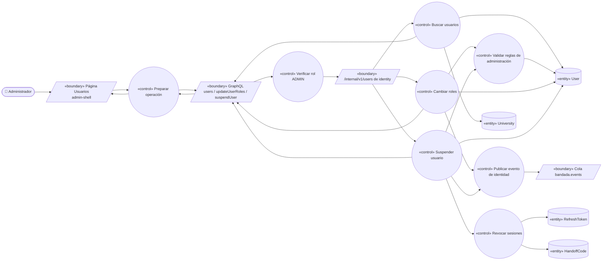
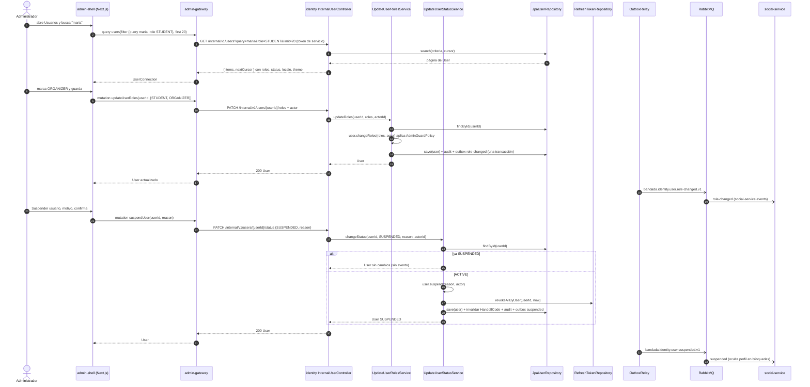
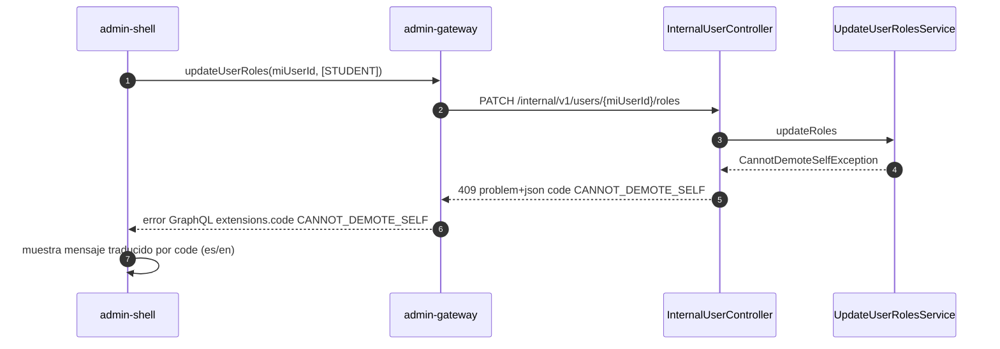

# UC-21 — Gestionar usuarios y roles

| Campo | Valor |
|---|---|
| Paquete | Admin |
| Actor principal | Administrador |
| Actores secundarios | `identity-service` (dueño de `User`), `social-service` (consume eventos de identidad) |
| Prioridad (MoSCoW) | Must |
| Requisitos | RF-25, RNF-06, RNF-07, RNF-13 |
| Tecnologías de la cátedra que demuestra | **T3**, T4 (REST interno), T13 (SSO: el panel usa la misma identidad) |
| Servicios involucrados | `bandadau-admin/shell` (página propia del shell, **no** es un MFE), `admin-gateway`, `identity-service`, RabbitMQ, `social-service` |
| Estado ICONIX | Secuencia (pendiente CDR) |

## 1. Narrativa

**Precondiciones**

1. El Administrador tiene sesión en el panel con rol `ADMIN` (login o UC-03).
2. `admin-gateway` tiene un token de servicio vigente (`POST /auth/service-token`) para llamar a `/internal/v1/users` de `identity-service`.

**Disparador:** el Administrador abre la sección "Usuarios" del panel.

**Curso básico — buscar, cambiar roles y suspender**

1. El Administrador abre "Usuarios" en el admin-shell; la página (componente del shell Next.js, no un MFE) ejecuta la query `users(filter, after, first: 20)`.
2. El `admin-gateway` valida `@auth(requires: [ADMIN])` y llama a `GET /internal/v1/users?query&role&status&universityId&cursor&limit` (`searchUsers`) con su token de servicio.
3. El sistema (`identity-service`) devuelve `{ items, nextCursor }` con `id`, `email`, `displayName`, `universityId`, `roles`, `status`, `locale`, `theme`, `createdAt`, `lastLoginAt`; el gateway lo mapea a una `UserConnection` (Relay) y resuelve `university` con DataLoader.
4. El shell muestra la tabla paginada: correo, universidad, roles (chips), estado, idioma (`es`/`en`) y tema (`SYSTEM`/`LIGHT`/`DARK`) del usuario.
5. El Administrador escribe "maria" en el buscador y filtra por rol `STUDENT`; el shell repite los pasos 1–4 con el filtro (debounce 300 ms).
6. El Administrador abre el detalle de María (`user(id)`) y marca el rol `ORGANIZER` además de `STUDENT`.
7. El shell envía `updateUserRoles(userId, roles: [STUDENT, ORGANIZER])` (la mutación reemplaza el conjunto completo de roles: es idempotente por naturaleza).
8. El `admin-gateway` llama a `PATCH /internal/v1/users/{userId}/roles` (`updateUserRoles`) con el cuerpo `{ roles }` y la cabecera de actor con el `userId` del Administrador.
9. El sistema valida las reglas (RN-21.1 a RN-21.3), actualiza `User.roles`, registra la auditoría y, en la misma transacción, escribe en el outbox `bandada.identity.user.role-changed.v1` (`userId`, `previousRoles`, `roles`, `changedBy`).
10. El sistema publica el evento; `social-service` lo consume (cola `social-service.events`, binding `bandada.identity.user.#`) para actualizar la insignia de organizador en el `Profile`.
11. El shell muestra "Roles actualizados" y la fila refleja los nuevos roles. Los nuevos roles se aplican en el **próximo access token** de María (≤ 15 min o en su siguiente `refreshToken`).
12. Más tarde, el Administrador abre el detalle de otro usuario denunciado y pulsa "Suspender", escribe un motivo y confirma en un diálogo (acción sensible, confirmación explícita).
13. El shell envía `suspendUser(userId, reason)`; el gateway llama a `PATCH /internal/v1/users/{userId}/status` (`updateUserStatus`) con `{ status: SUSPENDED, reason }`.
14. El sistema cambia `User.status` a `SUSPENDED`, **revoca todos los `RefreshToken` activos** del usuario (`revokedAt = now`, todas las familias) e invalida sus `HandoffCode` pendientes, y escribe en el outbox `bandada.identity.user.suspended.v1` (`userId`, `reason`, `suspendedBy`, `suspendedAt`) en la misma transacción.
15. El sistema publica el evento; `social-service` lo consume para ocultar el perfil del usuario suspendido en búsquedas y sugerencias.
16. El shell muestra el usuario con estado "Suspendido".

**Cursos alternos**

- **2a. La sesión del Administrador expiró:** el gateway responde `UNAUTHENTICATED`; el shell intenta `refreshToken` y repite la operación; si falla, redirige al login.
- **3a. `identity-service` no responde** (timeout/circuito abierto): el gateway devuelve un error GraphQL `SERVICE_UNAVAILABLE` con `extensions.code`; el shell muestra "No se pudo cargar la lista, reintenta" sin romper el resto del panel.
- **5a. No hay resultados:** el shell muestra el estado vacío "Ningún usuario coincide con la búsqueda".
- **7a. Rol inválido** (valor fuera de `Role`): la validación del esquema GraphQL lo rechaza antes de llegar a identity.
- **9a. El Administrador intenta quitarse a sí mismo el rol `ADMIN`:** identity responde `409` Problem Details `code = CANNOT_DEMOTE_SELF`; el shell muestra el mensaje localizado.
- **9b. Se intenta dejar la plataforma sin ningún `ADMIN` activo:** `409 LAST_ADMIN`.
- **9c. Lista de roles vacía:** `422 ROLES_REQUIRED` (todo usuario conserva al menos `STUDENT`).
- **9d. Roles iguales a los actuales:** el sistema responde 200 con el usuario sin cambios y **no** publica evento (idempotencia de negocio).
- **12a. El Administrador intenta suspenderse a sí mismo:** `409 CANNOT_SUSPEND_SELF`.
- **13a. El usuario ya está `SUSPENDED`:** el sistema responde 200 con el estado actual, no revoca de nuevo ni publica evento (repetir la mutación es seguro).
- **14a. El usuario suspendido tiene un access token vigente:** sigue siendo válido hasta su expiración (≤ 15 min, RF-03). Al intentar renovarlo, `refreshToken` falla con `401 ACCOUNT_SUSPENDED` y la app cierra sesión. Es una ventana residual aceptada y documentada.
- **14b. El usuario suspendido intenta iniciar sesión:** `login` responde `403 ACCOUNT_SUSPENDED` con texto localizado según `Accept-Language`.
- **17. Reactivar:** el Administrador pulsa "Reactivar"; `reactivateUser(userId)` → `PATCH /internal/v1/users/{userId}/status` `{ status: ACTIVE }`; el usuario vuelve a poder iniciar sesión (sus tokens revocados **no** se restauran).
- **18. Gestionar universidades** (resto de RF-25): desde "Universidades" el Administrador ejecuta `createUniversity` / actualiza dominios permitidos; el gateway llama a `POST/PATCH /internal/v1/universities` (`createUniversity`, `updateUniversity`). Un dominio duplicado entre universidades devuelve `409 DOMAIN_ALREADY_ASSIGNED`.

**Postcondiciones**

- `User.roles` / `User.status` actualizados en `identity_db`, con registro de auditoría (quién, cuándo, valores anterior y nuevo, motivo).
- Al suspender, el usuario no tiene ningún `RefreshToken` activo.
- Se publicó exactamente un evento por cambio efectivo.

**Reglas de negocio**

- RN-21.1 Solo `ADMIN` gestiona usuarios; `MODERATOR` solo puede suspender autores desde UC-18 (misma mutación `suspendUser`, autorizada para `MODERATOR` únicamente cuando se invoca desde un caso de moderación — se decide en la CDR).
- RN-21.2 Un administrador no puede quitarse `ADMIN` ni suspenderse a sí mismo; siempre debe quedar ≥ 1 `ADMIN` activo.
- RN-21.3 Todo usuario conserva el rol `STUDENT` (el resto son aditivos).
- RN-21.4 Suspender revoca todas las familias de refresh tokens y los códigos de traspaso pendientes.
- RN-21.5 `locale` y `theme` se muestran en modo **solo lectura**: son preferencias del propio usuario (`updateMyPreferences`, D13/D14) y el administrador no las cambia.
- RN-21.6 Ningún servicio lee `identity_db`: los demás se enteran por eventos.

## 2. Diagrama de robustez



| Objeto | Tipo | Componente real |
|---|---|---|
| Página Usuarios | Boundary | `bandadau-admin/shell/app/(panel)/users/page.tsx` + `UserDetailDrawer` |
| GraphQL | Boundary | `admin-gateway`: `UsersResolver` (`users`, `user`, `updateUserRoles`, `suspendUser`, `reactivateUser`) |
| `/internal/v1/users` | Boundary | `identity-service`: `InternalUserController` (adaptador de entrada) |
| Cola `bandada.events` | Boundary | RabbitMQ (`bandada.identity.user.role-changed.v1`, `bandada.identity.user.suspended.v1`) |
| Preparar operación | Control | Hooks del shell (`useUsers`, `useUpdateUserRoles`, `useSuspendUser`) con cliente GraphQL |
| Verificar rol ADMIN | Control | Directiva `@auth(requires: [ADMIN])` |
| Buscar usuarios | Control | `SearchUsersService` (implementa `SearchUsersUseCase`) |
| Cambiar roles | Control | `UpdateUserRolesService` |
| Suspender usuario | Control | `UpdateUserStatusService` |
| Revocar sesiones | Control | `RevokeAllSessionsService` |
| Validar reglas de administración | Control | `User.changeRoles()`, `User.suspend()` + `AdminGuardPolicy` (dominio) |
| Publicar evento de identidad | Control | `OutboxWriter` + `OutboxRelay` |
| User / RefreshToken / HandoffCode / University | Entity | Agregado `User` y entidades en `identity_db` |

## 3. Diagrama de secuencia



**Alterno 9a (quitarse el propio rol ADMIN):**



## 4. Clases y contratos involucrados

**identity-service (Spring Boot 4, Hexagonal — `com.bandadau.identity`)**

| Capa | Clases |
|---|---|
| Dominio | `User` (agregado: `id`, `email`, `status: UserStatus`, `roles: Set<Role>`, `locale`, `theme`; métodos `changeRoles`, `suspend`, `reactivate`), `RefreshToken`, `HandoffCode`, `AdminGuardPolicy`, excepciones `CannotDemoteSelfException`, `LastAdminException`, `CannotSuspendSelfException` |
| Puertos de entrada | `SearchUsersUseCase`, `UpdateUserRolesUseCase`, `UpdateUserStatusUseCase` |
| Servicios de aplicación | `SearchUsersService`, `UpdateUserRolesService`, `UpdateUserStatusService`, `RevokeAllSessionsService` |
| Puertos de salida | `UserRepository`, `RefreshTokenRepository`, `HandoffCodeRepository`, `UserAuditLog`, `OutboxPort` |
| Adaptadores | `InternalUserController` (REST `/internal/v1/users`), `JpaUserRepository`, `JpaRefreshTokenRepository`, `JpaOutboxAdapter`, `OutboxRelay` (RabbitMQ) |

**admin-gateway:** `UsersResolver`, `IdentityDataSource` (cliente REST con token de servicio, circuito y timeout), `UniversityLoader` (DataLoader).

**bandadau-admin/shell:** `UsersPage`, `UserDetailDrawer`, `RoleChips`, `SuspendUserDialog`; textos con `i18next` (`admin.users.*`) y errores traducidos por `code`.

**Contratos**

| Tipo | Identificador |
|---|---|
| REST interno | `searchUsers` (`GET /internal/v1/users`), `updateUserRoles` (`PATCH /internal/v1/users/{userId}/roles`), `updateUserStatus` (`PATCH /internal/v1/users/{userId}/status`), `createUniversity`, `updateUniversity` |
| GraphQL | `Query.users(filter, after, first)`, `Query.user(id)`, `Query.universities`, `Mutation.updateUserRoles`, `Mutation.suspendUser`, `Mutation.reactivateUser`, `Mutation.createUniversity`; `User.locale`, `User.theme` |
| Eventos | `bandada.identity.user.role-changed.v1`, `bandada.identity.user.suspended.v1` |

Fragmento esperado en `bandadau-docs/contracts/graphql/admin.graphql`:

```graphql
type User {
  id: ID!
  email: String!
  displayName: String
  university: University
  roles: [Role!]!
  status: UserStatus!
  locale: Locale!     # es | en (solo lectura en el panel)
  theme: Theme!       # SYSTEM | LIGHT | DARK (solo lectura en el panel)
  createdAt: DateTime!
  lastLoginAt: DateTime
}

input UserFilter { query: String, role: Role, status: UserStatus, universityId: ID }

extend type Query {
  users(filter: UserFilter, after: String, first: Int = 20): UserConnection! @auth(requires: [ADMIN])
  user(id: ID!): User @auth(requires: [ADMIN])
}
extend type Mutation {
  updateUserRoles(userId: ID!, roles: [Role!]!): User! @auth(requires: [ADMIN])
  suspendUser(userId: ID!, reason: String!): User! @auth(requires: [ADMIN])
  reactivateUser(userId: ID!): User! @auth(requires: [ADMIN])
}
```

## 5. Pruebas de aceptación

```gherkin
Escenario: Buscar usuarios con idioma y tema visibles
  Dado un administrador autenticado
  Y una estudiante "maria@umsa.bo" con locale en y theme DARK
  Cuando busca "maria" con rol STUDENT
  Entonces ve a maria con roles STUDENT, estado ACTIVE, idioma en y tema DARK

Escenario: Otorgar rol ORGANIZER
  Dado una estudiante con roles [STUDENT]
  Cuando el administrador ejecuta updateUserRoles con [STUDENT, ORGANIZER]
  Entonces identity guarda los roles [STUDENT, ORGANIZER]
  Y se publica un único bandada.identity.user.role-changed.v1 con previousRoles [STUDENT]
  Y el siguiente access token de la estudiante incluye ORGANIZER

Escenario: Repetir el mismo cambio de roles
  Dado una usuaria con roles [STUDENT, ORGANIZER]
  Cuando el administrador vuelve a enviar [STUDENT, ORGANIZER]
  Entonces la respuesta es 200 sin cambios y no se publica ningún evento

Escenario: Suspender revoca sesiones
  Dado un usuario ACTIVE con 2 refresh tokens activos en dos dispositivos
  Cuando el administrador lo suspende con motivo "Spam reiterado"
  Entonces su status es SUSPENDED y ambos refresh tokens tienen revokedAt
  Y se publica bandada.identity.user.suspended.v1
  Y su siguiente refreshToken responde 401 ACCOUNT_SUSPENDED
  Y login responde 403 ACCOUNT_SUSPENDED

Escenario: Suspender dos veces
  Dado un usuario SUSPENDED
  Cuando el administrador ejecuta suspendUser otra vez
  Entonces recibe el usuario SUSPENDED y no se publica un segundo evento

Escenario: Administrador intenta quitarse ADMIN
  Dado el administrador A
  Cuando ejecuta updateUserRoles sobre sí mismo con [STUDENT]
  Entonces recibe el error CANNOT_DEMOTE_SELF y sus roles no cambian

Escenario: Usuario sin rol ADMIN
  Dado un usuario con rol MODERATOR
  Cuando ejecuta la query users
  Entonces recibe FORBIDDEN y el gateway no llama a identity

Escenario: Reactivar
  Dado un usuario SUSPENDED
  Cuando el administrador ejecuta reactivateUser
  Entonces su status es ACTIVE y puede iniciar sesión de nuevo
```

## 6. Trazabilidad

| Requisito | Paso del UC | Contrato | Clases | Pruebas |
|---|---|---|---|---|
| RF-25 (buscar) | 1–5 | `users`, `searchUsers` | `UsersResolver`, `SearchUsersService` | Escenarios 1, 7 |
| RF-25 (roles) | 6–11, 9a–9d | `updateUserRoles`, `bandada.identity.user.role-changed.v1` | `UpdateUserRolesService`, `AdminGuardPolicy` | Escenarios 2, 3, 6 |
| RF-25 (suspender/reactivar) | 12–17 | `suspendUser`, `reactivateUser`, `updateUserStatus`, `bandada.identity.user.suspended.v1` | `UpdateUserStatusService`, `RevokeAllSessionsService` | Escenarios 4, 5, 8 |
| RF-25 (universidades) | 18 | `createUniversity`, `updateUniversity` | `UniversitiesResolver` | (UC complementario en CDR) |
| RF-03 | 14, 14a | `refreshToken` | `RefreshToken` | Escenario 4 |
| RNF-07 | 2, 8, 13 | `/internal/v1/**` con token de servicio | `IdentityDataSource` | prueba de gateway: `/internal` → 403 |
| D13 / D14 | 3–4, RN-21.5 | `User.locale`, `User.theme` | `User` | Escenario 1 |
| T3 | 1–16 | GraphQL del panel | `UsersResolver` | todos |

**Pendientes para la CDR (propuestas):**

- PROPUESTA: agregar a decisiones-clave.md las rutas exactas `PATCH /internal/v1/users/{userId}/roles` y `PATCH /internal/v1/users/{userId}/status` (D1 solo dice "PATCH roles/status").
- PROPUESTA: agregar a decisiones-clave.md la cabecera interna `X-Actor-User-Id` (el `admin-gateway` la envía junto al token de servicio para auditar quién hizo el cambio) y la tabla `user_audit_log` en `identity_db`.
- PROPUESTA: agregar a decisiones-clave.md el evento `bandada.identity.user.reactivated.v1` (D12 no tiene evento de reactivación; sin él, `social-service` no puede volver a mostrar el perfil).
- PROPUESTA: agregar los códigos de error `CANNOT_DEMOTE_SELF`, `LAST_ADMIN`, `ROLES_REQUIRED`, `CANNOT_SUSPEND_SELF`, `ACCOUNT_SUSPENDED`, `DOMAIN_ALREADY_ASSIGNED` al catálogo de códigos de Problem Details y a `@bandada/i18n`.
- PROPUESTA: decidir en la CDR si `suspendUser` admite `MODERATOR` (UC-18 "suspender autor") o si UC-18 debe escalar a un `ADMIN`.
