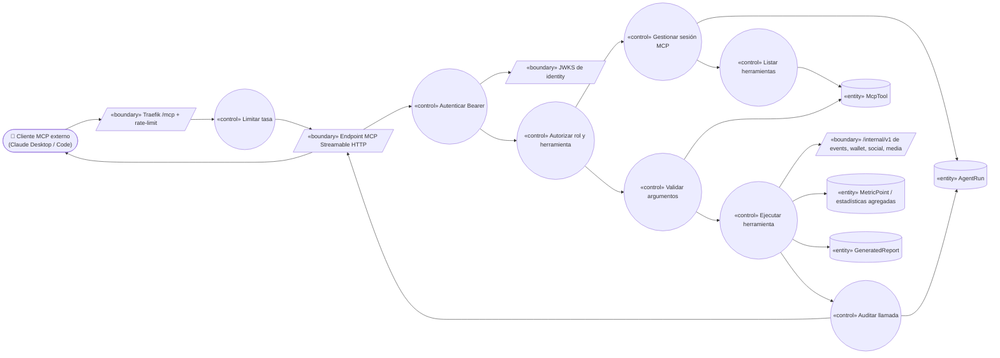
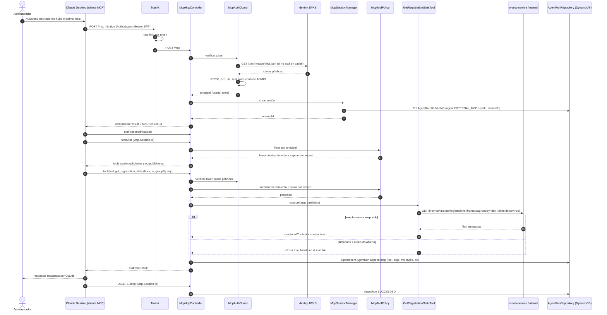
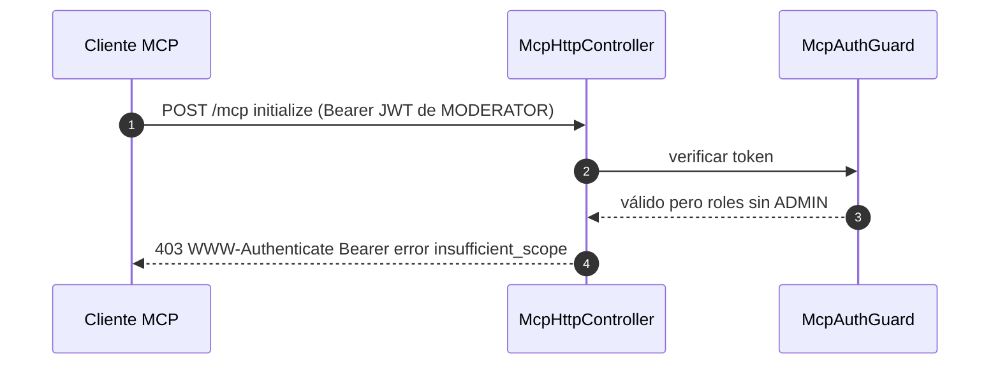

# UC-22 — Consultar la plataforma desde un cliente MCP externo

| Campo | Valor |
|---|---|
| Paquete | Admin |
| Actor principal | Cliente MCP externo (Claude Desktop / Claude Code operado por un Administrador) |
| Actores secundarios | Administrador (configura el cliente y hace la pregunta), `identity-service` (JWKS), servicios consultados por las herramientas |
| Prioridad (MoSCoW) | Must |
| Requisitos | RF-26, RNF-06, RNF-07, RNF-08, RNF-13, RNF-19 |
| Tecnologías de la cátedra que demuestra | **T12**, T5 (mismas herramientas que los agentes), T13 (misma identidad) |
| Servicios involucrados | Traefik (`/mcp`, rate-limit), `insights-service` (servidor MCP), `identity-service` (JWKS), `events-service`, `wallet-service`, `social-service`, `media-service` (vía `/internal`) |
| Estado ICONIX | Secuencia (pendiente CDR) |

## 1. Narrativa

**Precondiciones**

1. El Administrador tiene una cuenta con rol `ADMIN` y obtuvo un Bearer JWT emitido por `identity-service` (ver RN-22.1).
2. El cliente MCP está configurado con la URL `https://api.<dominio>/mcp` (local: `http://api.bandada.localhost/mcp`) y la cabecera `Authorization: Bearer <token>` (ver ejemplos en §4).
3. El servidor MCP de `insights-service` está activo con transporte **Streamable HTTP** (`@modelcontextprotocol/sdk`).

**Disparador:** el Administrador pregunta en Claude Desktop: *"¿Cuántas inscripciones hubo el último mes y qué evento tuvo más?"* (la misma pregunta de UC-19, paso 9 del guion de defensa).

**Curso básico**

1. El Cliente MCP envía `POST /mcp` con el mensaje JSON-RPC `initialize` (versión de protocolo, capacidades e `clientInfo`) y la cabecera `Authorization: Bearer <JWT>`.
2. Traefik enruta `/mcp` a `insights-service:7008` aplicando el middleware de rate-limit por cabecera `Authorization`.
3. El sistema valida el JWT con la JWKS de identity (`/.well-known/jwks.json`, en caché): firma RS256, `exp`, `iss`, `aud` y que `roles` contenga `ADMIN`.
4. El sistema crea la sesión MCP, devuelve el resultado de `initialize` (versión negociada, capacidades `tools`, `resources`, `prompts`, `serverInfo { name: "bandada-insights" }`) y la cabecera `Mcp-Session-Id`. Abre un `AgentRun` de auditoría (`agent = EXTERNAL_MCP`, `userId`, `clientInfo`).
5. El Cliente MCP envía la notificación `notifications/initialized` y luego `tools/list`.
6. El sistema devuelve las herramientas permitidas para un cliente externo: todas las de lectura de D9 más `generate_report`; **no** incluye `raise_alert` (exclusiva de agentes internos). Cada herramienta trae `inputSchema` y `outputSchema` (JSON Schema) y anotación `readOnlyHint`.
7. El LLM del cliente decide llamar a `get_registration_stats`; el Cliente MCP envía `tools/call { name: "get_registration_stats", arguments: { from: "2026-09-14", to: "2026-10-14", groupBy: "day" } }`.
8. El sistema valida los argumentos contra el `inputSchema` (rango máximo 366 días), comprueba la autorización de la herramienta para el rol y el límite de llamadas, y la ejecuta: `GET /internal/v1/stats/registrations` (`getRegistrationStats`) en `events-service` con token de servicio.
9. El sistema devuelve el resultado con `structuredContent` (filas agregadas) y un bloque `content` de texto equivalente; registra el paso en el `AgentRun` (herramienta, argumentos, duración, tamaño de respuesta; **sin** el contenido completo).
10. El cliente llama a `list_events { from, to }` para nombrar el evento con más inscripciones; el sistema la ejecuta igual que en 8–9.
11. Claude Desktop redacta la respuesta al Administrador con los datos obtenidos.
12. Al cerrar la conversación (o tras 30 min de inactividad), el cliente envía `DELETE /mcp` con `Mcp-Session-Id` o la sesión expira; el sistema cierra el `AgentRun` como `SUCCEEDED`.

**Cursos alternos**

- **1a. Sin cabecera `Authorization` o token mal formado:** `401` con `WWW-Authenticate: Bearer realm="bandada-mcp"`; no se crea sesión.
- **3a. Token expirado o firma inválida:** `401` con `error="invalid_token"`; el Administrador debe obtener un token nuevo.
- **3b. Usuario sin rol `ADMIN`** (p. ej. `MODERATOR`): `403` con `error="insufficient_scope"`; se registra el intento en logs de seguridad (sin token).
- **3c. Usuario `SUSPENDED` con token aún vigente:** la validación consulta el estado en la caché de usuarios suspendidos de insights (alimentada por `bandada.identity.user.suspended.v1` en `insights-service.analytics`) y responde `403`.
- **2a. Se excede el rate-limit:** Traefik responde `429` (60 peticiones/min por token); dentro del servidor, más de 30 `tools/call` por minuto por usuario devuelve un error JSON-RPC con `retryAfter`.
- **5a. `Mcp-Session-Id` desconocido o expirado:** `404`; el cliente debe repetir `initialize` (comportamiento estándar de Streamable HTTP).
- **7a. Herramienta inexistente o no permitida** (p. ej. `raise_alert`): error JSON-RPC `-32602` "herramienta no disponible"; queda registrado en el `AgentRun`.
- **8a. Argumentos inválidos** (rango > 366 días, fecha mal formada): resultado con `isError: true` y mensaje explicativo, para que el LLM del cliente corrija la llamada.
- **8b. El servicio de origen falla o excede 5 s:** resultado `isError: true` con "fuente no disponible: events-service"; el circuito se abre tras 5 fallos y las llamadas siguientes fallan rápido.
- **8c. Petición de datos personales** (p. ej. argumentos que intentan listar correos): las herramientas no tienen parámetros que lo permitan; solo devuelven agregados (RNF-08).
- **10a. El cliente llama `generate_report`:** el sistema crea un `GeneratedReport` igual que UC-19 (pasos 4–14) con el `userId` del Administrador y devuelve `{ reportId, status: PENDING }`; el resultado puede consultarse luego con `getReport` o en el panel.
- **10b. El cliente lee un recurso** (`resources/read bandada://kpis/today` o `bandada://alerts/open`) o usa un prompt (`prompts/get monthly_report`): mismo flujo de autorización y auditoría.

**Postcondiciones**

- La sesión queda auditada en un `AgentRun` con `agent = EXTERNAL_MCP`, `userId`, cliente, herramientas usadas y resultado de cada llamada.
- No se modificó ningún dato de la plataforma (salvo un `GeneratedReport` si se usó `generate_report`).

**Reglas de negocio**

- RN-22.1 Autenticación: Bearer JWT de identity con rol `ADMIN` (D9). El access token normal dura 15 min, lo que es incómodo para un cliente de escritorio; ver PROPUESTA de token MCP de larga duración en §6.
- RN-22.2 Los clientes externos ven exactamente las mismas herramientas de lectura que los agentes internos (UC-19, UC-20), menos `raise_alert`.
- RN-22.3 Todas las herramientas devuelven **agregados**; ninguna expone correos, nombres ni IDs individuales de estudiantes.
- RN-22.4 Toda llamada queda auditada (quién, qué herramienta, cuándo, cuánto tardó, éxito/error); los argumentos se guardan, las respuestas solo como tamaño y hash.
- RN-22.5 Límites: 60 req/min por token en el gateway, 30 `tools/call`/min por usuario en el servidor, 5 sesiones simultáneas por usuario, tamaño de respuesta ≤ 256 KB (si es mayor, se pagina o se resume).
- RN-22.7 (D14) `structuredContent` no depende del idioma (códigos, enums y números). El texto de `content`, las descripciones de las herramientas y los mensajes de error salen en el `locale` del administrador (claim/perfil `User.locale`, por defecto `es`); el LLM del cliente puede responder en el idioma que use el administrador. `generate_report` crea el reporte con ese `locale` (UC-19).
- RN-22.6 `/mcp` valida la cabecera `Origin` cuando está presente (protección contra *DNS rebinding*, recomendado por la especificación MCP) y en producción solo se sirve por HTTPS.

## 2. Diagrama de robustez



| Objeto | Tipo | Componente real |
|---|---|---|
| Traefik `/mcp` + rate-limit | Boundary | Router `insights-mcp` con middleware `ratelimit` (`sourceCriterion.requestHeaderName: Authorization`) |
| Endpoint MCP Streamable HTTP | Boundary | `McpHttpController` (POST/GET/DELETE `/mcp`) + `StreamableHTTPServerTransport` del SDK |
| JWKS de identity | Boundary | `GET /.well-known/jwks.json` (`getJwks`), caché con `@bandada/auth-ts` |
| `/internal/v1` | Boundary | `getRegistrationStats`, `listSagas`, `getCreditStats`, `GET /internal/v1/stats/daily`, `listFlaggedMedia` |
| Limitar tasa | Control | Middleware Traefik + `McpRateLimiter` (contador por usuario y minuto) |
| Autenticar Bearer | Control | `McpAuthGuard` (`JwtVerifier` de `@bandada/auth-ts`) |
| Autorizar rol y herramienta | Control | `McpToolPolicy` (rol `ADMIN`; `raise_alert` solo `typ=service`) |
| Gestionar sesión MCP | Control | `McpSessionManager` |
| Listar herramientas | Control | `McpToolRegistry` |
| Validar argumentos | Control | Validación `inputSchema` (zod) del SDK |
| Ejecutar herramienta | Control | Handlers `GetRegistrationStatsTool`, `ListEventsTool`… |
| Auditar llamada | Control | `McpAuditInterceptor` → `AgentRunRepository` |
| McpTool / AgentRun / GeneratedReport / MetricPoint | Entity | Registro de herramientas; ítems `AGENTRUN#`, `REPORT#`, `METRIC#` en `bandada-insights` |

## 3. Diagrama de secuencia



**Alterno 3b (token sin rol ADMIN):**



## 4. Clases, contratos y configuración del cliente

**insights-service (NestJS, Clean Architecture)**

| Capa | Clases |
|---|---|
| Domain | `McpTool` (nombre, descripción, esquemas, `readOnly`, `allowedPrincipals`), `AgentRun` |
| Application | `ExecuteToolUseCase`, `ListToolsUseCase`, puertos `StatsSourcePort` (por servicio), `AgentRunRepository`, `RateLimiterPort` |
| Infrastructure | `EventsInternalClient`, `WalletInternalClient`, `SocialInternalClient`, `MediaInternalClient`, `DynamoAgentRunRepository`, `DynamoRateLimiter` |
| Interface | `McpHttpController`, `McpAuthGuard`, `McpSessionManager`, `McpToolPolicy`, `McpToolRegistry`, `McpAuditInterceptor`, handlers de herramientas |

**Contratos**

| Tipo | Identificador |
|---|---|
| MCP (`bandadau-docs/contracts/mcp/tools.md`) | Métodos `initialize`, `notifications/initialized`, `tools/list`, `tools/call`, `resources/list`, `resources/read`, `prompts/list`, `prompts/get`; herramientas `get_platform_kpis`, `get_registration_stats`, `list_events`, `get_credit_stats`, `get_content_stats`, `list_flagged_content`, `list_failed_sagas`, `get_service_health`, `detect_anomalies`, `generate_report`; recursos `bandada://kpis/today`, `bandada://alerts/open`; prompts `monthly_report`, `weekly_summary` |
| REST | `getJwks`, `getRegistrationStats`, `getCreditStats`, `listSagas`, `listFlaggedMedia`, `GET /internal/v1/stats/daily` |
| Transporte | `POST/GET/DELETE /mcp`, cabeceras `Authorization`, `Mcp-Session-Id`, `MCP-Protocol-Version`, `traceparent` |

Ejemplo de `tools/call` y su resultado (JSON-RPC 2.0):

```json
{ "jsonrpc": "2.0", "id": 7, "method": "tools/call",
  "params": { "name": "get_registration_stats",
              "arguments": { "from": "2026-09-14", "to": "2026-10-14", "groupBy": "day" } } }
```

```json
{ "jsonrpc": "2.0", "id": 7,
  "result": {
    "structuredContent": { "total": 412, "byStatus": { "CONFIRMED": 398, "FAILED": 9, "CANCELLED": 5 },
                           "rows": [{ "date": "2026-09-14", "confirmed": 12, "failed": 1, "cancelled": 0 }] },
    "content": [{ "type": "text", "text": "412 inscripciones entre 2026-09-14 y 2026-10-14 (398 confirmadas)." }],
    "isError": false } }
```

**Configuración del cliente — Claude Code** (CLI, transporte HTTP con cabecera):

```bash
claude mcp add --transport http bandada https://api.bandadau.com/mcp \
  --header "Authorization: Bearer ${BANDADA_MCP_TOKEN}"
```

o en `.mcp.json` del proyecto (sin el token en git; se toma de la variable de entorno):

```json
{
  "mcpServers": {
    "bandada": {
      "type": "http",
      "url": "http://api.bandada.localhost/mcp",
      "headers": { "Authorization": "Bearer ${BANDADA_MCP_TOKEN}" }
    }
  }
}
```

**Configuración del cliente — Claude Desktop** (`claude_desktop_config.json`), usando el puente `mcp-remote` para enviar la cabecera Bearer a un servidor remoto:

```json
{
  "mcpServers": {
    "bandada": {
      "command": "npx",
      "args": ["-y", "mcp-remote", "https://api.bandadau.com/mcp",
               "--header", "Authorization:${BANDADA_AUTH_HEADER}"],
      "env": { "BANDADA_AUTH_HEADER": "Bearer <token-de-admin>" }
    }
  }
}
```

> El token nunca se versiona. Antes de la implementación se debe verificar la sintaxis contra la documentación vigente de Claude Code, Claude Desktop y `mcp-remote` (AGENTS.md, regla 8).

## 5. Pruebas de aceptación

```gherkin
Escenario: Administrador consulta inscripciones desde Claude Desktop
  Dado un token JWT válido con rol ADMIN configurado en el cliente
  Cuando el cliente ejecuta initialize, tools/list y tools/call get_registration_stats del último mes
  Entonces initialize devuelve Mcp-Session-Id y capacidades tools, resources y prompts
  Y tools/list incluye get_registration_stats y no incluye raise_alert
  Y tools/call devuelve structuredContent con total 412
  Y existe un AgentRun EXTERNAL_MCP con el userId del administrador y 1 paso registrado

Escenario: Token sin rol ADMIN
  Dado un token válido con roles [STUDENT, MODERATOR]
  Cuando el cliente ejecuta initialize
  Entonces recibe 403 con error insufficient_scope y no se crea sesión

Escenario: Sin token o token expirado
  Cuando el cliente ejecuta initialize sin Authorization o con un token expirado
  Entonces recibe 401 con cabecera WWW-Authenticate Bearer

Escenario: Herramienta reservada
  Dado una sesión MCP de administrador
  Cuando llama tools/call raise_alert
  Entonces recibe un error JSON-RPC y no se crea ninguna Alert

Escenario: Rate-limit
  Dado una sesión MCP de administrador
  Cuando hace 31 tools/call en el mismo minuto
  Entonces la llamada 31 es rechazada con retryAfter
  Y el intento queda registrado en el AgentRun

Escenario: Fuente caída
  Dado events-service detenido
  Cuando el cliente llama get_registration_stats
  Entonces recibe un CallToolResult con isError true y un mensaje "fuente no disponible"
  Y la sesión MCP sigue activa

Escenario: Argumentos inválidos
  Cuando el cliente llama get_registration_stats con un rango de 400 días
  Entonces recibe isError true con el motivo y no se llama a events-service

Escenario: Textos de herramientas en el idioma del administrador
  Dado un administrador con User.locale en
  Cuando ejecuta tools/list y tools/call get_registration_stats
  Entonces las descripciones y el bloque content están en inglés
  Y structuredContent es igual al de un administrador con locale es

Escenario: Endpoint /internal no expuesto
  Cuando un cliente llama GET https://api.bandadau.com/internal/v1/stats/registrations
  Entonces Traefik responde 403
```

## 6. Trazabilidad

| Requisito | Paso del UC | Contrato | Clases | Pruebas |
|---|---|---|---|---|
| RF-26 (exponer herramientas) | 1–10 | `/mcp`, `tools/list`, `tools/call` | `McpHttpController`, `McpToolRegistry` | Escenario 1 |
| RF-26 (solo `ADMIN`) | 3, 1a, 3a–3c | `getJwks` | `McpAuthGuard`, `McpToolPolicy` | Escenarios 2, 3, 4 |
| RNF-06 (rate-limit, HTTPS) | 2, 2a, RN-22.5, RN-22.6 | Middleware Traefik | `McpRateLimiter` | Escenario 5 |
| RNF-07 | 8 | `/internal/v1/**` con token de servicio | `EventsInternalClient` | Escenario 8 |
| RNF-08 | RN-22.3, 8c | `outputSchema` de herramientas | handlers de herramientas | revisión de esquemas |
| RNF-19 / auditoría | 4, 9, 12, RN-22.4 | `AgentRun` | `McpAuditInterceptor` | Escenarios 1, 5 |
| T12 | todo el UC | MCP Streamable HTTP | servidor MCP | todos |
| D14 (i18n) | RN-22.7 | `content` / descripciones por `locale` | `McpToolRegistry` | Escenario 9 |

**Pendientes para la CDR (propuestas):**

- PROPUESTA: agregar a decisiones-clave.md un token MCP de larga duración: `POST /api/v1/auth/mcp-tokens` 🔑 (`createMcpToken`, solo `ADMIN`) que emite un JWT `typ=mcp`, `aud=bandada-mcp`, vigencia 30 días, revocable (`DELETE /api/v1/auth/mcp-tokens/{id}`, `revokeMcpToken`), con su `jti` en `identity_db`. Alternativa a futuro: autorización OAuth de la especificación MCP (*Protected Resource Metadata*) para que Claude Desktop se conecte como conector remoto sin copiar tokens.
- PROPUESTA: agregar a decisiones-clave.md el valor `EXTERNAL_MCP` en un enum `AgentKind` = `MONITORING`, `REPORT`, `EXTERNAL_MCP` para `AgentRun.agent`.
- PROPUESTA: documentar en `catalogo-servicios.md` (vía ADR) el middleware de rate-limit específico de `/mcp` (60 req/min por token) y que insights mantiene una caché de usuarios suspendidos a partir de `bandada.identity.user.suspended.v1` (ya recibido por `insights-service.analytics` con `bandada.#`).
