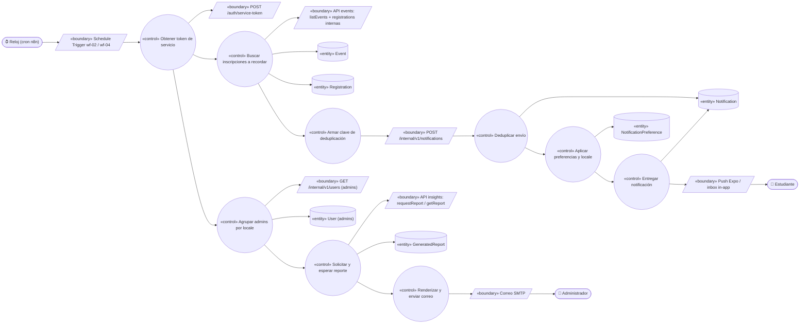
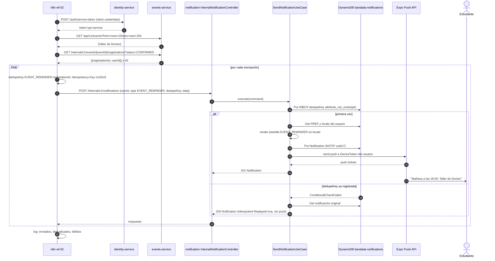
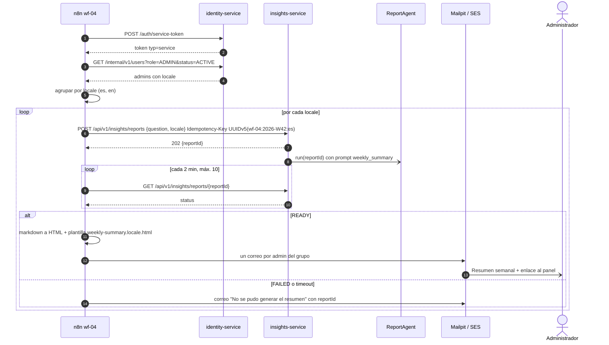

# UC-23 — Recibir recordatorios de evento y resumen semanal

| Campo | Valor |
|---|---|
| Paquete | Automatización |
| Actor principal | Reloj (cron de n8n) |
| Actores secundarios | Estudiante (recibe el recordatorio), Administrador (recibe el resumen semanal), Modelo de IA (ReportAgent de UC-19), servidor de correo (Mailpit / SES) |
| Prioridad (MoSCoW) | Must |
| Requisitos | RF-27, RF-28, RNF-03, RNF-05, RNF-13 |
| Tecnologías de la cátedra que demuestra | **T10, T11**, T8 |
| Servicios involucrados | n8n (`wf-02-recordatorio-evento`, `wf-04-resumen-semanal`), `identity-service` (token de servicio, lista de administradores), `events-service`, `notification-service`, `insights-service` |
| Estado ICONIX | Secuencia (pendiente CDR) |

Este UC agrupa dos workflows de n8n con un mismo actor (Reloj). Se describen como dos cursos básicos: **A** (recordatorio 24 h) y **B** (resumen semanal generativo).

## 1. Narrativa

**Precondiciones**

1. n8n está activo con los workflows `wf-02-recordatorio-evento` y `wf-04-resumen-semanal` importados desde `bandadau-infra/n8n/workflows/*.json` y activados.
2. n8n tiene credenciales de cliente de servicio (`N8N_CLIENT_ID`, `N8N_CLIENT_SECRET` por variables de entorno) para `POST /auth/service-token` (`issueServiceToken`).
3. `notification-service` mantiene la copia local de `locale` de cada usuario (evento `bandada.identity.user.preferences-changed.v1`) y sus `NotificationPreference`.

### Curso básico A — Recordatorio 24 h antes (`wf-02-recordatorio-evento`)

**Disparador:** el Reloj dispara el workflow cada hora en punto (n8n *Schedule Trigger*).

1. n8n solicita un token de servicio a `identity-service` (`POST /auth/service-token`, red interna).
2. n8n consulta los eventos publicados que empiezan entre `now + 23 h` y `now + 25 h` (`GET /api/v1/events?from&to`, `listEvents`). La ventana de 2 h se solapa a propósito con la corrida anterior para que una corrida perdida no deje eventos sin recordar; los duplicados se eliminan en el paso 6.
3. Por cada evento, n8n obtiene las inscripciones confirmadas (`GET /internal/v1/events/{eventId}/registrations?status=CONFIRMED`, ver PROPUESTA) con `registrationId` y `userId`.
4. Por cada inscripción, n8n arma la clave de deduplicación `dedupeKey = EVENT_REMINDER:<registrationId>` y una `Idempotency-Key` determinista (UUIDv5 de esa misma cadena).
5. n8n envía `POST /internal/v1/notifications` (ver PROPUESTA) a `notification-service` con `{ userId, type: EVENT_REMINDER, dedupeKey, data: { eventId, title, startsAt, venue, registrationId } }`, sin textos: el texto lo pone notification-service.
6. El sistema (`notification-service`) registra la `dedupeKey` en su inbox con `ConditionExpression attribute_not_exists(pk)`; como es la primera vez, continúa.
7. El sistema consulta la `NotificationPreference` del estudiante y su `locale`, renderiza la plantilla `EVENT_REMINDER` en ese idioma ("Mañana a las 18:00: Taller de Docker — Auditorio FCPN" / "Tomorrow at 6:00 PM: …") y formatea la hora en `America/La_Paz` con `es-BO` o `en-US`.
8. El sistema guarda la `Notification` in-app y envía el push por Expo a los `DeviceToken` del estudiante (detalle en UC-24).
9. El Estudiante recibe el recordatorio; al tocarlo, la app abre el ticket del evento.
10. n8n registra en el log de la ejecución el total de recordatorios enviados, ya enviados (deduplicados) y fallidos.

### Curso básico B — Resumen semanal generativo (`wf-04-resumen-semanal`)

**Disparador:** el Reloj dispara el workflow los lunes a las 08:00 (`America/La_Paz`).

1. n8n solicita un token de servicio a `identity-service`.
2. n8n obtiene la lista de administradores activos con su `locale` (`GET /internal/v1/users?role=ADMIN&status=ACTIVE`, `searchUsers`).
3. n8n agrupa a los administradores por `locale` (p. ej. `es`: 3, `en`: 1).
4. Por cada `locale`, n8n envía `POST /api/v1/insights/reports` (`requestReport`) con `{ question: "Resumen de la semana <isoWeek>", locale }` y una `Idempotency-Key` determinista = UUIDv5(`wf-04:<isoWeek>:<locale>`), p. ej. `wf-04:2026-W42:es`.
5. El sistema (`insights-service`) responde **202** `{ reportId }` y ejecuta el ReportAgent (UC-19, pasos 6–14), que puede usar el prompt MCP `weekly_summary` y herramientas como `get_platform_kpis`, `get_registration_stats`, `get_credit_stats`, `get_content_stats`.
6. n8n espera 2 min (*Wait*) y consulta `GET /api/v1/insights/reports/{reportId}` (`getReport`); repite cada 2 min hasta un estado terminal (máx. 10 intentos).
7. Con el reporte `READY`, n8n convierte el `markdown` a HTML y renderiza la plantilla de correo `weekly-summary.<locale>.html` (solo tema claro, D13) con el texto, un enlace al reporte en el panel (`https://admin.<dominio>/insights/reports/<reportId>`) y, si hay audio, el enlace "Escuchar resumen (≤ 90 s)" que abre el mismo reporte en el panel.
8. n8n envía un correo por administrador en su idioma (SMTP: Mailpit en dev, SES en prod).
9. Los Administradores leen el resumen y, si quieren, escuchan el audio desde el panel (requiere sesión, UC-03).

**Cursos alternos**

- **A2a. No hay eventos en la ventana:** el workflow termina sin efectos.
- **A2b. `events-service` no responde:** el nodo HTTP reintenta 3 veces con espera de 30 s; si sigue fallando, la ejecución termina en error y se notifica al canal de errores de n8n. La siguiente corrida (1 h después) cubre la misma ventana gracias al solape de 2 h.
- **A3a. Una inscripción se canceló después de consultarla:** el recordatorio puede llegar igual (ventana de segundos); es aceptable. Las canceladas antes de la consulta no aparecen porque se filtra `status=CONFIRMED`.
- **A5a. La misma inscripción aparece en dos corridas** (solape de ventanas, reintento manual, n8n re-ejecuta la corrida): `notification-service` encuentra la `dedupeKey` ya registrada, responde **200** con la notificación original y `Idempotent-Replayed: true`, y **no** envía un segundo push. Esta es la garantía de "no recordar dos veces la misma inscripción".
- **A5b. Dos corridas en paralelo envían la misma inscripción a la vez:** solo una gana la escritura condicional; la otra recibe la respuesta de la primera (o `409 IDEMPOTENCY_IN_PROGRESS`, que n8n trata como éxito).
- **A5c. `notification-service` caído:** n8n reintenta 3 veces; las inscripciones pendientes se recuperan en la siguiente corrida (solape). Publicar e inscribirse no se ven afectados (RNF-03).
- **A7a. El estudiante desactivó los recordatorios** (`NotificationPreference.channels.EVENT_REMINDER = []`): se registra la `dedupeKey`, no se crea notificación ni push, y la respuesta indica `suppressed: true`.
- **A7b. El estudiante tiene `push` desactivado pero `inApp` activo:** solo se guarda la notificación in-app.
- **B2a. No hay administradores activos:** el workflow termina con advertencia en el log.
- **B4a. El workflow se re-ejecuta el mismo lunes** (reinicio de n8n, ejecución manual): la `Idempotency-Key` determinista devuelve el mismo `reportId`; no se genera un segundo reporte ni se gasta LLM de nuevo. Para no reenviar correos, n8n guarda en `staticData` del workflow la última semana enviada por `locale` y omite el envío si coincide.
- **B6a. El reporte termina `FAILED` o no termina tras 10 intentos (20 min):** n8n envía a los administradores un correo corto "No se pudo generar el resumen de la semana" con el `reportId` para revisarlo en el panel (el `AgentRun` tiene el detalle).
- **B6b. El reporte está `READY` sin audio (`AUDIO_UNAVAILABLE`):** el correo se envía sin el enlace de audio.
- **B8a. El servidor SMTP rechaza un correo:** n8n reintenta 2 veces y registra el destinatario fallido; los demás correos se envían igual.

**Postcondiciones**

- A: cada inscripción `CONFIRMED` de un evento que empieza en ~24 h tiene **exactamente una** notificación `EVENT_REMINDER` (o una supresión registrada por preferencia).
- B: existe un `GeneratedReport` por semana e idioma, y cada administrador activo recibió un correo en su idioma.

**Reglas de negocio**

- RN-23.1 Un recordatorio por inscripción: la unicidad la garantiza `notification-service` con `dedupeKey = EVENT_REMINDER:<registrationId>`, no n8n.
- RN-23.2 Los textos de notificaciones y correos **no** se escriben en n8n para el recordatorio: n8n envía `type` + `data` y `notification-service` renderiza por `locale` del destinatario (D14). El resumen semanal lo redacta el ReportAgent en el `locale` de cada grupo de administradores.
- RN-23.3 Los correos no incluyen URLs prefirmadas de S3 (expiran a los 15 min, RNF-08); enlazan al panel, que exige sesión.
- RN-23.4 Los workflows se versionan como JSON en `bandadau-infra/n8n/workflows/` y no contienen secretos (credenciales por variables de entorno).
- RN-23.5 Horarios en `America/La_Paz` (variable `GENERIC_TIMEZONE` de n8n).

## 2. Diagrama de robustez



| Objeto | Tipo | Componente real |
|---|---|---|
| Schedule Trigger | Boundary | Nodo *Schedule Trigger* de n8n en `wf-02-recordatorio-evento.json` y `wf-04-resumen-semanal.json` |
| `POST /auth/service-token` | Boundary | identity-service (`issueServiceToken`) |
| API events | Boundary | `listEvents`; `GET /internal/v1/events/{eventId}/registrations` (PROPUESTA) |
| `POST /internal/v1/notifications` | Boundary | notification-service `InternalNotificationController` (PROPUESTA) |
| API insights | Boundary | `requestReport`, `getReport` |
| `GET /internal/v1/users` | Boundary | identity `searchUsers` |
| Push Expo / inbox in-app | Boundary | `ExpoPushSender`; `GET /notifications` en la app |
| Correo SMTP | Boundary | Nodo *Send Email* de n8n → Mailpit / SES |
| Obtener token / Buscar inscripciones / Armar clave | Control | Nodos *HTTP Request*, *Loop Over Items*, *Code* (UUIDv5) de n8n |
| Deduplicar envío | Control | `SendNotificationUseCase` + `DynamoInboxStore` (notification-service) |
| Aplicar preferencias y locale | Control | `PreferencePolicy` + `NotificationTemplateRenderer` |
| Entregar notificación | Control | `DeliverNotificationUseCase` |
| Agrupar admins por locale | Control | Nodo *Code* de n8n |
| Solicitar y esperar reporte | Control | Nodos *HTTP Request* + *Wait* + *If* de n8n |
| Renderizar y enviar correo | Control | Nodos *Code* (markdown → HTML, plantilla por locale) + *Send Email* |
| Entidades | Entity | `Event`, `Registration` (events_db), `Notification`, `NotificationPreference` (`bandada-notifications`), `GeneratedReport` (`bandada-insights`), `User` (identity_db) |

## 3. Diagrama de secuencia

**Curso A — recordatorio con deduplicación:**



**Curso B — resumen semanal:**



## 4. Clases y contratos involucrados

**n8n (`bandadau-infra/n8n/workflows/`)**

| Workflow | Nodos principales |
|---|---|
| `wf-02-recordatorio-evento.json` | Schedule Trigger (cada hora) → HTTP Request (service-token) → HTTP Request (`listEvents`) → Loop Over Items → HTTP Request (registrations) → Code (`dedupeKey`, UUIDv5) → HTTP Request (`POST /internal/v1/notifications`, reintentos 3) → Code (resumen de la corrida) |
| `wf-04-resumen-semanal.json` | Schedule Trigger (lunes 08:00) → HTTP Request (service-token) → HTTP Request (`searchUsers`) → Code (agrupar por locale) → HTTP Request (`requestReport`) → Wait (2 min) → HTTP Request (`getReport`) → If (estado) → Code (markdown → HTML, plantilla) → Send Email |

**notification-service (Laravel 12, Clean — `Bandada\Notification\`)**: `InternalNotificationController`, `SendNotificationUseCase`, `DeliverNotificationUseCase`, `PreferencePolicy`, `NotificationTemplateRenderer`, `DynamoInboxStore`, `ExpoPushSender` (detalle en UC-24).

**insights-service**: `ReportsController`, `RequestReportUseCase`, ReportAgent (UC-19), prompt MCP `weekly_summary`.

**Contratos**

| Tipo | Identificador |
|---|---|
| REST | `issueServiceToken`, `listEvents`, `searchUsers`, `requestReport`, `getReport`; PROPUESTAS `listEventRegistrations`, `sendNotification` |
| Enum | `NotificationType.EVENT_REMINDER` |
| MCP | prompt `weekly_summary`; herramientas `get_platform_kpis`, `get_registration_stats`, `get_credit_stats`, `get_content_stats` |
| Plantillas | `notification-service`: `EVENT_REMINDER` en `es` y `en`; n8n: `weekly-summary.es.html`, `weekly-summary.en.html` |

Cuerpo de `POST /internal/v1/notifications` (PROPUESTA):

```json
{
  "userId": "0199c0aa-1b2c-7d3e-8f40-112233445566",
  "type": "EVENT_REMINDER",
  "dedupeKey": "EVENT_REMINDER:0199d1bb-2c3d-7e4f-9051-223344556677",
  "data": {
    "eventId": "0199a0cc-3d4e-7f50-a162-334455667788",
    "registrationId": "0199d1bb-2c3d-7e4f-9051-223344556677",
    "title": "Taller de Docker",
    "startsAt": "2026-10-15T22:00:00Z",
    "venue": "Auditorio FCPN"
  }
}
```

## 5. Pruebas de aceptación

```gherkin
Escenario: Recordatorio 24 h antes en el idioma del estudiante
  Dado un evento "Taller de Docker" que empieza en 24 h
  Y una estudiante con inscripción CONFIRMED, locale en y push activo
  Cuando se ejecuta wf-02
  Entonces la estudiante recibe un push en inglés con la hora en formato en-US y zona America/La_Paz
  Y existe una Notification EVENT_REMINDER en su inbox

Escenario: No recordar dos veces la misma inscripción
  Dado que wf-02 ya envió el recordatorio de la inscripción R
  Cuando la corrida siguiente vuelve a encontrar R por el solape de ventanas
  Entonces notification-service responde con la notificación original e Idempotent-Replayed true
  Y no se envía un segundo push
  Y el inbox del estudiante tiene una sola notificación EVENT_REMINDER para R

Escenario: Corrida perdida
  Dado que n8n estuvo caído en la corrida de las 10:00
  Cuando se ejecuta la corrida de las 11:00
  Entonces se envían los recordatorios de los eventos que la corrida de las 10:00 debía cubrir

Escenario: Estudiante con recordatorios desactivados
  Dado una inscripción CONFIRMED de un estudiante con EVENT_REMINDER desactivado
  Cuando se ejecuta wf-02
  Entonces no se crea notificación ni push y la respuesta indica suppressed true

Escenario: Inscripción cancelada no recibe recordatorio
  Dado una inscripción CANCELLED de un evento que empieza en 24 h
  Cuando se ejecuta wf-02
  Entonces no se envía recordatorio para esa inscripción

Escenario: Resumen semanal por idioma
  Dado 3 administradores con locale es y 1 con locale en
  Cuando wf-04 se ejecuta el lunes 08:00
  Entonces se generan 2 GeneratedReport (es y en) de la semana
  Y cada administrador recibe un correo en su idioma con enlace al reporte en el panel

Escenario: Re-ejecución del resumen semanal
  Dado que wf-04 ya se ejecutó esta semana
  Cuando se ejecuta manualmente otra vez
  Entonces requestReport devuelve los mismos reportId con Idempotent-Replayed true
  Y no se reenvían los correos

Escenario: Reporte fallido
  Dado que el ReportAgent termina FAILED
  Cuando wf-04 consulta el reporte
  Entonces los administradores reciben el correo "No se pudo generar el resumen" con el reportId
```

## 6. Trazabilidad

| Requisito | Paso del UC | Contrato | Clases / workflow | Pruebas |
|---|---|---|---|---|
| RF-27 (recordatorio 24 h) | A1–A10 | `listEvents`, `listEventRegistrations`*, `sendNotification`* | `wf-02-recordatorio-evento`, `SendNotificationUseCase` | Escenarios 1, 3, 5 |
| RNF-05 / T8 (no duplicar) | A4–A6, A5a, A5b, B4a | `Idempotency-Key`, `dedupeKey`, `requestReport` ♻️ | `DynamoInboxStore` | Escenarios 2, 7 |
| RF-28 (preferencias) | A7, A7a, A7b | `NotificationPreference` | `PreferencePolicy` | Escenario 4 |
| RF-27 (resumen semanal) / T11 | B1–B9 | `requestReport`, `getReport`, prompt `weekly_summary` | `wf-04-resumen-semanal`, ReportAgent | Escenarios 6, 8 |
| D14 (i18n) | A7, B3–B8 | plantillas por `locale` | `NotificationTemplateRenderer`, plantillas n8n | Escenarios 1, 6 |
| T10 | todo el UC | workflows JSON versionados | n8n | todos |
| RNF-03 | A5c | — | reintentos n8n | — |

\* Propuestas pendientes de contrato.

**Pendientes para la CDR (propuestas):**

- PROPUESTA: agregar a decisiones-clave.md (D1, events-service) `GET /internal/v1/events/{eventId}/registrations?status` (`listEventRegistrations`), necesario para wf-02 (D10 dice "por cada inscrito confirmado" pero no hay endpoint).
- PROPUESTA: agregar a decisiones-clave.md (D1, notification-service) `POST /internal/v1/notifications` ♻️ (`sendNotification`, body `{ userId, type, dedupeKey, data }`), la "REST notification interna" que menciona D10.
- PROPUESTA: agregar `wf-04` a la lista de clientes que pueden llamar `requestReport` con token de servicio (D9 solo menciona token de servicio para agentes internos).
- PROPUESTA: aclarar en D10 que el correo de wf-04 enlaza al panel en lugar de una URL prefirmada de audio, y que se genera un reporte por `locale` de administradores.
