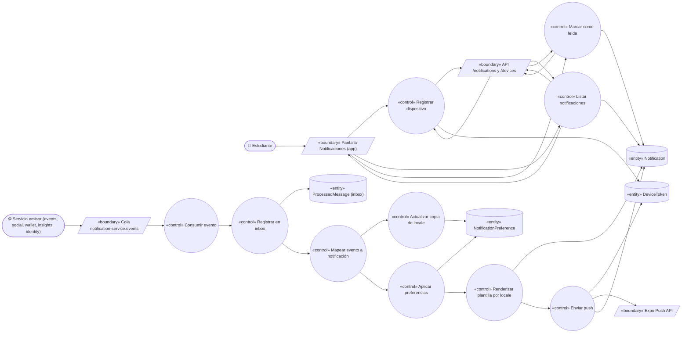
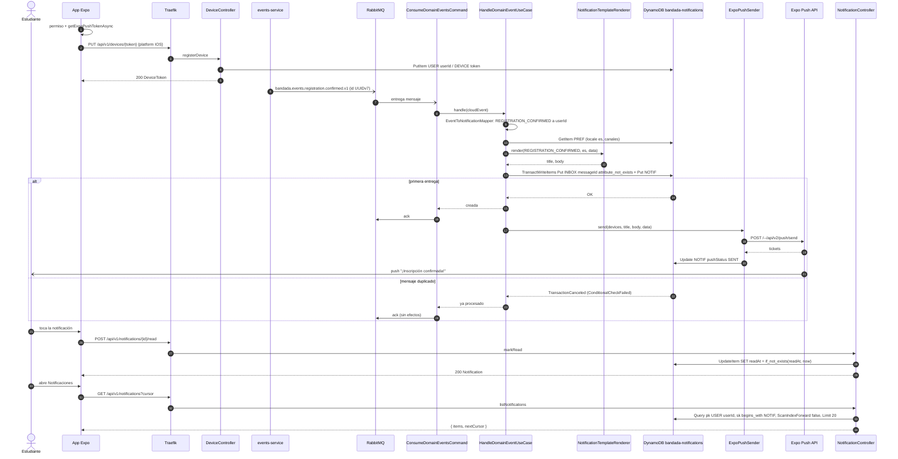
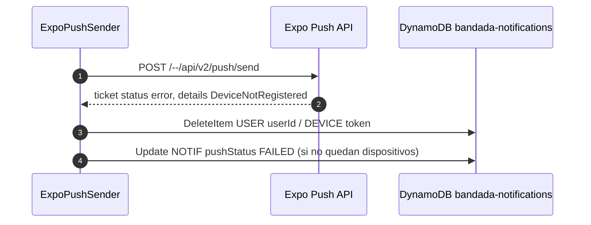

# UC-24 — Recibir notificaciones push e in-app

| Campo | Valor |
|---|---|
| Paquete | Automatización |
| Actor principal | Estudiante |
| Actores secundarios | Servicios emisores de eventos (events, social, wallet, insights, identity), n8n (vía `POST /internal/v1/notifications`, UC-23), Expo Push Service (APNs / FCM) |
| Prioridad (MoSCoW) | Must |
| Requisitos | RF-28, RF-10, RNF-03, RNF-05, RNF-09, RNF-13 |
| Tecnologías de la cátedra que demuestra | T4, **T8**, C2 (PHP), C4 (DynamoDB), C5 (Clean) |
| Servicios involucrados | `notification-service` (Laravel 12, Clean, DynamoDB `bandada-notifications`), RabbitMQ (cola `notification-service.events`), `bandadau-frontend` (Expo SDK 57), Expo Push API |
| Estado ICONIX | Secuencia (pendiente CDR) |

## 1. Narrativa

**Precondiciones**

1. El Estudiante tiene sesión en la app (UC-02).
2. `notification-service` consume la cola `notification-service.events` (bindings: `bandada.events.registration.#`, `bandada.social.#`, `bandada.wallet.topup.#`, `bandada.insights.alert.#`, `bandada.identity.user.registered.v1`, `bandada.identity.user.preferences-changed.v1`).
3. Existe el ítem `PREF` del Estudiante (creado al consumir `bandada.identity.user.registered.v1`, con `locale` y canales por defecto).

**Disparador:** ocurre un hecho de negocio que interesa al Estudiante; ejemplo: su inscripción a "Taller de Docker" se confirma y `events-service` publica `bandada.events.registration.confirmed.v1`.

**Curso básico**

1. Al abrir la app por primera vez tras iniciar sesión, la app pide permiso de notificaciones, obtiene el token Expo Push (`expo-notifications`) y llama a `PUT /api/v1/devices/{token}` (`registerDevice`) con `{ platform: IOS|ANDROID }`.
2. El sistema guarda el `DeviceToken` (`pk = USER#<userId>`, `sk = DEVICE#<token>`) con `platform` y `lastSeenAt`; repetir la llamada solo actualiza `lastSeenAt` (PUT idempotente).
3. `events-service` publica `bandada.events.registration.confirmed.v1` (CloudEvent con `id` UUIDv7) y el mensaje llega a `notification-service.events`.
4. El consumidor (`notifications:consume`) recibe el mensaje y el `EventToNotificationMapper` determina el `NotificationType` (`REGISTRATION_CONFIRMED`) y el destinatario (`data.userId`).
5. El sistema lee el `PREF` del destinatario: `locale = es` y canales de `REGISTRATION_CONFIRMED` = `inApp` + `push`.
6. El `NotificationTemplateRenderer` renderiza título y cuerpo en el `locale` del destinatario ("¡Inscripción confirmada!" / "Tu entrada para Taller de Docker ya está en tu billetera de tickets.") con fechas en `America/La_Paz` y formato `es-BO`.
7. El sistema escribe **en una sola transacción DynamoDB** (`TransactWriteItems`): el ítem de inbox `INBOX#<messageId>` con `ConditionExpression attribute_not_exists(pk)` y la `Notification` (`sk = NOTIF#<uuidv7>`, `type`, `title`, `body`, `data`, `readAt = null`, `pushStatus = PENDING`, TTL 90 días).
8. El sistema confirma (`ack`) el mensaje a RabbitMQ.
9. El sistema envía el push a todos los `DeviceToken` del Estudiante por la Expo Push API (`title`, `body`, `data: { notificationId, type, deepLink }`) y guarda `pushStatus = SENT` con los IDs de *ticket*.
10. El Estudiante ve la notificación en su teléfono; al tocarla, la app abre el *deep link* (`/tickets/{ticketId}`) y llama a `POST /api/v1/notifications/{id}/read`.
11. El sistema marca `readAt = now` solo si estaba vacío (`if_not_exists`), por lo que repetir la llamada no cambia nada.
12. Más tarde el Estudiante abre la pestaña "Notificaciones"; la app llama a `GET /api/v1/notifications?cursor` (`listNotifications`) y muestra la lista (más reciente primero) con indicador de no leídas.
13. El Estudiante pulsa "Marcar todas como leídas"; la app llama a `POST /api/v1/notifications/read-all` y el sistema marca todas las no leídas.

**Cursos alternos**

- **1a. El Estudiante niega el permiso de notificaciones:** no se registra dispositivo; las notificaciones siguen llegando al inbox in-app (paso 12).
- **1b. App web PWA:** Expo Push no cubre web; la PWA usa solo el inbox in-app (refresco al enfocar la pestaña y cada 60 s). Web Push queda fuera del alcance de este release.
- **1c. Cierre de sesión:** la app llama a `DELETE /api/v1/devices/{token}` para que el dispositivo no reciba notificaciones de una cuenta ajena.
- **4a. Evento sin interés para notificar** (p. ej. `bandada.social.post.created.v1`): el mapper devuelve "sin notificación"; el sistema registra el inbox y hace `ack` sin más efectos.
- **4b. El actor es el mismo destinatario** (reacciona a su propio post): no se notifica.
- **4c. `bandada.identity.user.preferences-changed.v1`:** no genera notificación; el sistema actualiza `locale` en el `PREF` del usuario (copia local para plantillas, D14). Se aplica solo si el `time` del evento es posterior al `updatedAt` guardado (evita que un mensaje viejo pise uno nuevo).
- **4d. `bandada.identity.user.registered.v1`:** crea el `PREF` con canales por defecto y el `locale` del evento (o `es`).
- **5a. El Estudiante desactivó ese tipo en sus preferencias** (`GET/PUT /api/v1/notifications/preferences`): si `inApp` está desactivado no se crea `Notification`; si solo `push` está desactivado, se guarda in-app sin push. En ambos casos se registra el inbox.
- **5b. No existe `PREF` del usuario** (evento llegó antes que `user.registered`): se usan valores por defecto (`locale = es`, `inApp` + `push`).
- **6a. Falta la plantilla en el `locale`** (p. ej. clave nueva sin traducción `en`): se usa `es` (fallback de D14) y se registra una métrica `notification_template_fallback_total`.
- **7a. Mensaje duplicado** (RabbitMQ lo reentrega porque el `ack` del intento anterior se perdió): la condición `attribute_not_exists(pk)` del ítem `INBOX#<messageId>` falla, la transacción completa se cancela (`TransactionCanceledException` con `ConditionalCheckFailed`), el sistema hace `ack` y **no** crea una segunda notificación ni envía otro push.
- **7b. DynamoDB no disponible:** el consumidor hace `nack` con reintento (3 veces con *backoff*); luego el mensaje va a `bandada.dlx` y el `MonitoringAgent` lo detecta (UC-20). El resto de la plataforma sigue operando (RNF-03).
- **9a. Expo responde `DeviceNotRegistered`** (app desinstalada) en el *ticket* o en el *receipt* posterior: el sistema elimina ese `DeviceToken`.
- **9b. Expo no disponible o error 5xx:** reintento en proceso 3 veces; después `pushStatus = FAILED`. La notificación in-app ya existe, así que el usuario no la pierde. Un barrido cada minuto reintenta los `pushStatus = PENDING` de más de 1 min (caída del proceso entre los pasos 8 y 9).
- **9c. El Estudiante no tiene dispositivos registrados:** solo in-app.
- **10a. La notificación no existe o es de otro usuario:** `404` (la clave incluye `USER#<userId>` del JWT, así que nunca se puede marcar la de otro).
- **12a. Sin conexión:** la app muestra la última lista cacheada (TanStack Query persistido, RNF-09) y encola el "marcar como leída" en la cola offline (`OfflineMutation`), que se reintenta sin riesgo porque la operación es idempotente.
- **12b. Notificación directa desde n8n** (recordatorio de UC-23): llega por `POST /internal/v1/notifications` con `dedupeKey`; sigue los pasos 5–11 usando `INBOX#<dedupeKey>` como registro de inbox.

**Tabla de mapeo evento → notificación**

| Evento | `NotificationType` | Destinatario |
|---|---|---|
| `bandada.events.registration.confirmed.v1` | `REGISTRATION_CONFIRMED` | `data.userId` |
| `bandada.events.registration.failed.v1` | `REGISTRATION_FAILED` | `data.userId` (texto según `reason`, p. ej. `INSUFFICIENT_FUNDS` → "Recarga créditos") |
| `bandada.social.comment.created.v1` | `NEW_COMMENT` | autor del post |
| `bandada.social.reaction.set.v1` | `NEW_REACTION` | autor del post (agrupadas: máx. 1 por post cada 30 min) |
| `bandada.social.follow.created.v1` | `NEW_FOLLOWER` | `data.followeeId` |
| `bandada.social.group.join-requested.v1` | `GROUP_REQUEST` | dueños/administradores del grupo |
| `bandada.social.post.hidden.v1` | `CONTENT_FLAGGED` | autor del post |
| `bandada.wallet.topup.paid.v1` | `TOPUP_PAID` | `data.userId` |
| `bandada.insights.alert.raised.v1` | `ALERT` | administradores (ver PROPUESTA `recipientUserIds`) |
| (n8n, UC-23) | `EVENT_REMINDER` | `userId` del cuerpo |

**Postcondiciones**

- Cada mensaje procesado tiene exactamente un ítem `INBOX#<messageId>` y como máximo una `Notification` asociada.
- El Estudiante ve la notificación en su idioma; las leídas tienen `readAt`.

**Reglas de negocio**

- RN-24.1 Procesar el mismo mensaje N veces produce el mismo efecto que 1 (RNF-05): inbox con `ConditionExpression` en la misma transacción que la `Notification`.
- RN-24.2 El inbox in-app es la fuente de verdad; el push es *best-effort*.
- RN-24.3 Se respeta `NotificationPreference` por tipo y canal (`inApp`, `push`, `email`); `ALERT` y `REGISTRATION_FAILED` no se pueden desactivar en `inApp`.
- RN-24.4 Los textos se renderizan con la plantilla del `locale` del destinatario **al crear** la notificación y se guardan; si el usuario cambia de idioma, las notificaciones nuevas salen en el idioma nuevo y las antiguas se conservan.
- RN-24.5 El contenido de usuarios (texto de comentarios) no se incluye completo en el push: solo un extracto de ≤ 80 caracteres, y nunca en los logs.
- RN-24.6 Las notificaciones expiran a los 90 días (TTL); los ítems `INBOX#` a los 7 días (más que la retención de la cola).

## 2. Diagrama de robustez



> Nota: los controles de la app (`useRegisterDevice`, `useNotifications`, `useMarkRead`) llaman a la *boundary* API; en el servidor, los controladores HTTP pasan a los casos de uso del mismo nombre. Se dibujan como un solo control por verbo para no duplicar.

| Objeto | Tipo | Componente real |
|---|---|---|
| Cola `notification-service.events` | Boundary | RabbitMQ; consumidor `ConsumeDomainEventsCommand` (artisan `notifications:consume`) |
| API `/notifications` y `/devices` | Boundary | `NotificationController`, `DeviceController`, `PreferenceController` (Laravel, capa Presentation) |
| Expo Push API | Boundary | `ExpoPushSender` (HTTP a `https://exp.host/--/api/v2/push/send`, lotes de ≤ 100) |
| Pantalla Notificaciones | Boundary | `bandadau-frontend/app/(tabs)/notifications.tsx` |
| Consumir evento | Control | `HandleDomainEventUseCase` |
| Registrar en inbox | Control | `DynamoInboxStore` (parte de la transacción) |
| Mapear evento a notificación | Control | `EventToNotificationMapper` |
| Aplicar preferencias | Control | `PreferencePolicy` |
| Renderizar plantilla por locale | Control | `NotificationTemplateRenderer` (plantillas `resources/lang/{es,en}/notifications.php` con ICU vía `MessageFormatter`) |
| Enviar push | Control | `DeliverPushUseCase` + `RetryPendingPushJob` |
| Registrar dispositivo | Control | `RegisterDeviceUseCase` / `UnregisterDeviceUseCase` |
| Listar notificaciones | Control | `ListNotificationsUseCase` |
| Marcar como leída | Control | `MarkNotificationReadUseCase`, `MarkAllNotificationsReadUseCase` |
| Actualizar copia de locale | Control | `SyncUserPreferencesUseCase` |
| Notification / DeviceToken / NotificationPreference | Entity | Ítems `NOTIF#`, `DEVICE#`, `PREF` bajo `USER#<userId>` en `bandada-notifications` |
| ProcessedMessage (inbox) | Entity | Ítem `INBOX#<messageId>` (clave `INBOX#<id>` / `META`) |

## 3. Diagrama de secuencia



**Alterno 9a (token de dispositivo inválido):**



## 4. Clases y contratos involucrados

**notification-service (PHP 8.4 + Laravel 12, Clean Architecture — `Bandada\Notification\`)**

| Capa | Clases |
|---|---|
| Domain | `Notification` (`id`, `userId`, `type: NotificationType`, `title`, `body`, `data`, `readAt`, `pushStatus`; `markRead()` idempotente), `DeviceToken` (`token`, `userId`, `platform`, `lastSeenAt`), `NotificationPreference` (`userId`, `locale`, `channels`, `updatedAt`), `NotificationType` (enum), `ChannelSet` (value object) |
| Application | `HandleDomainEventUseCase`, `SendNotificationUseCase` (entrada directa de n8n), `DeliverPushUseCase`, `RegisterDeviceUseCase`, `UnregisterDeviceUseCase`, `ListNotificationsUseCase`, `MarkNotificationReadUseCase`, `MarkAllNotificationsReadUseCase`, `UpdatePreferencesUseCase`, `SyncUserPreferencesUseCase`; puertos `NotificationRepository`, `DeviceTokenRepository`, `PreferenceRepository`, `InboxStore`, `PushSender`, `TemplateRenderer`, `Clock` |
| Infrastructure | `DynamoNotificationRepository`, `DynamoDeviceTokenRepository`, `DynamoPreferenceRepository`, `DynamoInboxStore` (`aws/aws-sdk-php`, `TransactWriteItems`), `ExpoPushSender`, `IcuTemplateRenderer`, `ConsumeDomainEventsCommand` (AMQP), `RetryPendingPushJob` (scheduler) |
| Presentation | `NotificationController`, `DeviceController`, `PreferenceController`, `InternalNotificationController` |

Reglas de dependencia verificadas con Deptrac: Domain no depende de nada; Application solo de Domain; Infrastructure y Presentation dependen hacia adentro.

**bandadau-frontend:** `usePushRegistration` (`expo-notifications`), `useNotifications` (TanStack Query infinito), `useMarkRead` (mutación con cola offline), pantalla `notifications.tsx`, textos con `i18next` (`notifications.*`).

**Contratos**

| Tipo | Identificador |
|---|---|
| REST | `listNotifications` (`GET /notifications?cursor`), `POST /notifications/{id}/read`, `POST /notifications/read-all`, `registerDevice` (`PUT /devices/{token}`), `DELETE /devices/{token}`, `GET/PUT /notifications/preferences` |
| Eventos consumidos | ver tabla de mapeo; además `bandada.identity.user.registered.v1`, `bandada.identity.user.preferences-changed.v1` |
| Enum | `NotificationType` (`REGISTRATION_CONFIRMED`, `REGISTRATION_FAILED`, `EVENT_REMINDER`, `NEW_COMMENT`, `NEW_REACTION`, `NEW_FOLLOWER`, `GROUP_REQUEST`, `TOPUP_PAID`, `CONTENT_FLAGGED`, `ALERT`) |
| DynamoDB | `bandada-notifications`: `USER#<userId>` / `NOTIF#<uuidv7>` (TTL 90 días), `DEVICE#<token>`, `PREF`; `INBOX#<messageId>` (PROPUESTA) |

Ítems de ejemplo en `bandada-notifications`:

```json
{ "pk": "USER#0199c0aa-1b2c-7d3e-8f40-112233445566", "sk": "NOTIF#0199e3b2-0a1b-7c2d-8e3f-445566778899",
  "type": "REGISTRATION_CONFIRMED", "title": "¡Inscripción confirmada!",
  "body": "Tu entrada para Taller de Docker ya está en tu billetera de tickets.",
  "data": { "eventId": "0199a0cc-3d4e-7f50-a162-334455667788", "ticketId": "0199e3b1-ffee-7d00-9abc-556677889900", "deepLink": "/tickets/0199e3b1-ffee-7d00-9abc-556677889900" },
  "readAt": null, "pushStatus": "SENT", "createdAt": "2026-10-14T15:04:05Z", "expiresAt": 1792249445 }

{ "pk": "INBOX#0199e3b1-aaaa-7bbb-8ccc-ddddeeeeffff", "sk": "META",
  "messageType": "bandada.events.registration.confirmed.v1", "processedAt": "2026-10-14T15:04:05Z", "expiresAt": 1761059045 }
```

## 5. Pruebas de aceptación

```gherkin
Escenario: Notificación de inscripción confirmada en el idioma del estudiante
  Dado un estudiante con locale es, push activo y un dispositivo iOS registrado
  Cuando llega bandada.events.registration.confirmed.v1 para su inscripción
  Entonces se crea una Notification REGISTRATION_CONFIRMED con título "¡Inscripción confirmada!"
  Y Expo recibe un push dirigido a su token
  Y el mensaje queda registrado en el inbox

Escenario: Mensaje duplicado no genera doble notificación
  Dado que el mensaje con id M ya fue procesado
  Cuando RabbitMQ entrega de nuevo el mensaje M
  Entonces la transacción DynamoDB se cancela por la ConditionExpression
  Y el mensaje recibe ack
  Y el estudiante sigue teniendo una sola notificación y un solo push

Escenario: Preferencias respetadas
  Dado un estudiante con NEW_REACTION desactivado en push y activo en inApp
  Cuando llega bandada.social.reaction.set.v1 sobre su post
  Entonces se crea la notificación in-app y no se envía push

Escenario: Cambio de idioma
  Dado un estudiante con locale es
  Cuando llega bandada.identity.user.preferences-changed.v1 con locale en
  Y luego llega bandada.wallet.topup.paid.v1 para él
  Entonces la nueva notificación TOPUP_PAID está en inglés
  Y las notificaciones anteriores conservan su texto en español

Escenario: Marcar como leída es idempotente
  Dado una notificación no leída
  Cuando el estudiante la marca como leída dos veces
  Entonces readAt conserva el valor de la primera vez

Escenario: Marcar todas como leídas
  Dado 5 notificaciones no leídas
  Cuando el estudiante ejecuta read-all
  Entonces las 5 tienen readAt y el contador de no leídas es 0

Escenario: No se pueden leer notificaciones de otro usuario
  Dado una notificación de otro estudiante
  Cuando el estudiante llama POST /api/v1/notifications/{id}/read con ese id
  Entonces recibe 404

Escenario: Token de dispositivo inválido
  Dado un dispositivo cuya app fue desinstalada
  Cuando Expo responde DeviceNotRegistered
  Entonces el DeviceToken se elimina y la notificación in-app se conserva

Escenario: Registrar el mismo dispositivo dos veces
  Cuando la app llama PUT /api/v1/devices/{token} dos veces
  Entonces existe un solo DeviceToken con lastSeenAt actualizado

Escenario: notification-service caído no bloquea la inscripción
  Dado notification-service detenido
  Cuando un estudiante se inscribe a un evento
  Entonces la inscripción se confirma igual
  Y al reiniciar notification-service la notificación se entrega desde la cola
```

## 6. Trazabilidad

| Requisito | Paso del UC | Contrato | Clases | Pruebas |
|---|---|---|---|---|
| RF-28 (push) | 1–2, 9, 9a–9c | `registerDevice`, Expo Push API | `RegisterDeviceUseCase`, `ExpoPushSender` | Escenarios 1, 8, 9 |
| RF-28 (in-app) | 7, 12 | `listNotifications` | `ListNotificationsUseCase` | Escenario 1 |
| RF-28 (preferencias) | 5, 5a | `GET/PUT /notifications/preferences` | `PreferencePolicy` | Escenario 3 |
| RF-28 (leídas) | 10–13 | `POST /notifications/{id}/read`, `read-all` | `MarkNotificationReadUseCase`, `MarkAllNotificationsReadUseCase` | Escenarios 5, 6, 7 |
| RF-10 (notificar al autor) | 4, tabla de mapeo | `bandada.social.comment.created.v1`, `bandada.social.reaction.set.v1` | `EventToNotificationMapper` | Escenario 3 |
| RNF-05 / T8 | 7, 7a, 11, 12a | inbox `INBOX#<messageId>` | `DynamoInboxStore` | Escenarios 2, 5, 9 |
| RNF-03 | 7b, 9b | DLQ `bandada.dlx` | `ConsumeDomainEventsCommand` | Escenario 10 |
| D14 (i18n) | 4c, 6, 6a, RN-24.4 | `bandada.identity.user.preferences-changed.v1` | `NotificationTemplateRenderer`, `SyncUserPreferencesUseCase` | Escenario 4 |
| C2 / C4 / C5 | todo el UC | — | capas Clean en Laravel + DynamoDB | prueba de arquitectura Deptrac |

**Pendientes para la CDR (propuestas):**

- PROPUESTA: agregar a catalogo-servicios.md §6 (vía ADR) el patrón `pk = INBOX#<messageId>` / `sk = INBOX` (TTL 7 días) en `bandada-notifications`, que materializa el inbox con `ConditionExpression` de D3.2; también se usa con `dedupeKey` para envíos directos (UC-23).
- PROPUESTA: agregar a decisiones-clave.md los `operationId` faltantes de notification-service: `markNotificationRead`, `markAllNotificationsRead`, `unregisterDevice`, `getNotificationPreferences`, `updateNotificationPreferences`, y `POST /internal/v1/notifications` (`sendNotification`, ver UC-23).
- PROPUESTA: agregar a decisiones-clave.md los campos `Notification.data`, `Notification.pushStatus` (`PENDING`, `SENT`, `FAILED`, `SKIPPED`) y `NotificationPreference.locale`, `updatedAt` al modelo de dominio.
- PROPUESTA: que los eventos `bandada.social.comment.created.v1` y `bandada.social.reaction.set.v1` incluyan `postAuthorId`, y `bandada.social.group.join-requested.v1` incluya `notifyUserIds` (dueños/administradores del grupo), para que notification-service no tenga que consultar social-service.
- PROPUESTA: que `bandada.insights.alert.raised.v1` incluya `recipientUserIds` (ver UC-20).
- PROPUESTA: que `bandada.identity.user.registered.v1` incluya `locale` (D14 ya lo acepta en `registerUser`).
