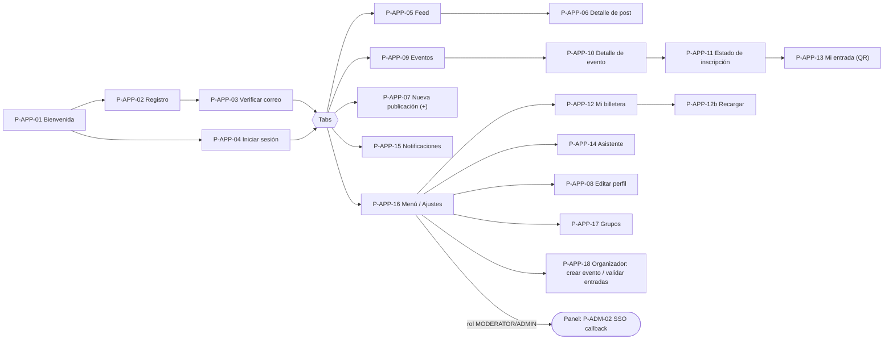

# Prototipos de GUI (storyboards)

Artefacto de la fase de **Requisitos** de ICONIX: bocetos de baja fidelidad de las pantallas
clave para que el texto de los casos de uso nombre **boundaries concretos**. Cada pantalla tiene
un ID (`P-APP-nn`, `P-ADM-nn`, `P-LND-nn`) que los UCs y las HU pueden citar.

Convenciones del boceto:

- Textos en español (idioma principal); todas las cadenas salen de `locales/{es,en}/*.json`
  (D14), por eso en los bocetos algunos textos aparecen como clave (`events.register.cta`).
- Colores: solo tokens semánticos (D13); los bocetos no muestran colores. Cada pantalla existe
  en **claro y oscuro**.
- `[Botón]`, `( ) radio`, `[x] check`, `[____] campo`, `▾` desplegable, `⟳` cargando,
  `⚠` error/aviso, `☁̸` sin conexión.
- Estados transversales que toda pantalla de datos debe diseñar: **cargando** (skeleton),
  **vacío**, **error** (Problem Details → mensaje por `code`), **sin conexión**.

---

## 1. App (F5 · `bandadau-frontend` · iOS, Android y PWA)

### 1.1 Mapa de navegación



### P-APP-01 Bienvenida / onboarding — UC-01, UC-02

```
┌───────────────────────────────┐
│                     [ES|EN] ◐ │  ← selector de idioma y tema (antes de registrarse)
│        (isotipo 3 aves "U")   │
│          Bandada U            │
│  La red social de tu U.       │
│  ● ○ ○   (3 láminas swipe:    │
│  verificados · eventos ·      │
│  asistente sin conexión)      │
│                               │
│  [   Crear cuenta          ]  │
│  [   Ya tengo cuenta       ]  │
└───────────────────────────────┘
```

### P-APP-02 Registro — UC-01 · boundary «Pantalla Registro»

```
┌───────────────────────────────┐
│ ←  Crear cuenta               │
│ Universidad  [ UMSA        ▾] │  ← listUniversities
│ Correo institucional          │
│ [ lucia@umsa.bo           ]   │
│ ⚠ El dominio @gmail.com no    │  ← 422 code=EMAIL_DOMAIN_NOT_ALLOWED
│   pertenece a tu universidad  │
│ Contraseña  [ ••••••••    ]👁 │
│ Repetir     [ ••••••••    ]   │
│ [x] Acepto términos           │
│ [   Continuar   ⟳          ]  │  ← registerUser (Idempotency-Key)
└───────────────────────────────┘
```

### P-APP-03 Verificar correo — UC-01 · «Pantalla Verificar correo»

```
┌───────────────────────────────┐
│ ←  Verifica tu correo         │
│ Enviamos un código a          │
│ lucia@umsa.bo                 │
│  [4][8][1][ ][ ][ ]           │  ← verifyEmail
│ Intentos restantes: 4         │
│ Vence en 14:32                │
│ ¿No llegó? [Reenviar] (60 s)  │  ← resendVerificationCode
└───────────────────────────────┘
```

### P-APP-04 Iniciar sesión — UC-02 · «Pantalla Iniciar sesión»

```
┌───────────────────────────────┐
│ ←  Iniciar sesión             │
│ Correo     [______________]   │
│ Contraseña [______________]👁 │
│ ⚠ Correo o contraseña         │  ← 401 code=INVALID_CREDENTIALS
│   incorrectos                 │
│ [    Entrar    ⟳           ]  │  ← login
└───────────────────────────────┘
```

### P-APP-05 Feed (con estado offline) — UC-06, UC-07 · «Pantalla Feed»

```
┌───────────────────────────────┐
│ Bandada U            🔔3  🔍  │
│ ┌───────────────────────────┐ │
│ │☁̸ Sin conexión · mostrando │ │  ← banner offline (cache TanStack Query)
│ │  lo guardado hace 12 min  │ │
│ └───────────────────────────┘ │
│ ┌───────────────────────────┐ │
│ │ ⏳ Tu publicación está      │ │  ← «Tarjeta de post pendiente» (cola offline)
│ │   pendiente de envío      │ │
│ │   "Apuntes de Cálculo II" │ │
│ │   [Reintentar] [Descartar]│ │
│ └───────────────────────────┘ │
│ ┌───────────────────────────┐ │
│ │ (av) Marco · Sistemas · 2h│ │
│ │ Taller de Docker el jueves│ │
│ │ [ imagen ]                │ │
│ │ #docker #taller           │ │
│ │ 👍 12  💡 3  😂 0  🤝 1   │ │  ← setReaction
│ │ 💬 4 comentarios          │ │
│ └───────────────────────────┘ │
│ ┌───────────────────────────┐ │
│ │ Sugerido para ti (ML)     │ │  ← getFollowSuggestions (UC-08)
│ │ (av) Ana  [Seguir]        │ │
│ └───────────────────────────┘ │
│ ⟳ (scroll infinito: cursor)   │  ← getFeed
├───────────────────────────────┤
│ 🏠 Feed  📅 Eventos  ➕  🔔  ☰ │
└───────────────────────────────┘
```

### P-APP-06 Detalle de post — UC-07, UC-10 · «Pantalla Detalle de post»

```
┌───────────────────────────────┐
│ ←  Publicación          ⋯     │  ← ⋯ → «Hoja de denuncia» (UC-10) / Borrar (autor)
│ (post completo)               │
│ 👍 12 (tú)  💡  😂  🤝         │
│ ─── Comentarios ───           │
│ Ana: ¡Me anoto!          1h   │
│ Tú: Gracias ⏳ (pendiente)     │  ← comentario en cola offline
│ [ Escribe un comentario… ][➤] │  ← createComment (Idempotency-Key)
└───────────────────────────────┘
```

### P-APP-07 Nueva publicación (con estado offline y pre-chequeo IA) — UC-05 · «Pantalla Nueva publicación»

```
┌───────────────────────────────┐
│ ✕  Nueva publicación [Publicar]│
│ ┌───────────────────────────┐ │
│ │ ¿Qué querés compartir?    │ │  texto ≤ 2000 · contador 1840
│ │ Apuntes de #calculo2 …    │ │
│ └───────────────────────────┘ │
│ [img1][img2][img3][ + ]  (≤4) │  o 1 video ≤ 60 s
│ ⚠ img2: el análisis en tu     │  ← pre-chequeo on-device (nsfw-mobile)
│   teléfono sugiere que podría │     aviso NO bloqueante
│   ser rechazada [Quitar]      │
│ Visibilidad (•) Pública       │
│             ( ) Seguidores    │
│             ( ) Grupo ▾       │
│ ┌───────────────────────────┐ │
│ │☁̸ Sin conexión: se enviará │ │  ← OfflineMutation (clientId + idempotencyKey)
│ │  automáticamente al volver│ │
│ │  la red.                  │ │
│ └───────────────────────────┘ │
└───────────────────────────────┘
Tras publicar online: tarjeta "Procesando imágenes…" (post PENDING_MEDIA) →
"Publicado" (PUBLISHED) o "Una imagen fue rechazada por moderación" (REJECTED).
```

Estados de la mutación en la UI: `QUEUED` (⏳ pendiente) → `SENDING` (⟳) → `SYNCED` (✓) /
`FAILED` (⚠ con Reintentar/Descartar).

### P-APP-08 Editar perfil y preferencias — UC-04 · «Pantalla Editar perfil», «Pantalla Ajustes»

```
┌───────────────────────────────┐
│ ←  Mi perfil         [Guardar]│
│   (avatar) [Cambiar foto]     │  ← createUpload/completeUpload
│ Nombre visible [Lucía P.   ]  │
│ Universidad    UMSA (fijo)    │
│ Carrera        [Sistemas  ▾]  │
│ Semestre       [ 4 ▾]         │
│ Bio (≤280)     [________]     │
│ Intereses (≤10) #ia #redes +  │
│ ─── Preferencias ───          │
│ Tema   (•) Sistema ( ) Claro ( ) Oscuro │  ← updateMyPreferences { theme }
│ Idioma (•) Español ( ) English│  ← updateMyPreferences { locale }
│ ✓ Se aplica al instante y se  │
│   sincroniza con tu cuenta    │
└───────────────────────────────┘
```

### P-APP-09 Eventos (lista) — UC-11, UC-12

```
┌───────────────────────────────┐
│ Eventos        [Esta semana ▾]│
│ ┌───────────────────────────┐ │
│ │ [portada] Taller Docker   │ │
│ │ jue 23 oct · 18:00 · Aula 5│ │
│ │ 30 créditos · 12/40 cupos │ │
│ └───────────────────────────┘ │
│ ┌───────────────────────────┐ │
│ │ [portada] Charla IA       │ │
│ │ Gratis · AGOTADO          │ │
│ └───────────────────────────┘ │
└───────────────────────────────┘
```

### P-APP-10 / P-APP-11 Detalle de evento + inscripción (PENDING / CONFIRMED / FAILED) — UC-12, UC-13 · «Pantalla Detalle de evento / Estado de inscripción»

```
┌───────────────────────────────┐    Estados del bloque inferior
│ ←  Taller de Docker           │
│ [ portada ]                   │    (a) sin inscripción
│ jue 23 oct 18:00–20:00        │    [ Inscribirme · 30 créditos ]
│ Aula 5, Edificio Central      │    Tu saldo: 45 créditos
│ Organiza: Centro de Sistemas  │
│ Cupos: 12 / 40                │    (b) PENDING  (202 → polling getRegistration)
│ Descripción…                  │    ⟳ Procesando tu inscripción…
│ ───────────────────────────── │       ✓ Cupo reservado
│ (bloque de estado →)          │       ⟳ Cobrando créditos
└───────────────────────────────┘       ○ Emitiendo entrada

(c) CONFIRMED                           (d) FAILED
✓ ¡Estás inscripto!                     ⚠ No pudimos completar tu inscripción
[ Ver mi entrada ]  → P-APP-13          Motivo: Saldo insuficiente
[ Cancelar inscripción ] (hasta 24 h)   No se te cobró nada.
                                         [ Recargar y reintentar ] → P-APP-12b (UC-15 «extend»)
(e) CANCELLATION_PENDING / CANCELLED    Motivo (otro): "No se pudo emitir la entrada.
⟳ Cancelando… → ✓ Cancelada. Se         Te devolvimos 30 créditos." (rollback)
devolvieron 30 créditos.
```

`registerToEvent` (Idempotency-Key; el botón se deshabilita y un doble toque reusa la misma
clave) → `getRegistration` (polling corto) y push `REGISTRATION_CONFIRMED/FAILED` (UC-24).

### P-APP-12 Mi billetera / P-APP-12b Recargar — UC-15, UC-16 · «Pantalla Mi billetera», «Pantalla Recargar», «Página checkout simulada»

```
┌───────────────────────────────┐   ┌───────────────────────────────┐
│ ←  Mi billetera               │   │ ←  Recargar créditos          │
│      45 créditos              │   │ ( ) 20  ( ) 50  (•) 100       │
│ [   Recargar   ]              │   │ [ Ir a pagar ]                │ ← createTopUp
│ ─── Movimientos ───           │   │                               │
│ + 50  Recarga        12 oct   │   │ ── Pasarela simulada (demo) ──│
│ − 30  Taller Docker  14 oct   │   │ Total Bs 100                  │
│ + 30  Reembolso      14 oct   │   │ [ Pagar ] ← doble clic = 1 cargo│
│ ⟳ (paginado por cursor)       │   │ ✓ Pago acreditado (+100)      │
└───────────────────────────────┘   └───────────────────────────────┘
getMyWallet · listMyLedgerEntries        simulateTopUpPayment → paymentWebhook
```

### P-APP-13 Mi entrada (QR) — UC-12, UC-14 · «Pantalla Mi entrada (QR)»

```
┌───────────────────────────────┐
│ ←  Mi entrada                 │
│ Taller de Docker              │
│ jue 23 oct · 18:00 · Aula 5   │
│   ┌───────────────┐           │
│   │ ▓▓ ▓ ▓▓▓ ▓▓▓  │  QR firmado (qrPayload)
│   │ ▓ ▓▓▓ ▓ ▓ ▓▓  │  disponible sin conexión
│   └───────────────┘           │
│ Estado: VÁLIDA                │  ISSUED | USADA (USED) | ANULADA (VOIDED)
│ Brillo al máximo al mostrar   │
└───────────────────────────────┘
```

### P-APP-14 Asistente de estudio offline — UC-17 · «Pantalla Descargar modelo», «Pantalla Asistente»

```
┌───────────────────────────────┐   ┌───────────────────────────────┐
│ ←  Asistente de estudio       │   │ ←  Asistente      ☁̸ sin red ✓ │
│ Funciona sin conexión, en tu  │   │ [Resumir] [Flashcards]        │
│ teléfono. Tamaño: 0.9 GB      │   │ Pega o escribe tu texto:      │
│ Solo por Wi-Fi [x]            │   │ [ La derivada mide…        ]  │
│ [ Descargar ]                 │   │ [ Generar ]                   │
│ ▓▓▓▓▓▓░░░░ 62 % [Pausar]      │   │ ⟳ generando… (tokens en vivo)│
│ ⚠ Tu dispositivo no tiene     │   │ ┌ Tarjeta 1/8 ──────────────┐ │
│   memoria suficiente → modo   │   │ │ ¿Qué mide la derivada?    │ │
│   reducido (modelo pequeño)   │   │ │ [Voltear]                 │ │
└───────────────────────────────┘   │ └───────────────────────────┘ │
                                    └───────────────────────────────┘
```

### P-APP-15 Notificaciones — UC-24 · «Pantalla Notificaciones (app)»

```
┌───────────────────────────────┐
│ Notificaciones [Marcar todas] │  ← markAllNotificationsRead
│ ● ✓ Inscripción confirmada    │  ← REGISTRATION_CONFIRMED (no leída)
│     Taller de Docker · 2 min  │
│ ● 💬 Ana comentó tu post      │
│   ⏰ Mañana: Charla IA 10:00   │  ← EVENT_REMINDER (n8n wf-02)
│   💰 Recarga acreditada +100   │
│ [⚙ Preferencias]              │  ← get/updateNotificationPreferences
└───────────────────────────────┘
```

### P-APP-16 Menú / Ajustes con "Abrir panel" — UC-03, UC-04, UC-02 · «Pantalla Ajustes de la app»

```
┌───────────────────────────────┐
│ ☰  Lucía P. · Sistemas        │
│ 👤 Mi perfil            →     │
│ 💰 Mi billetera  45 cr  →     │
│ 🎟 Mis entradas          →     │
│ 👥 Grupos                →     │
│ 🧠 Asistente de estudio  →     │
│ 📣 Organizador           →     │  (rol ORGANIZER)
│ 🛡 Abrir panel           ↗     │  (rol MODERATOR/ADMIN) ← createHandoffCode → navegador
│ ─── Apariencia e idioma ───   │
│ Tema   [ Sistema ▾ ]          │  SYSTEM | LIGHT | DARK
│ Idioma [ Español ▾ ]          │  es | en
│ 🔔 Notificaciones        →     │
│ ⎋ Cerrar sesión               │  ← logout + unregisterDevice
└───────────────────────────────┘
"Abrir panel": ⟳ "Abriendo el panel de forma segura…" → navegador del sistema en
https://admin.<BASE_DOMAIN>/sso/callback?code=…#cv=…
```

### P-APP-17 Grupos — UC-09 · «Pantallas Grupos: buscar, detalle, crear, solicitudes»

```
┌───────────────────────────────┐
│ Grupos  [🔍 cálculo      ]  ➕ │  ← listGroups / createGroup
│ Cálculo II · Pública · 84 👥   │ [Unirme]          ← joinGroup → ACTIVE
│ Redes · Privada · 12 👥         │ [Solicitar] → "Solicitud enviada" (PENDING)
│ ─ Solicitudes (soy OWNER) ─   │
│ Ana  [Aprobar] [Rechazar]     │  ← approveGroupMember
└───────────────────────────────┘
```

### P-APP-18 Organizador: crear evento y validar entradas — UC-11, UC-14 · «Pantalla Crear/Publicar evento», «Pantalla Validar entradas (cámara)»

```
┌───────────────────────────────┐   ┌───────────────────────────────┐
│ ←  Nuevo evento   [Guardar]   │   │ ←  Validar entradas           │
│ Título [______________]       │   │ ┌───────────────────────────┐ │
│ Portada [ subir ]             │   │ │      (visor de cámara)    │ │
│ Inicio [23/10 18:00] Fin [20:00]│ │ └───────────────────────────┘ │
│ Lugar [Aula 5]                │   │ ✓ VÁLIDA — Lucía P.           │ ← validateTicket
│ Cupo [40]  Precio [30] cr     │   │ ⚠ YA USADA a las 18:04        │
│ [ Publicar ]                  │   │ ⚠ No es de este evento        │
└───────────────────────────────┘   └───────────────────────────────┘
createEvent → publishEvent
```

---

## 2. Panel (F2 shell + F3/F4 MFEs)

### 2.1 Layout del shell

```
┌──────────────────────────────────────────────────────────────────────────┐
│ Bandada U · Panel        [🔍]      [ES|EN ▾]  [◐ Tema ▾]  🔔2  Raúl ▾   │ ← header: idioma y tema
├────────────┬─────────────────────────────────────────────────────────────┤
│ Dashboard  │                                                             │
│ Usuarios   │   <contenido de la ruta>                                     │
│ Moderación │   (Moderación → <bandada-mfe-moderation>, Angular)          │
│ Insights   │   (Insights   → <bandada-mfe-insights>,  React)             │
│ Eventos    │   atributos: graphql-url, base-path, theme, locale          │
│ Universid. │   propiedad: access-token                                   │
│            │   eventos ↑: bandada:navigate, bandada:toast,               │
│ [Abrir en  │              bandada:auth-expired                           │
│  la app ↗] │                                                             │
└────────────┴─────────────────────────────────────────────────────────────┘
```

El cambio de tema/idioma en el header actualiza `data-theme`/`lang` del documento, los atributos
`theme`/`locale` de los MFEs y llama `updateMyPreferences`.

### P-ADM-01 Iniciar sesión (panel) — UC-02

```
┌──────────────────────────────┐
│  Bandada U · Panel  [ES|EN] ◐│
│  Correo     [____________]   │
│  Contraseña [____________]   │  ← login (solo MODERATOR/ADMIN; si no → 403 "Sin acceso al panel")
│  [ Entrar ]                  │
│  ¿Tenés la app? Abrí el panel│
│  desde Menú → Abrir panel.   │
└──────────────────────────────┘
```

### P-ADM-02 SSO callback — UC-03 · «Página SSO Callback del panel»

```
┌──────────────────────────────┐
│  ⟳ Iniciando sesión…         │  ← exchangeHandoffCode { code, codeVerifier (#cv) }
│                              │     limpia la URL (history.replaceState)
│  ✓ → redirige a /dashboard   │
│  ⚠ El enlace expiró o ya se  │  ← 400/410 code=HANDOFF_CODE_INVALID
│    usó. [Iniciar sesión]     │
└──────────────────────────────┘
```

### P-ADM-03 Dashboard — UC-20

```
┌──────────────────────────────────────────────────────────────┐
│ Dashboard                      Rango [Últimos 7 días ▾]      │ ← dashboard(range)
│ ┌────────┐┌────────┐┌────────┐┌────────┐┌────────────────┐   │
│ │Activos ││ Posts  ││Inscrip.││Créditos││ Salud servicios│   │
│ │ 1 284  ││  532   ││  211   ││ 6 340  ││ ● 8/9  ⚠ media │   │ ← serviceHealth
│ └────────┘└────────┘└────────┘└────────┘└────────────────┘   │
│ [gráfico de líneas inscripciones/día · Vega-Lite con tokens] │
│ Alertas abiertas (2)   [Ver en Insights →]                   │
└──────────────────────────────────────────────────────────────┘
```

### P-ADM-04 Usuarios — UC-21 · «Página Usuarios»

```
┌──────────────────────────────────────────────────────────────┐
│ Usuarios  [🔍 correo o nombre] [Rol ▾] [Estado ▾] [Univ. ▾]   │ ← users(filter, after, first)
│ ┌──────────────┬──────────────┬─────────────┬────────┬─────┐ │
│ │ Nombre       │ Correo       │ Roles       │ Estado │     │ │
│ │ Lucía P.     │ lucia@umsa.bo│ STUDENT     │ ACTIVE │ ⋯   │ │
│ │ Marco R.     │ marco@umsa.bo│ STUDENT,ORG │ ACTIVE │ ⋯   │ │
│ └──────────────┴──────────────┴─────────────┴────────┴─────┘ │
│ ⋯ → Editar roles [x]STUDENT [x]ORGANIZER [ ]MODERATOR [ ]ADMIN│ ← updateUserRoles
│     Suspender (motivo obligatorio, confirmación)             │ ← suspendUser / reactivateUser
│ [ Cargar más ]                                               │
└──────────────────────────────────────────────────────────────┘
```

### P-ADM-05 MFE Moderación (`<bandada-mfe-moderation>`, Angular) — UC-18 · «MFE bandada-mfe-moderation (cola)»

```
┌──────────────────────────────────────────────────────────────────────┐
│ Moderación   [IA ▾ | Denuncias]  [Severidad ▾]   ● En vivo (12)       │ ← moderationQueue + subscription moderationQueueChanged
├───────────────────────┬──────────────────────────────────────────────┤
│ ▸ img · score 0.91 ⚠  │  [ vista previa difuminada · Mostrar ]       │
│   autor: juanp · 3 min│  Modelo nsfw-classifier v1.0.0               │
│ ▸ video · 0.72        │  nsfw 0.91 · violence 0.04 · tags: meme       │
│ ▸ post · 3 denuncias  │  Frames marcados: 00:04, 00:06               │
│                       │  Autor: juanp (2 flags en 24 h)              │
│                       │  Nota [______________________]               │
│                       │  [Aprobar] [Rechazar] [Rechazar y suspender] │ ← moderateMedia / resolveContentReport / suspendUser
└───────────────────────┴──────────────────────────────────────────────┘
Toast al shell (bandada:toast): "Contenido rechazado".
```

### P-ADM-06 MFE Insights (`<bandada-mfe-insights>`, React) — UC-19, UC-20 · «Pantalla Reportes», «Panel Alertas»

```
┌──────────────────────────────────────────────────────────────────────┐
│ Insights   [Reportes] [Alertas ●2] [Ejecuciones de agentes]           │
├──────────────────────────────────────────────────────────────────────┤
│ Preguntá en lenguaje natural:                                         │
│ [ ¿Cuántas inscripciones hubo el último mes y en qué eventos?   ][➤] │ ← requestReport(question, locale)
│ ⟳ El agente está trabajando… paso 3/8: get_registration_stats         │ ← reportReady(id) / agentRun
│ ┌─ Reporte · 14 oct 2026 ─────────────────────────────────────────┐   │
│ │ ▶ ━━━━━━●──────── 0:42 / 1:28   [1x ▾] [⬇]                       │   │ ← audioUrl (≤ 90 s, voz por idioma)
│ │ ## Resumen                                                       │   │
│ │ En septiembre hubo 211 inscripciones (+18 %)…  (Markdown)        │   │
│ │ [gráfico de barras Vega-Lite]                                    │   │
│ │ ┌ Tabla (dataset) ─────────────┐  [Copiar CSV]                   │   │
│ │ │ Evento        │ Inscripciones│                                 │   │
│ │ └───────────────┴──────────────┘                                 │   │
│ │ Herramientas usadas: get_registration_stats, list_events · 3 412 tokens│
│ └──────────────────────────────────────────────────────────────────┘   │
│ ─ Alertas en vivo ─────────────────────────────────── ● conectado ─── │ ← subscription alertRaised
│ 🔴 CRITICAL  SAGA fallida en ticketing (3 en 10 min)  2 min [Reconocer]│ ← acknowledgeAlert
│ 🟡 WARNING   DLQ notification-service.events: 4 msgs  9 min [Reconocer]│
│ [ Ejecutar monitoreo ahora ]                                          │ ← runMonitoringNow
└──────────────────────────────────────────────────────────────────────┘
```

---

## 3. Landing (F1 · `bandadau-landing`, rutas `/es` y `/en`)

### P-LND-01 Secciones — UC-01 (entrada), UC-11 (eventos públicos)

```
┌──────────────────────────────────────────────────────────────────────┐
│ (logo) Bandada U   Funciones  Eventos  Universidades   [ES|EN] ◐      │ ← navbar: idioma (/es,/en) y tema
│                                         [Panel] [ Entrar ]            │ ← admin. / app.
├──────────────────────────────────────────────────────────────────────┤
│ HERO  "La red social de tu universidad"                               │
│       [ Entrar a la app ]  [ Descargar para Android/iOS ]             │
│ ─ Funciones ─  Verificados · Grupos de estudio · Eventos con créditos │
│               · Asistente sin conexión · Moderación con IA            │
│ ─ Eventos destacados ─ (listEvents?public=true, build estático +      │
│                         refresco en cliente)  [tarjeta][tarjeta]      │
│ ─ Cómo funciona ─ 1 Registrate con tu correo · 2 Unite · 3 Participá  │
│ ─ Universidades habilitadas ─ (listUniversities)                      │
│ ─ Para administradores ─ panel, reportes con IA, MCP  [Panel]         │
│ ─ FAQ ─                                                               │
│ Footer: términos · privacidad · contacto · © Grupo 24                 │
└──────────────────────────────────────────────────────────────────────┘
```

---

## 4. Matriz pantalla → UC → boundary → operaciones

| ID | Pantalla | App | UC | Boundary (nombre usado en robustez) | Operaciones / eventos |
|---|---|---|---|---|---|
| P-APP-01 | Bienvenida | mobile | UC-01, UC-02, UC-04 | Pantalla Bienvenida | — (tema/idioma locales) |
| P-APP-02 | Registro | mobile | UC-01 | Pantalla Registro | `listUniversities`, `registerUser` |
| P-APP-03 | Verificar correo | mobile | UC-01 | Pantalla Verificar correo | `verifyEmail`, `resendVerificationCode` |
| P-APP-04 | Iniciar sesión | mobile | UC-02 | Pantalla Iniciar sesión | `login`, `refreshToken` |
| P-APP-05 | Feed | mobile | UC-06, UC-07, UC-08 | Pantalla Feed; Tarjeta de post pendiente; Service worker NetworkFirst | `getFeed`, `setReaction`, `getFollowSuggestions`, `followUser` |
| P-APP-06 | Detalle de post | mobile | UC-07, UC-10 | Pantalla Detalle de post; Hoja de denuncia | `getPost`, `listComments`, `createComment`, `reportContent`, `deletePost` |
| P-APP-07 | Nueva publicación | mobile | UC-05 | Pantalla Nueva publicación; Monitor de red NetInfo / Background Sync | `createUpload`, `completeUpload`, `createPost`, `getMedia` |
| P-APP-08 | Editar perfil y preferencias | mobile | UC-04 | Pantalla Editar perfil; Pantalla Ajustes | `getMyProfile`, `updateMyProfile`, `updateMyPreferences`, `getMe` |
| P-APP-09 | Eventos | mobile | UC-11, UC-12 | Pantalla Eventos | `listEvents` |
| P-APP-10/11 | Detalle de evento / Estado de inscripción | mobile | UC-12, UC-13 | Pantalla Detalle de evento / Estado de inscripción | `getEvent`, `registerToEvent`, `getRegistration`, `cancelRegistration` |
| P-APP-12 | Mi billetera / Recargar | mobile | UC-15, UC-16 | Pantalla Mi billetera; Pantalla Recargar; Página checkout simulada | `getMyWallet`, `listMyLedgerEntries`, `createTopUp`, `getTopUp`, `simulateTopUpPayment` |
| P-APP-13 | Mi entrada (QR) | mobile | UC-12, UC-14 | Pantalla Mi entrada (QR) | `listMyTickets`, `getTicket` |
| P-APP-14 | Asistente | mobile | UC-17 | Pantalla Descargar modelo; Pantalla Asistente; LocalLlm | — (on-device) |
| P-APP-15 | Notificaciones | mobile | UC-24 | Pantalla Notificaciones (app); Push / bandeja in-app | `listNotifications`, `markNotificationRead`, `markAllNotificationsRead`, `registerDevice`, preferencias |
| P-APP-16 | Menú / Ajustes | mobile | UC-03, UC-04, UC-02 | Pantalla Ajustes de la app; Navegador del sistema; Pantalla sso/callback de la app | `createHandoffCode`, `exchangeHandoffCode` (inverso), `logout`, `updateMyPreferences` |
| P-APP-17 | Grupos | mobile | UC-09 | Pantallas Grupos | `listGroups`, `createGroup`, `joinGroup`, `approveGroupMember`, `listGroupPosts` |
| P-APP-18 | Organizador | mobile | UC-11, UC-14 | Pantalla Crear/Publicar evento; Pantalla Validar entradas (cámara) | `createEvent`, `publishEvent`, `validateTicket` |
| P-ADM-01 | Login panel | admin-shell | UC-02 | Página Login del panel | `login` |
| P-ADM-02 | SSO callback | admin-shell | UC-03 | Página SSO Callback del panel | `exchangeHandoffCode` |
| P-ADM-03 | Dashboard | admin-shell | UC-20 | Página Dashboard | GraphQL `dashboard`, `serviceHealth`, `alerts` |
| P-ADM-04 | Usuarios | admin-shell | UC-21 | Página Usuarios | GraphQL `users`, `updateUserRoles`, `suspendUser`, `reactivateUser`, `createUniversity` |
| P-ADM-05 | Moderación | mfe-moderation | UC-18 | MFE bandada-mfe-moderation (cola) | GraphQL `moderationQueue`, `moderateMedia`, `resolveContentReport`, `suspendUser`, sub. `moderationQueueChanged` |
| P-ADM-06 | Insights | mfe-insights | UC-19, UC-20 | Pantalla Reportes; Panel Alertas | GraphQL `requestReport`, `report`, `alerts`, `acknowledgeAlert`, `runMonitoringNow`, sub. `reportReady`, `alertRaised`; audio por URL prefirmada |
| P-LND-01 | Landing | landing | UC-01, UC-11 | Landing / listado de eventos | `listEvents?public=true`, `listUniversities` |

> Los nombres de *boundary* de esta tabla son los que deben usar los diagramas de robustez. Si un
> UC usa otro nombre para la misma pantalla, se unifica en la PDR.
