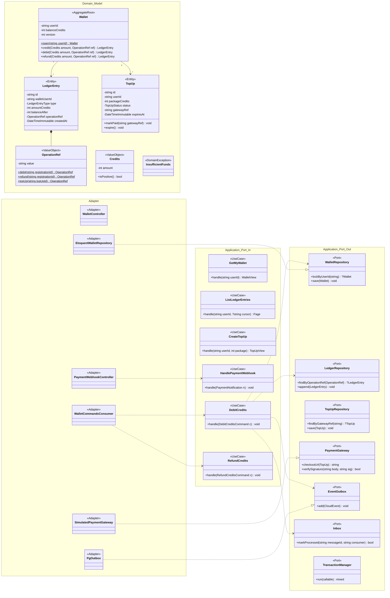

# Modelo estático — Billetera (`wallet-service`)

PHP 8.4 + Laravel 12 · **Hexagonal** · PostgreSQL `wallet_db` · namespace `Bandada\Wallet\`
(`Domain/{Model,Event,Exception}`, `Application/{Port/In,Port/Out,UseCase}`,
`Adapter/{In/Http,In/Messaging,Out/Persistence,Out/Messaging,Out/External}`).
UCs: UC-12 (débito), UC-13 (reembolso), UC-15, UC-16. Participante de la SAGA (D2).

## 1. Clases de diseño



- `DebitCredits`: en una transacción → inbox → `lockByUserId` (`SELECT … FOR UPDATE`) →
  `Wallet.debit()` (lanza `InsufficientFunds`) → asiento `DEBIT:<registrationId>` → outbox
  `credits-debited` / `credits-debit-failed`. Si `operation_ref` ya existe (reenvío del orquestador)
  → re-publica la respuesta original (`idempotencia.md` §3.4).
- `RefundCredits` sin débito previo → responde `credits-refunded` sin asiento (compensación idempotente).
- Saldo (invariante 3): `wallets.balance_credits` es una proyección mantenida en la misma
  transacción que el asiento; verificable con `SUM(ledger_entries)`.

## 2. Modelo persistente (`wallet_db`, migraciones Laravel)

```sql
CREATE TABLE wallets (
    user_id          UUID PRIMARY KEY,
    balance_credits  BIGINT      NOT NULL DEFAULT 0 CHECK (balance_credits >= 0),
    version          BIGINT      NOT NULL DEFAULT 0,
    created_at       TIMESTAMPTZ NOT NULL DEFAULT now(),
    updated_at       TIMESTAMPTZ NOT NULL DEFAULT now()
);

CREATE TABLE ledger_entries (
    id              UUID PRIMARY KEY,
    wallet_user_id  UUID        NOT NULL REFERENCES wallets(user_id),
    type            VARCHAR(8)  NOT NULL CHECK (type IN ('TOPUP','DEBIT','REFUND')),
    amount_credits  BIGINT      NOT NULL CHECK (amount_credits > 0),
    balance_after   BIGINT      NOT NULL CHECK (balance_after >= 0),
    operation_ref   VARCHAR(64) NOT NULL,     -- 'DEBIT:<registrationId>' …
    saga_id         UUID,
    created_at      TIMESTAMPTZ NOT NULL DEFAULT now()
);
CREATE UNIQUE INDEX ux_ledger_operation_ref ON ledger_entries (operation_ref);
CREATE INDEX idx_ledger_wallet_created ON ledger_entries (wallet_user_id, created_at DESC, id DESC);

CREATE TABLE top_ups (
    id               UUID PRIMARY KEY,
    user_id          UUID        NOT NULL,
    package_credits  INTEGER     NOT NULL,
    status           VARCHAR(8)  NOT NULL,   -- PENDING|PAID|FAILED|EXPIRED
    gateway_ref      VARCHAR(80),
    idempotency_key  UUID,
    expires_at       TIMESTAMPTZ NOT NULL,
    paid_at          TIMESTAMPTZ,
    created_at       TIMESTAMPTZ NOT NULL DEFAULT now()
);
CREATE UNIQUE INDEX ux_topups_gateway_ref ON top_ups (gateway_ref) WHERE gateway_ref IS NOT NULL;
CREATE INDEX idx_topups_user ON top_ups (user_id, created_at DESC);

-- outbox y processed_messages: mismo DDL que events_db (saga-inscripcion-evento.md §5)
```

Estadísticas internas (`getCreditStats`): agregación por día y `type` sobre `ledger_entries`.
