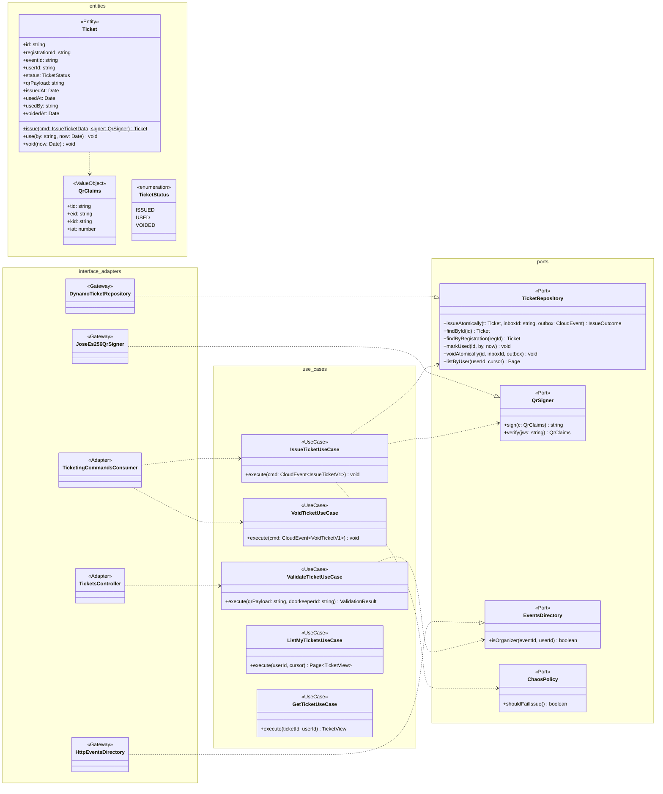

# Modelo estático — Entradas (`ticketing-service`)

TypeScript + NestJS 11 · **Clean Architecture** · DynamoDB `bandada-ticketing` (tabla única).
UCs: UC-12 (emitir), UC-13 (anular), UC-14 (validar). Participante de la SAGA (D2).
QR: JWS compacto **ES256** verificable sin conexión (UC-14).

## 1. Clases de diseño

- `IssueTicketUseCase`: con `CHAOS_TICKETING_FAIL=true` responde `ticket-issue-failed` (demo C1).
  Si la transacción falla por el centinela `REG#…` (ya emitido) → re-publica `ticket-issued`
  con el ticket existente.
- `ValidateTicketUseCase`: verifica firma y `kid`, comprueba organizador (`EventsDirectory`, caché
  corta) y hace `UpdateItem … ConditionExpression status = ISSUED` → `USED`; si falla la condición
  → `409 TICKET_ALREADY_USED` / `TICKET_VOIDED`. Publica `bandada.ticketing.ticket.used.v1`.

## 2. Modelo persistente (`bandada-ticketing`)

Claves `pk`/`sk` (S); GSI1 (`gsi1pk`, `gsi1sk`) y GSI2 (`gsi2pk`, `gsi2sk`) con proyección `ALL`.
On-demand. Sin TTL (ver propuesta P-4 en `00-indice.md`).

| Ítem | `pk` | `sk` | `gsi1pk` / `gsi1sk` | `gsi2pk` / `gsi2sk` | Atributos |
|---|---|---|---|---|---|
| Ticket | `TICKET#<ticketId>` | `META` | `USER#<userId>` / `EVENT#<eventId>#<issuedAt>` | `REG#<registrationId>` / `TICKET` | `ticketId`, `registrationId`, `eventId`, `userId`, `status`, `qrPayload`, `kid`, `issuedAt`, `usedAt`, `usedBy`, `voidedAt`, `sagaId` |
| Centinela 1 ticket/inscripción | `REG#<registrationId>` | `LOCK` | — | — | `ticketId`, `createdAt` |
| Inbox | `INBOX#<messageId>` | `META` | — | — | `consumer`, `processedAt` |
| Outbox | `OUTBOX#<cloudEventId>` | `META` | `OUTBOX#PENDING` / `<createdAt>#<id>` | — | `exchange`, `routingKey`, `payload`, `headers`, `attempts`, `leaseUntil` |

Patrones de acceso:

| Acceso | Operación |
|---|---|
| `getTicket` | `GetItem pk=TICKET#id, sk=META` (+ comprobar `userId` = sub) |
| `listMyTickets` | `Query GSI1 gsi1pk=USER#<userId>` (orden por `gsi1sk`) |
| Tickets de un evento | No es un acceso de los UCs actuales; si se necesitara (lista de asistentes), agregar GSI3 `EVENT#<eventId>` vía ADR |
| Ticket de una inscripción (`void-ticket`) | `Query GSI2 gsi2pk=REG#<registrationId>` |
| Emitir | `TransactWriteItems`: Put `INBOX#` (cond. `attribute_not_exists`), Put `REG#…/LOCK` (cond.), Put `TICKET#…`, Put `OUTBOX#…` |
| Anular | `TransactWriteItems`: Put `INBOX#`, Update `TICKET#` `status=VOIDED` (cond. `status <> USED`), Put `OUTBOX#` |
| Validar | `UpdateItem TICKET#` cond. `status = ISSUED` + Put `OUTBOX#` (transacción) |
