# Modelo estático — Eventos (`events-service`)

Java 25 + Spring Boot 4 · **DDD táctico** · PostgreSQL `events_db` · paquete `com.bandadau.events`
(`domain/{shared,event,registration,saga}`, `application/…`, `infrastructure/…`, `interfaces/…`).
UCs: UC-11, UC-12, UC-13, UC-23 (consulta). **Orquestador de la SAGA** (D2). Máquinas de estado,
DDL normativo y fragmentos del orquestador: `bandadau-docs/docs/03-arquitectura/saga-inscripcion-evento.md`.

## 1. Clases de diseño

```mermaid
classDiagram
    direction TB
    namespace domain_event {
        class Event {
            <<AggregateRoot>>
            -EventId id
            -UUID organizerId
            -UUID universityId
            -String title
            -String description
            -UUID coverMediaId
            -Venue venue
            -EventSchedule schedule
            -Capacity capacity
            -int seatsTaken
            -Credits price
            -EventStatus status
            -long version
            +create(...)$ Event
            +publish(Instant now) void
            +cancel(String reason) void
            +reserveSeat() void
            +releaseSeat() void
            +isFree() boolean
            +acceptsRegistrations(Instant now) boolean
        }
        class EventSchedule {
            <<ValueObject>>
            -Instant startsAt
            -Instant endsAt
            +cancellationDeadline(Duration cutoff) Instant
        }
        class Capacity {
            <<ValueObject>>
            -int value
            +hasRoomFor(int seatsTaken) boolean
        }
        class Credits {
            <<ValueObject>>
            -long amount
            +isZero() boolean
        }
        class Venue {
            <<ValueObject>>
            -String name
        }
    }
    namespace domain_registration {
        class Registration {
            <<AggregateRoot>>
            -RegistrationId id
            -EventId eventId
            -UUID userId
            -RegistrationStatus status
            -Credits priceSnapshot
            -FailureReason failureReason
            -UUID ticketId
            -UUID idempotencyKey
            -long version
            +request(...)$ Registration
            +confirm(UUID ticketId) void
            +fail(FailureReason) void
            +requestCancellation(Instant now, Instant deadline) void
            +markCancelled() void
        }
    }
    namespace domain_saga {
        class SagaInstance {
            <<AggregateRoot>>
            -SagaId id
            -RegistrationId registrationId
            -SagaType type
            -SagaStatus status
            -SagaStep step
            -int attempt
            -Instant deadlineAt
            -SagaContext context
            -List~SagaTransition~ history
            -long version
            +start(type, ctx, Instant now)$ SagaInstance
            +onReply(SagaReply r) SagaDecision
            +onTimeout(Instant now) SagaDecision
            +isTerminal() boolean
        }
        class SagaContext {
            <<ValueObject>>
            -EventId eventId
            -UUID userId
            -Credits price
            -boolean debited
            -UUID ticketId
            -UUID ledgerEntryId
        }
        class SagaDecision {
            <<ValueObject>>
            -SagaCommand nextCommand
            -boolean releaseSeat
            -RegistrationOutcome outcome
        }
        class SagaStep {
            <<enumeration>>
            RESERVE_SEAT
            DEBIT_CREDITS
            ISSUE_TICKET
            VOID_TICKET
            REFUND_CREDITS
            RELEASE_SEAT
        }
    }
    namespace application {
        class CreateEventService {
            <<ApplicationService>>
            +create(CreateEventCommand) EventView
            +publish(EventId, UUID organizerId) void
        }
        class RegisterToEventService {
            <<ApplicationService>>
            +register(EventId, UUID userId, UUID idemKey) RegistrationView
        }
        class CancelRegistrationService {
            <<ApplicationService>>
            +cancel(RegistrationId, UUID userId) RegistrationView
        }
        class RegistrationSagaOrchestrator {
            <<ApplicationService>>
            +start(Registration, Event) void
            +handleReply(CloudEvent reply) void
            +handleTimeout(SagaId) void
        }
        class SagaTimeoutScheduler {
            <<ApplicationService>>
            +sweep() void
        }
        class SagaCommandSender {
            <<Port>>
            +send(SagaCommand, SagaId, String idemKey) void
        }
    }
    namespace infrastructure {
        class EventRepository {
            <<Repository>>
        }
        class RegistrationRepository {
            <<Repository>>
        }
        class SagaRepository {
            <<Repository>>
            +findDue(Instant now, int limit) List
        }
        class OutboxSagaCommandSender {
            <<Adapter>>
        }
        class AmqpSagaReplyListener {
            <<Adapter>>
        }
        class OutboxRelay {
            <<Adapter>>
        }
    }
    namespace interfaces {
        class EventsController {
            <<Adapter>>
        }
        class RegistrationsController {
            <<Adapter>>
        }
        class InternalSagasController {
            <<Adapter>>
        }
    }

    Event *-- EventSchedule
    Event *-- Capacity
    Event *-- Credits
    Event *-- Venue
    Registration ..> Event : eventId
    SagaInstance ..> Registration : registrationId
    SagaInstance *-- SagaContext
    RegistrationsController ..> RegisterToEventService
    RegisterToEventService ..> RegistrationSagaOrchestrator
    AmqpSagaReplyListener ..> RegistrationSagaOrchestrator
    SagaTimeoutScheduler ..> RegistrationSagaOrchestrator
    RegistrationSagaOrchestrator ..> SagaRepository
    RegistrationSagaOrchestrator ..> SagaCommandSender
    OutboxSagaCommandSender ..|> SagaCommandSender
```

- Paso 1 (síncrono): en **una** transacción `Event.reserveSeat()` (bloqueo optimista por
  `version`) + `Registration PENDING` + `SagaInstance STARTED` + outbox del primer comando → 202.
- `SagaInstance.onReply/onTimeout` son **puros** (devuelven `SagaDecision`); el orquestador aplica
  la decisión y escribe outbox en la misma transacción.
- Eventos de dominio: `event.published`, `event.cancelled`, `registration.confirmed`,
  `registration.failed`, `registration.cancelled`; comandos: los 4 de D2.

## 2. Modelo persistente (`events_db`)

Normativo en `saga-inscripcion-evento.md` §5: tablas `events`, `registrations` (índice parcial
único `ux_registrations_active`), `saga_instances` (`ux_saga_active`, `idx_saga_due`), `outbox`,
`processed_messages`. Resumen:

| Tabla | PK | Índices clave | Notas |
|---|---|---|---|
| `events` | `id` | `(status, starts_at)` | `CHECK seats_taken <= capacity`, `version` |
| `registrations` | `id` | único parcial `(event_id, user_id) WHERE status IN ('PENDING','CONFIRMED')`; `(user_id, created_at DESC)` | `price_credits` = snapshot; `idempotency_key` |
| `saga_instances` | `id` | único parcial `(registration_id, type)` activo; `(deadline_at)` activo; `(status, finished_at)` | `context`, `history` en JSONB |
| `outbox` | `id` (= CloudEvent id) | `(created_at) WHERE published_at IS NULL` | relay `FOR UPDATE SKIP LOCKED` |
| `processed_messages` | `message_id` | — | inbox de `events-service.saga-replies` |

Consultas para insights/admin (`/internal/v1/stats/registrations`, `/internal/v1/sagas`) se
resuelven con `GROUP BY date_trunc('day', created_at)` sobre `registrations` y el índice
`(status, finished_at)` de `saga_instances`.
