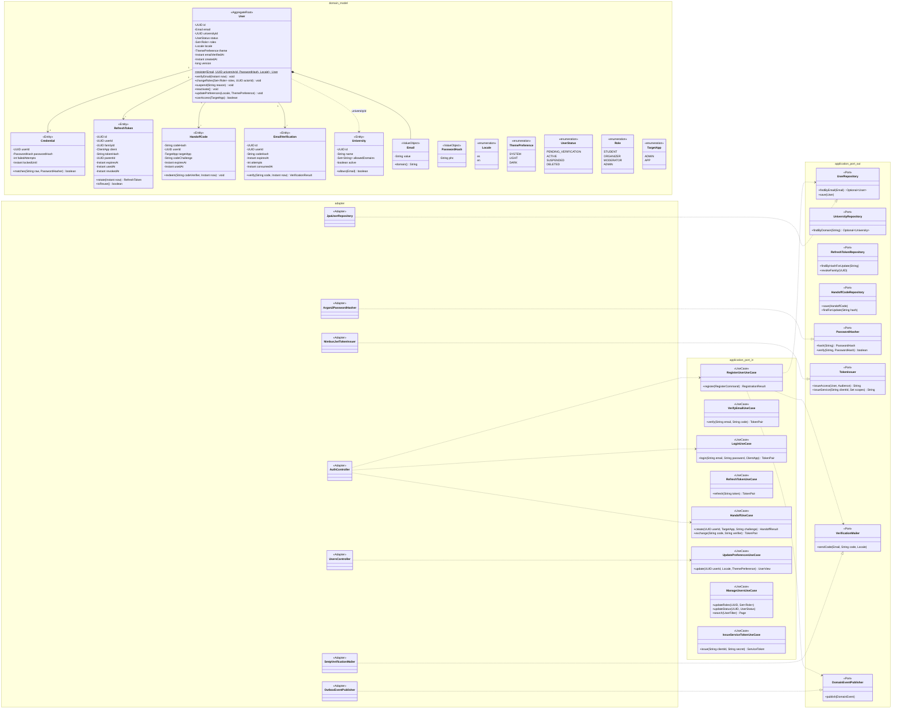

# Modelo estático — Identidad (`identity-service`)

Java 25 + Spring Boot 4 · **Hexagonal** · PostgreSQL `identity_db` · paquete `com.bandadau.identity`.
UCs: UC-01, UC-02, UC-03, UC-04 (preferencias), UC-21. Detalle de seguridad: `bandadau-docs/docs/03-arquitectura/seguridad-y-sso.md`.

## 1. Clases de diseño



Eventos de dominio publicados (vía outbox): `bandada.identity.user.registered.v1`,
`bandada.identity.user.role-changed.v1`, `bandada.identity.user.suspended.v1`,
`bandada.identity.user.preferences-changed.v1` (`userId`, `locale`, `theme`; D14).

## 2. Modelo persistente (`identity_db`, Flyway)

`signing_keys`, `refresh_tokens` y `handoff_codes` siguen el DDL normativo de
`seguridad-y-sso.md` (§2.2, §4, §7.1); aquí se repiten solo por completitud resumida.

```sql
CREATE TABLE universities (
    id               UUID PRIMARY KEY,
    name             VARCHAR(160) NOT NULL,
    allowed_domains  TEXT[]       NOT NULL,          -- ['umsa.bo','est.umsa.bo']
    active           BOOLEAN      NOT NULL DEFAULT true,
    created_at       TIMESTAMPTZ  NOT NULL DEFAULT now(),
    updated_at       TIMESTAMPTZ  NOT NULL DEFAULT now()
);
CREATE INDEX idx_universities_domains ON universities USING GIN (allowed_domains);

CREATE TABLE users (
    id                 UUID PRIMARY KEY,                 -- UUIDv7 de la app
    email              VARCHAR(254) NOT NULL,
    university_id      UUID         NOT NULL REFERENCES universities(id),
    status             VARCHAR(24)  NOT NULL,            -- UserStatus
    roles              TEXT[]       NOT NULL DEFAULT '{STUDENT}',
    locale             VARCHAR(2)   NOT NULL DEFAULT 'es' CHECK (locale IN ('es','en')),
    theme              VARCHAR(6)   NOT NULL DEFAULT 'SYSTEM' CHECK (theme IN ('SYSTEM','LIGHT','DARK')),
    email_verified_at  TIMESTAMPTZ,
    suspended_reason   VARCHAR(280),
    version            BIGINT       NOT NULL DEFAULT 0,
    created_at         TIMESTAMPTZ  NOT NULL DEFAULT now(),
    updated_at         TIMESTAMPTZ  NOT NULL DEFAULT now()
);
CREATE UNIQUE INDEX ux_users_email ON users (lower(email));
CREATE INDEX idx_users_status ON users (status);
CREATE INDEX idx_users_roles ON users USING GIN (roles);

CREATE TABLE credentials (
    user_id          UUID PRIMARY KEY REFERENCES users(id),
    password_hash    VARCHAR(255) NOT NULL,             -- PHC Argon2id
    failed_attempts  SMALLINT     NOT NULL DEFAULT 0,
    locked_until     TIMESTAMPTZ,
    updated_at       TIMESTAMPTZ  NOT NULL DEFAULT now()
);

CREATE TABLE email_verifications (
    id           UUID PRIMARY KEY,
    user_id      UUID        NOT NULL REFERENCES users(id),
    code_hash    CHAR(64)    NOT NULL,                  -- SHA-256 del código de 6 dígitos
    expires_at   TIMESTAMPTZ NOT NULL,                  -- +15 min (RF-02)
    attempts     SMALLINT    NOT NULL DEFAULT 0 CHECK (attempts <= 5),
    consumed_at  TIMESTAMPTZ,
    created_at   TIMESTAMPTZ NOT NULL DEFAULT now()
);
CREATE INDEX idx_email_verif_user ON email_verifications (user_id, created_at DESC);

-- refresh_tokens, handoff_codes, signing_keys: DDL en seguridad-y-sso.md
CREATE TABLE service_clients (
    client_id      VARCHAR(64) PRIMARY KEY,             -- 'admin-gateway', 'insights-service', 'n8n'
    secret_hash    VARCHAR(255) NOT NULL,               -- Argon2id
    scopes         TEXT[]      NOT NULL,                -- internal:read, internal:write, mcp:tools
    active         BOOLEAN     NOT NULL DEFAULT true,
    created_at     TIMESTAMPTZ NOT NULL DEFAULT now()
);

CREATE TABLE role_changes (                             -- auditoría UC-21
    id          UUID PRIMARY KEY,
    user_id     UUID        NOT NULL REFERENCES users(id),
    actor_id    UUID        NOT NULL,
    old_roles   TEXT[]      NOT NULL,
    new_roles   TEXT[]      NOT NULL,
    created_at  TIMESTAMPTZ NOT NULL DEFAULT now()
);

-- outbox: DDL idéntico al de events_db (saga-inscripcion-evento.md §5)
```
