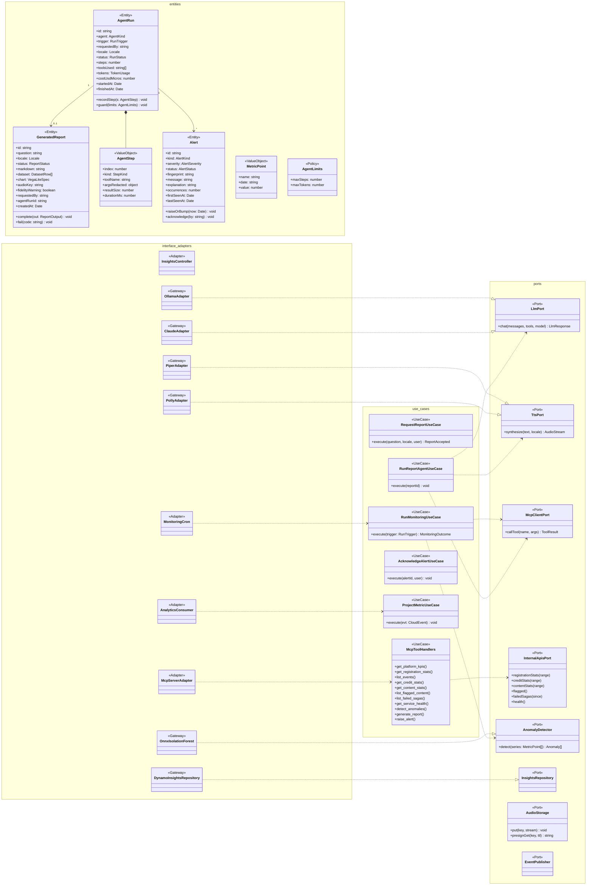

# Modelo estático — Insights (`insights-service`)

TypeScript + NestJS 11 · **Clean Architecture** · DynamoDB `bandada-insights` + S3 (audio).
UCs: UC-19, UC-20, UC-22, UC-23 (resumen semanal). Agentes, LLM, TTS y MCP: D8, D9,
`bandadau-docs/docs/03-arquitectura/agentes-y-reportes-generativos.md` (§7 persistencia, normativa para este
contexto) y `bandadau-docs/docs/03-arquitectura/mcp.md`.

## 1. Clases de diseño

Los agentes son **clientes MCP** del propio servidor (`McpClientPort` → `/mcp` con token de
servicio): ven exactamente las mismas herramientas que un cliente externo (UC-22).
Eventos publicados: `bandada.insights.alert.raised.v1`, `bandada.insights.report.ready.v1`.

## 2. Modelo persistente (`bandada-insights`)

Diseño normativo en `agentes-y-reportes-generativos.md` §7; resumen:

| Ítem | `pk` | `sk` | `gsi1pk` / `gsi1sk` (propuesta P-1) | TTL |
|---|---|---|---|---|
| Reporte | `REPORT#<id>` | `META` | `REPORT` / `<createdAt>#<id>` | — |
| Ejecución de agente | `AGENTRUN#<id>` | `META` | `AGENTRUN` / `<startedAt>#<id>` | 30 días |
| Paso de agente | `AGENTRUN#<id>` | `STEP#<0001>` | — | 30 días |
| Alerta | `ALERT#<id>` | `META` | `ALERT#<status>` / `<lastSeenAt>#<id>` | — |
| Huella de alerta (dedupe) | `ALERTFP#<fingerprint>` | `META` | — | ventana de dedupe |
| Métrica diaria | `METRIC#<name>` | `<yyyy-mm-dd>` | — | — |
| Inbox | `INBOX#<messageId>` | `META` | — | 14 días |
| Outbox | `OUTBOX#<id>` | `META` | `OUTBOX#PENDING` / `<createdAt>#<id>` | — |

Patrones de acceso:

| Acceso | Operación |
|---|---|
| `getReport` / `getAgentRun` | `GetItem` (+ `Query pk=AGENTRUN#id begins_with STEP#` para pasos) |
| `reports(after)`, `agentRuns(after)` | `Query GSI1 gsi1pk=REPORT` / `AGENTRUN`, descendente |
| `alerts(status)` | `Query GSI1 gsi1pk=ALERT#OPEN` |
| Proyección de métricas | `TransactWriteItems`: Put `INBOX#` (cond.) + `Update METRIC#<name>/<día> ADD value :n` |
| Serie para anomalías | `Query pk=METRIC#<name> AND sk BETWEEN :from AND :to` |

S3 `bandada-reports`: `reports/<reportId>.mp3` (resumen ≤ 90 s), servido por URL prefirmada.
