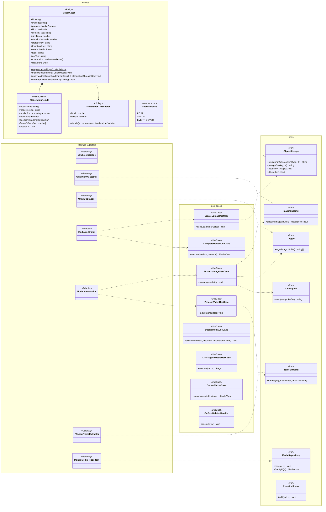

# Modelo estático — Media (`media-service`)

TypeScript + NestJS 11 (+ onnxruntime-node, ffmpeg) · **Clean Architecture** · MongoDB `media` + S3/MinIO.
UCs: UC-04 (avatar), UC-05, UC-11 (portada), UC-18. Modelos y umbrales: D7 y `bandadau-docs/docs/03-arquitectura/ml-dl.md`.

## 1. Clases de diseño

Ciclo: `PENDING_UPLOAD` →(`completeUpload`)→ `PROCESSING` →(clasificadores)→ `APPROVED` (`< 0.5`),
`FLAGGED` (`0.5–0.85`), `REJECTED` (`≥ 0.85`); `FLAGGED` →(moderador `decideMedia`)→ `APPROVED`/`REJECTED`.
Eventos: `bandada.media.asset.approved.v1`, `.flagged.v1`, `.rejected.v1`. El procesamiento corre
en un *worker* interno con concurrencia `ML_WORKER_CONCURRENCY`, disparado tras `completeUpload`
(cola en memoria + barrido de `PROCESSING` atascados al arrancar).

## 2. Modelo persistente

### MongoDB `media`

| Colección | Documento | Índices |
|---|---|---|
| `mediaAssets` | `{ _id, ownerId, purpose, kind, contentType, sizeBytes, durationSeconds, storageKey, thumbnailKey, status, tags[], ocrText, moderation: [{ modelName, modelVersion, labels, maxScore, decision, frameOffsetsSec[], createdAt }], manualDecision: { decision, moderatorId, note, at }, createdAt, updatedAt, processingStartedAt }` | `{ status: 1, createdAt: 1 }` (cola `FLAGGED`, barrido de `PROCESSING`); `{ ownerId: 1, createdAt: -1 }`; `{ tags: 1 }`; texto `{ ocrText: "text" }` |
| `outbox` | `eventos-y-mensajeria.md` §5.2 | `{ publishedAt: 1, createdAt: 1 }` |
| `processedMessages` | `{ _id: messageId, consumer, processedAt }` | TTL 14 días |

### S3 / MinIO

| Bucket | Clave | Notas |
|---|---|---|
| `bandada-media` | `uploads/<ownerId>/<mediaId>/original` | PUT prefirmado (`UPLOAD_URL_TTL_SECONDS`), `Content-Type` y tamaño firmados |
| `bandada-media` | `uploads/<ownerId>/<mediaId>/thumb.jpg` | Miniatura (frame de mayor calidad en video) |
| `bandada-media` | `uploads/<ownerId>/<mediaId>/frames/<n>.jpg` | Frames analizados (borrado tras 7 días por *lifecycle*) |
| `bandada-models` | `models/<nombre>/<versión>/model.onnx` | Solo lectura para el servicio |
