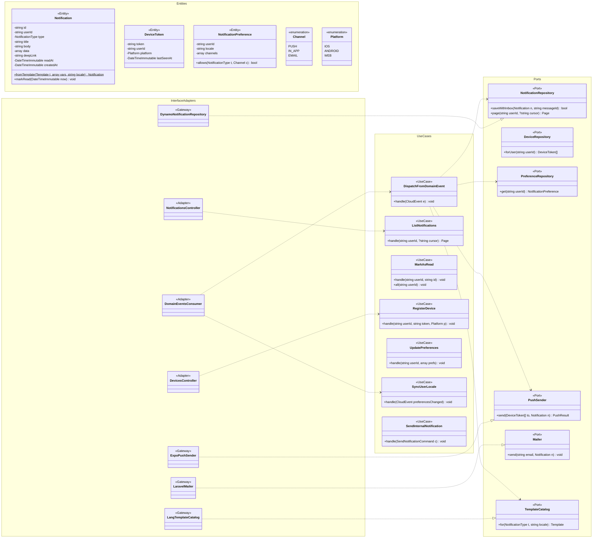

# Modelo estático — Notificaciones (`notification-service`)

PHP 8.4 + Laravel 12 · **Clean Architecture** · DynamoDB `bandada-notifications`.
UCs: UC-24 (y como canal de UC-07, UC-09, UC-12, UC-13, UC-15, UC-18, UC-20, UC-23).
Plantillas por `locale` del destinatario (D14), copia local del idioma vía
`bandada.identity.user.preferences-changed.v1`.

## 1. Clases de diseño

`DispatchFromDomainEvent` mapea tipo de evento → `NotificationType` (p. ej.
`registration.confirmed` → `REGISTRATION_CONFIRMED`). La notificación in-app se guarda **antes**
de intentar el push (el push es best-effort; tokens inválidos devueltos por Expo se borran).
La caída de este servicio no afecta publicar ni inscribirse (RNF-03): los mensajes esperan en su cola.

## 2. Modelo persistente (`bandada-notifications`)

| Ítem | `pk` | `sk` | Atributos | TTL (`expiresAt`) |
|---|---|---|---|---|
| Notificación | `USER#<userId>` | `NOTIF#<uuidv7>` | `type`, `title`, `body`, `data`, `deepLink`, `locale`, `readAt`, `createdAt` | 90 días |
| Dispositivo | `USER#<userId>` | `DEVICE#<token>` | `platform`, `lastSeenAt` | — |
| Preferencias | `USER#<userId>` | `PREF` | `locale`, `channels` (`{ type: [PUSH, IN_APP, EMAIL] }`), `updatedAt` | — |
| Inbox | `INBOX#<messageId>` | `META` | `consumer`, `processedAt` | 14 días |
| Outbox *(si publica)* | `OUTBOX#<id>` | `META` | ver `eventos-y-mensajeria.md` §5.3 | — |

Patrones de acceso:

| Acceso | Operación |
|---|---|
| `listNotifications` | `Query pk=USER#u AND begins_with(sk,'NOTIF#')`, `ScanIndexForward=false`, `Limit 20` (UUIDv7 ⇒ orden cronológico) |
| `markNotificationRead` | `UpdateItem SET readAt` (cond. `attribute_exists(pk)`) |
| `markAllNotificationsRead` | `Query` no leídas + `BatchWrite`/`Update` por lotes |
| Contador no leídas | Atributo `unreadCount` en el ítem `PREF` (ADD ±1 en la misma transacción) |
| Push a un usuario | `Query pk=USER#u AND begins_with(sk,'DEVICE#')` |
| `registerDevice` / `unregisterDevice` | `PutItem` / `DeleteItem` (idempotentes por naturaleza) |
| Consumir evento | `TransactWriteItems`: Put `INBOX#` (cond.) + Put `NOTIF#` (+ Update `PREF.unreadCount`) |

> Si el panel o n8n necesitan listar por tipo o fecha global, se agregará GSI1 (propuesta P-1).
