# Modelo estático — Social (`social-service`)

TypeScript + NestJS 11 · **Clean Architecture** · MongoDB `social` (replica set `rs0`).
Capas: `entities/` → `use-cases/` (+ `ports/`) → `interface-adapters/` → `frameworks-drivers/`
(`bandadau-backend/services/social-service/AGENTS.md`). UCs: UC-04, UC-05, UC-06, UC-07, UC-08, UC-09, UC-10, UC-18 (parte social).

## 1. Clases de diseño

```mermaid
classDiagram
    direction LR
    namespace entities {
        class Profile {
            <<Entity>>
            +userId: string
            +universityId: string
            +displayName: string
            +career: string
            +semester: number
            +bio: string
            +interests: string[]
            +avatarMediaId: string
            +avatarStatus: MediaStatus
            +update(patch: ProfilePatch) void
        }
        class Post {
            <<Entity>>
            +id: string
            +authorId: string
            +clientId: string
            +text: string
            +hashtags: string[]
            +visibility: PostVisibility
            +groupId: string
            +media: PostMedia[]
            +status: PostStatus
            +reportCount: number
            +counters: PostCounters
            +createdAt: Date
            +create(input: NewPost)$ Post
            +onMediaApproved(mediaId: string) void
            +onMediaRejected(mediaId: string) void
            +hide(reason: string) void
            +remove(byUserId: string) void
            +isVisibleTo(viewer: Viewer) boolean
        }
        class PostMedia {
            <<ValueObject>>
            +mediaId: string
            +kind: MediaKind
            +status: MediaStatus
        }
        class Comment {
            <<Entity>>
            +id: string
            +postId: string
            +authorId: string
            +clientId: string
            +text: string
            +status: PostStatus
            +createdAt: Date
        }
        class Reaction {
            <<Entity>>
            +postId: string
            +userId: string
            +type: ReactionType
            +updatedAt: Date
        }
        class Follow {
            <<Entity>>
            +followerId: string
            +followeeId: string
            +createdAt: Date
        }
        class Group {
            <<Entity>>
            +id: string
            +name: string
            +subject: string
            +privacy: GroupPrivacy
            +ownerId: string
            +memberCount: number
            +requestJoin(userId: string) GroupMembership
        }
        class GroupMembership {
            <<Entity>>
            +groupId: string
            +userId: string
            +role: GroupRole
            +status: MembershipStatus
            +approve(by: string) void
            +reject(by: string) void
        }
        class ContentReport {
            <<Entity>>
            +id: string
            +targetType: ReportTargetType
            +targetId: string
            +reporterId: string
            +reason: ReportReason
            +status: ReportStatus
            +resolve(decision: ReportStatus, by: string) void
        }
        class FeedItem {
            <<ValueObject>>
            +postId: string
            +score: number
            +source: FeedSource
        }
        class FeedRankingPolicy {
            <<Policy>>
            +score(features: FeedFeatures) number
        }
        class FollowSuggestionPolicy {
            <<Policy>>
            +rank(candidates: Candidate[]) Suggestion[]
        }
    }
    namespace use_cases {
        class CreatePostUseCase {
            <<UseCase>>
            +execute(cmd: CreatePostCommand) PostView
        }
        class GetFeedUseCase {
            <<UseCase>>
            +execute(q: FeedQuery) Page~FeedItemView~
        }
        class CreateCommentUseCase {
            <<UseCase>>
            +execute(cmd) CommentView
        }
        class SetReactionUseCase {
            <<UseCase>>
            +execute(cmd) void
        }
        class FollowUserUseCase {
            <<UseCase>>
            +execute(followerId, followeeId) void
        }
        class GetFollowSuggestionsUseCase {
            <<UseCase>>
            +execute(userId) Suggestion[]
        }
        class JoinGroupUseCase {
            <<UseCase>>
            +execute(groupId, userId) MembershipView
        }
        class ReportContentUseCase {
            <<UseCase>>
            +execute(cmd) ReportView
        }
        class OnMediaModeratedHandler {
            <<UseCase>>
            +execute(evt: MediaModeratedEvent) void
        }
        class UpdateMyProfileUseCase {
            <<UseCase>>
            +execute(userId, patch) ProfileView
        }
    }
    namespace ports {
        class PostRepository {
            <<Port>>
            +findByAuthorAndClientId(a, c) Post
            +save(p: Post, tx) void
            +findFeedCandidates(viewer, cursor, limit) Post[]
        }
        class FollowRepository {
            <<Port>>
        }
        class GroupRepository {
            <<Port>>
        }
        class ReportRepository {
            <<Port>>
            +countDistinctReporters(targetId) number
        }
        class FeedRanker {
            <<Port>>
            +rank(items, viewer) FeedItem[]
        }
        class EventPublisher {
            <<Port>>
            +add(evt: CloudEvent, tx) void
        }
        class UnitOfWork {
            <<Port>>
            +run(fn) T
        }
        class IdGenerator {
            <<Port>>
            +uuidv7() string
        }
    }
    namespace interface_adapters {
        class PostsController {
            <<Adapter>>
        }
        class FeedController {
            <<Adapter>>
        }
        class MediaEventsConsumer {
            <<Adapter>>
        }
        class MongoPostRepository {
            <<Gateway>>
        }
        class LogisticFeedRanker {
            <<Gateway>>
        }
        class MongoOutboxPublisher {
            <<Gateway>>
        }
    }

    Post *-- PostMedia
    Post "1" --> "*" Comment
    Post "1" --> "*" Reaction
    Group "1" --> "*" GroupMembership
    ContentReport ..> Post : targetId
    PostsController ..> CreatePostUseCase
    FeedController ..> GetFeedUseCase
    MediaEventsConsumer ..> OnMediaModeratedHandler
    CreatePostUseCase ..> PostRepository
    CreatePostUseCase ..> EventPublisher
    GetFeedUseCase ..> FeedRanker
    LogisticFeedRanker ..|> FeedRanker
    LogisticFeedRanker ..> FeedRankingPolicy
    MongoPostRepository ..|> PostRepository
    MongoOutboxPublisher ..|> EventPublisher
```

Reglas clave en entidades: invariante 6 (post `PENDING_MEDIA` hasta que todos sus `PostMedia`
estén `APPROVED`; uno `REJECTED` → el post queda `HIDDEN` y se avisa al autor), invariante 7
(`clientId` único por autor), ocultamiento automático con `REPORT_HIDE_THRESHOLD` denunciantes
distintos (RF-13). Eventos: `post.created`, `post.published`, `post.hidden`, `post.deleted`,
`comment.created`, `reaction.set`, `follow.created`, `group.join-requested`, `content.reported`.

## 2. Modelo persistente (MongoDB `social`)

| Colección | Documento (campos principales) | Índices |
|---|---|---|
| `profiles` | `{ _id: userId, universityId, displayName, career, semester, bio, interests[], avatarMediaId, avatarStatus, createdAt, updatedAt }` | `{ universityId: 1, career: 1 }`; texto `{ displayName: "text" }` |
| `posts` | `{ _id, authorId, clientId, universityId, text, hashtags[], visibility, groupId, media: [{ mediaId, kind, status }], status, reportCount, counters: { comments, reactions: { LIKE, HELPFUL, FUNNY, SUPPORT } }, createdAt, publishedAt, updatedAt }` | **único** `{ authorId: 1, clientId: 1 }`; `{ status: 1, createdAt: -1 }`; `{ authorId: 1, createdAt: -1 }`; `{ groupId: 1, createdAt: -1 }`; `{ hashtags: 1, createdAt: -1 }`; `{ "media.mediaId": 1 }` |
| `comments` | `{ _id, postId, authorId, clientId, text, status, createdAt }` | **único** `{ authorId: 1, clientId: 1 }`; `{ postId: 1, createdAt: 1 }` |
| `reactions` | `{ _id: "<postId>:<userId>", postId, userId, type, updatedAt }` | `{ postId: 1, type: 1 }` (el `_id` compuesto garantiza 1 por usuario/post) |
| `follows` | `{ _id: "<followerId>:<followeeId>", followerId, followeeId, createdAt }` | `{ followerId: 1 }`, `{ followeeId: 1 }` |
| `groups` | `{ _id, name, subject, privacy, ownerId, universityId, memberCount, createdAt }` | `{ universityId: 1, subject: 1 }`; texto `{ name: "text", subject: "text" }` |
| `groupMemberships` | `{ _id: "<groupId>:<userId>", groupId, userId, role, status, requestedAt, decidedAt, decidedBy }` | `{ groupId: 1, status: 1 }`, `{ userId: 1, status: 1 }` |
| `contentReports` | `{ _id, targetType, targetId, reporterId, reason, note, status, createdAt, resolvedAt, resolvedBy }` | **único** `{ targetId: 1, reporterId: 1 }` (un denunciante cuenta una vez); `{ status: 1, createdAt: 1 }` |
| `feedFeatures` *(opcional)* | `{ _id: userId, careerAffinity, interactedAuthors[], updatedAt }` | — |
| `outbox` | ver `eventos-y-mensajeria.md` §5.2 | `{ publishedAt: 1, createdAt: 1 }`, TTL sobre `publishedAt` |
| `processedMessages` | `{ _id: messageId, consumer, processedAt }` | TTL `processedAt` 14 días |

Feed (RF-09): consulta por candidatos (seguidos + grupos + `PUBLIC` de la universidad) con cursor
opaco `base64({createdAt,_id})`, puntuación por `FeedRankingPolicy` (coeficientes de
`FEED_MODEL_PATH`) y mezcla de recomendados; sin desnormalizar timelines (escala de demo).
