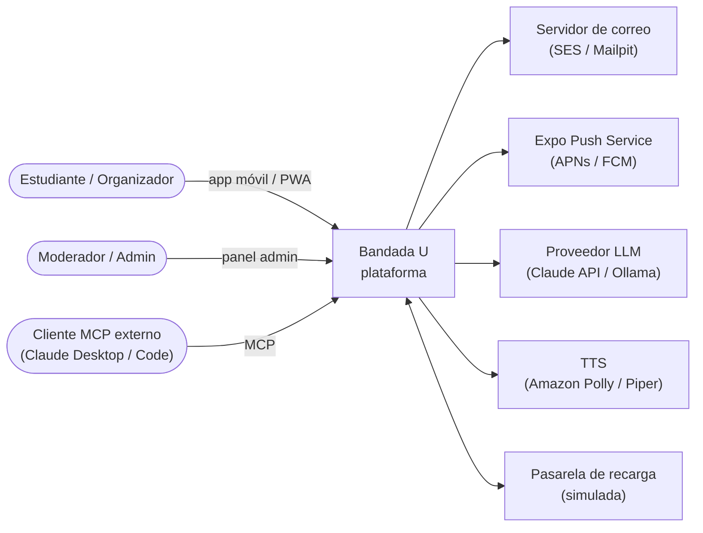
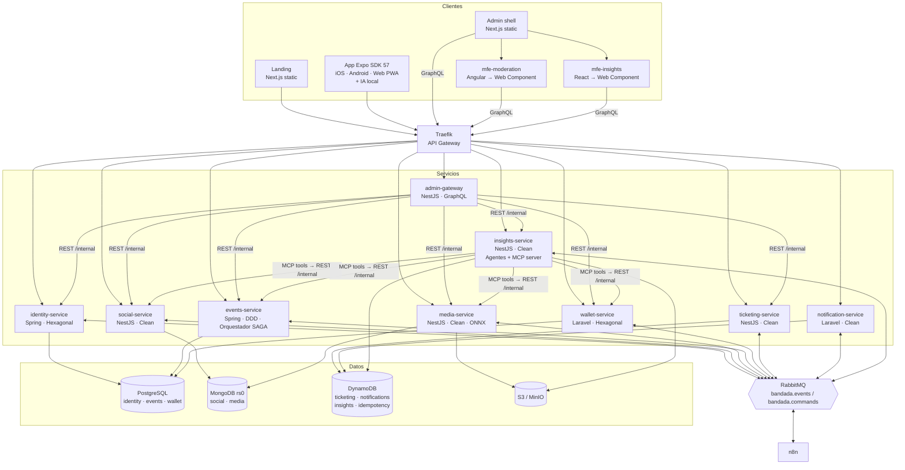
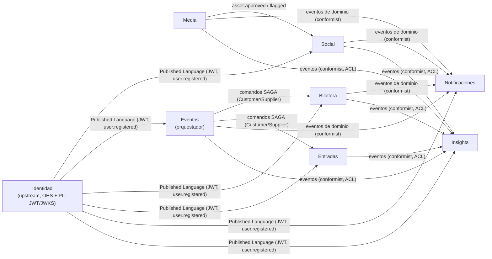

# Arquitectura general — Bandada U

Vista C4 (contexto y contenedores), mapa de contextos DDD y decisiones clave.
Puertos, colas y tablas exactas: `catalogo-servicios.md` (normativo).

## 1. Contexto (C4 nivel 1)



## 2. Contenedores (C4 nivel 2)



## 3. Mapa de contextos (DDD estratégico)



- **Identidad** es upstream de todos: publica el lenguaje (claims del JWT, evento
  `user.registered`). Ningún servicio consulta la base de identidad.
- **Eventos ↔ Billetera / Entradas**: relación cliente-proveedor; Eventos define los
  comandos que necesita y Billetera/Entradas los implementan.
- **Insights** es un consumidor con *Anti-Corruption Layer*: traduce eventos ajenos a
  su propio modelo de métricas.
- Cada contexto es dueño exclusivo de su base. **Prohibido** leer la base de otro
  servicio; se integra por API, eventos o réplicas locales (read models).

## 4. Estilos de comunicación

| Necesidad | Mecanismo | Ejemplo |
|---|---|---|
| Cliente → servicio | REST síncrono vía gateway | `POST /api/v1/posts` |
| Panel → datos agregados | GraphQL (admin-gateway) | `query { moderationQueue }` |
| Servicio → servicio (consulta) | REST `/internal/v1` con token de servicio | admin-gateway → wallet |
| Hechos de negocio | Evento de dominio (pub/sub) | `bandada.social.post.created.v1` |
| Transacción distribuida | Comandos + respuestas (SAGA orquestada) | `bandada.wallet.cmd.debit-credits.v1` |
| Automatización | RabbitMQ → n8n, cron en n8n → REST | recordatorio de evento |
| Agentes / herramientas | MCP (Streamable HTTP) | `get_platform_kpis` |
| Tiempo real panel | GraphQL subscriptions (`graphql-ws`) | `alertRaised` |
| Tiempo real app | Push (Expo) + polling corto del estado de la inscripción | ticket emitido |

## 5. Patrones transversales obligatorios

| Patrón | Dónde | Documento |
|---|---|---|
| Transactional Outbox | Todo servicio que publica eventos | `eventos-y-mensajeria.md` |
| Idempotent Consumer (inbox) | Todo consumidor de RabbitMQ | `idempotencia.md` |
| Idempotency-Key HTTP | POST/PUT/PATCH que crean efectos | `idempotencia.md` |
| SAGA orquestada | Inscripción/cancelación a eventos | `saga-inscripcion-evento.md` |
| BFF | Panel (GraphQL) | `graphql-admin.md` |
| Database per service | Todos | este documento |
| Retry + backoff + DLQ | Consumidores | `eventos-y-mensajeria.md` |
| Circuit breaker + timeout | Llamadas síncronas internas | `api-rest-guidelines.md` |
| Health checks live/ready | Todos | `catalogo-servicios.md` |
| Observabilidad con OpenTelemetry | Todos | `observabilidad.md` |

## 6. Repositorios (ADR-0017)

`parcial-II/` es un **workspace** con 8 repositorios git hermanos, al estilo Homy. La carpeta del
workspace no es un repositorio; solo contiene la guía común (`AGENTS.md`, `CLAUDE.md`, `README.md`) y
el archivo `bandadau.code-workspace`.

```
parcial-II/                          ← workspace (no es repo)
├── AGENTS.md  CLAUDE.md  README.md  bandadau.code-workspace
├── bandadau-docs/                   ← repo: docs ICONIX + contracts/ (fuente de verdad)
│   ├── docs/
│   └── contracts/                   ← OpenAPI, AsyncAPI, GraphQL SDL, MCP
├── bandadau-shared/                 ← repo: paquetes @bandada/* (pnpm workspace)
│   └── packages/  ui-tokens/ i18n/ contracts-ts/ messaging-ts/ idempotency-ts/ auth-ts/ eslint-config/ tsconfig/
├── bandadau-backend/                ← repo: los 9 microservicios
│   └── services/
│       ├── identity-service/        ← Spring Boot (Gradle) · Hexagonal
│       ├── events-service/          ← Spring Boot (Gradle) · DDD
│       ├── wallet-service/          ← Laravel (Composer) · Hexagonal
│       ├── notification-service/    ← Laravel (Composer) · Clean
│       ├── social-service/  media-service/  ticketing-service/  insights-service/  ← NestJS · Clean
│       └── admin-gateway/           ← NestJS · GraphQL
├── bandadau-frontend/               ← repo: Expo SDK 57 (iOS/Android/Web PWA)
├── bandadau-admin/                  ← repo: panel (pnpm workspace)
│   ├── shell/                       ← Next.js 16 static, host de MFEs
│   ├── mfe-moderation/              ← Angular 21 + Angular Elements
│   └── mfe-insights/                ← React 19 + Vite (web component)
├── bandadau-landing/                ← repo: Next.js 16 static
├── bandadau-infra/                  ← repo: compose, Traefik, init DBs, RabbitMQ, n8n/, AWS, CI, Makefile
└── bandadau-ml/                     ← repo: notebooks Python → ONNX
```

- No se comparte código entre lenguajes: se comparten **contratos** (`bandadau-docs/contracts/`).
  Los equivalentes Java/PHP de `messaging-ts`, `idempotency-ts` y `auth-ts` viven dentro de cada servicio.
- Los paquetes TS se consumen como dependencia local hermana (`file:../bandadau-shared/packages/<pkg>`).
- Commits y CI **por repositorio**. Un cambio de contrato va primero a `bandadau-docs`.

## 7. Despliegue (resumen)

- **Local**: `cd bandadau-infra && make up` levanta todo con Docker Compose + Traefik en `*.bandada.localhost`.
- **AWS (demo)**: 1 EC2 (t3.xlarge) con Docker Compose para servicios + RabbitMQ +
  MongoDB + n8n + LGTM; **RDS PostgreSQL** (db.t4g.micro), **DynamoDB** on-demand,
  **S3** + **CloudFront** para estáticos (landing, admin, MFEs, app web). Detalle en
  `bandadau-docs/docs/05-infraestructura/infraestructura.md`.
