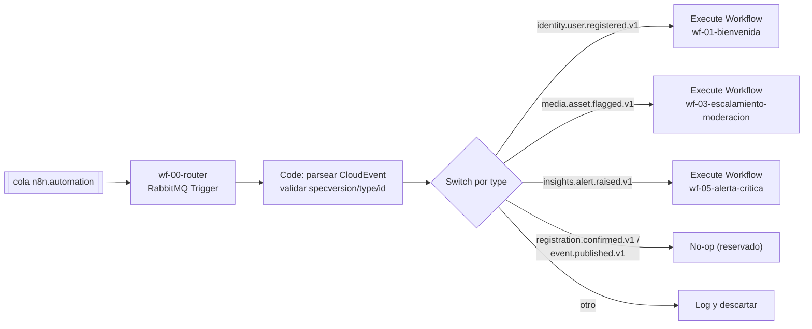
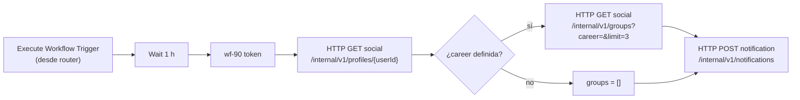
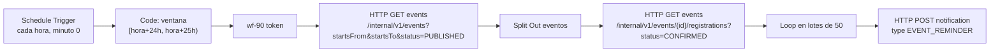
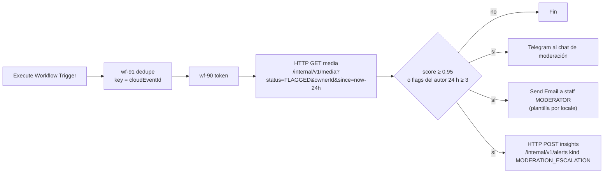
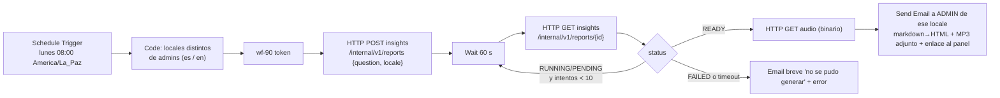
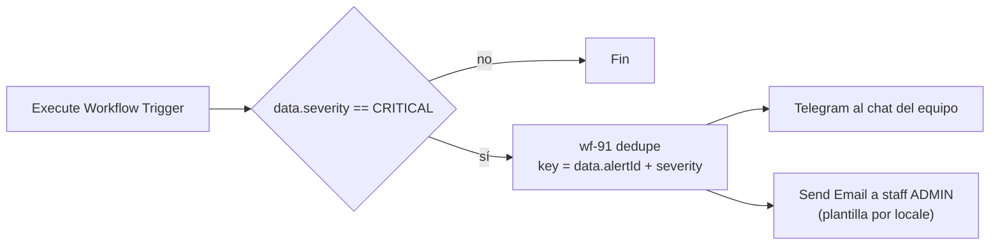

# Automatización con n8n

> Detalle de **D10** (`decisiones-clave.md`). Cubre la cátedra **T10** y RF-27 (y parte de
> RF-22/RF-24). Casos de uso: UC-23, UC-18, UC-20, UC-01. Cola y bindings: `catalogo-servicios.md` §5
> (`n8n.automation`). Seguridad del token de servicio: `seguridad-y-sso.md` §6.2. Idiomas: D14.

**Versiones.** Imagen `n8nio/n8n` (fijar una versión exacta, nunca `latest`), nombres y opciones de
nodos (RabbitMQ Trigger, Schedule Trigger, HTTP Request, Wait, Execute Workflow, Error Trigger,
Telegram, Send Email) y comandos de la CLI (`export:workflow`, `import:workflow`,
`import:credentials`, activación) **deben verificarse** en la documentación de la versión fijada.

---

## 1. Principios

| # | Regla |
|---|---|
| N1 | n8n **orquesta**, no tiene lógica de negocio: decide *cuándo* y *a quién*; los servicios deciden *qué* (plantillas, preferencias, permisos). |
| N2 | n8n **NO DEBE** acceder a ninguna base de datos de los servicios. Solo RabbitMQ (cola `n8n.automation`) y REST `/internal/v1` con token de servicio. |
| N3 | Toda llamada con efecto **DEBE** llevar `Idempotency-Key` derivada del evento o de la ventana del cron (§5). |
| N4 | Correos/push a **estudiantes** se envían **a través de notification-service** (respeta preferencias e idioma del destinatario, D14). n8n envía directo solo al **equipo** (moderadores/admins) por Telegram/email. |
| N5 | Ningún secreto en los JSON versionados. Credenciales por variables de entorno (§3). |
| N6 | Un **único** consumidor de la cola `n8n.automation` (workflow router, §4.1). |

## 2. Despliegue

| Aspecto | Decisión |
|---|---|
| Contenedor | `n8nio/n8n:<versión fija>` en el mismo Docker Compose (`bandadau-infra/`), red interna `bandada` |
| Base de datos de n8n | **SQLite** en el volumen `n8n_data` (`/home/node/.n8n`) |
| Por qué SQLite | Instancia única, volumen bajo (≈ cientos de ejecuciones/día), no agrega una cuarta base al Postgres del catálogo (que define 3 bases) ni costo de RDS. Respaldo = snapshot del volumen + JSON versionados |
| Cuándo migrar a Postgres | Si se necesita *queue mode* (workers), alta disponibilidad o > ~10k ejecuciones/día → ADR nuevo con `n8n_db` |
| Exposición | Local: `http://localhost:5678`. Producción: `n8n.<BASE_DOMAIN>` (`marca-y-dominio.md`) **protegido**: Traefik con *allowlist* de IP del equipo + autenticación propia de n8n (cuenta *owner*); alternativa túnel SSH. Sin webhooks públicos (no se usan) |
| Zona horaria | `GENERIC_TIMEZONE=America/La_Paz` y `TZ=America/La_Paz` (cron del lunes 08:00) |
| Retención | Poda de ejecuciones activada, 7 días |
| Telemetría | Diagnósticos de n8n desactivados |

Variables (en `bandadau-infra/.env.example`, sin valores reales; nombres de variables propias de n8n a verificar):

```dotenv
N8N_ENCRYPTION_KEY=            # obligatorio y estable: cifra las credenciales guardadas
GENERIC_TIMEZONE=America/La_Paz
N8N_DIAGNOSTICS_ENABLED=false
EXECUTIONS_DATA_PRUNE=true
EXECUTIONS_DATA_MAX_AGE=168     # horas
# --- propias de Bandada U (leídas con $env en expresiones; habilitar acceso a env en nodos) ---
BANDADA_IDENTITY_INTERNAL_URL=http://identity-service:7001
BANDADA_SOCIAL_INTERNAL_URL=http://social-service:7002
BANDADA_MEDIA_INTERNAL_URL=http://media-service:7003
BANDADA_EVENTS_INTERNAL_URL=http://events-service:7004
BANDADA_NOTIFICATION_INTERNAL_URL=http://notification-service:7007
BANDADA_INSIGHTS_INTERNAL_URL=http://insights-service:7008
BANDADA_ADMIN_URL=http://admin.bandada.localhost
N8N_SERVICE_CLIENT_ID=n8n
N8N_SERVICE_CLIENT_SECRET=
N8N_STAFF_RECIPIENTS=[{"email":"moderacion@bandada.localhost","locale":"es","roles":["MODERATOR"]},{"email":"admin@bandada.localhost","locale":"en","roles":["ADMIN"]}]
TELEGRAM_BOT_TOKEN=
TELEGRAM_STAFF_CHAT_ID=
RABBITMQ_N8N_URL=amqp://n8n:<secreto>@rabbitmq:5672
SMTP_HOST=mailpit
SMTP_PORT=1025
```

## 3. Credenciales

- Las credenciales de n8n (RabbitMQ, SMTP, Telegram) se crean al arrancar con
  `bandadau-infra/n8n/scripts/bootstrap.sh`: toma plantillas `bandadau-infra/n8n/credentials/*.json.tpl`
  (con `${VARIABLES}`), las renderiza con `envsubst` a un directorio temporal, ejecuta
  `n8n import:credentials` y borra los archivos renderizados. Los IDs de credencial son fijos en la
  plantilla para que los workflows importados los referencien.
- El secreto del cliente de servicio **no** es una credencial de n8n: lo usa el subworkflow
  `wf-90-service-token` vía `$env.N8N_SERVICE_CLIENT_SECRET`.
- Usuario RabbitMQ `n8n` con permisos **solo de lectura/consumo** sobre `n8n.automation`
  (definido en `bandadau-infra/rabbitmq/definitions.json`).
- **NO DEBE** exportarse con `--decrypted` ni commitearse ningún export de credenciales.

## 4. Arquitectura de workflows

### 4.1 Router (por qué uno solo)

La cola `n8n.automation` recibe 5 tipos de evento. Si cada workflow tuviera su propio *RabbitMQ
Trigger* sobre la misma cola, serían **consumidores competidores**: RabbitMQ repartiría los
mensajes en *round-robin* y cada workflow recibiría eventos que no le corresponden (y los
perdería). Por eso:



- *Ack* del mensaje **al terminar la ejecución** (opción del trigger; verificar nombre) y límite de
  procesamiento en paralelo bajo (p. ej. 5). Los subworkflows se invocan **sin esperar** (modo
  "no esperar respuesta") cuando incluyen `Wait` largos (wf-01), para no retener el mensaje 1 h.
- Si el router falla al parsear, el mensaje se rechaza sin reencolar → va a `bandada.dlx`
  (la cola tiene DLX, `catalogo-servicios.md` §5) y lo detecta el `MonitoringAgent` (`DLQ_BACKLOG`).
- `bandada.events.registration.confirmed.v1` y `bandada.events.event.published.v1` llegan por el
  binding del catálogo pero el MVP no tiene workflow para ellos (reservados; ver PROPUESTAS).

### 4.2 Subworkflows utilitarios

| Workflow | Función |
|---|---|
| `wf-90-service-token` | `POST {{$env.BANDADA_IDENTITY_INTERNAL_URL}}/api/v1/auth/service-token` (form client credentials, scope `internal:read internal:write`) → guarda `{token, exp}` en *static data* del workflow y lo reutiliza hasta 30 s antes de `exp` (`seguridad-y-sso.md` §6.2). Devuelve `token` |
| `wf-91-dedupe` | Recibe `key`; mantiene en *static data* un anillo de las últimas 2 000 claves con timestamp; devuelve `seen: true/false` y registra la nueva. Solo para envíos directos al equipo (Telegram/SMTP), que no pasan por `Idempotency-Key` |
| `wf-99-error-handler` | Error Trigger (ver §6) |

> La *static data* de n8n solo persiste en ejecuciones de producción (workflows activos), no en
> ejecuciones manuales de prueba — verificar en la versión fijada.

Todas las peticiones HTTP a servicios: timeout 10 s, 3 reintentos con espera (opción del nodo) solo
para errores de red/5xx, cabeceras `Authorization: Bearer <token>`, `X-Correlation-Id` =
`correlationid` del CloudEvent (o `n8n-<executionId>` en crons), `Idempotency-Key` según §5.

## 5. Workflows de negocio

### wf-01-bienvenida (UC-01)



Cuerpo de la notificación (notification-service elige plantilla e **idioma del destinatario**, D14):

```json
{ "userId": "{{data.userId}}", "type": "WELCOME", "channels": ["EMAIL", "IN_APP"],
  "params": { "suggestedGroups": [{ "groupId": "…", "name": "…" }] } }
```

`Idempotency-Key: n8n:wf-01:<cloudEventId>`. Si el usuario ya no está `ACTIVE`, notification responde
4xx de negocio y el workflow termina sin error.

### wf-02-recordatorio-evento (UC-23, RF-27)



- Ventana semiabierta alineada a la hora (`startsFrom` inclusive, `startsTo` exclusive): cada evento
  cae en **una** sola corrida. Si n8n estuvo caído, la corrida perdida no se recupera (aceptado; ver riesgos).
- `Idempotency-Key: n8n:wf-02:<registrationId>` → aunque una corrida se reintente, un solo recordatorio.
- `params`: `eventId`, `title`, `startsAt` (UTC; notification formatea en `America/La_Paz` y el locale del usuario).

### wf-03-escalamiento-moderacion (UC-18)



- Destinatarios del equipo desde `N8N_STAFF_RECIPIENTS` filtrando por rol. Texto del email/Telegram
  por **idioma del destinatario** con un nodo Code que contiene las plantillas `es`/`en`
  (el contenido del post **no** se incluye; solo `mediaId`, puntaje y enlace al panel
  `{{$env.BANDADA_ADMIN_URL}}/moderation/{{mediaId}}`).
- `Idempotency-Key` del POST de alerta: `n8n:wf-03:<cloudEventId>`; los envíos directos se protegen con `wf-91`.

### wf-04-resumen-semanal (UC-23, RF-27)



- Un reporte **por locale** presente entre los admins (D14: reporte y audio en el idioma del solicitante).
- Pregunta fija por locale: `es` "Resume la actividad de Bandada U de la semana pasada (lunes a domingo): usuarios activos, publicaciones, inscripciones, créditos y moderación, comparado con la semana anterior." / `en` equivalente.
- `Idempotency-Key: n8n:wf-04:<isoWeek>:<locale>` (p. ej. `2026-W42:es`).
- El audio se **adjunta** (la URL prefirmada vence a los 15 min, RNF-08); el enlace del email apunta
  a la página del reporte en el panel (requiere sesión).

### wf-05-alerta-critica (UC-20)



La clave de dedupe incluye la severidad: si una alerta escala de `WARNING` a `CRITICAL` se avisa
una vez; repeticiones del mismo evento no.

## 6. Manejo de errores

- `wf-99-error-handler` (Error Trigger) se configura como *error workflow* en los ajustes de
  **todos** los workflows. Envía a Telegram/email de desarrolladores: nombre del workflow, nodo,
  mensaje, `executionId`, enlace a la ejecución, `correlationId`. Sin datos personales.
- Nodos HTTP: "continuar en error" **solo** donde un 4xx de negocio es un resultado válido
  (usuario inactivo, evento cancelado); en el resto, fallar para que salte el error workflow.
- Mensajes de RabbitMQ no procesables → DLX (ver §4.1).
- Los errores de n8n no afectan al negocio (RNF-03): ningún flujo de usuario depende de n8n.

## 7. Versionado

```
bandadau-infra/n8n/
├── AGENTS.md
├── workflows/
│   ├── wf-00-router.json
│   ├── wf-01-bienvenida.json · wf-02-recordatorio-evento.json · wf-03-escalamiento-moderacion.json
│   ├── wf-04-resumen-semanal.json · wf-05-alerta-critica.json · wf-06-difusion-evento.json (D15)
│   └── wf-90-service-token.json · wf-91-dedupe.json · wf-99-error-handler.json
├── credentials/        *.json.tpl (sin secretos)
└── scripts/            bootstrap.sh · export.sh · import.sh · normalize.mjs · publish-test-event.sh · validate.mjs
```

| Acción | Comando (verificar flags en la versión fijada) |
|---|---|
| Exportar | `make n8n-export` → `docker compose exec n8n n8n export:workflow --all --separate --output=/tmp/wf` → copiar → `normalize.mjs` (renombra a `<name>.json`, ordena claves, elimina campos volátiles como fechas/`versionId`, fija `active: false`) |
| Importar | `make n8n-import` → `n8n import:workflow --separate --input=/workflows` y luego activar los workflows de la lista `ACTIVE_WORKFLOWS` |
| Revisión | Los JSON se revisan en PR como código; IDs de workflow **fijos** (`wf00router…`) para que `Execute Workflow` y el error workflow los referencien de forma estable |

Regla: **nunca** editar solo en la UI de producción. Flujo: editar en local → exportar → PR →
importar en producción con `make n8n-import` en el despliegue.

## 8. Pruebas

| Prueba | Cómo |
|---|---|
| Router | `publish-test-event.sh <type> <archivo.json>` publica un CloudEvent en `bandada.events` con la routing key; verificar en la lista de ejecuciones que solo corre el subworkflow esperado |
| wf-01 | Registrar usuario en la app (Mailpit `:8025`); para no esperar 1 h, variable `N8N_WELCOME_DELAY_SECONDS` (por defecto 3600) usada por el nodo `Wait` |
| wf-02 | Crear evento que empiece en 24 h 30 min, inscribirse, ejecutar manualmente; repetir la ejecución → un solo recordatorio (idempotencia) |
| wf-03 | Subir imagen de prueba "no apta" (demo paso 3) → Telegram/Mailpit + alerta en el panel |
| wf-04 | Ejecutar manualmente; verificar email con MP3 adjunto en Mailpit, en el idioma de cada admin |
| wf-05 | Detener `wallet-service` 10 min → el `MonitoringAgent` levanta `CRITICAL` → aviso único |
| Errores | Forzar 500 (detener notification-service) → mensaje del `wf-99` |
| Lint de JSON | CI: los JSON parsean, no contienen `"password"`, tokens ni `credentials` con datos; `active` es `false` |

## 9. Riesgos y errores comunes

| Riesgo / error | Mitigación |
|---|---|
| Varios triggers sobre `n8n.automation` | Solo `wf-00-router` consume (§4.1) |
| Reintentos duplican emails | `Idempotency-Key` en notification/insights; `wf-91` para envíos directos |
| Corrida horaria perdida por caída | Aceptado en MVP; el `MonitoringAgent` puede vigilar `/health/ready` de n8n (agregarlo a `get_service_health`) |
| Cambiar `N8N_ENCRYPTION_KEY` | Credenciales ilegibles → re-ejecutar `bootstrap.sh` |
| SQLite corrupta/volumen perdido | Recrear con `bootstrap.sh` + `make n8n-import` (todo está versionado) |
| Textos a estudiantes escritos en n8n | Prohibido (N4): idioma y preferencias los maneja notification-service |
| Usar `/api/v1/...` públicos con token de servicio | Los servicios aceptan `typ=service` solo en `/internal/v1/**` (`seguridad-y-sso.md` §6) |

## Implementación (fase 2, 2026-10-15)

Implementado en `bandadau-infra/n8n/` y verificado contra los servicios reales (ver `n8n/README.md`). Diferencias con el diseño:

- Un solo contenedor n8n 2.43.5 con SQLite; el servicio arranca con `n8n/scripts/entrypoint.sh`: importa credenciales (plantillas
  `credentials/*.json.tpl` renderizadas con variables), `import:workflow --separate` y `publish:workflow --id=<id>`. Las opciones
  `--activeState=fromJson` / `update:workflow --active` solo funcionan en modo cola, por eso se usa `publish:workflow`.
- Propietario por variables `N8N_OWNER_EMAIL` y `N8N_OWNER_PASSWORD_HASH`. `N8N_WELCOME_DELAY` reemplaza a `N8N_WELCOME_DELAY_SECONDS`.
- Los servicios exigen `Idempotency-Key` con forma de UUID: se usan **UUID deterministas** derivados del evento o del cron.
- wf-02 usa ventana de **23 a 25 h** (cada evento cae en dos corridas; no duplica gracias a `dedupeKey`), no "alineado a la hora".
- wf-06 notifica a los **dueños de los grupos públicos** de la carrera del organizador: no existe endpoint para listar miembros.
  Para una difusión real hay que añadirlo al contrato.
- wf-04 envía enlace al panel (sin adjuntar audio). Un CloudEvent inválido hace fallar el router y lo descarta wf-99 (aviso por
  correo); no pasa a `n8n.automation.dlq`.
- Telegram es opcional (`TELEGRAM_BOT_TOKEN`, `TELEGRAM_STAFF_CHAT_ID`) y no se probó.

