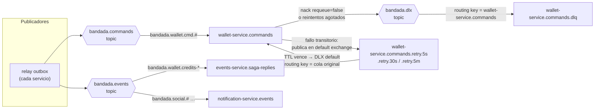
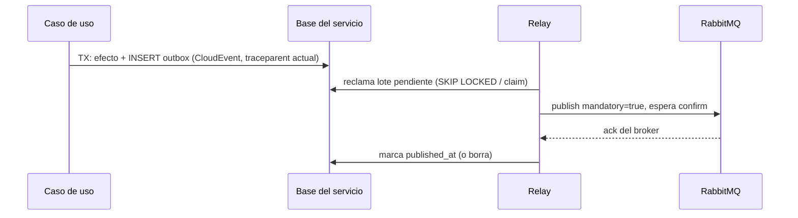
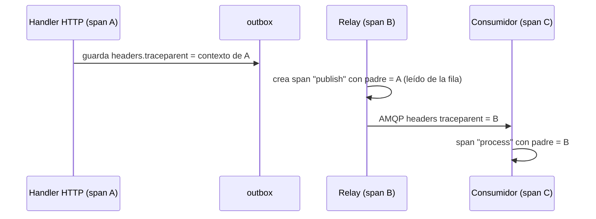

# Eventos y mensajería (RabbitMQ)

> Normativo para todo servicio que publica o consume mensajes. Exchanges y colas:
> `catalogo-servicios.md` §5 (fuente de verdad). Catálogo de tipos: D12 y
> `bandadau-docs/contracts/asyncapi/bandada-events.yaml`. Idempotencia de consumidores:
> `idempotencia.md` §3. Trazas: `observabilidad.md`.

## 1. Principios

| Principio | Regla |
|---|---|
| Entrega | **At-least-once**. Todo consumidor es idempotente (inbox) |
| Publicación | **Siempre vía transactional outbox**; nunca `publish` directo desde el caso de uso |
| Eventos vs comandos | Evento = hecho pasado, muchos consumidores, `bandada.events`. Comando = intención dirigida a un dueño, `bandada.commands` |
| Sobre | CloudEvents 1.0, JSON, **modo estructurado** |
| Orden | No garantizado entre mensajes; los consumidores lo toleran (§7) |
| Contrato | Ningún tipo de mensaje existe si no está en AsyncAPI |

## 2. Topología



### 2.1 Exchanges (del catálogo)

| Exchange | Tipo | Durable | Uso |
|---|---|---|---|
| `bandada.events` | topic | sí | Eventos de dominio y respuestas de la SAGA |
| `bandada.commands` | topic | sí | Comandos de la SAGA |
| `bandada.dlx` | topic | sí | Dead letters |

### 2.2 Declaración de cada cola principal `<q>`

| Argumento | Valor | Motivo |
|---|---|---|
| `x-queue-type` | `quorum` | Durabilidad (RabbitMQ 4 eliminó las colas espejo clásicas) |
| `x-dead-letter-exchange` | `bandada.dlx` | Exigido por el catálogo |
| `x-dead-letter-routing-key` | `<q>` | La DLQ se enlaza por nombre de cola, no por tipo de mensaje |
| `x-delivery-limit` | `10` | Corta bucles de *poison messages* si el consumidor muere antes del ack |

Por cada cola principal se declaran además:

| Cola | Tipo | Argumentos |
|---|---|---|
| `<q>.retry.5s` / `<q>.retry.30s` / `<q>.retry.5m` | classic, durable | `x-message-ttl` = 5000 / 30000 / 300000, `x-dead-letter-exchange: ""`, `x-dead-letter-routing-key: <q>` |
| `<q>.dlq` | quorum | Enlazada a `bandada.dlx` con routing key `<q>`. Sin consumidor automático |

La topología la declara **el dueño de la cola** al arrancar (idempotente). El
publicador solo declara exchanges. `bandadau-infra/rabbitmq/definitions.json` contiene la
misma topología para `make infra-up` y DEBE mantenerse sincronizado.

### 2.3 Reintentos con colas de espera

```text
on message m from <q>:
  try handle(m) in TX (inbox + efecto + outbox); ack
  catch TransientError (DB caída, timeout, 503):
      n = header x-retry-count (default 0)
      if n < 3: publish copy to default exchange, routingKey = "<q>.retry." + [5s,30s,5m][n],
                headers x-retry-count = n+1, x-last-error = summary; ack original
      else:     nack(requeue=false)            # → bandada.dlx → <q>.dlq
  catch PermanentError (validación, esquema, versión desconocida):
      nack(requeue=false)                      # directo a DLQ, sin reintentos
```

- **NO** usar `nack(requeue=true)` para reintentar: genera bucles calientes.
- Una copia a la cola de espera conserva `message_id`, `type` y todas las cabeceras
  (incluido `traceparent`) para que el inbox siga funcionando.
- Reprocesar una DLQ: herramienta `make dlq-replay Q=<q>` (shovel manual) tras
  corregir la causa. `dlq_depth` > 0 dispara alerta (`observabilidad.md`).

### 2.4 Consumo

| Parámetro | Valor |
|---|---|
| Ack | Manual, **después** del commit |
| Prefetch | 10 (SAGA: 20) |
| Concurrencia | 1–4 consumidores por proceso; correcta con cualquier número gracias al inbox |
| Conexiones | Una para publicar (canal con *publisher confirms*) y otra para consumir |

## 3. Sobre CloudEvents

Modo estructurado de la vinculación AMQP de CloudEvents: el cuerpo es el CloudEvent
completo, `content_type = application/cloudevents+json`.

```json
{
  "specversion": "1.0",
  "id": "0192b7c3-1f2a-7c3d-8e4f-5a6b7c8d9e0f",
  "source": "/services/events-service",
  "type": "bandada.wallet.cmd.debit-credits.v1",
  "time": "2026-10-14T15:04:05Z",
  "subject": "registration/0192b7c0-…",
  "datacontenttype": "application/json",
  "correlationid": "c-7f3a…",
  "causationid": "0192b7c1-…",
  "sagaid": "0192b7c0-…",
  "traceparent": "00-4bf92f3577b34da6a3ce929d0e0e4736-00f067aa0ba902b7-01",
  "data": { "sagaId": "…", "registrationId": "…", "idempotencyKey": "…:DEBIT_CREDITS", "userId": "…", "eventId": "…", "amountCredits": 50 }
}
```

Propiedades AMQP que DEBEN fijarse además: `message_id = id`, `type = type`,
`timestamp`, `delivery_mode = 2` (persistente), cabeceras `traceparent` y
`tracestate` (copia de la extensión, para la instrumentación automática).

| Campo | Regla |
|---|---|
| `id` | UUIDv7, = `outbox.id`; clave del inbox |
| `source` | `/services/<servicio>` |
| `type` | = routing key |
| `subject` | `<entidad>/<id>` del agregado |
| `correlationid` | `X-Correlation-Id` de la petición que originó la cadena; se propaga sin cambios |
| `causationid` | `id` del mensaje que causó este (ausente si lo causó una petición HTTP) |
| `data` | Solo IDs y datos necesarios; **nunca** contraseñas, tokens ni texto de posts |

## 4. Catálogo y añadidos recientes

El catálogo mínimo es D12. Añadido por D14:

| Tipo | Publica | `data` | Consumidores |
|---|---|---|---|
| `bandada.identity.user.preferences-changed.v1` | identity-service | `{ userId, locale: "es"\|"en", theme: "SYSTEM"\|"LIGHT"\|"DARK" }` | notification-service (copia local de `locale` para plantillas) |

> El binding actual de `notification-service.events` solo incluye
> `bandada.identity.user.registered.v1`; hace falta agregar
> `bandada.identity.user.preferences-changed.v1` en el catálogo (**PROPUESTA pendiente
> de ADR**; mientras tanto no implementar el consumidor). `insights-service.analytics`
> ya lo recibe por `bandada.#`.

## 5. Transactional outbox por motor



Garantía: si la TX hace commit, el mensaje se publicará **al menos una vez**. Si el
relay cae entre el confirm y el `UPDATE`, se republica → lo absorbe el inbox.

### 5.1 PostgreSQL (identity, events, wallet)

DDL de la tabla `outbox`: ver `saga-inscripcion-evento.md` §5 (idéntica en los 3 servicios).

```sql
-- Relay: cada 500 ms, en una TX
SELECT id, exchange, routing_key, payload, headers
FROM outbox
WHERE published_at IS NULL
ORDER BY created_at
LIMIT 100
FOR UPDATE SKIP LOCKED;
-- publicar cada fila con confirms; luego:
UPDATE outbox SET published_at = now(), attempts = attempts + 1 WHERE id = ANY($1);
-- fallos: attempts + 1, last_error; se reintenta en el siguiente ciclo
-- limpieza diaria: DELETE FROM outbox WHERE published_at < now() - interval '7 days';
```

- Spring: `@Scheduled` en `OutboxRelay` con `fixedDelay` = `OUTBOX_RELAY_INTERVAL` (**por defecto `PT1S`** en identity y events, no 500 ms; el lote falla en el primer error, anota `attempts`/`last_error` y reintenta en el siguiente ciclo); `RabbitTemplate` con
  `spring.rabbitmq.publisher-confirm-type=correlated` y `publisher-returns=true`
  (`mandatory`). Esperar el `CorrelationData.getFuture()` con timeout de 5 s.
- Laravel (wallet): comando long-running `php artisan bandada:relay` (alias `bandada:outbox-relay` y `wallet:relay-outbox`; bucle con `usleep` de `OUTBOX_POLL_INTERVAL_MS` = 500 ms) que además hace las tareas periódicas (expiración de recargas y purga de filas publicadas con `retention_days = 7`), contenedor propio `wallet-relay`, `restart: unless-stopped`. Notification tiene `notifications:relay-outbox` (alias `bandada:relay`), inactivo mientras el servicio no publica.
- **La limpieza diaria del SQL de arriba solo existe en wallet**: los relays de identity y events no purgan `outbox` (divergencia abierta; ver el informe de la revisión cruzada de C-9).
- `SKIP LOCKED` permite varias réplicas del relay sin publicar el mismo lote en paralelo.
- Alternativa opcional para reducir latencia: `NOTIFY outbox` tras el insert y
  `LISTEN` en el relay; el polling se mantiene como respaldo.

### 5.2 MongoDB (social, media)

Colección `outbox` en la misma base; inserción dentro de la sesión de transacción
(replica set `rs0` obligatorio).

```ts
// documento
{ _id: '<cloudEventId>', exchange, routingKey, payload, headers, createdAt,
  publishedAt: null, lockedUntil: null, attempts: 0 }
// índice
db.outbox.createIndex({ publishedAt: 1, createdAt: 1 });

// relay: reclamar uno a uno (atómico por documento)
const doc = await outbox.findOneAndUpdate(
  { publishedAt: null, $or: [{ lockedUntil: null }, { lockedUntil: { $lt: new Date() } }] },
  { $set: { lockedUntil: new Date(Date.now() + 30_000) }, $inc: { attempts: 1 } },
  { sort: { createdAt: 1 }, returnDocument: 'after' },
);
// publicar con confirm → $set { publishedAt: new Date() }, $unset lockedUntil
```

Índice TTL sobre `publishedAt` (`expireAfterSeconds: 604800`) para limpieza.
Change streams son una optimización opcional, no el mecanismo base.

### 5.3 DynamoDB (ticketing, insights; notification si publica)

> Verificado contra el código (C-9, 2026-10-15): `DynamoOutbox` de `bandadau-shared/packages/messaging-ts` (usado por ticketing e insights) coincide con esta sección; notification-service es Laravel y su relay está inactivo.

Ítem de outbox en **la tabla del servicio**, escrito en el mismo `TransactWriteItems`
que el efecto. Para encontrar los pendientes se **sobrecarga GSI1** (atributos
genéricos `gsi1pk`/`gsi1sk`), que ya existe en el diseño de tabla única:

| Atributo | Valor |
|---|---|
| `pk` / `sk` | `OUTBOX#<cloudEventId>` / `META` |
| `gsi1pk` / `gsi1sk` | `OUTBOX#PENDING` / `<createdAt ISO>#<id>` |
| `exchange`, `routingKey`, `payload` (JSON string), `headers`, `createdAt`, `attempts`, `leaseUntil` (epoch ms, mientras se publica), `lastError` | — |

En ticketing GSI1 también sirve el listado `USER#<userId>` (atributos `gsi1pk`/`gsi1sk` sobrecargados, como prevé este diseño); GSI2 resuelve `REG#<registrationId>`.

Poller (`@bandada/messaging-ts`, `DynamoOutbox`/`OutboxRelay`; cada 500 ms, lote de 100 por defecto): `Query` GSI1 `gsi1pk = OUTBOX#PENDING` (orden
ascendente) → *lease* por ítem → publicar con confirm → `DeleteItem` con
`ConditionExpression: attribute_exists(pk)` (un fallo de publicación anota `lastError` y quita el `leaseUntil`). Varias réplicas pueden publicar el mismo
ítem (los GSI son eventualmente consistentes y no hay `SKIP LOCKED`): es aceptable
porque el consumidor deduplica; para reducirlo, el poller toma un *lease* con
`UpdateItem SET leaseUntil = :t IF attribute_not_exists(leaseUntil) OR leaseUntil < :now`.

> DynamoDB Streams + Lambda es la alternativa en AWS; no se usa para mantener
> paridad con DynamoDB Local y un solo modo de despliegue.

## 6. Librerías por lenguaje

| Lenguaje | Publicar / consumir | Notas |
|---|---|---|
| Java (Spring Boot 4) | **Spring AMQP** (`spring-boot-starter-amqp`): `RabbitTemplate` + `@RabbitListener(ackMode = "MANUAL")` | Declarar `Queue`/`Binding` como beans `Declarables` solo para las colas propias. `Jackson2JsonMessageConverter` NO: el cuerpo se maneja como `byte[]` y se parsea con el SDK de CloudEvents o un record propio |
| PHP (Laravel 12) | **php-amqplib** en comandos artisan long-running: `bandada:consume {queue}` y `bandada:outbox-relay` | Un contenedor por comando (misma imagen). `basic_qos(null, 10, null)`, `basic_consume(no_ack: false)`, bucle `while ($channel->is_consuming()) $channel->wait();`. Manejar `SIGTERM` con `pcntl_signal` para terminar el mensaje en curso. Reconectar con backoff. No se usa la cola de Laravel (`queue:work`) para RabbitMQ |
| TypeScript (NestJS 11) | **`amqp-connection-manager` + `amqplib`**, envuelto en `@bandada/messaging-ts` | Elegido sobre `@golevelup/nestjs-rabbitmq` por control explícito de topología, confirm channels y colas de espera. El paquete expone `@ConsumeMessage('<type>')`, `OutboxModule` (Mongo/DynamoDB) y `CloudEvent<T>` tipado desde `@bandada/contracts-ts` |

```ts
// @bandada/messaging-ts — uso en ticketing-service
@Injectable()
export class IssueTicketConsumer {
  @ConsumeMessage({ queue: 'ticketing-service.commands', type: 'bandada.ticketing.cmd.issue-ticket.v1' })
  async handle(event: CloudEvent<IssueTicketV1>): Promise<void> {
    await this.issueTicket.execute(event);   // caso de uso: TransactWriteItems inbox+ticket+outbox
  }
}
```

```php
// wallet-service: app/Console/Commands/ConsumeCommand.php (esqueleto)
$channel->basic_consume($queue, '', false, false, false, false, function (AMQPMessage $m) use ($router) {
    $event = CloudEvent::fromJson($m->getBody());
    $span = $this->tracing->startConsumerSpan($event, $m->get_properties()['application_headers'] ?? null);
    try {
        $router->dispatch($event);             // handler → DB::transaction(inbox + efecto + outbox)
        $m->ack();
    } catch (TransientException $e) {
        $this->retry->schedule($m, $e);        // copia a <q>.retry.Ns y ack
    } catch (\Throwable $e) {
        $m->nack(false);                       // requeue=false → DLQ
    } finally { $span->end(); }
});
```

## 7. Orden

- RabbitMQ preserva el orden **por cola y por canal** solo sin reintentos ni varios
  consumidores. Con colas de espera y concurrencia, el orden **no** está garantizado.
- Reglas para consumidores:
  1. **Máquina de estados** (SAGA): una respuesta que no corresponde al estado actual se ignora (`saga-inscripcion-evento.md` §10).
  2. **Eventos de estado de entidad** (`post.hidden`, `asset.approved`…): DEBEN
     llevar en `data` un `aggregateVersion` (entero creciente) y el consumidor
     descarta versiones ≤ a la que ya aplicó.
  3. **Eventos acumulativos** (métricas en insights): conmutativos (sumas por día), el orden no importa.
- **NO** usar *single active consumer* para "arreglar" el orden: limita el throughput y no resuelve reintentos.

## 8. Versionado de eventos

| Cambio | ¿Nueva versión? | Procedimiento |
|---|---|---|
| Agregar campo opcional | No | Consumidores DEBEN ignorar campos desconocidos |
| Agregar valor a un enum | No, pero avisar | Consumidores DEBEN tratar valores desconocidos (log + ignorar) |
| Quitar / renombrar / cambiar tipo de un campo | Sí (`.v2`) | Publicar `.v1` y `.v2` en paralelo (dos filas de outbox) hasta migrar consumidores; luego retirar `.v1` en el AsyncAPI con fecha |
| Cambiar semántica | Sí | Nuevo tipo |

Un consumidor que recibe un tipo/versión que no conoce: `nack(requeue=false)` → DLQ
(error permanente) y alerta, nunca descarte silencioso.

## 9. Propagación de `traceparent`



- El relay corre fuera del contexto de la petición: la instrumentación automática
  crearía una traza nueva. Por eso el contexto **se guarda en la fila** y el relay lo
  restaura explícitamente como padre del span de publicación.
- Al consumir, se extrae de la cabecera AMQP `traceparent`; si no está, de la
  extensión CloudEvents.
- `correlationid` se propaga aparte (es de negocio y sobrevive a reinicios de traza).

## 10. Reglas

- **DEBE** publicarse todo mensaje vía outbox, en la misma transacción que el cambio de estado.
- **DEBE** el relay usar *publisher confirms* y `mandatory`; un mensaje no enrutable es un error de configuración (alerta).
- **DEBE** cada consumidor declarar su cola, sus colas de espera y su DLQ.
- **DEBE** cada servicio consumir **solo** su propia cola.
- **NO DEBE** un consumidor lanzar excepciones al broker sin clasificarlas (transitoria / permanente).
- **NO DEBE** viajar PII ni secretos en `data`.
- **NO DEBE** usarse el exchange por defecto salvo para las colas de espera.

## 11. Errores comunes

| Error | Consecuencia | Corrección |
|---|---|---|
| Publicar y luego hacer commit | Evento fantasma si el commit falla | Outbox |
| `requeue=true` en errores | Bucle caliente, CPU al 100 % | Colas de espera |
| DLX sin `x-dead-letter-routing-key` | DLQ recibe la routing key original y no coincide el binding | Fijar `<q>` como routing key |
| Consumir con autoAck | Pérdida de mensajes al caer | Ack manual post-commit |
| Relay sin restaurar `traceparent` | Trazas cortadas en la SAGA | Guardar contexto en la fila |
| Cambiar un campo en `.v1` | Consumidores rotos en otro lenguaje | `.v2` en paralelo |
