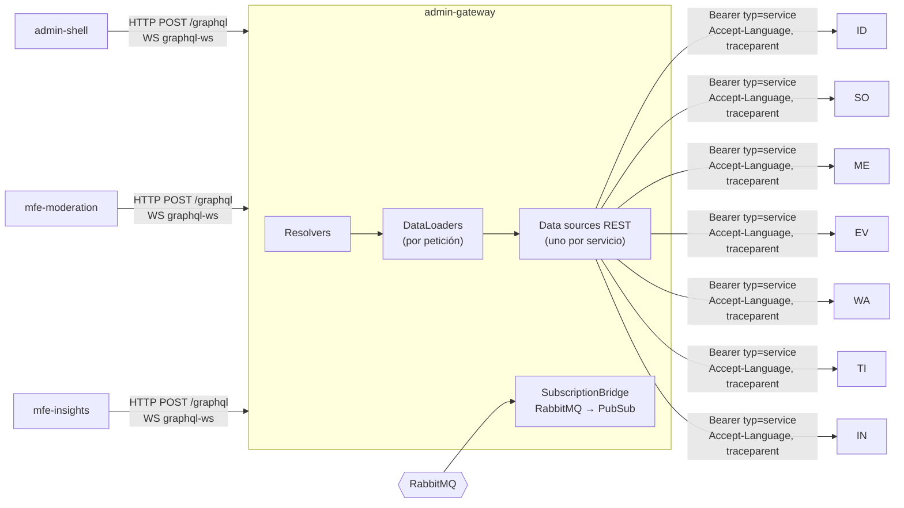

# GraphQL del panel — `admin-gateway` (T3)

> Detalle de **D11**. Servicio S9: NestJS 11 + Apollo Server 5, puerto 7010, ruta
> `/graphql` (HTTP + WebSocket `graphql-ws`). Contrato: `bandadau-docs/contracts/graphql/admin.graphql`
> (schema-first, contract-first). Seguridad: `seguridad-y-sso.md`. Consumidores:
> `admin-shell`, `mfe-moderation`, `mfe-insights` (`microfrontends.md`).

## 1. Rol del gateway

Es un **BFF sin estado**: no tiene base de datos ni lógica de negocio. Traduce
GraphQL → REST `/internal/v1/**` (y algunos `/api/v1` con el token del usuario),
agrega respuestas, aplica autorización por rol y expone subscriptions.



## 2. Organización del código (capas)

```
bandadau-backend/services/admin-gateway/src/
├── main.ts                     # bootstrap; OTel se carga antes (observabilidad.md)
├── app.module.ts
├── graphql/
│   ├── graphql.module.ts       # GraphQLModule.forRoot<ApolloDriverConfig>(…)
│   ├── directives/auth.directive.ts
│   ├── scalars/                # DateTime, UUID
│   ├── errors/error-formatter.ts
│   └── limits/                 # depth + complexity
├── modules/                    # un módulo Nest por área del schema
│   ├── users/      users.resolver.ts   users.loader.ts
│   ├── moderation/ moderation.resolver.ts
│   ├── events/     events.resolver.ts  sagas.resolver.ts
│   ├── wallet/     wallet.resolver.ts
│   ├── insights/   reports.resolver.ts alerts.resolver.ts
│   └── health/     health.resolver.ts
├── datasources/                # IdentityApi, SocialApi, MediaApi, EventsApi, WalletApi, TicketingApi, InsightsApi
│   └── base-rest.datasource.ts # timeout, retry GET, circuit breaker, Problem → GraphQLError
├── subscriptions/subscription-bridge.ts
└── generated/graphql.ts        # tipos de resolvers (codegen)
```

Regla de dependencias: `resolvers → loaders → datasources`. Un resolver nunca llama
`fetch` directamente; un data source nunca conoce tipos GraphQL de entrada.

## 3. Schema-first

```ts
GraphQLModule.forRoot<ApolloDriverConfig>({
  driver: ApolloDriver,
  typePaths: [join(process.cwd(), '../../contracts/graphql/*.graphql')],
  transformSchema: (schema) => authDirectiveTransformer(schema, 'auth'),
  subscriptions: { 'graphql-ws': { onConnect: wsAuth.onConnect } },
  context: ({ req, extra }) => buildContext(req ?? extra.request, extra),
  formatError,
  validationRules: [depthLimit(7), complexityRule(1000)],
  introspection: process.env.APP_ENV !== 'production',
  playground: false,                       // usar Apollo Sandbox local o GraphiQL
});
```

> Verificar en la documentación de `@nestjs/apollo` instalada la compatibilidad con
> Apollo Server 5 y los nombres exactos de opciones (`typePaths`, `transformSchema`,
> `subscriptions`). No inventar opciones.

Extracto del contrato (ilustrativo; el normativo es `admin.graphql`):

```graphql
directive @auth(requires: [Role!]!) on OBJECT | FIELD_DEFINITION

enum Role { STUDENT ORGANIZER MODERATOR ADMIN }
enum Locale { es en }
enum ThemePreference { SYSTEM LIGHT DARK }

type User @auth(requires: [ADMIN]) {
  id: ID!
  email: String!
  displayName: String
  roles: [Role!]!
  status: UserStatus!
  university: University
  locale: Locale!            # D14
  theme: ThemePreference!    # D13
}

type Query {
  me: User! @auth(requires: [MODERATOR, ADMIN])
  moderationQueue(filter: ModerationFilter, after: String, first: Int = 20): ModerationItemConnection!
    @auth(requires: [MODERATOR, ADMIN])
  sagas(status: SagaStatus!): [Saga!]! @auth(requires: [ADMIN])
}

type Mutation {
  moderateMedia(id: ID!, decision: ModerationVerdict!, note: String): MediaAsset!
    @auth(requires: [MODERATOR, ADMIN])
  requestReport(question: String!, locale: Locale): Report! @auth(requires: [ADMIN])
}

type Subscription {
  alertRaised: Alert! @auth(requires: [ADMIN])
  moderationQueueChanged: ModerationQueueEvent! @auth(requires: [MODERATOR, ADMIN])
  reportReady(id: ID!): Report! @auth(requires: [ADMIN])
}
```

Paginación Relay: `XConnection { edges { cursor node } pageInfo { hasNextPage endCursor } }`.
El `endCursor` es el `nextCursor` opaco del REST (`{ items, nextCursor }`), sin reinterpretarlo.

## 4. Resolvers, data sources y DataLoader

```ts
@Resolver('MediaAsset')
export class ModerationResolver {
  constructor(private readonly media: MediaApi) {}

  @Query()
  moderationQueue(@Args() args: QueryModerationQueueArgs, @Context() ctx: GqlContext) {
    return this.media.listFlagged({ cursor: args.after, limit: args.first }, ctx).then(toConnection);
  }

  @ResolveField()
  owner(@Parent() asset: MediaAssetDto, @Context() ctx: GqlContext) {
    return ctx.loaders.userById.load(asset.ownerId);   // N+1 → 1 petición por lote
  }
}
```

- `ctx.loaders` se crea **por petición** (y por operación en WS) en `buildContext`;
  nunca un DataLoader global (filtraría datos entre usuarios y nunca invalidaría).
- Loaders mínimos: `userById` (identity `searchUsers?ids=…`), `eventById`
  (events), `postById` (social). Máx. 100 IDs por lote.
- Data source base:

| Aspecto | Valor |
|---|---|
| Cliente HTTP | `undici` (`fetch` de Node) |
| Timeout | 2 s (reportes: 5 s) |
| Reintentos | Solo `GET`, 1 reintento en 502/503/504 |
| Circuit breaker | `opossum` por servicio: abre con 50 % de error en 10 s, medio-abierto a los 15 s |
| Cabeceras salientes | `Authorization: Bearer <token de servicio>`, `X-Actor-Id`, `X-Correlation-Id`, `traceparent` (automático por OTel), `Accept-Language` del panel |
| Mutations con efectos | Reenvían `Idempotency-Key` si el endpoint REST es ♻️ (el cliente GraphQL la manda como cabecera HTTP) |

**`Accept-Language` (D14):** el contexto toma la cabecera `Accept-Language` de la
petición HTTP del panel (o `connectionParams.locale` en WS) y la propaga a todos los
data sources para que los Problem Details y textos generados vuelvan en el idioma del
usuario. Si falta, usa el claim `locale` del JWT; si tampoco, `es`.

## 5. Autorización: directiva `@auth`

```ts
export function authDirectiveTransformer(schema: GraphQLSchema, name: string) {
  return mapSchema(schema, {
    [MapperKind.OBJECT_FIELD]: (field, _fieldName, typeName) => {
      const directive = getDirective(schema, field, name)?.[0]
        ?? getDirective(schema, schema.getType(typeName) as GraphQLObjectType, name)?.[0];
      if (!directive) return field;
      const { resolve = defaultFieldResolver, subscribe } = field;
      const guard = (ctx: GqlContext) => {
        if (!ctx.user) throw gqlError('UNAUTHENTICATED');
        if (!directive.requires.some((r: Role) => ctx.user.roles.includes(r))) throw gqlError('FORBIDDEN');
      };
      return {
        ...field,
        resolve: (src, args, ctx, info) => { guard(ctx); return resolve(src, args, ctx, info); },
        ...(subscribe && { subscribe: (src, args, ctx, info) => { guard(ctx); return subscribe(src, args, ctx, info); } }),
      };
    },
  });
}
```

- Autenticación en el contexto: JWT con `aud = bandada-admin` validado por
  `@bandada/auth-ts`. Sin token válido, `ctx.user = null`.
- **Todo** campo raíz DEBE tener `@auth` (lint en CI con `graphql-inspector` / regla propia).
- La directiva es control grueso; reglas finas (p. ej. un MODERATOR no ve emails) se
  aplican con `@auth` en el campo concreto (`email: String! @auth(requires: [ADMIN])`).

## 6. Subscriptions (`graphql-ws`)

### 6.1 Fuente: RabbitMQ → PubSub

Cada instancia del gateway declara una cola **exclusiva, auto-delete, no durable**
`admin-gateway.subscriptions.<instanceId>` en `bandada.events`:

| Routing key | Publica en PubSub | Subscription |
|---|---|---|
| `bandada.insights.alert.raised.v1` | `ALERT_RAISED` | `alertRaised` |
| `bandada.media.asset.flagged.v1`, `.approved.v1`, `.rejected.v1` | `MODERATION_QUEUE_CHANGED` | `moderationQueueChanged` |
| `bandada.social.content.reported.v1`, `bandada.social.post.hidden.v1` | `MODERATION_QUEUE_CHANGED` | `moderationQueueChanged` |
| `bandada.insights.report.ready.v1` | `REPORT_READY.<reportId>` | `reportReady(id)` |

- Es entrega *at-most-once* hacia la UI: sin inbox, sin DLQ. Si el panel se pierde un
  aviso, la siguiente consulta lo corrige (la UI refetchea al reconectar).
- `PubSub` en memoria (`graphql-subscriptions`) es correcto con N instancias porque
  **cada instancia** recibe todos los eventos por su cola exclusiva.
- El payload del evento es mínimo: el resolver de la subscription completa datos
  con los data sources (p. ej. `Alert` completo desde insights).

> Esta cola no figura en el catálogo §5 → **PROPUESTA** de ADR para agregarla.

### 6.2 Autenticación del WebSocket

- Cliente: `connectionParams: async () => ({ accessToken: await getToken(), locale })`.
- `onConnect` valida el JWT (aud `bandada-admin`); inválido → cierre `4401 Unauthorized`.
- Al expirar el token, el servidor cierra con `4401` en el siguiente evento/ping; el
  cliente reconecta y `connectionParams` (función) entrega el token nuevo.
- El dominio WebSocket pasa por Traefik (`/graphql`, upgrade automático).

## 7. Límites

| Límite | Valor | Implementación |
|---|---|---|
| Profundidad | 7 | `graphql-depth-limit` |
| Complejidad | 1000 por operación | `graphql-query-complexity`: campo = 1, conexión = `first × hijos`, `first` máx. 100 |
| Tamaño del body | 100 KB | middleware Nest |
| Alias / batching | Máx. 20 alias por campo; batching HTTP desactivado | regla de validación propia |
| Rate limit | Traefik `ratelimit-api` | — |
| Persisted queries | **Desactivadas** inicialmente. Opción futura: *trusted documents* generados por codegen (el cliente envía hash; producción rechaza documentos desconocidos) | — |

## 8. Errores

Apollo devuelve `errors[]` con `extensions.code` estable (los clientes traducen por
`code`, D14):

| `extensions.code` | Origen | Status REST de origen |
|---|---|---|
| `UNAUTHENTICATED` | Sin token / expirado | 401 |
| `FORBIDDEN` | `@auth` o 403 del servicio | 403 |
| `BAD_USER_INPUT` | Validación GraphQL o 400/422 REST | 400, 422 |
| `NOT_FOUND` | 404 | 404 |
| `CONFLICT` | 409 (incluye `IDEMPOTENCY_IN_PROGRESS`) | 409 |
| `UPSTREAM_UNAVAILABLE` | Timeout, circuito abierto, 5xx | 5xx |
| `INTERNAL_SERVER_ERROR` | Bug del gateway | — |

```json
{
  "errors": [{
    "message": "El contenido ya fue moderado.",
    "path": ["moderateMedia"],
    "extensions": {
      "code": "CONFLICT",
      "problemCode": "MEDIA_ALREADY_DECIDED",
      "service": "media-service",
      "correlationId": "c-7f3a…"
    }
  }],
  "data": null
}
```

- `message` = `detail` del Problem Details (ya localizado por `Accept-Language`).
- `problemCode` = `code` del Problem Details original.
- En producción `formatError` elimina `stacktrace` y reemplaza mensajes de errores no previstos.
- Fallas parciales: si `dashboard` agrega 4 servicios y uno falla, el campo de ese
  servicio queda `null` con su error en `errors[]`; los demás se devuelven (campos
  agregados DEBEN ser anulables).

## 9. Caché

| Nivel | Qué | TTL |
|---|---|---|
| DataLoader | Deduplicación por petición | vida de la petición |
| LRU en memoria (`lru-cache`) | `dashboard(range)`, `walletStats(range)` | 30 s, clave = campo + args + rol |
| LRU en memoria | `serviceHealth` | 10 s |
| Cliente (urql) | `cacheExchange` documental | hasta mutation que invalida `__typename` |

Sin caché compartida (Redis) en esta fase; si se agregan réplicas, se acepta
inconsistencia de ≤ 30 s en paneles agregados.

## 10. Consumo desde shell y MFEs (decisión: **urql**)

| Opción | Pros | Contras |
|---|---|---|
| **urql** (`@urql/core` + `graphql-ws`) — elegida | ~10 KB; núcleo agnóstico de framework (sirve en Angular y React); cada MFE trae su propio cliente sin pesar | Caché normalizada opcional (`@urql/exchange-graphcache`) |
| Apollo Client | Caché normalizada potente, DevTools | ~40 KB+ por MFE (cada web component lo empaqueta), integración Angular por separado (`apollo-angular`) |

Como cada MFE empaqueta sus dependencias (no hay dependencias compartidas en
runtime, `microfrontends.md`), el tamaño pesa: se usa urql en los tres.

```ts
// Igual en shell (React), mfe-insights (React) y mfe-moderation (Angular, envuelto en un servicio)
export function createGqlClient(opts: { url: string; getToken: () => string | null; locale: () => string }) {
  const ws = createWsClient({
    url: opts.url.replace(/^http/, 'ws'),
    connectionParams: () => ({ accessToken: opts.getToken(), locale: opts.locale() }),
    retryAttempts: Infinity,
  });
  return new Client({
    url: opts.url,
    exchanges: [cacheExchange, authErrorExchange(), fetchExchange,
      subscriptionExchange({ forwardSubscription: (req) => ({ subscribe: (sink) => ({ unsubscribe: ws.subscribe({ ...req, query: req.query ?? '' }, sink) }) }) })],
    fetchOptions: () => ({ headers: {
      Authorization: `Bearer ${opts.getToken() ?? ''}`,
      'Accept-Language': opts.locale(),
    } }),
  });
}
```

- `authErrorExchange`: ante `UNAUTHENTICATED` el MFE emite `bandada:auth-expired`;
  el shell refresca y reasigna la propiedad `accessToken`; el MFE reintenta una vez.
- En Angular el resultado (`wonka` source / promesa) se expone como `signal` vía un
  servicio `GraphqlService`; nada de `zone.js` (MFE zoneless).

## 11. Codegen

`@graphql-codegen/cli` (en `bandadau-shared`: `pnpm contracts:gen`; en `admin-gateway`: su script `codegen`), leyendo `../bandadau-docs/contracts/graphql/admin.graphql`:

| Salida | Preset / plugin | Destino |
|---|---|---|
| Tipos de resolvers | `typescript` + `typescript-resolvers` | `bandadau-backend/services/admin-gateway/src/generated/graphql.ts` |
| Operaciones tipadas para clientes | `client-preset` (`TypedDocumentNode`) | `bandadau-shared/packages/contracts-ts/src/graphql/` |

Las operaciones (`*.graphql` o `graphql()` con tag) viven en cada app/MFE; codegen las
valida contra el schema en CI (falla si una query usa un campo inexistente).
`graphql-inspector diff` en CI detecta cambios incompatibles del schema.

## 12. Pruebas

| Nivel | Qué |
|---|---|
| Unitarias | Resolvers con data sources falsos; directiva `@auth` (tabla rol × campo) |
| Integración | `ApolloServer.executeOperation` con schema real + `msw`/`nock` para REST; límites de profundidad/complejidad |
| Contrato | Codegen + `graphql-inspector validate` de todas las operaciones de los clientes |
| Subscriptions | Testcontainers RabbitMQ: publicar `alert.raised` → cliente `graphql-ws` recibe `alertRaised` |

## 13. Reglas

- **DEBE** el schema vivir solo en `bandadau-docs/contracts/graphql/`; el gateway no define tipos en código.
- **DEBE** cada campo raíz tener `@auth`.
- **DEBE** crearse un DataLoader nuevo por petición.
- **DEBE** propagarse `Accept-Language`, `X-Correlation-Id` y `traceparent` a los servicios.
- **NO DEBE** el gateway acceder a ninguna base de datos ni tener lógica de negocio.
- **NO DEBE** reenviarse el JWT del usuario a `/internal/**` (se usa el token de servicio).
- **NO DEBE** exponerse introspección en producción.

## 14. Errores comunes

| Error | Corrección |
|---|---|
| N+1 al resolver `owner` de 50 ítems | `ctx.loaders.userById` |
| DataLoader como singleton | Crear en `context` |
| Subscriptions con cola durable compartida entre instancias | Cola exclusiva por instancia |
| Lanzar `Error` genérico | `GraphQLError` con `extensions.code` |
| Campos agregados no anulables | Una falla de un servicio tumba toda la respuesta |
| Pasar el token a los MFEs por atributo | Propiedad JS (`microfrontends.md`) |
