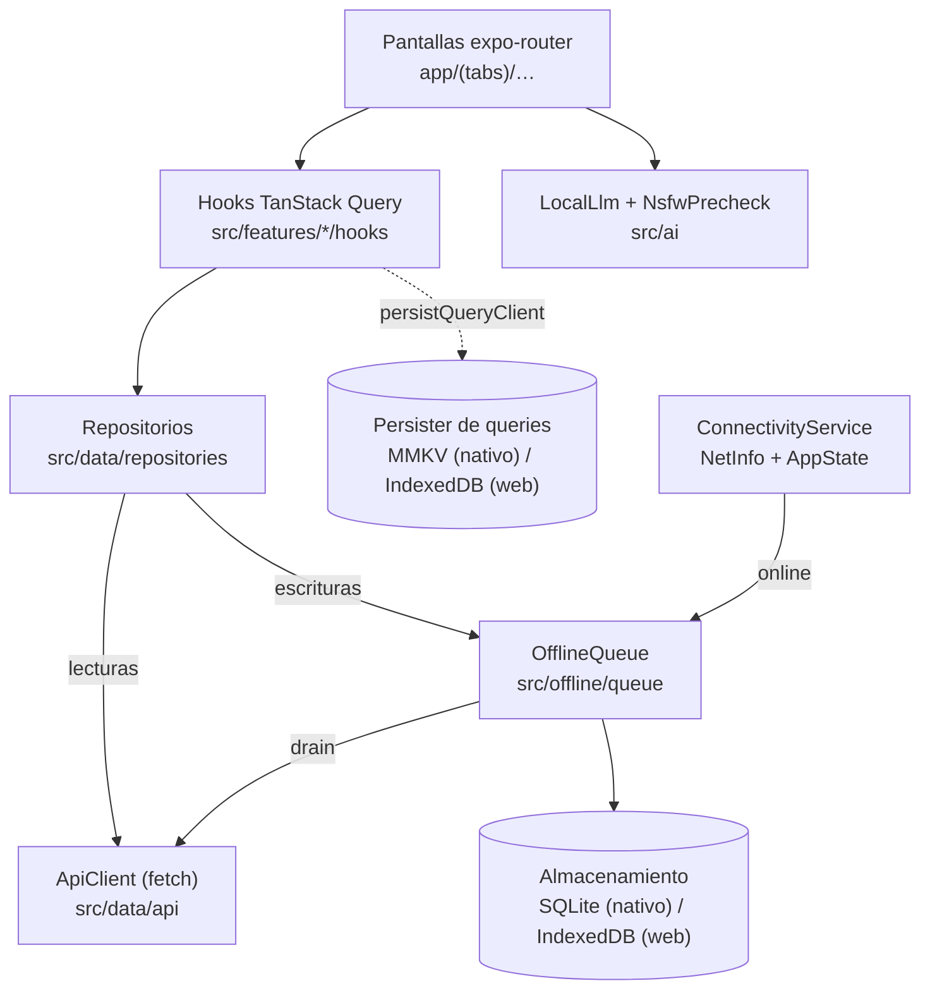
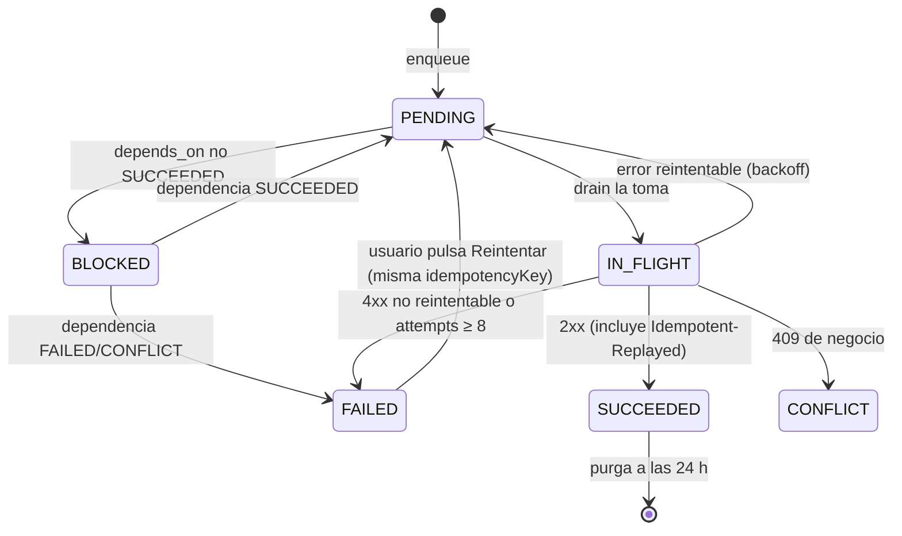
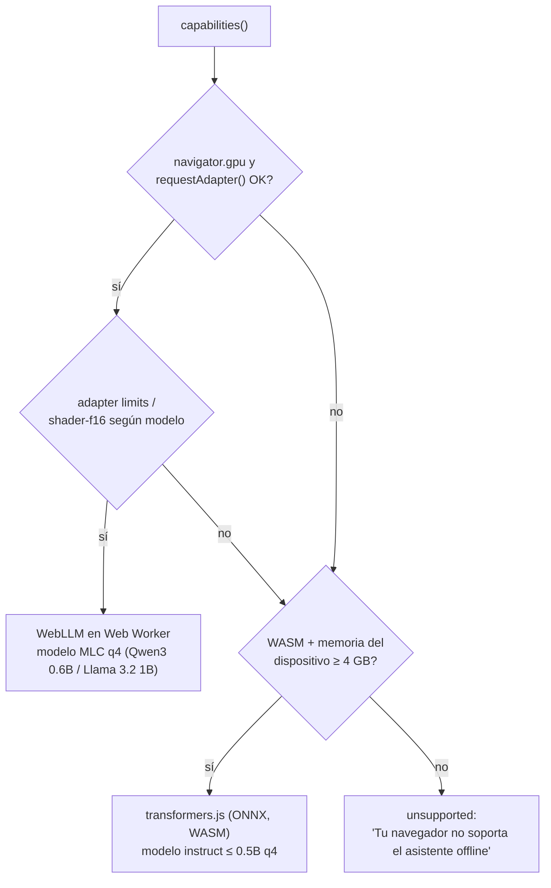

# IA local, offline-first y PWA — `bandadau-frontend`

> Detalle de **D6** (`decisiones-clave.md`). Cubre la cátedra **T6** (IA local) y **T7** (PWA)
> y los requisitos RF-08, RF-09, RF-21, RNF-09, RNF-10 y RNF-11. Casos de uso: UC-05, UC-06, UC-17.
> Si algo aquí contradice `catalogo-servicios.md` o `decisiones-clave.md`, mandan ellos.

> **Estado (2026-10-16):** la **cola offline** (outbox + sync con NetInfo), el **persister** de TanStack
> Query y el **asistente offline** (UC-17, `src/ai/` + `app/(tabs)/assistant`) están implementados, con los
> **backends LLM on-device enchufados**: `ExecutorchLlm` (nativo, `react-native-executorch@0.10.5`) y
> `BrowserLlm` (web, `@mlc-ai/web-llm@0.2.86`), sobre la API imperativa `createLLMChatSession`/`CreateMLCEngine`.
> El fallback **extractivo** (JS puro) sigue disponible para dispositivos sin soporte. La **descarga del modelo**
> (espacio libre ×1.2 + confirmación Wi-Fi) vive en la pantalla del asistente. **Pendiente:** el fallback web
> **transformers.js** (difiere: `onnxruntime-web` rompe el export de Metro) y publicar los pesos + `manifest.json`
> en el bucket de modelos (D7).

**Versiones.** Las librerías nombradas (`react-native-executorch`, `@mlc-ai/web-llm`,
`@huggingface/transformers`, `onnxruntime-react-native`, `onnxruntime-web`, `workbox-*`,
`@tanstack/react-query`, `expo-sqlite`, `react-native-mmkv`, `@react-native-community/netinfo`)
**deben verificarse** contra su documentación oficial al implementar (Expo SDK 57,
React Native con New Architecture). Los fragmentos de código son ilustrativos: describen
la forma de nuestras interfaces, no la API exacta de terceros.

**Development build obligatorio.** `react-native-executorch`, `onnxruntime-react-native`,
`react-native-mmkv` y `expo-sqlite` con extensiones son módulos nativos: la app **no**
corre en Expo Go. Se usa `npx expo run:ios|android` o EAS Build (`developmentClient: true`).

---

## 1. Principios

| # | Regla |
|---|---|
| P1 | La UI **NO DEBE** llamar a `fetch` directamente. Todo pasa por hooks → repositorios. |
| P2 | Toda escritura que el usuario puede hacer offline **DEBE** ir por la cola `OfflineMutation`, aunque haya red (un solo camino de código). |
| P3 | Toda mutación encolada **DEBE** llevar `idempotencyKey` (UUID) y, si crea recurso, `clientId` (UUIDv7) generados **al encolar**, nunca al enviar. |
| P4 | La IA local **NO DEBE** enviar el texto del usuario a ningún servidor. Ni telemetría del contenido. |
| P5 | El pre-chequeo NSFW on-device es **consultivo**: avisa, no bloquea. La decisión final la toma `media-service` (D7). |
| P6 | Operaciones con dinero o cupo (`registerToEvent`, `createTopUp`, `cancelRegistration`, `validateTicket`) **NO DEBEN** encolarse offline: requieren red y muestran error claro. |
| P7 | Código específico de plataforma en archivos `.native.ts` / `.web.ts` con un barrel `.ts` (patrón ya usado en Homy). |

---

## 2. Capas de la app



| Capa | Responsabilidad | NO DEBE |
|---|---|---|
| UI | Renderizar, disparar hooks, mostrar estado `pendingSync` | Conocer URLs, tokens ni la cola |
| Hooks | `useQuery`/`useInfiniteQuery`/`useMutation`, actualizaciones optimistas, invalidaciones | Hacer `fetch` |
| Repositorios | Traducir dominio ↔ DTO (`@bandada/contracts-ts`), decidir lectura online/caché, encolar escrituras | Manejar reintentos (eso es de la cola) |
| ApiClient | Cabeceras (`Authorization`, `Idempotency-Key`, `X-Correlation-Id`, `Accept-Language: es`), refresh de token, parseo de Problem Details | Reintentar mutaciones por su cuenta |
| OfflineQueue | Persistir, ordenar, drenar con backoff, clasificar errores | Conocer la UI |

Estructura de carpetas propuesta:

```
bandadau-frontend/src/
├── ai/            local-llm.ts · local-llm.native.ts · local-llm.web.ts · prompts.ts
│                  nsfw-precheck.ts · .native.ts · .web.ts · model-store.ts
├── offline/       queue.ts · queue-store.native.ts · queue-store.web.ts · drain.ts · backoff.ts
├── data/          api/ · repositories/ · query-keys.ts · persister.native.ts · persister.web.ts
├── features/      posts/ · feed/ · comments/ · assistant/ …
└── sw/            service-worker.ts (solo web; ver §8)
```

---

## 3. Lecturas offline (TanStack Query + persister)

- `QueryClient` con `networkMode: 'offlineFirst'` en queries que se persisten.
- Persister: nativo → `react-native-mmkv` (síncrono, rápido); web → IndexedDB (p. ej. `idb-keyval`).
  Se envuelve con `persistQueryClient` / `PersistQueryClientProvider` (verificar API de la versión).
- `maxAge` 24 h, `buster = <versión de la app>` (al cambiar de versión se descarta la caché).
- **Solo** se persisten queries en lista blanca (`meta: { persist: true }` + `dehydrateOptions.shouldDehydrateQuery`):

| Query key | Motivo |
|---|---|
| `['feed', 'home']` (primeras 3 páginas) | RF-09: feed offline |
| `['profile', 'me']` | Perfil propio |
| `['tickets', 'me']` y `['ticket', id]` | Mostrar QR en la puerta sin red |
| `['wallet', 'me']` | Saldo (solo lectura, marcado "desactualizado") |
| `['registrations', 'me']` | Mis inscripciones |
| `['assistant', 'sessions']` | Historial local del asistente (no viene del servidor) |

- **Logout DEBE** limpiar: caché de queries, persister, cola `OfflineMutation` del usuario, cachés del SW (`api-*`) y modelos? **No**: los modelos de IA no contienen datos personales y se conservan.

---

## 4. Cola offline `OfflineMutation`

### 4.1 Esquema

Misma forma lógica en SQLite (nativo, `expo-sqlite`) y en IndexedDB (web, object store `offlineMutations`, índices `byStatusNext` y `byUser`).

```sql
CREATE TABLE IF NOT EXISTS offline_mutations (
  id               TEXT PRIMARY KEY,          -- UUIDv7 (ordena por creación)
  user_id          TEXT NOT NULL,             -- dueño; nunca drenar con otro usuario logueado
  type             TEXT NOT NULL,             -- ver tabla 4.2
  method           TEXT NOT NULL,             -- POST | PUT | DELETE
  path             TEXT NOT NULL,             -- '/api/v1/posts'
  body             TEXT,                      -- JSON
  local_files      TEXT,                      -- JSON: [{ uri, mime, size }] (solo uploadMedia)
  idempotency_key  TEXT NOT NULL UNIQUE,      -- UUID generado al encolar
  client_id        TEXT,                      -- UUIDv7 del recurso creado (posts, comentarios)
  depends_on       TEXT,                      -- id de otra mutación que debe completar antes
  status           TEXT NOT NULL,             -- PENDING|IN_FLIGHT|SUCCEEDED|FAILED|CONFLICT|BLOCKED
  attempts         INTEGER NOT NULL DEFAULT 0,
  next_attempt_at  INTEGER NOT NULL,          -- epoch ms
  last_error       TEXT,                      -- JSON Problem Details resumido
  result           TEXT,                      -- JSON de respuesta (p. ej. mediaId devuelto)
  created_at       INTEGER NOT NULL,
  updated_at       INTEGER NOT NULL
);
CREATE INDEX IF NOT EXISTS ix_om_status_next ON offline_mutations(status, next_attempt_at);
```

### 4.2 Tipos de mutación permitidos

| `type` | Endpoint (D1) | `clientId` | Notas |
|---|---|---|---|
| `createPost` | `POST /posts` ♻️ | sí | `body.mediaIds` se resuelven desde `result` de las `uploadMedia` de las que depende |
| `uploadMedia` | `POST /media/uploads` ♻️ → `PUT uploadUrl` → `POST /media/{id}/complete` | — | Mutación compuesta; ver 4.5 |
| `createComment` | `POST /posts/{postId}/comments` ♻️ | sí | Si el post es local aún, `depends_on` = su `createPost` y `postId` se resuelve al drenar |
| `setReaction` / `removeReaction` | `PUT/DELETE /posts/{id}/reactions/me` | — | Idempotentes por naturaleza; **coalescer**: solo cuenta la última por post |
| `follow` / `unfollow` | `PUT/DELETE /follows/{userId}` | — | Coalescer por `userId` |
| `reportContent` | `POST /reports` ♻️ | — | |
| `updateMyProfile` | `PATCH /profiles/me` | — | Coalescer: se fusionan campos, gana el último |
| `markNotificationRead` | `POST /notifications/{id}/read` | — | Idempotente |

Cualquier otro tipo **NO DEBE** aceptarse (lista cerrada, validada al encolar).

### 4.3 Estados



Al arrancar la app, toda fila `IN_FLIGHT` vuelve a `PENDING` (la app murió a mitad de envío; la
`Idempotency-Key` hace seguro el reenvío).

### 4.4 Drenado

Disparadores: (1) `ConnectivityService` pasa a online (`isConnected && isInternetReachable !== false`),
(2) `AppState` pasa a `active`, (3) se encola algo estando online, (4) evento `sync` del service
worker en web (§8.4), (5) temporizador al `next_attempt_at` más cercano.

Algoritmo (single-flight; en web además `navigator.locks.request('bandada-drain', …)` para
que dos pestañas no drenen a la vez):

```ts
async function drain(): Promise<void> {
  if (draining) return; draining = true;
  try {
    for (;;) {
      const m = await store.nextReady(currentUserId, Date.now()); // FIFO por id, status PENDING, next_attempt_at <= now
      if (!m) break;
      if (m.dependsOn && !(await store.isSucceeded(m.dependsOn))) { await store.block(m.id); continue; }
      await store.mark(m.id, 'IN_FLIGHT');
      const outcome = await execute(m);              // ApiClient con Idempotency-Key = m.idempotencyKey
      await store.apply(m.id, classify(outcome, m.attempts));
      if (outcome.kind === 'offline') break;         // se cortó la red: parar, no quemar intentos
    }
  } finally { draining = false; }
}
```

Clasificación de respuestas:

| Respuesta | Acción |
|---|---|
| 2xx (con o sin `Idempotent-Replayed: true`) | `SUCCEEDED`, guardar `result`, reconciliar caché (§4.6) |
| Error de red / timeout / 5xx / 429 / `409 IDEMPOTENCY_IN_PROGRESS` | `PENDING`, `attempts++`, backoff |
| 401 | Intentar `refreshToken` una vez; si falla, pausar la cola hasta nuevo login (no gastar intentos) |
| `409` de negocio (p. ej. grupo privado, post eliminado) | `CONFLICT`, mostrar al usuario |
| `422 IDEMPOTENCY_KEY_REUSED` | `FAILED` y log de error: es un **bug** (se cambió el body tras encolar) |
| Otros 4xx (400, 403, 404, 413, 422) | `FAILED` sin reintento |

Backoff: `delay = min(2^attempts × 2 s, 5 min) × (0.5 + random())` (jitter completo); máximo 8 intentos.

### 4.5 Medios en posts offline

1. Al crear el post offline se copian los archivos a almacenamiento propio de la app
   (`FileSystem.documentDirectory/pending-media/` en nativo; `Blob` en IndexedDB en web) — la URI del
   selector de imágenes puede ser temporal.
2. Se encola una `uploadMedia` por archivo y un `createPost` con `depends_on` = la última `uploadMedia`
   (las uploads se encadenan entre sí para mantener orden).
3. `uploadMedia` se ejecuta **al drenar**: `POST /media/uploads` (Idempotency-Key de la fila) →
   `PUT` al `uploadUrl` prefirmado → `POST /media/{mediaId}/complete`. Guarda `{ mediaId }` en `result`.
4. Si el `PUT` devuelve 403 por URL vencida (la respuesta repetida por idempotencia puede traer una
   URL expirada), se regenera **una** nueva `idempotencyKey` solo para esa sub-etapa y se pide otra URL.
5. Se borra el archivo local cuando el post queda `SUCCEEDED`.

### 4.6 Conflictos y reconciliación

- **Duplicados**: imposibles por diseño — `posts(authorId, clientId)` único en el servidor (D3.3) +
  `Idempotency-Key` (D3.1). Si el servidor responde con el post ya existente, es éxito.
- **Optimista**: `onMutate` inserta en `['feed','home']` un ítem con `id = clientId`, `pendingSync: true`.
  Al `SUCCEEDED` se reemplaza por el recurso del servidor buscando por `clientId`.
- **Moderación**: un post con medios vuelve como `PENDING_MEDIA`; la UI muestra "En revisión".
- **Coalescencia** de reacciones/follows: al encolar, se eliminan filas `PENDING` previas del mismo
  `(type-family, targetId)`; si se anulan entre sí (follow + unfollow) no se envía nada.
- **Last-write-wins** solo para `updateMyProfile`. No hay edición offline de posts (no existe en D1).

### 4.7 Errores comunes

| Error | Consecuencia | Prevención |
|---|---|---|
| Generar `Idempotency-Key` al enviar | Reintentos crean duplicados | Generarla al encolar y persistirla |
| Usar `Date.now()` o `Math.random()` como `clientId` | Colisiones / no ordenable | UUIDv7 (librería `uuid` v10+ o equivalente, verificar) |
| Drenar con otro usuario logueado | Posts publicados en otra cuenta | Filtrar por `user_id`; limpiar cola al logout |
| `AsyncStorage` para la cola | Límite de tamaño en Android, sin transacciones | SQLite / IndexedDB |
| Reintentar 400/422 | Bucle infinito, batería | Clasificación de §4.4 |
| Dos drenadores (pestañas o SW + app) | Envíos concurrentes | Web Locks + `IN_FLIGHT`; idempotencia como red de seguridad |

---

## 5. Interfaz `LocalLlm`

```ts
// bandadau-frontend/src/ai/local-llm.ts  (barrel + tipos; Metro/webpack resuelven .native/.web)
export type LocalModelId = 'qwen3-0.6b-q' | 'llama-3.2-1b-q' | 'web-fallback-small';

export interface LocalModelInfo {
  id: LocalModelId; displayName: string; sizeBytes: number; backend: 'executorch' | 'webllm' | 'transformersjs';
}
export type LlmStatus =
  | { kind: 'not-downloaded' } | { kind: 'downloading'; progress: number }
  | { kind: 'loading' } | { kind: 'ready' } | { kind: 'unsupported'; reason: string } | { kind: 'error'; message: string };

export interface GenerateOptions { maxTokens?: number; temperature?: number; signal?: AbortSignal; onToken?: (t: string) => void; }

export interface LocalLlm {
  capabilities(): Promise<{ supported: boolean; recommended: LocalModelInfo | null; reason?: string }>;
  status(): LlmStatus;
  onStatus(cb: (s: LlmStatus) => void): () => void;
  download(model: LocalModelId, opts?: { allowCellular?: boolean }): Promise<void>;
  load(model: LocalModelId): Promise<void>;
  generate(messages: { role: 'system' | 'user' | 'assistant'; content: string }[], opts?: GenerateOptions): Promise<string>;
  unload(): Promise<void>;
  remove(model: LocalModelId): Promise<void>;
}
export { createLocalLlm } from './local-llm.impl'; // resuelve a .native.ts / .web.ts
```

### 5.1 Implementación nativa (`local-llm.native.ts`)

- Backend: **`react-native-executorch`** (Software Mansion; modelos `.pte` de ExecuTorch).
  La librería ofrece hooks/clases para LLM con descarga, progreso, generación en streaming e
  interrupción — **verificar** nombres exactos (`useLLM`, constantes de modelos, `interrupt`) en la
  versión instalada. Nuestro adaptador envuelve esa API detrás de `LocalLlm` (sin hooks en la interfaz,
  para poder usarlo desde servicios y pruebas).
- Modelos candidatos (D6): **Qwen 3 0.6B cuantizado** (por defecto, menor tamaño) y **Llama 3.2 1B
  cuantizado** (mejor calidad, gama media-alta). Debe cumplir RNF-11: ≤ 1.5 GB en disco y primer token
  < 3 s en gama media. Si el modelo elegido no cumple, se usa el otro; registrar la medición.
- `capabilities()`: RAM total (vía `expo-device` `totalMemory`) ≥ 4 GB para Qwen 0.6B y ≥ 6 GB para
  Llama 1B; si no, `unsupported` con mensaje en español.
- Generación **fuera del hilo de UI** (la librería corre en nativo); la UI recibe tokens por callback.

### 5.2 Implementación web (`local-llm.web.ts`)



- **WebLLM** (`@mlc-ai/web-llm`): motor compatible con la forma OpenAI `chat.completions`, con
  callback de progreso de inicialización. **DEBE** ejecutarse en un **Web Worker** (variante worker del
  motor) para no congelar la UI. IDs de modelo de la lista precompilada de MLC (verificar los nombres
  exactos, p. ej. variantes `q4f16_1`).
- **Fallback transformers.js** (`@huggingface/transformers`): pipeline `text-generation` con un modelo
  instruct pequeño en ONNX cuantizado (≈0.5B, multilingüe para español). Más lento; se limita
  `maxTokens` a 256 y se avisa "modo básico".
- Último recurso dentro de "unsupported": el resumen **extractivo** (algoritmo tipo TextRank en JS puro,
  `src/ai/extractive-summary.ts`) sigue disponible; las flashcards no.

### 5.3 Descarga y almacenamiento del modelo (`model-store.ts`)

| Aspecto | Nativo | Web |
|---|---|---|
| Ubicación | Directorio de documentos de la app (gestionado por la librería) | Cache Storage / IndexedDB que administra WebLLM o transformers.js |
| Persistencia | Permanente hasta `remove()` | Llamar `navigator.storage.persist()`; si se niega, avisar que el navegador puede borrarlo |
| Espacio | Verificar espacio libre (`FileSystem.getFreeDiskStorageAsync`) ≥ tamaño × 1.2 | `navigator.storage.estimate()` |
| Red | Por defecto **solo Wi-Fi** (NetInfo `type === 'wifi'`); el usuario puede aceptar datos móviles con confirmación que muestra el tamaño | Igual, con `navigator.connection` cuando exista; si no, confirmar siempre |
| Reanudación | Si la librería no reanuda, reintentar completa y mostrar progreso | Las librerías web descargan por fragmentos y reutilizan lo cacheado |
| Integridad | Versión del modelo en `model-manifest.json` del bundle (id, url, sha256, sizeBytes) | Igual |

Pantalla **Ajustes → Asistente offline**: modelo, tamaño, estado, "Descargar", "Eliminar".
La descarga **NO DEBE** iniciar automáticamente (RNF-11: "bajo demanda").

### 5.4 Prompts del asistente (`prompts.ts`)

Se usan plantillas de chat (el motor aplica el formato del modelo). **Idioma (D14):** el
asistente responde en el idioma **activo de la UI** (`i18next.language` → `es` | `en`); las
plantillas viven en `src/ai/prompts.ts` como `PROMPTS[locale].summary` / `PROMPTS[locale].flashcards`
(no en los JSON de `locales/`, porque no son textos de UI sino instrucciones al modelo) y se
seleccionan con `buildPrompt(kind, locale, text)`. Abajo se muestra la versión `es`; la `en` es su
traducción literal con "Respond in English". Si el texto de entrada está en otro idioma, se resume
igualmente en el idioma de la UI. Mensajes de error/estado del asistente sí van en
`locales/{es,en}/assistant.json`. Temperatura baja (0.2–0.3). Entrada truncada a ~1 500 tokens; textos más largos se dividen en
fragmentos, se resume cada uno y luego se resume la concatenación (map-reduce).

**Resumen:**

```text
[system]
Eres un asistente de estudio para universitarios. Respondes siempre en español neutro.
Resume el texto del usuario en 5 a 8 viñetas cortas, fieles al contenido.
No inventes datos que no estén en el texto. Si el texto está vacío o no tiene sentido, responde: "No hay contenido suficiente para resumir."
[user]
<texto del usuario>
```

**Flashcards (JSON):**

```text
[system]
Eres un generador de tarjetas de estudio. Respondes ÚNICAMENTE con JSON válido, sin texto adicional,
con esta forma exacta:
{"cards":[{"q":"pregunta","a":"respuesta breve"}]}
Genera entre 5 y 10 tarjetas a partir del texto. Preguntas claras, respuestas de máximo 25 palabras,
en español. No incluyas información que no esté en el texto.
[user]
<texto del usuario>
```

Validación obligatoria de la salida de flashcards:
1. Extraer el primer bloque `{…}` balanceado (los modelos pequeños a veces agregan texto).
2. `JSON.parse` + validación con esquema (Zod): `cards` 1..10, `q`/`a` strings no vacías, `a` ≤ 300 chars.
3. Si falla: **un** reintento con el mensaje "Tu respuesta anterior no era JSON válido. Responde solo el JSON."
4. Si vuelve a fallar: mostrar "No se pudieron generar tarjetas; prueba con un texto más corto".

Las sesiones (texto de entrada, resumen, tarjetas) se guardan **solo localmente**
(`assistant_sessions` en SQLite / IndexedDB). No hay endpoint de servidor para ellas.

---

## 6. Pre-chequeo NSFW on-device (UC-05)

| Aspecto | Decisión |
|---|---|
| Modelo | `nsfw-mobile` (D7): MobileNetV2 destilado de `nsfw-classifier`, ONNX ~5 MB, salida `p(nsfw)` |
| Runtime nativo | `onnxruntime-react-native` (verificar compatibilidad con New Architecture/SDK 57; alternativa: TFLite con `react-native-fast-tflite`) |
| Runtime web | `onnxruntime-web` (WASM; WebGPU opcional) |
| Distribución | Incluido en el bundle de la app (es pequeño) **o** descargado de `models/nsfw-mobile/<versión>/model.onnx` vía CDN pública; versión en `model-manifest.json` |
| Preproceso | Redimensionar a 224×224, RGB, normalización ImageNet — **debe coincidir** con `metadata.json` del modelo (D7 / `ml-dl.md`) |
| Umbral | Mismo corte que el servidor para avisar: `≥ 0.85` → aviso fuerte, `0.5–0.85` → aviso suave |
| Comportamiento | Muestra "Esta imagen podría no cumplir las normas; será revisada". El usuario puede **continuar** o quitarla |
| Video | No se pre-chequea on-device (costo); solo imágenes |
| Privacidad | La imagen no sale del dispositivo por el pre-chequeo; el puntaje local **no** se envía al servidor |

El pre-chequeo corre antes de encolar `uploadMedia`, por lo que funciona en modo avión.

---

## 7. Conectividad

`ConnectivityService` (único dueño de NetInfo):

- Expone `isOnline` (observable) y `connectionType`.
- En web usa `navigator.onLine` + eventos `online/offline` (NetInfo web lo envuelve); `navigator.onLine === true`
  no garantiza Internet: el primer fallo de red del drenado marca `offline` hasta el siguiente evento.
- Se integra con TanStack Query mediante `onlineManager.setEventListener(...)`.
- Banner global "Sin conexión — tus cambios se enviarán al volver la red (N pendientes)".

---

## 8. PWA (solo web)

### 8.1 Build

| Paso | Detalle |
|---|---|
| 1 | `npx expo export -p web` → `dist/`. Configuración `web.output: "single"` (SPA): la app está tras login, no necesita SEO (la landing es otra app) |
| 2 | `public/manifest.webmanifest` + íconos (192, 512, maskable) se copian a `dist/` |
| 3 | `scripts/build-sw.mjs`: compila `src/sw/service-worker.ts` (esbuild) y ejecuta Workbox **`injectManifest`** sobre `dist/` (globPatterns: `**/*.{js,css,html,ttf,woff2,png,svg,ico,webmanifest}`, excluye `**/*.map`) |
| 4 | `npm run build:web` encadena 1–3. Deploy a S3 + CloudFront (`app.<dominio>`) |

`Cache-Control`: `sw.js` y `index.html` con `no-cache`; assets con hash `max-age=31536000, immutable`.

### 8.2 Manifest

```json
{
  "name": "Bandada U",
  "short_name": "Bandada U",
  "lang": "es",
  "dir": "ltr",
  "start_url": "/?source=pwa",
  "scope": "/",
  "display": "standalone",
  "background_color": "#<color.bg.canvas (light)>",
  "theme_color": "#<color.action.primary.bg (light) de @bandada/ui-tokens>",
  "icons": [
    { "src": "/icons/icon-192.png", "sizes": "192x192", "type": "image/png" },
    { "src": "/icons/icon-512.png", "sizes": "512x512", "type": "image/png" },
    { "src": "/icons/maskable-512.png", "sizes": "512x512", "type": "image/png", "purpose": "maskable" }
  ]
}
```

Notas del manifest (D13/D14): el manifest es estático y único, por eso `lang: "es"` (idioma fuente y
*fallback*); el idioma real de la UI lo resuelve i18next en runtime. Si se quisiera `name` en inglés,
se generaría `manifest.en.webmanifest` y se cambiaría el `<link rel="manifest">` según el idioma
resuelto — **no** es necesario para el MVP. `theme_color`/`background_color` usan el valor del modo
claro de los tokens semánticos (`color.bg.canvas`, `color.action.primary.bg`); el color dinámico de la
barra se ajusta en runtime con `<meta name="theme-color" media="(prefers-color-scheme: dark)">`.

### 8.3 Estrategias del service worker

| Ruta / recurso | Estrategia Workbox | Caché | Notas |
|---|---|---|---|
| Shell (JS/CSS/fuentes/íconos con hash) | Precache (`precacheAndRoute(self.__WB_MANIFEST)`) | `workbox-precache` | |
| Navegaciones (`request.mode === 'navigate'`) | `NavigationRoute` → `index.html` precacheado | precache | SPA offline; excluir `/sso/callback` **no** (también es SPA) |
| `GET /api/v1/feed*` | `NetworkFirst` (timeout 3 s) | `api-feed` (máx. 20 entradas, 24 h) | D6. Purga en logout |
| `GET /api/v1/profiles/*`, `/tickets/*` | `NetworkFirst` (timeout 3 s) | `api-read` (máx. 100, 24 h) | Redundante con el persister; da robustez si se recarga sin JS |
| Medios (host S3/CloudFront de media, `GET`) | `StaleWhileRevalidate` | `media` (máx. 300, 7 días, `purgeOnQuotaError`) | **Clave sin query string** (ver abajo) |
| Modelos de IA | — | gestionados por WebLLM/transformers.js | El SW **NO DEBE** interceptarlos (archivos enormes) |
| `POST/PUT/PATCH/DELETE` | Red directa | — | La cola de la app maneja los reintentos |
| `/api/v1/auth/**` | Red directa, nunca caché | — | |

**URLs prefirmadas**: cambian en cada respuesta (`X-Amz-Signature`, `X-Amz-Expires`). Sin un plugin
`cacheKeyWillBeUsed` que normalice la clave (origen + path, sin query), la caché de medios nunca
acierta y crece sin límite. Las URLs vencen a los 15 min (RNF-08); la versión cacheada sigue siendo
válida para mostrar offline.

**Caché de API y multiusuario**: la Cache Storage no distingue por `Authorization`. En logout la app
envía `postMessage({ type: 'LOGOUT' })` y el SW borra `api-feed` y `api-read`.

### 8.4 Background Sync

- En navegadores con `SyncManager` (Chromium), al encolar estando offline la app registra
  `registration.sync.register('bandada-offline-queue')`.
- En el evento `sync`, el SW: (1) si hay clientes abiertos, les envía `postMessage({ type: 'DRAIN' })`
  y espera; (2) si no hay, ejecuta el mismo `drain()` (módulo compartido, sin dependencias de React)
  leyendo IndexedDB y usando el access token que la app guarda en el store `session` **solo si no ha
  expirado** (15 min). Con token vencido no drena (no hay refresh desde el SW) y la cola se drena al abrir la app.
- Navegadores sin Background Sync (Safari, Firefox): se drena al volver a abrir/enfocar la app. Es
  aceptable y se documenta en la matriz (§9).

### 8.5 Actualización del SW

- Estrategia **"preguntar al usuario"**: el SW nuevo queda en `waiting`; la app (vía `workbox-window`)
  detecta `waiting` y muestra "Hay una nueva versión — Actualizar". Al aceptar: `messageSkipWaiting()`
  y recarga en `controlling`.
- **NO** usar `skipWaiting()` incondicional: mezclaría chunks de versiones distintas en una SPA abierta.
- `clientsClaim()` sí, para controlar la primera carga.
- El SW se registra **solo** en producción web (`Platform.OS === 'web' && !__DEV__`).

### 8.6 Instalación

- Chromium: capturar `beforeinstallprompt`, guardarlo y mostrar botón "Instalar app" en Ajustes y
  tras el primer post. iOS/iPadOS: instrucciones "Compartir → Agregar a inicio".
- Verificación: Lighthouse CI (RNF-10) en `bandadau-frontend` sobre `dist/` servido localmente.

---

## 9. Matriz de compatibilidad (verificar en caniuse/MDN y la doc de cada librería al implementar)

| Capacidad | iOS nativo | Android nativo | Chrome/Edge escritorio | Chrome Android | Safari (macOS/iOS) | Firefox |
|---|---|---|---|---|---|---|
| Feed offline (persister) | ✅ | ✅ | ✅ | ✅ | ✅ | ✅ |
| Cola offline | ✅ SQLite | ✅ SQLite | ✅ IndexedDB | ✅ | ✅ | ✅ |
| Background Sync | n/a (drena al volver a `active`) | n/a | ✅ | ✅ | ❌ | ❌ |
| Asistente LLM completo | ✅ ExecuTorch (RAM ≥ 4 GB) | ✅ ExecuTorch (RAM ≥ 4 GB) | ✅ WebGPU | ⚠️ WebGPU según GPU/versión | ⚠️ WebGPU según versión | ⚠️ según versión/SO |
| Asistente modo básico | — | — | ✅ transformers.js | ✅ (lento) | ✅ (lento) | ✅ (lento) |
| Pre-chequeo NSFW | ✅ | ✅ | ✅ | ✅ | ✅ | ✅ |
| Instalación PWA | n/a | n/a | ✅ prompt | ✅ prompt | ⚠️ manual (Agregar a inicio) | ⚠️ limitada |

Límites conocidos:
- Modelos pequeños (0.6–1B) **alucinan**: la UI muestra "Generado por IA en tu dispositivo; revisa el contenido" (clave i18n `assistant.disclaimer`).
- Calidad en `en` suele ser mejor que en `es` con modelos de 0.6B; medir ambos idiomas en la prueba de RNF-11.
- Contexto efectivo corto: textos > ~6 000 palabras se rechazan con mensaje.
- Safari puede desalojar almacenamiento de sitios no usados por semanas: el modelo puede requerir re-descarga.
- Mientras genera, el LLM consume batería/temperatura; se permite cancelar (`AbortSignal`).

---

## 10. Pruebas

### 10.1 Automatizadas

| Nivel | Qué | Herramienta |
|---|---|---|
| Unitarias | `classify()`, backoff, coalescencia, resolución de `depends_on`, validador de flashcards | Jest |
| Integración | `OfflineQueue` con SQLite en memoria / `fake-indexeddb`; ApiClient con MSW simulando 5xx, 409, `Idempotent-Replayed` | Jest + MSW |
| Contrato | Los cuerpos encolados validan contra los tipos de `@bandada/contracts-ts` | tsc + Zod |
| E2E web | Playwright con `context.setOffline(true)`: crear post offline → online → 1 solo post | Playwright |
| PWA | Lighthouse CI (installable, perf ≥ 80) | Lighthouse CI |

### 10.2 Guion manual en modo avión (RNF-09, demo paso 2)

1. Con red: abrir feed, ver ticket, descargar modelo del asistente (Wi-Fi).
2. Activar modo avión. Cerrar y reabrir la app → feed, perfil y ticket visibles.
3. Crear post con texto + 1 foto "dudosa" → aviso del pre-chequeo → continuar → el post aparece con "Pendiente de envío".
4. Comentar en otro post, reaccionar dos veces (cambio de reacción) → 2 filas en cola (reacción coalescida).
5. Usar el asistente: resumir un texto y generar flashcards → funciona sin red.
6. **Matar la app** (forzar cierre). Reabrir → la cola sigue (N pendientes).
7. Desactivar modo avión → la cola drena; verificar en Mongo (`posts`) **un solo** post con ese `clientId`.
8. Repetir el paso 7 cortando la red **durante** el envío (Link Conditioner / throttling) → sigue habiendo un solo post (respuesta repetida con `Idempotent-Replayed: true`).
9. Web: mismos pasos con DevTools → Network "Offline"; con la pestaña cerrada, verificar Background Sync en Chrome (Application → Background services).

---

## 11. Riesgos

| Riesgo | Mitigación |
|---|---|
| `react-native-executorch` cambia API o no soporta el modelo elegido en SDK 57 | Adaptador detrás de `LocalLlm`; spike temprano en R4; plan B: solo resumen extractivo en nativo |
| Tamaño/tiempo de descarga en datos móviles | Solo Wi-Fi por defecto; modelo 0.6B como predeterminado |
| WebGPU inestable en móviles | Fallback transformers.js y modo extractivo |
| Cola corrupta tras actualización de esquema | Migraciones versionadas de la tabla (`PRAGMA user_version` / versión de IndexedDB) |
| SW sirve versión vieja indefinidamente | `sw.js` con `no-cache` + flujo de actualización §8.5 |
| Fuga de datos entre cuentas en el mismo navegador | Limpieza total en logout (§3, §8.3) |
