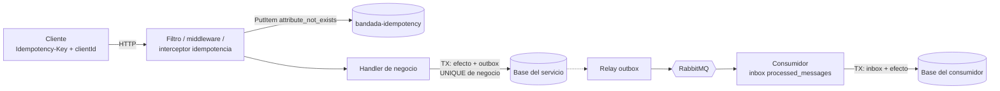
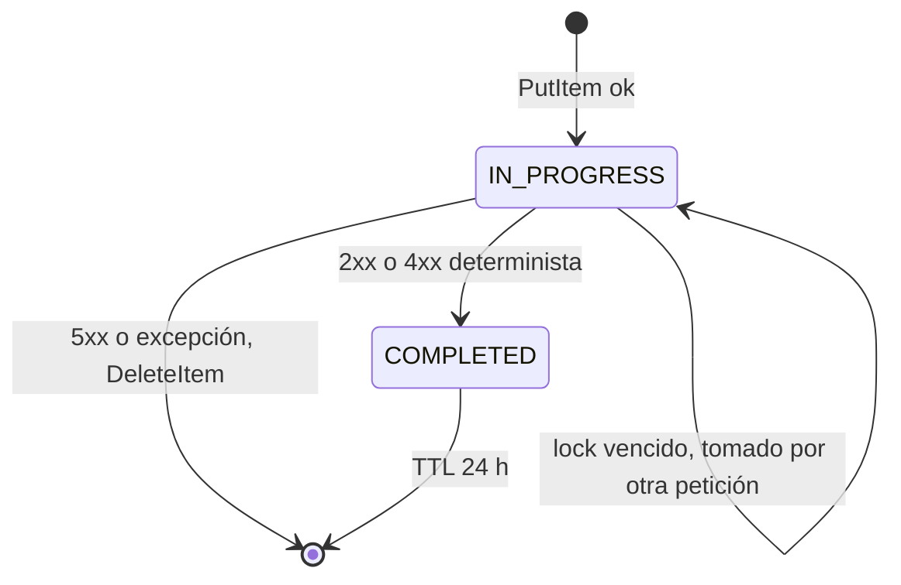

# Idempotencia (T8)

> Detalle de **D3** (`decisiones-clave.md`). Aplica a **todos** los servicios y a la
> app móvil/web. RNF-05: reenviar la misma petición o mensaje N veces produce el
> mismo efecto que 1. Mensajería: `eventos-y-mensajeria.md`. SAGA: `saga-inscripcion-evento.md`.

## 1. Los cinco mecanismos y qué protege cada uno

| # | Mecanismo | Protege contra | Dónde |
|---|---|---|---|
| 1 | `Idempotency-Key` HTTP + tabla DynamoDB `bandada-idempotency` | Doble clic, reintento del cliente tras timeout, cola offline que reenvía | Endpoints ♻️ de D1 |
| 2 | Inbox del consumidor (`processed_messages`) | Redelivery de RabbitMQ (at-least-once), relay que publica dos veces | Todo consumidor |
| 3 | Restricciones únicas de negocio | Todo lo que se escapa de 1 y 2 (carreras, caídas a mitad) | Base de cada servicio |
| 4 | IDs generados en el cliente (UUIDv7 `clientId`) | Duplicados creados offline y sincronizados varias veces | `posts`, `comments`, cola offline |
| 5 | Dedupe de webhooks (`gatewayRef`) | Pasarela que reintenta notificaciones | `wallet-service` |

Son **capas**: ninguna sola es suficiente. El mecanismo 1 no es atómico con la base
del servicio (DynamoDB ≠ Postgres/Mongo), por eso el 3 es obligatorio como red de seguridad.



## 2. Mecanismo 1 — `Idempotency-Key` HTTP

### 2.1 Reglas del protocolo

| Situación | Respuesta |
|---|---|
| Endpoint ♻️ sin cabecera | `400` Problem Details `code: IDEMPOTENCY_KEY_REQUIRED` |
| Cabecera que no es UUID (v4 o v7) | `400 IDEMPOTENCY_KEY_INVALID` |
| Clave nueva | Se ejecuta el handler; se guarda la respuesta |
| Misma clave, mismo hash, `COMPLETED` | Respuesta guardada (status, cuerpo, cabeceras permitidas) + `Idempotent-Replayed: true` |
| Misma clave, mismo hash, `IN_PROGRESS` | `409 IDEMPOTENCY_IN_PROGRESS` + `Retry-After: 1` |
| Misma clave, **distinto** hash o **distinto usuario** | `422 IDEMPOTENCY_KEY_REUSED` |
| Handler responde 2xx o 4xx determinista (`400`, `404`, `409`, `422`) | Se guarda como `COMPLETED` |
| Handler responde `401`, `403`, `429` o `5xx`, o lanza excepción | Se **borra** el registro → el cliente puede reintentar con la misma clave |

- La clave es **por operación lógica**, no por intento: el cliente la genera una vez y
  la reutiliza en todos los reintentos.
- Vigencia: 24 h (`expiresAt`). Pasado ese tiempo, la misma clave se trata como nueva.
- Cabeceras que se reproducen en un *replay*: `Content-Type`, `Location`,
  `Content-Language`. Nunca `Set-Cookie`.
- `Idempotent-Replayed` debe estar en `Access-Control-Expose-Headers` (CORS en Traefik).

### 2.2 Tabla DynamoDB `bandada-idempotency`

Compartida; cada servicio **solo** usa su prefijo (`<service>#`). Facturación
on-demand. TTL habilitado sobre `expiresAt`.

| Atributo | Tipo | Ejemplo / regla |
|---|---|---|
| `pk` (HASH) | S | `events-service#0192b7c0-7c1e-7d55-9a1e-2f9d8c0b1a10` |
| `status` | S | `IN_PROGRESS` \| `COMPLETED` |
| `requestHash` | S | SHA-256 hex (§2.3) |
| `principal` | S | `sub` del JWT, o `anonymous` |
| `method` / `path` | S | `POST` / `/api/v1/events/{eventId}/registrations` (plantilla, no la ruta concreta) |
| `lockExpiresAt` | N | epoch s; `now + 30` mientras está `IN_PROGRESS` |
| `responseStatus` | N | `202` |
| `responseHeaders` | M | `{ "Content-Type": "application/json", "Location": "…" }` |
| `responseBody` | S | JSON serializado. Máx. 300 KB; si excede, se guarda `responseTooLarge = true` y se responde `409 IDEMPOTENCY_RESPONSE_UNAVAILABLE` en replay |
| `createdAt` / `completedAt` | S | ISO-8601 UTC |
| `expiresAt` | N | epoch s, `createdAt + 86400` (TTL) |

Operaciones exactas:

```text
# 1) Reservar
PutItem
  Item: { pk, status: "IN_PROGRESS", requestHash, principal, method, path,
          lockExpiresAt: now+30, createdAt, expiresAt: now+86400 }
  ConditionExpression: attribute_not_exists(pk)

# 2a) Si ConditionalCheckFailed → GetItem(pk, ConsistentRead=true) y decidir (§2.4)

# 2b) Tomar un registro huérfano (proceso murió con IN_PROGRESS)
UpdateItem
  SET lockExpiresAt = :newLock
  ConditionExpression: #s = :inProgress AND lockExpiresAt < :now AND requestHash = :h

# 3) Completar
UpdateItem
  SET #s = :completed, responseStatus = :st, responseHeaders = :hd,
      responseBody = :b, completedAt = :t
  ConditionExpression: #s = :inProgress

# 3') Liberar (5xx, 401, 403, 429, excepción)
DeleteItem  ConditionExpression: #s = :inProgress
```

> TTL de DynamoDB borra con retraso (hasta ~48 h). Al leer, un ítem con
> `expiresAt < now` DEBE tratarse como inexistente (sobrescribirlo con `PutItem`
> condicionado a `attribute_not_exists(pk) OR expiresAt < :now`).

### 2.3 Hash canónico de la petición

```text
requestHash = hex(SHA-256(
    METHOD + "\n" +
    ROUTE_TEMPLATE + "\n" +           # /api/v1/events/{eventId}/registrations
    canonical(path params) + "\n" +   # eventId=0192…
    principal + "\n" +                # sub del JWT
    canonical(JSON body)              # claves ordenadas, sin espacios, UTF-8
))
```

- `canonical(JSON)`: ordenar claves de objetos recursivamente (orden de código
  Unicode), conservar orden de arrays, sin espacios, sin escapar `/` ni Unicode,
  números tal cual llegan. Cuerpo vacío → cadena vacía.
- El hash solo se compara **dentro del mismo servicio**, así que no se exige
  igualdad bit a bit entre lenguajes; sí se exigen vectores de prueba propios.
- No incluir cabeceras volátiles (`traceparent`, `X-Correlation-Id`, `Authorization`).

### 2.4 Estados y carreras



| Carrera | Qué pasa |
|---|---|
| Doble clic simultáneo | Solo un `PutItem` gana; el otro recibe `409 IDEMPOTENCY_IN_PROGRESS` y el cliente reintenta en 1 s → obtiene el replay |
| Proceso cae después del commit en Postgres y antes de `UpdateItem COMPLETED` | El ítem queda `IN_PROGRESS`; tras `lockExpiresAt` otra petición lo toma y re-ejecuta → choca con la restricción única (mecanismo 3) y el handler devuelve el **recurso existente** (§4) |
| Dos réplicas toman el mismo lock vencido | El `UpdateItem` condicionado deja pasar solo a una |

### 2.5 Spring Boot 4 (identity, events) — filtro

`IdempotencyFilter extends OncePerRequestFilter`, registrado después del filtro de
seguridad (necesita el `sub`). Se activa solo en handlers con `@Idempotent`
(anotación propia, resuelta con `HandlerMapping`). Cliente: AWS SDK for Java v2
(`DynamoDbClient`).

```java
@Override
protected void doFilterInternal(HttpServletRequest req, HttpServletResponse res, FilterChain chain)
        throws ServletException, IOException {
    var key = IdempotencyKey.parse(req.getHeader("Idempotency-Key")); // 400 si falta/ inválida
    var cachedReq = new ContentCachingRequestWrapper(req, MAX_BODY);
    var hash = hasher.hash(cachedReq, currentPrincipal());
    switch (store.reserve(service, key, hash, currentPrincipal())) {
        case Replay r      -> { r.writeTo(res); res.setHeader("Idempotent-Replayed", "true"); return; }
        case InProgress p  -> { problem(res, 409, "IDEMPOTENCY_IN_PROGRESS"); return; }
        case KeyReused k   -> { problem(res, 422, "IDEMPOTENCY_KEY_REUSED"); return; }
        case Reserved ok   -> { /* continúa */ }
    }
    var cachedRes = new ContentCachingResponseWrapper(res);
    try {
        chain.doFilter(cachedReq, cachedRes);
        if (isStorable(cachedRes.getStatus())) store.complete(key, snapshot(cachedRes));
        else store.release(key);
    } catch (Exception e) { store.release(key); throw e; }
    finally { cachedRes.copyBodyToResponse(); }
}
```

> `ContentCachingRequestWrapper` solo cachea lo que se lee: el hasher DEBE leer el
> cuerpo antes de pasarlo a la cadena (o usar un wrapper que lo lea completo).
> Verificar la firma del constructor en la versión de Spring Framework 7 instalada.

### 2.6 Laravel 12 (wallet, notification) — middleware

Middleware `EnsureIdempotency` registrado como alias en `bootstrap/app.php`
(`->withMiddleware(fn (Middleware $m) => $m->alias(['idempotent' => EnsureIdempotency::class]))`)
y aplicado por ruta: `Route::post('/wallet/topups', …)->middleware(['auth.jwt', 'idempotent'])`.
Cliente: `aws/aws-sdk-php` (`Aws\DynamoDb\DynamoDbClient`).

```php
public function handle(Request $request, Closure $next): Response
{
    $key = IdempotencyKey::fromHeader($request->header('Idempotency-Key')); // lanza 400
    $hash = $this->hasher->hash($request, $request->attributes->get('jwt_sub'));
    $outcome = $this->store->reserve('wallet-service', $key, $hash, $request->attributes->get('jwt_sub'));

    return match (true) {
        $outcome instanceof Replay     => $outcome->toResponse()->header('Idempotent-Replayed', 'true'),
        $outcome instanceof InProgress => Problem::response(409, 'IDEMPOTENCY_IN_PROGRESS')->header('Retry-After', '1'),
        $outcome instanceof KeyReused  => Problem::response(422, 'IDEMPOTENCY_KEY_REUSED'),
        default => $this->runAndStore($request, $next, $key),
    };
}

private function runAndStore(Request $request, Closure $next, IdempotencyKey $key): Response
{
    try {
        $response = $next($request);
    } catch (\Throwable $e) {
        $this->store->release($key);
        throw $e;
    }
    $this->isStorable($response->getStatusCode())
        ? $this->store->complete($key, $response)
        : $this->store->release($key);
    return $response;
}
```

En hexagonal, `IdempotencyStore` es un puerto (`Bandada\Wallet\Application\Port\IdempotencyStore`)
y `DynamoDbIdempotencyStore` su adaptador; el middleware vive en `Infrastructure\Http`.

### 2.7 NestJS 11 — interceptor de `@bandada/idempotency-ts`

```ts
// En el controlador
@Post()
@Idempotent()                       // metadata leída por el interceptor
@UseInterceptors(IdempotencyInterceptor)
createPost(@Body() dto: CreatePostDto, @CurrentUser() user: AuthUser) { … }

// Registro del módulo (social-service)
IdempotencyModule.forRoot({
  service: 'social-service',
  tableName: process.env.IDEMPOTENCY_TABLE ?? 'bandada-idempotency',
  ttlSeconds: 86_400,
  lockSeconds: 30,
});
```

Esqueleto del interceptor (dentro del paquete):

```ts
async intercept(ctx: ExecutionContext, next: CallHandler): Promise<Observable<unknown>> {
  const http = ctx.switchToHttp();
  const req = http.getRequest<Request>();
  const res = http.getResponse<Response>();
  const key = parseKey(req.header('Idempotency-Key'));            // BadRequest con code
  const outcome = await this.store.reserve(key, hashRequest(req), req.user?.sub ?? 'anonymous');
  if (outcome.kind === 'replay') {
    res.status(outcome.status).set({ ...outcome.headers, 'Idempotent-Replayed': 'true' });
    return of(outcome.body);
  }
  if (outcome.kind !== 'reserved') throw toProblem(outcome);       // 409 / 422
  return next.handle().pipe(
    mergeMap(async (body) => { await this.store.complete(key, res.statusCode, body); return body; }),
    catchError(async (err) => {
      if (isStorableError(err)) await this.store.completeError(key, err); else await this.store.release(key);
      throw err;
    }),
  );
}
```

> Los guards se ejecutan antes que los interceptores: `req.user` ya existe. Las
> excepciones 4xx de Nest pasan por `catchError` antes del filtro de excepciones; el
> paquete serializa el Problem Details igual que el filtro global para que el replay
> sea idéntico.

## 3. Mecanismo 2 — Inbox del consumidor

Clave: CloudEvent `id`. Se inserta **en la misma transacción** que el efecto. Si ya
existe, se hace `ack` sin efecto (y, en participantes de la SAGA, ver §3.4).

### 3.1 PostgreSQL (identity, events, wallet)

```sql
INSERT INTO processed_messages (message_id, consumer) VALUES ($1, $2)
ON CONFLICT (message_id) DO NOTHING;   -- 0 filas afectadas ⇒ duplicado
```

```php
// wallet-service (Laravel), dentro del handler del comando
DB::transaction(function () use ($msg) {
    $inserted = DB::table('processed_messages')->insertOrIgnore([
        'message_id' => $msg->id, 'consumer' => 'wallet-service.commands', 'processed_at' => now(),
    ]);
    if ($inserted === 0) { return; }                        // duplicado
    $this->debitCredits->handle(DebitCreditsCommand::fromCloudEvent($msg)); // ledger + outbox
});
```

### 3.2 MongoDB (social, media) — colección `processedMessages`

Por la convención de nombres de Mongo (camelCase) la colección se llama
`processedMessages` (equivalente a `processed_messages` de D3). Documento
`{ _id: <messageId>, consumer, processedAt }`. Requiere el replica set `rs0`.

```ts
await session.withTransaction(async () => {
  try {
    await db.collection('processedMessages').insertOne(
      { _id: msg.id, consumer: 'social-service.events', processedAt: new Date() }, { session });
  } catch (e) {
    if (isDuplicateKey(e)) return;          // código 11000
    throw e;
  }
  await handler.execute(msg, session);      // efecto + outbox en la misma sesión
});
```

Índice TTL opcional: `processedAt` con `expireAfterSeconds: 1209600` (14 días).

### 3.3 DynamoDB (ticketing, notification, insights)

Ítem en la **tabla del servicio**: `pk = INBOX#<messageId>`, `sk = META`, dentro del
mismo `TransactWriteItems` que el efecto:

```ts
await ddb.send(new TransactWriteItemsCommand({ TransactItems: [
  { Put: { TableName: 'bandada-ticketing',
           Item: marshall({ pk: `INBOX#${msg.id}`, sk: 'META', processedAt: nowIso() }),
           ConditionExpression: 'attribute_not_exists(pk)' } },
  { Put: { TableName: 'bandada-ticketing', Item: marshall(ticketItem),
           ConditionExpression: 'attribute_not_exists(pk)' } },
  { Put: { TableName: 'bandada-ticketing', Item: marshall(outboxItem) } },
]}));
```

`TransactionCanceledException` con `CancellationReasons[0].Code = ConditionalCheckFailed`
⇒ duplicado. Límite: 100 ítems por transacción.

### 3.4 Participantes de la SAGA: duplicado ≠ silencio

El inbox deduplica **el mismo mensaje**. Un **reenvío** del orquestador trae un id
nuevo y la misma `idempotencyKey` (`<sagaId>:<step>`); lo atrapa la restricción de
negocio (`operation_ref`, ticket por `registrationId`). En ese caso el participante
DEBE volver a publicar la respuesta original (vía outbox), nunca ignorarlo en silencio.

## 4. Mecanismo 3 — Restricciones únicas de negocio

| Servicio | Restricción | Al violarla |
|---|---|---|
| events | `UNIQUE (event_id, user_id) WHERE status IN ('PENDING','CONFIRMED')` | Si la fila existente tiene la misma `idempotency_key` → devolver `202` con ella; si no → `409 ALREADY_REGISTERED` |
| wallet | `ledger_entries.operation_ref UNIQUE` (`DEBIT:<registrationId>`, `REFUND:<registrationId>`, `TOPUP:<topUpId>`) | Re-publicar la respuesta con el asiento existente |
| wallet | `top_ups.gateway_ref UNIQUE` | Webhook → `200` sin efecto |
| ticketing | Ítem `pk = REG#<registrationId>`, `sk = LOCK` con `attribute_not_exists(pk)` en la misma transacción que el ticket (GSI2 sirve para consultar) | Re-publicar `ticket-issued` con el ticket existente |
| social | `posts { authorId: 1, clientId: 1 } unique`; ídem en `comments` | Devolver `201` con el post existente (mismo cuerpo que la primera vez) |

> Un GSI de DynamoDB **no** impone unicidad; por eso ticketing usa un ítem de bloqueo
> con `ConditionExpression`, no solo el GSI2.

## 5. Mecanismo 4 — IDs del cliente y cola offline (app Expo)

Ver D6. Cada mutación offline es un `OfflineMutation` persistido en `expo-sqlite`
(nativo) o IndexedDB (web):

| Campo | Tipo | Regla |
|---|---|---|
| `id` | UUIDv7 | id local de la fila |
| `idempotencyKey` | UUID | se genera **al encolar** y nunca cambia |
| `clientId` | UUIDv7 | id del recurso creado (`Post.clientId`) |
| `method`, `path`, `body` | — | `path` puede contener marcadores `{{ref:<clientId>}}` |
| `status` | enum | `PENDING`, `SENDING`, `DONE`, `FAILED` |
| `attempts`, `nextAttemptAt`, `lastError` | — | backoff exponencial 1 s → 5 min con jitter |

Drenado (al recuperar red vía NetInfo, al abrir la app o por Background Sync en web):

1. Procesa en **orden FIFO** y de a una (las dependencias van en orden).
2. Antes de enviar, resuelve marcadores: un comentario sobre un post creado offline
   usa `{{ref:<clientId del post>}}`, que se reemplaza por el `postId` real guardado
   cuando la mutación del post terminó.
3. Clasifica la respuesta:

| Respuesta | Acción |
|---|---|
| 2xx (incluido replay) | `DONE`; guarda el id del servidor para marcadores; invalida queries de TanStack |
| Red caída, timeout, 5xx, `409 IDEMPOTENCY_IN_PROGRESS`, `429` | Reintento con backoff, misma clave |
| `401` | Refresca el token (single-flight) y reintenta una vez |
| `422 IDEMPOTENCY_KEY_REUSED` | `FAILED` (es un bug; se reporta) |
| Otro 4xx | `FAILED`; se muestra al usuario en la UI con el mensaje traducido por `code` (D14) |

- La cola sobrevive al cierre de la app (RNF-09).
- **NO** regenerar `idempotencyKey` en un reintento: es el error que produce posts duplicados.

## 6. Mecanismo 5 — Webhooks de pago

`POST /wallet/webhooks/payment` (sin JWT):

1. Verifica firma HMAC-SHA256 del cuerpo crudo con `PAYMENT_WEBHOOK_SECRET` y
   tolerancia de 5 min sobre la marca de tiempo (cabeceras definidas en el contrato OpenAPI).
   Comparación en tiempo constante (`hash_equals`).
2. TX: busca `TopUp` por `gateway_ref` con `FOR UPDATE`; si ya está `PAID` → `200`
   sin efecto; si no → asiento `TOPUP:<topUpId>` + `TopUp PAID` + outbox `bandada.wallet.topup.paid.v1`.
3. Siempre `200` en duplicados (si se responde error, la pasarela reintenta indefinidamente).

## 7. Métricas

| Métrica | Etiquetas | Significado |
|---|---|---|
| `idempotency_replays_total` | `service`, `outcome` (`replayed`, `in_progress`, `key_reused`, `orphan_takeover`) | Peticiones resueltas por el mecanismo 1 |
| `inbox_duplicates_total` | `service`, `consumer` | Mensajes descartados por el inbox |
| `business_dedupe_total` | `service`, `constraint` | Violaciones de unicidad resueltas como idempotentes |

## 8. Reglas

- **DEBE** todo endpoint ♻️ de D1 exigir `Idempotency-Key`; los `PUT`/`DELETE` naturalmente idempotentes no la requieren.
- **DEBE** guardarse `principal` y rechazar con `422` una clave usada por otro usuario.
- **DEBE** insertarse el inbox en la misma transacción que el efecto.
- **DEBE** existir una restricción única de negocio para cada efecto crítico (dinero, cupo, ticket, post).
- **NO DEBE** el filtro/middleware envolver endpoints `GET`.
- **NO DEBE** guardarse respuestas 5xx (bloquearían reintentos legítimos 24 h).
- **NO DEBE** un servicio leer ni escribir claves de otro prefijo en `bandada-idempotency`.
- **NO DEBE** usarse la `Idempotency-Key` del cliente como id del recurso.

## 9. Errores comunes

| Error | Síntoma | Corrección |
|---|---|---|
| Generar la clave en cada intento | Duplicados tras timeout | Generarla al iniciar la operación lógica |
| Hash con cabeceras volátiles | `422` falsos en reintentos | Solo método, ruta plantilla, params, principal, cuerpo canónico |
| `GetItem` sin `ConsistentRead` tras el conflicto | Lee estado viejo | `ConsistentRead: true` |
| Confiar en el TTL para "expirar" | Clave vencida sigue bloqueando | Comprobar `expiresAt` al leer |
| Inbox fuera de la transacción | Efecto doble si cae entre ambos | Misma TX / mismo `TransactWriteItems` |
| Participante SAGA que descarta el reenvío sin responder | Timeout y compensación innecesaria | Re-publicar respuesta |
