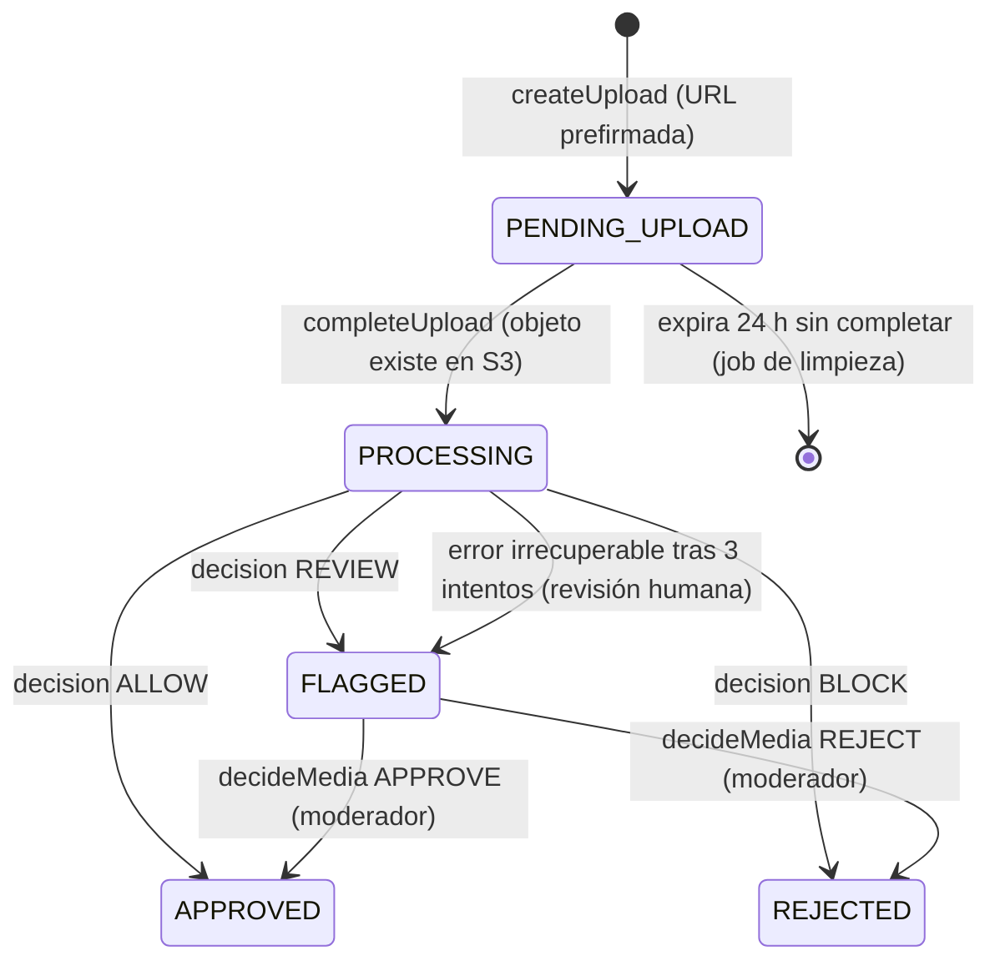
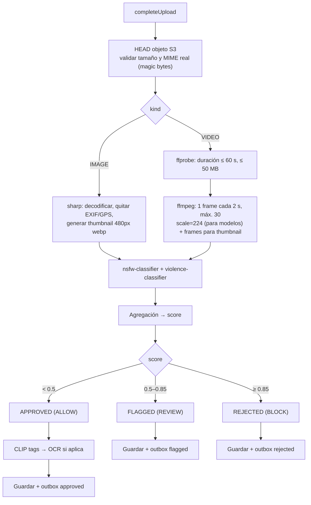
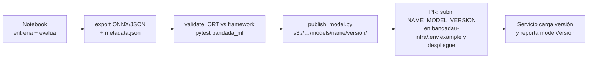

# Machine Learning y Deep Learning

> Detalle de **D7** (`decisiones-clave.md`). Cubre la cátedra **T9** y RF-07, RF-09, RF-11,
> RF-24, RNF-12. Casos de uso: UC-05, UC-06, UC-08, UC-18, UC-20.
> Normativo: tabla de modelos y umbrales de D7. Este documento los detalla, no los cambia.

**Versiones.** `onnxruntime-node`, `onnxruntime-web/react-native`, `sharp`, `ffmpeg`, `skl2onnx`,
`torch`, `optimum`, `scikit-learn`, Tesseract y PaddleOCR **deben verificarse** al implementar.
Licencias de datasets y checkpoints **deben** confirmarse en su fuente antes de usarlos; las
indicadas aquí son orientativas.

---

## 1. Principios

| # | Regla |
|---|---|
| M1 | Python **solo** entrena y exporta (`bandadau-ml/`). En producción nada corre en Python: ONNX desde NestJS (`onnxruntime-node`) o JSON de coeficientes en JS puro. |
| M2 | Cada artefacto se publica en S3/MinIO `models/<nombre>/<versión>/` con `model.onnx` (o `weights.json`) **y** `metadata.json`. Nunca en git (> 50 MB prohibido por `convenciones-generales.md`). |
| M3 | El servicio carga la versión indicada por variable de entorno (`<NOMBRE>_MODEL_VERSION`) y **DEBE** guardar `modelVersion` en cada resultado (RNF-12). |
| M4 | El preprocesamiento en Node **DEBE** reproducir exactamente el de entrenamiento (tamaño, orden de canales, normalización), leído de `metadata.json`, no hardcodeado. |
| M5 | Los umbrales de moderación son los de D7: `≥ 0.85` BLOCK, `0.5–0.85` REVIEW, `< 0.5` ALLOW. |
| M6 | Ningún modelo recibe datos personales identificables más allá del propio contenido a evaluar; features de ranking usan IDs, no nombres. |

## 2. Estructura de `bandadau-ml/`

```
bandadau-ml/
├── AGENTS.md
├── Dockerfile · Makefile · requirements.txt   # pipeline reproducible en Docker (CPU)
├── scripts/                  # train.py (descarga checkpoint) · export_onnx.py · evaluate.py · eval_recall.py · publish_model.py
├── src/bandada_ml/           # utilidades testeables: preprocessing.py · metrics.py · neutral_images.py · nsfw.py
├── fixtures/<modelo>/        # imágenes sintéticas/neutras + tensores de referencia para tests de paridad
├── models/<modelo>/<v>/      # metadata.json + model-card.md (.onnx y checkpoint NO van a git)
├── tests/                    # pytest
├── data/                     # .gitignore (solo README con cómo obtener datos)
└── reports/                  # reportes de evaluación (reports/eval/ ignorado por git)
```

Los notebooks `01…05` previstos originalmente **no existen aún**: el `nsfw-classifier` se produce con los
scripts anteriores (`make train export evaluate`); el resto de modelos (violence, feed-ranker, sugerencias, anomalías)
están pendientes.

`metadata.json` (contrato entre `bandadau-ml/` y los servicios):

```json
{
  "name": "nsfw-classifier",
  "version": "1.0.0",
  "createdAt": "2026-10-15T11:01:54Z",
  "framework": "pytorch→onnx", "opset": 17,
  "input": { "name": "pixel_values", "shape": [1, 3, 224, 224], "layout": "NCHW",
             "resize": 224, "resizeMode": "stretch", "crop": "none",
             "mean": [0.5, 0.5, 0.5], "std": [0.5, 0.5, 0.5], "colorOrder": "RGB", "scale": 255 },
  "output": { "name": "logits", "labels": ["normal", "nsfw"], "activation": "softmax", "positiveLabel": "nsfw" },
  "thresholds": { "block": 0.85, "review": 0.5 },
  "artifacts": { "fp32": { "file": "model.onnx", "sha256": "…" }, "int8": { "file": "model.int8.onnx", "sha256": "…" } },
  "source": { "hfRepo": "Falconsai/nsfw_image_detection", "revision": "<commit fijo>", "license": "apache-2.0", "note": "checkpoint preentrenado, sin reentrenar" },
  "dataset": { "name": "…", "sha256": null, "license": "…" },
  "metrics": { "parity": { "…": "…" }, "neutral_set": { "…": "…" }, "latency_cpu_python_ort": { "…": "…" }, "recall@0.5": null, "recall_note": "…" },
  "sha256": "<hash de model.onnx (fp32)>"
}
```

Valores reales en `bandadau-ml/models/nsfw-classifier/1.0.0/metadata.json` (ejemplo abreviado: `metrics` real lleva los números medidos).

| Campo | Significado |
|---|---|
| `input.resizeMode` | `stretch`: se redimensiona **directo** a `resize`×`resize` (no conserva aspecto, no hay recorte). `crop` es `none`. |
| `input.colorOrder` / `scale` | Orden de canales (`RGB`) y divisor de los bytes (`255`): `x = (pixel/scale − mean)/std`. |
| `input.mean` / `std` | Normalización del checkpoint `Falconsai/nsfw_image_detection` (`ViTImageProcessor`): **0.5 / 0.5**, no los valores ImageNet (0.485…/0.229…). |
| `artifacts.fp32/int8` | Archivos publicados con su `sha256`; el servicio elige cuál cargar. `sha256` raíz = fp32. |
| `source` | Procedencia del checkpoint base: repo HF, revisión fija y licencia. |
| `metrics.recall@0.5` | `null` mientras no se mida sobre un set curado (§5.1). **No** se inventan cifras. |

Consistencia entrenamiento/servicio (verificada 2026-10-15): `bandadau-ml/src/bandada_ml/preprocessing.py`
(PIL `BILINEAR` con antialias) y `OnnxImageClassifier` de media-service (`sharp` `fit: 'fill'`, `kernel: 'linear'`) leen/aplican el mismo
contrato; las diferencias de interpolación entre PIL y sharp son de orden sub-píxel y las cubre el test de paridad con fixtures
(`bandadau-ml/fixtures/nsfw-classifier/`).

---

## 3. Catálogo de modelos

### 3.1 `nsfw-classifier` (DL)

| Aspecto | Detalle |
|---|---|
| Problema | Clasificación binaria `safe` / `nsfw` de imágenes y frames |
| Punto de partida | Checkpoint abierto ya entrenado para NSFW (p. ej. un ViT-base o MobileNet/EfficientNet publicado en Hugging Face con licencia Apache-2.0/MIT — verificar model card y licencia). Se **re-calibra** y ajusta (fine-tune de la cabeza) en lugar de entrenar desde cero |
| Datos | Negativos: COCO 2017 (anotaciones CC BY 4.0; imágenes con licencias Flickr variadas) + fotos propias del equipo de apuntes/aulas/eventos. Positivos: **no se descargan ni versionan datasets explícitos en el repo**; se usa el checkpoint preentrenado y un set de validación pequeño, curado y guardado fuera del repo con acceso restringido. Para la demo se usa una imagen "no apta" sintética/no explícita acordada (p. ej. una imagen marcada por el propio modelo) |
| Arquitectura | **Implementado**: ViT-B/16 (`Falconsai/nsfw_image_detection`, 224×224, 2 clases `normal`/`nsfw`), sin reentrenar (M-6). Alternativa prevista: EfficientNet-B0 |
| Preprocesado | Resize directo 224×224 bilineal (sin crop central), RGB, `x/255`, `(x−0.5)/0.5`, NCHW (ver `metadata.json`) |
| Métrica objetivo | **Recall ≥ 0.90** en clase `nsfw` (RNF-12) al umbral 0.5; precisión ≥ 0.80; AUC ≥ 0.95 |
| Export | `torch.onnx.export` (o `optimum` para modelos HF), opset 17, eje batch dinámico; validar con `onnxruntime` que la salida difiere < 1e-4 del modelo PyTorch |
| Cuantización | Opcional INT8 dinámica (`onnxruntime.quantization`) si mantiene recall ≥ 0.90 |

### 3.2 `violence-classifier` (DL)

| Aspecto | Detalle |
|---|---|
| Problema | `safe` / `violence` (armas, peleas, sangre) en imágenes y frames |
| Datos sugeridos | *Real Life Violence Situations* (Kaggle, videos; extraer frames — verificar licencia), *RWF-2000* (uso académico bajo solicitud — verificar términos); negativos COCO / frames de deporte (ojo: deportes de contacto son falsos positivos típicos) |
| Arquitectura | CNN MobileNetV3-Large o EfficientNet-B0 preentrenada en ImageNet, fine-tune completo |
| Métricas | Recall ≥ 0.85, precisión ≥ 0.75; reportar matriz de confusión por subtipo (deporte, cine, real) |
| Export | Igual que 3.1 |

### 3.3 `clip-zero-shot` (DL, preentrenado)

- Modelo: CLIP ViT-B/32 (OpenAI, licencia MIT del código/pesos — verificar). Hay exportaciones ONNX
  comunitarias (p. ej. en Hugging Face, separadas en *vision* y *text encoder*); o exportar con `optimum`.
- **Solo** el encoder de visión corre por imagen. Los embeddings de texto de las etiquetas se
  **precalculan en el notebook** y se publican como `labels.json` (`{ label, prompt, embedding[512] }`).
- Etiquetas (identificadores en inglés; la UI las traduce por clave i18n `media.tags.<id>`):

| `tag` | Prompt usado (en inglés, CLIP rinde mejor) |
|---|---|
| `notes` | "a photo of handwritten class notes" |
| `whiteboard` | "a photo of a whiteboard in a classroom" |
| `event` | "a photo of a university event with people" |
| `sports` | "a photo of people playing sports" |
| `meme` | "a meme with text" |
| `campus` | "a photo of a university campus building" |
| `food` | "a photo of food" |
| `selfie` | "a selfie of a person" |
| `screenshot` | "a screenshot of a computer screen" |

- Inferencia: `softmax(100 · cos(img, text_i))`; se asignan las etiquetas con probabilidad ≥ 0.25
  (máx. 3). Se guardan en `MediaAsset.tags`.
- Si `notes` o `whiteboard` o `screenshot` está entre las etiquetas → se dispara OCR.

### 3.4 `ocr`

- **Decisión**: Tesseract 5 (Apache-2.0) con datos `spa` + `eng`, invocado como binario en la imagen
  Docker de media-service (más simple que reimplementar el pre/post-proceso de PaddleOCR en Node).
  PaddleOCR ONNX queda como mejora opcional si la calidad en manuscritos es insuficiente.
- Preproceso con `sharp`: escala de grises, normalizar, ancho máx. 2 000 px.
- Salida: `MediaAsset.ocrText` (máx. 10 000 chars), indexado para búsqueda en social-service vía
  el evento `bandada.media.asset.approved.v1` (campo `ocrText`, verificar en AsyncAPI).
- OCR **solo** sobre activos `APPROVED` (no se extrae texto de contenido bloqueado).

### 3.5 `nsfw-mobile` (DL, on-device)

- MobileNetV2 (≈3.5 M parámetros) **destilado** de `nsfw-classifier` (maestro) con las mismas
  imágenes; pérdida KL sobre logits suavizados + CE.
- Export ONNX (y TFLite opcional). Tamaño objetivo ≤ 6 MB (INT8 si es necesario).
- Recall ≥ 0.85 (puede ser menor que el servidor: es solo aviso). Uso descrito en `ia-local-y-offline.md` §6.

### 3.6 `feed-ranker` (ML clásico)

| Aspecto | Detalle |
|---|---|
| Problema | Probabilidad de que el usuario interactúe (reacción o comentario) con un post candidato |
| Etiqueta | `1` si hubo reacción/comentario dentro de 48 h tras la impresión; `0` si no |
| Datos | Log de impresiones e interacciones. Para la demo: generador sintético en el notebook a partir del seed (`make seed`) con comportamiento plausible (más interacción con seguidos, misma carrera, posts recientes) |
| Modelo | Regresión logística L2 (`scikit-learn`), features estandarizadas |
| Métricas | AUC ≥ 0.70 en validación temporal (entrenar con días 1–20, validar 21–28); NDCG@10 offline vs. orden cronológico |

Features (calculables en social-service sin llamar a otros servicios):

| Feature | Definición |
|---|---|
| `followsAuthor` | 1 si el usuario sigue al autor |
| `sameCareer` | 1 si `Profile.career` coincide |
| `sameGroup` | 1 si el post es de un grupo donde el usuario es miembro `ACTIVE` |
| `logAgeHours` | `log1p(horas desde publicación)` |
| `logReactions` | `log1p(reacciones)` |
| `logComments` | `log1p(comentarios)` |
| `hasMedia` | 1 si tiene medios |
| `interestOverlap` | Jaccard entre `Profile.interests` del usuario y `Post.hashtags` + `tags` de sus medios |
| `authorAffinity` | `log1p(interacciones del usuario con el autor en 30 días)` |

Export (`models/feed-ranker/<versión>/weights.json`):

```json
{ "name": "feed-ranker", "version": "1.0.0",
  "features": ["followsAuthor","sameCareer","sameGroup","logAgeHours","logReactions","logComments","hasMedia","interestOverlap","authorAffinity"],
  "mean": [/* … */], "std": [/* … */], "coef": [/* … */], "intercept": -1.23,
  "metrics": { "auc": 0.74 } }
```

Uso en social-service (capa de dominio, sin dependencias):

```ts
export function scoreItem(x: number[], m: RankerWeights): number {
  let z = m.intercept;
  for (let i = 0; i < x.length; i++) z += m.coef[i] * ((x[i] - m.mean[i]) / (m.std[i] || 1));
  return 1 / (1 + Math.exp(-z));
}
```

Pipeline del feed: candidatos (posts de seguidos + grupos + "populares en tu carrera" de 72 h, máx. 300)
→ filtrar `PUBLISHED` y visibilidad → features → `scoreItem` → ordenar → diversificar (máx. 2
posts seguidos del mismo autor). Para paginar con cursor estable se recomienda guardar el orden
calculado como *snapshot* corto (10 min) y que el cursor referencie `snapshotId + offset`
(decisión de detalle de social-service). `weights.json` se carga al arrancar desde S3 y se recarga
cada hora; si no está disponible, **fallback** a orden cronológico (degradación elegante).

### 3.7 `follow-suggester` (ML clásico)

- Candidatos: usuarios a 2 saltos en el grafo (seguidos de mis seguidos) + misma carrera y universidad
  + compañeros de grupo; máx. 500.
- Score: `w1·Jaccard(seguidos) + w2·sameCareer + w3·sameUniversity + w4·Jaccard(grupos) + w5·Jaccard(intereses)`.
- Pesos ajustados en `04-suggestions.ipynb` maximizando *precision@10* sobre follows reales ocultos
  (*leave-out* del 20 % de aristas). Objetivo: precision@10 ≥ 0.15 (base aleatoria ≈ 0.01).
- Export `models/follow-suggester/<versión>/weights.json` (`{ weights: {...}, version }`).
- Excluir: yo mismo, ya seguidos, `SUSPENDED`, usuarios que rechacé (si existiera). Endpoint
  `GET /follows/suggestions` (D1). Cachear resultado por usuario 1 h.

### 3.8 `anomaly-detector` (ML clásico → ONNX)

| Aspecto | Detalle |
|---|---|
| Problema | Detectar días/intervalos anómalos en series de métricas (`MetricPoint`) |
| Series | `registrations.count`, `saga.failed.count`, `posts.count`, `media.flagged.count`, `credits.topup.sum`, `users.active` |
| Features por punto | `value`, `z28` (z-score vs. media/desv. móviles de 28 días), `delta1` (vs. día anterior), `dow_sin`, `dow_cos` |
| Modelo | `IsolationForest(n_estimators=100, contamination=0.02, random_state=42)` — **un modelo por serie** o uno global con la serie como feature one-hot (preferido: uno por serie, más simple de interpretar) |
| Export | `skl2onnx` (IsolationForest está soportado; requiere dominio `ai.onnx.ml` — verificar opsets compatibles con la versión de `onnxruntime-node`). Salidas: `label` (-1 anómalo / 1 normal) y `scores` |
| Publicación | `models/anomaly-detector/<versión>/<serie>.onnx` + `metadata.json` (orden de features) |
| Datos | Sintéticos con estacionalidad semanal + anomalías inyectadas (picos ×3, caídas a 0) para medir |
| Métricas | Recall de anomalías inyectadas ≥ 0.8 con ≤ 1 falsa alarma por serie y semana |

Uso en insights-service: la herramienta MCP `detect_anomalies` (D9) carga el ONNX con
`onnxruntime-node`, arma features de los últimos N puntos y devuelve
`{ series, date, value, score, isAnomaly }[]`. **Guardas**: con < 14 días de historia se usa
`|z28| > 3` en lugar del modelo; el resultado indica `method: "zscore" | "isolation-forest"`.
El `MonitoringAgent` usa esto como **una** de sus reglas (ver `agentes-y-reportes-generativos.md`).

---

## 4. Pipeline de `media-service`

### 4.1 Estados de `MediaAsset`



Eventos (outbox en Mongo `media`): `bandada.media.asset.approved.v1`, `…flagged.v1`, `…rejected.v1`
(D12). social-service los consume para pasar el post de `PENDING_MEDIA` a `PUBLISHED`/`HIDDEN`
(invariante 6). Al recibir `bandada.social.post.deleted.v1`, media-service borra objetos y marca el activo.

### 4.2 Cola interna de trabajos

No se agrega una cola nueva de RabbitMQ (no está en el catálogo). Se usa una colección Mongo
`mediaJobs` como cola de trabajo con *lease*:

| Campo | Uso |
|---|---|
| `_id` | `mediaId` (un job por activo → idempotente: `completeUpload` repetido no duplica) |
| `status` | `QUEUED` · `RUNNING` · `DONE` · `FAILED` |
| `attempts` | máx. 3, backoff 10 s · 60 s · 5 min |
| `lockedUntil` | lease de 5 min; un worker toma con `findOneAndUpdate({status:'QUEUED' or lease vencido})` |
| `runAfter` | para backoff |

Worker `MediaProcessingWorker` dentro del mismo proceso NestJS, concurrencia configurable
(`MEDIA_WORKER_CONCURRENCY`, por defecto 2; inferencia CPU). La actualización del activo, el
`ModerationResult` y el evento de outbox se escriben en **una transacción** Mongo (replica set `rs0`).

### 4.3 Flujo



### 4.4 Detalles

- **Imágenes**: `sharp` → tensor `Float32Array` NCHW normalizado según `metadata.json`. Se eliminan
  metadatos EXIF (privacidad: GPS) antes de guardar la versión servida.
- **Video**: `ffmpeg -i in.mp4 -an -sn -vf "fps=1/2,scale=480:-2" -frames:v 30 -q:v 3 frame_%03d.jpg`
  (implementación real de `FfmpegFrameExtractor`; intervalo y máximo configurables por `VIDEO_FRAME_INTERVAL_SECONDS` / `VIDEO_MAX_FRAMES`).
  Cada frame se redimensiona luego al tamaño del modelo con el mismo preprocesado que las imágenes (stretch 224×224, sin crop). Se ejecuta con `child_process.spawn` y timeout de 60 s.
  Directorio temporal por job, borrado en `finally`.
- **Agregación de puntajes**:
  - Por imagen/frame: `s = max(p_nsfw, p_violence)`.
  - Video: `score = max(s_frame)` (prioriza recall, RNF-12). Se guarda también `framesOverReview`
    (frames con `s ≥ 0.5`) y el índice del peor frame para la vista previa del moderador.
  - Post con varias imágenes: cada activo se decide por separado; social-service publica el post
    solo si **todos** están `APPROVED`.
- **Miniatura de video**: entre los frames con `s < 0.5`, el de mayor nitidez (p. ej. la métrica
  `sharpness` de `sharp().stats()` — verificar) y brillo medio en rango; si ninguno, el primer frame
  difuminado. Se guarda como `thumbnailKey`.
- **ModerationResult**: `{ assetId, labels: {nsfw, violence}, scores, decision, modelVersion: "nsfw-classifier@1.0.0+violence-classifier@1.0.0", framesAnalyzed, createdAt }`.
- **Carga de modelos**: al arrancar (`onModuleInit`) se descargan de S3 a `/models-cache` si el
  `sha256` local no coincide; `InferenceSession` única por modelo, reutilizada. `/health/ready` falla
  si un modelo de moderación no cargó.

### 4.4.1 Estado de implementación (fase 2, 2026-10-15)

| Tema | Estado |
|---|---|
| Moderación | `MODERATION_MODE=onnx` → `OnnxModerationAdapter` (imágenes y video con ffmpeg); solo `scores: { nsfw }`. `violence-classifier`, CLIP, OCR y `nsfw-mobile` **no implementados** (opcionales) |
| Formatos | HEIC no se decodifica: pasa a revisión humana (`FLAGGED`). INT8 cuantiza solo MatMul (Δprob ≤ 0.023 vs fp32) |
| Salud | `/health/ready` incluye `moderation.state` (`READY` / `DEGRADED`) |
| Persistencia y API | Video: `ModerationResult.frameScores` (`[{index, timestampSeconds, nsfw}]`) y `worstFrameIndex` (alias `frameIndex`) se guardan con la decisión y se exponen en `/internal/v1/media/*` (OpenAPI) y en `ModerationResult` del GraphQL del panel; el puntaje del video es el máximo. Imágenes: un único puntaje (`frameScores: null`) |
| Procedencia | Checkpoint de terceros afinado con dataset propietario de licencia desconocida; sin fine-tune propio (ver model card) |
| Recall | No medido: ver §5.1 |

### 4.5 Puertos (Clean Architecture)

| Puerto (application) | Adaptador (infrastructure) |
|---|---|
| `ImageClassifierPort.classify(tensor)` | `OnnxImageClassifier` (uno por modelo) |
| `ZeroShotTaggerPort.tag(image)` | `OnnxClipTagger` |
| `OcrPort.extract(image)` | `TesseractCliOcr` |
| `FrameExtractorPort.extract(videoPath)` | `FfmpegFrameExtractor` |
| `ImageProcessorPort` | `SharpImageProcessor` |
| `ObjectStoragePort` | `S3ObjectStorage` (MinIO en dev) |
| `ModelRegistryPort.load(name, version)` | `S3ModelRegistry` |

La regla de decisión (`decide(score, thresholds)`) es dominio puro y tiene pruebas unitarias en los
bordes exactos (0.4999, 0.5, 0.8499, 0.85).

---

## 5. Evaluación, sesgos y ética

| Tema | Práctica obligatoria |
|---|---|
| Model card | `bandadau-ml/models/<modelo>/<versión>/model-card.md`: datos, licencias, métricas, umbrales, limitaciones, sesgos conocidos |
| Sesgo de tono de piel / cuerpo | Evaluar tasa de falsos positivos de `nsfw-classifier` por subgrupos (fotos de playa/deporte, distintos tonos de piel) con un set balanceado propio; si la diferencia de FPR > 5 pp, documentar y subir el umbral de BLOCK solo para revisión humana |
| Contexto académico | Imágenes médicas/anatomía de carreras de salud son falsos positivos esperados → van a `REVIEW`, nunca BLOCK automático si el score < 0.85 |
| Humano en el bucle | Todo `FLAGGED` lo decide un moderador (UC-18); los `REJECTED` automáticos se pueden apelar vía denuncia/revisión |
| Ranking | Evitar burbujas: diversificación por autor y 20 % de cupo para "populares en tu carrera". No usar features sensibles (género, edad) |
| Transparencia | La app indica "Recomendado para ti" en ítems que no son de seguidos |
| Datos de entrenamiento | No se entrenan modelos con contenido privado de usuarios sin consentimiento; los logs de interacción usados para el ranker se anonimizan (hash de IDs) |

### 5.1 Evaluación de recall (M-1, RNF-12) — estado: **pendiente de un set curado**

El recall ≥ 0.90 **no está medido** (`recall@0.5: null` en `metadata.json`): el repo no contiene ni descarga contenido explícito.
Lo que sí existe es el arnés reproducible, `bandadau-ml/scripts/eval_recall.py` (métricas en `src/bandada_ml/metrics.py`, con pruebas unitarias):

```bash
cd bandadau-ml
python scripts/eval_recall.py --dry-run                                  # tubería con imágenes sintéticas inocuas; NO mide recall real (exit 0)
BANDADA_EVAL_DIR=/ruta/privada/eval-set python scripts/eval_recall.py    # evaluación real al umbral thresholds.review (0.5)
#   opciones: --threshold, --model-file model.int8.onnx, --recall-target 0.90, --out-dir, --update-metadata --min-positives 200
```

| Aspecto | Detalle |
|---|---|
| Estructura del set | `safe/` y `nsfw/`, **fuera del repo** (el script rechaza rutas dentro de `bandadau-ml`). Cada subcarpeta es un subgrupo: `safe/skin_tones/<tono>/`, `safe/beach_sports/`, `safe/medical/`, `nsfw/<categoría>/`… |
| Salida | `reports/eval/eval-<modelo>-<fecha>.{json,md}`: precision, recall, F1, matriz de confusión, curva PR / average precision, recall (subgrupos `nsfw/*`) y FPR (subgrupos `safe/*`) |
| Criterio | exit 0 si recall ≥ 0.90; **exit 1** si recall < 0.90; exit 2 si no es medible (sin positivos, set dentro del repo, falta ruta). El `--dry-run` nunca falla por recall |
| Metadata | `--update-metadata` escribe `metrics."recall@0.5"` solo en evaluación real y con ≥ `--min-positives`; si no se usa, el campo sigue en `null` |
| Sesgos | Por §5: diferencia de FPR entre subgrupos `safe/skin_tones/*` > 5 pp se documenta en el model card |

Conjuntos candidatos (**no descargados**; verificar licencia y términos en la fuente antes de usar, y guardarlos fuera del repo con acceso restringido):
negativos de contexto y subgrupos — COCO 2017 (anotaciones CC BY 4.0, imágenes con licencias Flickr variadas) y Open Images V7 (anotaciones CC BY 4.0, imágenes CC BY 2.0);
tonos de piel — Monk Skin Tone Examples / Casual Conversations (verificar términos, algunos exigen solicitud). Para positivos no hay un dataset NSFW con licencia
abierta clara y redistribuible: debe curarlo el equipo (p. ej. contenido adulto propio/consentido o un conjunto académico bajo acuerdo de uso), o delegarse a una
revisión humana de una muestra de producción (`FLAGGED` → UC-18) anonimizada. **Hasta que exista ese set, RNF-12 se declara "no verificado"**, no "cumplido".

---

## 6. MLOps mínimo



- **Versionado**: SemVer. Mayor = cambia la forma de entrada/salida (requiere cambio de código);
  menor = reentrenamiento compatible; parche = recalibración de umbral interno/cuantización.
- **Promoción**: nunca se sobreescribe una versión publicada (`publish_model.py` falla si existe).
- **Rollback**: bajar `NAME_MODEL_VERSION` y reiniciar el servicio.
- **Monitoreo**: métricas OTel `media_moderation_decisions_total{decision,model_version}`,
  `media_inference_duration_seconds`, `feed_ranker_fallback_total`. El `MonitoringAgent` alerta si
  la tasa de `FLAGGED` diaria cambia > 3× (posible deriva o modelo roto).
- **Reproducibilidad**: semillas fijas, `requirements` fijados, hash del dataset en `metadata.json`.

## 7. Errores comunes

| Error | Síntoma | Prevención |
|---|---|---|
| Normalización distinta en Node que en Python | Puntajes aleatorios | Leer `mean/std/resize` de `metadata.json`; test de paridad con 5 imágenes fijas (salida esperada en el notebook) |
| NHWC vs NCHW | Error de forma o basura | Validar `input.shape` al cargar |
| Aplicar softmax dos veces / a un modelo que ya devuelve probabilidades | Scores comprimidos cerca de 0.5 | `output.activation` en metadata |
| Cargar `InferenceSession` por request | Latencia y memoria altas | Sesión singleton por modelo |
| Procesar video en el hilo del request | Timeouts en `completeUpload` | Siempre vía `mediaJobs` |
| No borrar temporales de ffmpeg | Disco lleno en el EC2 | `finally` + limpieza periódica |
| Guardar el ONNX en git | Repo enorme | S3/MinIO + `.gitignore` |
| Umbrales hardcodeados distintos en móvil y servidor | Avisos incoherentes | Ambos leen `thresholds` de su `metadata.json` |
