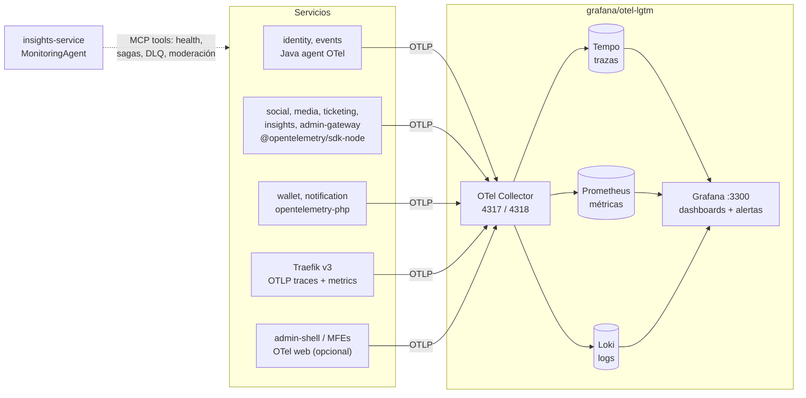

# Observabilidad (OpenTelemetry)

> RNF-13: toda petición y mensaje lleva `traceparent`; logs JSON con `traceId`,
> `correlationId`, `service`. Stack local: `grafana/otel-lgtm` (Grafana en `:3300`,
> OTLP en `:4317` gRPC / `:4318` HTTP). Convenciones de logs:
> `convenciones-generales.md` §7. Propagación por RabbitMQ: `eventos-y-mensajeria.md` §9.

## 1. Arquitectura



Producción (EC2 demo): mismo contenedor `otel-lgtm` o un OTel Collector que reenvía a
Grafana Cloud (free tier). El código **no cambia**: solo `OTEL_EXPORTER_OTLP_ENDPOINT`.

## 2. Configuración común (variables de entorno)

| Variable | Valor dev |
|---|---|
| `OTEL_SERVICE_NAME` | `events-service`, `wallet-service`, … (= nombre del catálogo) |
| `OTEL_RESOURCE_ATTRIBUTES` | `service.namespace=bandada,deployment.environment.name=local,service.version=<semver>` |
| `OTEL_EXPORTER_OTLP_ENDPOINT` | `http://otel-lgtm:4318` |
| `OTEL_EXPORTER_OTLP_PROTOCOL` | `http/protobuf` |
| `OTEL_TRACES_SAMPLER` | `parentbased_traceidratio` |
| `OTEL_TRACES_SAMPLER_ARG` | `1.0` en dev, `0.2` en prod (errores y SAGAs siempre: ver §4) |
| `OTEL_PROPAGATORS` | `tracecontext,baggage` |
| `OTEL_METRIC_EXPORT_INTERVAL` | `15000` |

## 3. Instrumentación por lenguaje

### 3.1 Java (identity, events) — **Java agent** (decisión)

- `opentelemetry-javaagent.jar` (2.x) copiado en la imagen y activado con
  `JAVA_TOOL_OPTIONS=-javaagent:/otel/opentelemetry-javaagent.jar`.
- Instrumenta sin código: Spring MVC, JDBC/Hikari, Spring AMQP/RabbitMQ, AWS SDK v2
  (DynamoDB de idempotencia), Logback (inyecta `trace_id`/`span_id` en MDC y exporta logs por OTLP).
- Métricas de negocio con **Micrometer** (`MeterRegistry`), puenteadas por el agente
  con `OTEL_INSTRUMENTATION_MICROMETER_ENABLED=true`.
- Se eligió el agente sobre el starter de Spring Boot por cobertura (AMQP, JDBC) sin
  configuración y por ser idéntico en ambos servicios. Verificar en la doc de Spring
  Boot 4 si el starter oficial cubre lo mismo antes de cambiar.

```java
// events-service: métricas de la SAGA
private final Timer.Builder sagaDuration = Timer.builder("saga.duration")
    .description("Duración de la SAGA hasta estado terminal").publishPercentileHistogram();

void recordTerminal(SagaInstance s) {
    sagaDuration.tags("saga_type", s.type().name(), "outcome", s.status().name())
        .register(registry).record(Duration.between(s.startedAt(), s.finishedAt()));
}
```

Logs: `logstash-logback-encoder` con `LogstashEncoder` a stdout; MDC con
`correlationId`, `userId`; nombres de campo renombrados a `traceId`/`spanId` (§5).

### 3.2 TypeScript / NestJS — `@opentelemetry/sdk-node`

Archivo `src/otel.ts`, cargado **antes** que Nest (`node --import ./dist/otel.js dist/main.js`
en ESM, o `-r` en CommonJS):

```ts
import { NodeSDK } from '@opentelemetry/sdk-node';
import { getNodeAutoInstrumentations } from '@opentelemetry/auto-instrumentations-node';

const sdk = new NodeSDK({
  instrumentations: [getNodeAutoInstrumentations({
    '@opentelemetry/instrumentation-fs': { enabled: false },
    '@opentelemetry/instrumentation-pino': {
      logKeys: { traceId: 'traceId', spanId: 'spanId', traceFlags: 'traceFlags' },
    },
  })],
  // exporters OTLP de trazas, métricas y logs toman la config de OTEL_* env
});
sdk.start();
process.on('SIGTERM', () => void sdk.shutdown());
```

Cubre HTTP/Express, `@nestjs/core`, GraphQL (admin-gateway), MongoDB, AWS SDK v3
(DynamoDB/S3), `amqplib`, `undici`, pino. Logs con `nestjs-pino` (JSON). Métricas de
negocio con `metrics.getMeter('<servicio>')` de `@opentelemetry/api`.
`onnxruntime-node` no tiene instrumentación: media-service crea spans manuales
`ml.inference` con atributos `ml.model`, `ml.model_version`, `ml.decision`.

### 3.3 PHP / Laravel — `open-telemetry/opentelemetry-php`

- Extensión PECL `opentelemetry` en la imagen + paquetes `open-telemetry/sdk`,
  `open-telemetry/exporter-otlp`, `open-telemetry/opentelemetry-auto-laravel`,
  `open-telemetry/opentelemetry-auto-pdo`, y propagación manual en php-amqplib.
- Autoinstrumentación con `OTEL_PHP_AUTOLOAD_ENABLED=true`.
- Logs: Monolog con formatter JSON a stdout + handler OTLP (`open-telemetry/opentelemetry-logger-monolog`).
- **Métricas**: en PHP-FPM cada petición es un proceso efímero; los contadores se
  exportan al final de la petición (costoso pero aceptable a escala demo). La latencia
  HTTP de wallet/notification se obtiene de **Traefik** y de los spans, no de
  métricas PHP. Los comandos long-running (`bandada:consume`, `bandada:outbox-relay`)
  exportan métricas periódicamente como cualquier proceso.
- Verificar nombres exactos de paquetes en Packagist para la versión instalada (regla 9 del AGENTS.md del workspace).

### 3.4 Traefik y frontends

- Traefik v3: `tracing.otlp` y `metrics.otlp` habilitados → spans de borde y métricas
  RED uniformes para los 9 servicios (incluidos los PHP).
- Shell/MFEs: opcional `@opentelemetry/sdk-trace-web` + `instrumentation-fetch`
  (propaga `traceparent` a `/graphql`; requiere `traceparent` en CORS, ya incluido) y
  métricas `mfe_load_*`. App Expo: solo `X-Correlation-Id` y Sentry/no-op (fuera de alcance).

## 4. Trazas: reglas

- Span por petición HTTP, por mensaje consumido, por publicación del relay y por
  llamada saliente (automáticos) + spans de negocio manuales: `saga.step`,
  `idempotency.check`, `ml.inference`, `agent.run`, `mcp.tool`.
- Atributos de negocio (sin PII): `bandada.saga_id`, `bandada.registration_id`,
  `bandada.event_id`, `bandada.correlation_id`, `messaging.message.id`.
- El relay de outbox restaura el contexto guardado en la fila (padre = span de la
  petición original), así la SAGA completa es **una sola traza** en Tempo.
- Muestreo: `parentbased` → si la petición raíz se muestrea, toda la SAGA también. En
  prod los spans con error se conservan con *tail sampling* en el collector (opcional).
- `insights-service`: cada `AgentRun` es un span raíz `agent.run` con hijos
  `llm.call` (atributos `gen_ai.request.model`, `gen_ai.usage.input_tokens`,
  `gen_ai.usage.output_tokens`) y `mcp.tool` (`mcp.tool.name`). Nunca el prompt
  completo como atributo.

## 5. Logs JSON

```json
{
  "timestamp": "2026-10-14T15:04:05.123Z",
  "level": "INFO",
  "service": "events-service",
  "traceId": "4bf92f3577b34da6a3ce929d0e0e4736",
  "spanId": "00f067aa0ba902b7",
  "correlationId": "c-7f3a…",
  "userId": "0192b7c0-…",
  "event": "saga.step.completed",
  "message": "Débito confirmado",
  "sagaId": "0192b7c0-…",
  "step": "DEBIT_CREDITS"
}
```

| Regla | Detalle |
|---|---|
| `event` | Nombre estable en inglés `<area>.<entidad>.<acción>` (`saga.compensation.started`, `auth.refresh.reuse_detected`, `idempotency.replayed`, `chaos.injected`). Es lo que se consulta en Loki |
| `message` | Texto libre (no se usa para alertas) |
| Niveles | `ERROR` = requiere acción; `WARN` = anómalo pero manejado; `INFO` = hitos de negocio; `DEBUG` desactivado en prod |
| Prohibido | Contraseñas, tokens, códigos de verificación/handoff, `Idempotency-Key` completa (solo 8 primeros caracteres), cuerpos de posts, emails completos |
| Etiquetas Loki | Solo `service_name`, `level`, `deployment_environment` (baja cardinalidad); el resto se consulta con `| json` |

## 6. Métricas clave

Nombres finales en Prometheus (tras la traducción OTLP → Prometheus, que agrega
sufijo de unidad y `_total`). Instrumentos OTel: el nombre con puntos y la unidad
correspondiente (p. ej. `saga.duration`, unidad `s` → `saga_duration_seconds`).
**Verificar el nombre final en Grafana → Explore** antes de fijar un dashboard.

| Métrica | Tipo | Etiquetas | Emite | Objetivo / umbral |
|---|---|---|---|---|
| `http_server_request_duration_seconds` | histograma | `service_name`, `http_route`, `http_request_method`, `http_response_status_code` | Auto (todos) | p95 lectura < 300 ms, escritura < 600 ms (RNF-01) |
| `traefik_service_request_duration_seconds` | histograma | `service`, `code` | Traefik | Vista de borde |
| `saga_duration_seconds` | histograma | `saga_type`, `outcome` | events | p95 < 3 s (RNF-02) |
| `saga_compensations_total` | contador | `saga_type`, `step`, `reason` | events | — |
| `saga_active` | gauge | `status` | events | `COMPENSATING` sostenido > 2 min = problema (RNF-04) |
| `idempotency_replays_total` | contador | `service`, `outcome` | todos con ♻️ | — |
| `inbox_duplicates_total` | contador | `service`, `consumer` | consumidores | — |
| `outbox_pending` | gauge | `service` | relays | < 100 |
| `outbox_publish_lag_seconds` | histograma | `service` | relays (`published_at - created_at`) | p95 < 2 s |
| `messaging_consume_failures_total` | contador | `service`, `queue`, `kind` (`transient`/`permanent`) | consumidores | — |
| `dlq_depth` | gauge | `queue` | insights-service (RabbitMQ Management API cada 30 s) | 0 |
| `moderation_backlog` | gauge | `kind` (`media`, `reports`) | media (`FLAGGED`), social (`OPEN`) cada 30 s | < 50 |
| `ml_inference_duration_seconds` | histograma | `model`, `model_version` | media | — |
| `ml_decisions_total` | contador | `model`, `decision` | media | — |
| `auth_login_failures_total` | contador | `reason` | identity | — |
| `agent_runs_total` / `agent_tokens_total` | contador | `agent`, `status` / `direction` | insights | presupuesto de tokens |

`dlq_depth` lo emite insights-service porque ya consulta la API de administración de
RabbitMQ para `get_service_health` (D9); así no se modifica el collector de `otel-lgtm`.
Alternativa opcional: plugin `rabbitmq_prometheus` (`:15692`) scrapeado por el collector.

PromQL de referencia:

```promql
# p95 HTTP por servicio y ruta
histogram_quantile(0.95, sum by (le, service_name, http_route)
  (rate(http_server_request_duration_seconds_bucket[5m])))

# p95 de la SAGA
histogram_quantile(0.95, sum by (le) (rate(saga_duration_seconds_bucket{outcome="COMPLETED"}[15m])))

# tasa de compensación
sum(rate(saga_compensations_total[15m])) / sum(rate(saga_duration_seconds_count[15m]))
```

## 7. Dashboards

Provisionados como JSON en `bandadau-infra/observability/grafana/dashboards/` (montados en el
contenedor `otel-lgtm`); nunca editados solo en la UI.

| Dashboard | Paneles |
|---|---|
| `bandada-overview` | RED por servicio (rate, errores 5xx, p95), salud `/health/ready`, top rutas lentas |
| `bandada-saga` | p95/p99 `saga_duration_seconds`, resultados por `outcome`, compensaciones por paso/motivo, `saga_active`, enlace a trazas de Tempo filtradas por `bandada.saga_id` |
| `bandada-messaging` | `outbox_pending`, lag de publicación, fallos de consumo, `dlq_depth` por cola |
| `bandada-idempotency` | `idempotency_replays_total` por `outcome`, `inbox_duplicates_total` (útil en la demo del doble clic y la cola offline) |
| `bandada-moderation-ml` | `moderation_backlog`, decisiones por modelo, latencia de inferencia |
| `bandada-agents` | ejecuciones de agentes, tokens, herramientas MCP más usadas, alertas emitidas |

Los paneles usan los colores de `@bandada/ui-tokens` para estados (ok/warn/danger) en
la medida que Grafana lo permite (D13: solo referencia visual, sin obligación técnica).

## 8. Alertas (Grafana Alerting, provisionadas en YAML)

| Alerta | Condición | Severidad |
|---|---|---|
| `SagaLatencyHigh` | p95 `saga_duration_seconds` > 3 s durante 10 min | warning |
| `SagaFailed` | `increase(saga_duration_seconds_count{outcome="FAILED"}[5m]) > 0` | critical |
| `SagaCompensationRateHigh` | tasa de compensación > 20 % en 15 min (excluye `reason="CHAOS_INJECTED"`) | warning |
| `DlqNotEmpty` | `max(dlq_depth) > 0` durante 5 min | warning |
| `OutboxStuck` | `outbox_pending > 100` o p95 lag > 60 s durante 5 min | critical |
| `HttpLatencyHigh` | p95 lectura > 300 ms durante 10 min | warning |
| `Http5xxRate` | 5xx > 2 % durante 5 min por servicio | critical |
| `ModerationBacklog` | `moderation_backlog > 50` durante 30 min | warning |
| `ServiceDown` | Sin métricas de `service_name` durante 2 min | critical |

Punto de contacto en dev: email a Mailpit. En prod: email + webhook a n8n
(`wf-05-alerta-critica` también recibe las alertas de dominio por RabbitMQ).

## 9. MonitoringAgent y la observabilidad

Hay **dos** canales de alerta complementarios:

| | Grafana Alerting | MonitoringAgent (insights-service) |
|---|---|---|
| Fuente | Métricas Prometheus | Herramientas MCP sobre `/internal` y RabbitMQ API |
| Detecta | Umbrales técnicos fijos | SAGAs fallidas concretas, DLQ, backlog, **anomalías** (Isolation Forest sobre `METRIC#` diarios) |
| Produce | Notificación operativa | `Alert` de dominio (`bandada.insights.alert.raised.v1`) → subscription `alertRaised` en el panel, n8n |
| Explicación | Ninguna | Texto generado por LLM con contexto ("3 SAGAs compensadas por `ticket-issue-failed` desde las 10:02") |

Ciclo del agente (cron 5 min, D8): `get_service_health` (salud + colas + `dlq_depth`)
→ `list_failed_sagas(since = última ejecución)` → `list_flagged_content` →
`detect_anomalies` → decide y llama `raise_alert` (deduplicado por `kind` + ventana
de 30 min). Cada ejecución es una traza `agent.run` y un `AgentRun` auditado.

El agente **no** consulta Prometheus en esta fase (no hay herramienta MCP para ello);
ver PROPUESTA de herramienta `query_metrics` de solo lectura.

## 10. Reglas

- **DEBE** cada servicio exportar trazas, métricas y logs por OTLP y escribir logs JSON a stdout.
- **DEBE** `OTEL_SERVICE_NAME` coincidir con el nombre del catálogo.
- **DEBE** propagarse `traceparent` en HTTP, AMQP y a través del outbox.
- **DEBE** toda métrica nueva documentarse en la tabla §6 antes de usarse en un dashboard.
- **NO DEBE** usarse `userId`, `registrationId` u otros IDs como etiqueta de métrica (cardinalidad); van en spans/logs.
- **NO DEBE** loguearse PII ni secretos (§5).
- **NO DEBE** un dashboard o alerta existir solo en la UI de Grafana.

## 11. Errores comunes

| Error | Corrección |
|---|---|
| Cargar `otel.ts` después de importar Nest | `--import`/`-r` antes de `main` |
| Métrica `saga_duration_seconds_seconds` | No incluir la unidad en el nombre del instrumento OTel |
| Etiquetas de alta cardinalidad (IDs, rutas concretas) | Usar `http_route` plantilla |
| Trazas de la SAGA cortadas en el relay | Restaurar contexto desde la fila del outbox |
| Métricas PHP-FPM perdidas | Flush al terminar la petición; latencia desde Traefik |
| Alerta de compensaciones disparada en la demo de caos | Excluir `reason="CHAOS_INJECTED"` |
