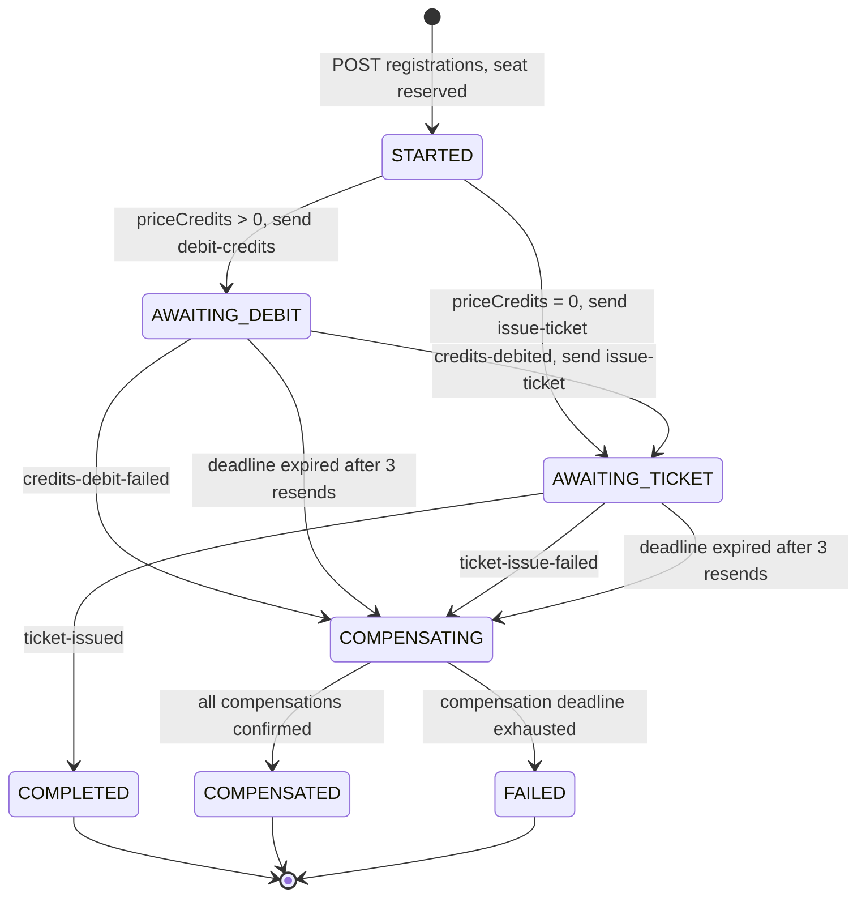
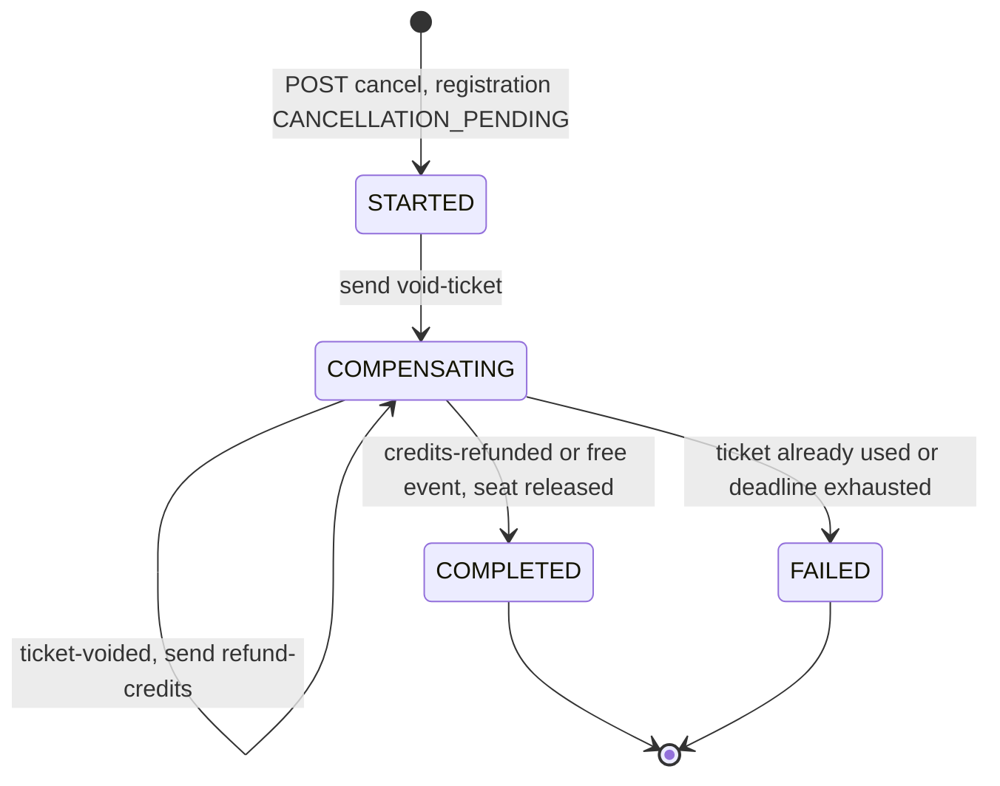
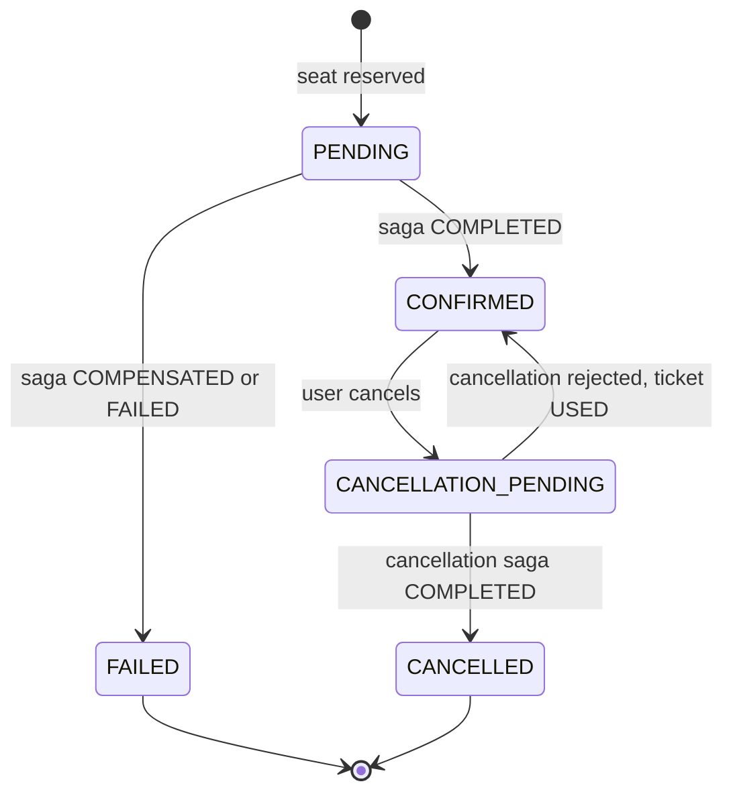
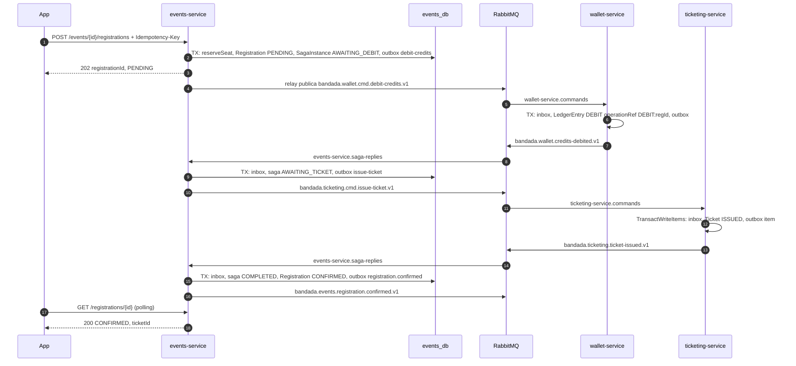
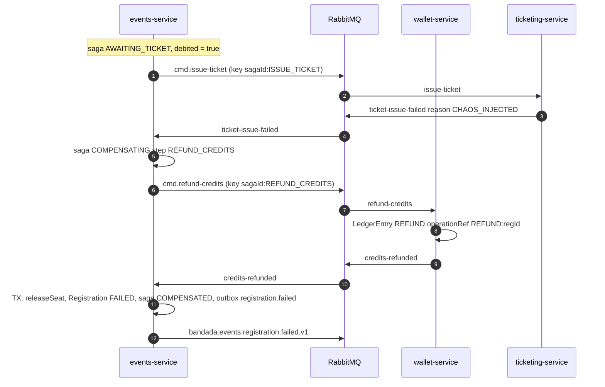

# SAGA de inscripción a evento (C1)

> Documento de detalle de **D2** (`decisiones-clave.md`). Normativo para
> `events-service` (orquestador), `wallet-service` y `ticketing-service`.
> Puertos, colas y nombres de mensajes: `catalogo-servicios.md` §5. Mensajería:
> `eventos-y-mensajeria.md`. Idempotencia: `idempotencia.md`. Casos de uso: UC-12
> (inscribirse), UC-13 (cancelar inscripción).

## 1. Resumen

| Aspecto | Decisión |
|---|---|
| Estilo | SAGA **orquestada** por `events-service` (`RegistrationSagaOrchestrator`) |
| Participantes | `events-service` (Java/Postgres) → `wallet-service` (PHP/Postgres) → `ticketing-service` (TS/DynamoDB) |
| Transporte | RabbitMQ: comandos en `bandada.commands`, respuestas en `bandada.events` |
| Garantías | Outbox en cada emisor, inbox en cada consumidor, `idempotencyKey = <sagaId>:<step>` en cada comando |
| Estado | Tabla `saga_instances` en `events_db` (una fila por SAGA) |
| Respuesta al cliente | `202 { registrationId, status: PENDING }`; el cliente hace polling a `GET /registrations/{id}` y recibe push |
| Timeout por paso | 30 s (`deadline_at`); reenvío hasta 3 veces con backoff dentro de la ventana |
| Scheduler | `@Scheduled(fixedDelay = 5s)` con `FOR UPDATE SKIP LOCKED` |
| Objetivo | p95 < 3 s (RNF-02); ningún estado intermedio > 2 min (RNF-04) |

## 2. Orquestación vs coreografía (por qué orquestada)

| Criterio | Orquestación (elegida) | Coreografía |
|---|---|---|
| Dónde vive el flujo | Una clase (`RegistrationSagaOrchestrator`) y una tabla | Repartido entre 3 servicios en 3 lenguajes |
| Visibilidad del estado | `saga_instances` responde "¿en qué paso está?" con un `SELECT` | Hay que reconstruirlo de eventos/trazas |
| Timeouts | Un único scheduler con `deadline_at` | Cada servicio necesitaría temporizadores propios |
| Compensación | Orden inverso explícito y testeable en un solo dominio | Cada servicio debe escuchar fallos ajenos → acoplamiento cíclico |
| Acoplamiento | `wallet` y `ticketing` no se conocen entre sí; solo implementan comandos (Customer/Supplier) | `ticketing` dependería de eventos de `wallet` |
| Herramientas MCP / panel | `list_failed_sagas` lee una tabla (`/internal/v1/sagas`) | Imposible sin un proyector adicional |
| Costo | Un punto central (si `events-service` cae, las SAGAs se pausan, no se corrompen) | Sin punto central |

Con 3 lenguajes distintos, la coreografía multiplicaría la lógica de compensación
en Java, PHP y TypeScript. La orquestación la concentra en el servicio DDD, donde la
SAGA es un agregado más con invariantes probables en pruebas unitarias.

## 3. Modelo de dominio (events-service, DDD táctico)

| Agregado | Raíz | Responsabilidad |
|---|---|---|
| `Event` | `Event` | Cupo (`capacity`, `seatsTaken`), precio, estado. Métodos `reserveSeat()`, `releaseSeat()` |
| `Registration` | `Registration` | Estado de la inscripción visible al usuario |
| `RegistrationSaga` | `SagaInstance` | Máquina de estados del proceso; decide el siguiente comando o compensación |

Servicio de aplicación: `RegistrationSagaOrchestrator` (paquete
`com.bandadau.events.application.saga`). Adaptadores: `JpaSagaRepository`,
`AmqpSagaReplyListener`, `OutboxRelay`, `SagaTimeoutScheduler`.

Pasos (`SagaStep`, enum en inglés):

| Paso | Tipo | Comando | Respuestas esperadas |
|---|---|---|---|
| `RESERVE_SEAT` | local | — | — |
| `DEBIT_CREDITS` | remoto | `bandada.wallet.cmd.debit-credits.v1` | `credits-debited` / `credits-debit-failed` |
| `ISSUE_TICKET` | remoto | `bandada.ticketing.cmd.issue-ticket.v1` | `ticket-issued` / `ticket-issue-failed` |
| `VOID_TICKET` | compensación remota | `bandada.ticketing.cmd.void-ticket.v1` | `ticket-voided` |
| `REFUND_CREDITS` | compensación remota | `bandada.wallet.cmd.refund-credits.v1` | `credits-refunded` |
| `RELEASE_SEAT` | compensación local | — | — |

## 4. Máquinas de estado

### 4.1 `SagaInstance` (type = `REGISTRATION`)



- `COMPENSATED` = el rollback terminó bien (la inscripción queda `FAILED` y el usuario no perdió nada).
- `FAILED` = una compensación no pudo confirmarse; requiere intervención. Dispara
  alerta (MonitoringAgent vía `list_failed_sagas`).
- Dentro de `COMPENSATING`, la columna `step` indica qué compensación se espera
  (`VOID_TICKET` → `REFUND_CREDITS` → `RELEASE_SEAT`).

### 4.2 `SagaInstance` (type = `CANCELLATION`, UC-13)



La cancelación reutiliza el enum `SagaStatus` existente: `COMPENSATING` mientras se
ejecutan los pasos inversos y `COMPLETED` cuando la cancelación terminó.

### 4.3 `Registration`



| `SagaStatus` (REGISTRATION) | `Registration.status` |
|---|---|
| `STARTED`, `AWAITING_DEBIT`, `AWAITING_TICKET`, `COMPENSATING` | `PENDING` |
| `COMPLETED` | `CONFIRMED` |
| `COMPENSATED`, `FAILED` | `FAILED` (`failureReason` = motivo original, p. ej. `INSUFFICIENT_FUNDS`) |

## 5. Esquema `events_db` (DDL PostgreSQL 18)

Migraciones con Flyway en `bandadau-backend/services/events-service/src/main/resources/db/migration/`.

```sql
CREATE TABLE events (
    id              UUID PRIMARY KEY,                 -- UUIDv7 generado por la app
    organizer_id    UUID         NOT NULL,
    university_id   UUID         NOT NULL,
    title           VARCHAR(160) NOT NULL,
    description     TEXT,
    venue           VARCHAR(200) NOT NULL,
    starts_at       TIMESTAMPTZ  NOT NULL,
    ends_at         TIMESTAMPTZ  NOT NULL,
    capacity        INTEGER      NOT NULL CHECK (capacity > 0),
    seats_taken     INTEGER      NOT NULL DEFAULT 0,
    price_credits   BIGINT       NOT NULL DEFAULT 0 CHECK (price_credits >= 0),
    status          VARCHAR(16)  NOT NULL,            -- DRAFT|PUBLISHED|CANCELLED|FINISHED
    version         BIGINT       NOT NULL DEFAULT 0,  -- @Version (bloqueo optimista)
    created_at      TIMESTAMPTZ  NOT NULL DEFAULT now(),
    updated_at      TIMESTAMPTZ  NOT NULL DEFAULT now(),
    published_at    TIMESTAMPTZ,
    CONSTRAINT seats_within_capacity CHECK (seats_taken >= 0 AND seats_taken <= capacity),
    CONSTRAINT ends_after_start CHECK (ends_at > starts_at)
);
CREATE INDEX idx_events_status_starts ON events (status, starts_at);

CREATE TABLE registrations (
    id               UUID PRIMARY KEY,
    event_id         UUID        NOT NULL REFERENCES events(id),
    user_id          UUID        NOT NULL,
    status           VARCHAR(24) NOT NULL,   -- RegistrationStatus
    price_credits    BIGINT      NOT NULL,   -- snapshot del precio al inscribirse
    failure_reason   VARCHAR(48),
    ticket_id        UUID,                   -- se llena con ticket-issued
    idempotency_key  UUID,                   -- clave HTTP que la creó (ver idempotencia.md §4)
    version          BIGINT      NOT NULL DEFAULT 0,
    created_at       TIMESTAMPTZ NOT NULL DEFAULT now(),
    updated_at       TIMESTAMPTZ NOT NULL DEFAULT now(),
    confirmed_at     TIMESTAMPTZ,
    cancelled_at     TIMESTAMPTZ
);
-- Invariante 2 del modelo de dominio / D3 mecanismo 3
CREATE UNIQUE INDEX ux_registrations_active
    ON registrations (event_id, user_id)
    WHERE status IN ('PENDING', 'CONFIRMED');
CREATE INDEX idx_registrations_user ON registrations (user_id, created_at DESC);

CREATE TABLE saga_instances (
    id               UUID PRIMARY KEY,
    registration_id  UUID        NOT NULL REFERENCES registrations(id),
    type             VARCHAR(16) NOT NULL,   -- REGISTRATION|CANCELLATION
    status           VARCHAR(16) NOT NULL,   -- SagaStatus
    step             VARCHAR(16) NOT NULL,   -- SagaStep actual
    attempt          SMALLINT    NOT NULL DEFAULT 0,   -- reenvíos del paso actual
    deadline_at      TIMESTAMPTZ,            -- null en estados terminales
    next_retry_at    TIMESTAMPTZ,
    context          JSONB       NOT NULL,   -- {eventId,userId,priceCredits,debited,ticketId,ledgerEntryId}
    failure_reason   VARCHAR(48),
    history          JSONB       NOT NULL DEFAULT '[]', -- [{at,from,to,step,messageId}]
    version          BIGINT      NOT NULL DEFAULT 0,
    started_at       TIMESTAMPTZ NOT NULL DEFAULT now(),
    updated_at       TIMESTAMPTZ NOT NULL DEFAULT now(),
    finished_at      TIMESTAMPTZ
);
-- Una sola SAGA activa por inscripción y tipo
CREATE UNIQUE INDEX ux_saga_active
    ON saga_instances (registration_id, type)
    WHERE status NOT IN ('COMPLETED', 'COMPENSATED', 'FAILED');
-- Lo que barre el scheduler
CREATE INDEX idx_saga_due
    ON saga_instances (deadline_at)
    WHERE status NOT IN ('COMPLETED', 'COMPENSATED', 'FAILED');
CREATE INDEX idx_saga_status_finished ON saga_instances (status, finished_at); -- /internal/v1/sagas

CREATE TABLE outbox (                        -- ver eventos-y-mensajeria.md §5.1
    id            UUID PRIMARY KEY,          -- = CloudEvent id
    exchange      VARCHAR(64)  NOT NULL,     -- bandada.events | bandada.commands
    routing_key   VARCHAR(160) NOT NULL,     -- = CloudEvent type
    payload       JSONB        NOT NULL,     -- CloudEvent completo (modo estructurado)
    headers       JSONB        NOT NULL DEFAULT '{}', -- traceparent, tracestate
    aggregate_id  UUID,
    created_at    TIMESTAMPTZ  NOT NULL DEFAULT now(),
    published_at  TIMESTAMPTZ,
    attempts      INTEGER      NOT NULL DEFAULT 0,
    last_error    TEXT
);
CREATE INDEX idx_outbox_pending ON outbox (created_at) WHERE published_at IS NULL;

CREATE TABLE processed_messages (            -- inbox (idempotencia.md §6)
    message_id    UUID PRIMARY KEY,          -- CloudEvent id
    consumer      VARCHAR(64) NOT NULL,      -- p. ej. saga-replies (diagnóstico)
    processed_at  TIMESTAMPTZ NOT NULL DEFAULT now()
);
```

## 6. Secuencia — camino feliz (evento pagado)



El cliente hace polling cada 1 s hasta 10 s; después se apoya en la notificación
push (`notification-service` consume `registration.confirmed`/`failed`).

## 7. Secuencia — fallo en ticketing con rollback (demo `CHAOS_TICKETING_FAIL`)



## 8. Tabla de compensaciones

| Punto de fallo | `debited` | ¿Ticket posible? | Compensaciones en orden | Estado final |
|---|---|---|---|---|
| Paso 1 (sin cupo / ya inscrito) | — | no | ninguna (síncrono `409 EVENT_FULL` / `409 ALREADY_REGISTERED`) | sin SAGA |
| `credits-debit-failed` | no | no | `RELEASE_SEAT` | `COMPENSATED` |
| Timeout en `DEBIT_CREDITS` | **desconocido** | no | `REFUND_CREDITS` → `RELEASE_SEAT` | `COMPENSATED` |
| `ticket-issue-failed` | sí (si precio > 0) | no | `REFUND_CREDITS` → `RELEASE_SEAT` | `COMPENSATED` |
| Timeout en `ISSUE_TICKET` | sí (si precio > 0) | **desconocido** | `VOID_TICKET` → `REFUND_CREDITS` → `RELEASE_SEAT` | `COMPENSATED` |
| Compensación sin confirmar tras 3 ventanas | — | — | se detiene; alerta | `FAILED` |

Regla clave: **ante la duda, compensar**. Si un paso venció por timeout no sabemos si
el participante lo ejecutó, así que se envía su compensación igualmente. Por eso los
participantes DEBEN implementar compensaciones **tolerantes a "no existe"**:

- `wallet-service` recibe `refund-credits` sin débito previo → registra la marca
  `REFUND:<registrationId>` con `amountCredits = 0` y responde `credits-refunded`
  (`refundedCredits: 0`). Si después llega tarde el `debit-credits` y ya existe
  `REFUND:<registrationId>`, responde `credits-debit-failed` (ver PROPUESTA de
  motivo `SAGA_ABORTED`) sin debitar. Es un *tombstone*.
- `ticketing-service` recibe `void-ticket` sin ticket → crea un ítem `VOIDED` para
  esa `registrationId` (tombstone) y responde `ticket-voided`. Un `issue-ticket`
  tardío encuentra la condición `attribute_not_exists` fallida y responde
  `ticket-issue-failed` (`reason: ALREADY_VOIDED`).

`RELEASE_SEAT` es local y se ejecuta en la **misma transacción** que el cierre de la
SAGA (`seats_taken--`, `Registration FAILED`, outbox `registration.failed`).

## 9. Contrato de los comandos y respuestas

Todos son CloudEvents (sobre en `eventos-y-mensajeria.md` §3). Campos de `data`
comunes a los 4 comandos:

```json
{
  "sagaId": "0192b7c0-...",
  "registrationId": "0192b7c0-...",
  "idempotencyKey": "0192b7c0-...:DEBIT_CREDITS",
  "userId": "0192...",
  "eventId": "0192...",
  "amountCredits": 50
}
```

- La extensión CloudEvents `sagaid` va siempre presente; `causationid` = id del
  mensaje que provocó el comando; `correlationid` = `X-Correlation-Id` de la petición HTTP original.
- Respuestas incluyen `sagaId`, `registrationId`, `idempotencyKey` y su resultado
  (`ledgerEntryId`, `ticketId`, `reason`).
- El esquema exacto vive en `bandadau-docs/contracts/asyncapi/bandada-events.yaml` (contract-first).

**Reenvíos:** un reenvío lleva un **nuevo** CloudEvent `id` pero la **misma**
`idempotencyKey`. El participante deduplica por `idempotencyKey` / `operationRef` y,
si la operación ya existía, **vuelve a publicar la misma respuesta** (si no la
reenvía, el orquestador esperaría hasta el timeout).

## 10. Orquestador (fragmento ilustrativo, Java 25 / Spring Boot 4)

```java
@Transactional
public void onReply(SagaReply reply) {                // invocado por AmqpSagaReplyListener
    if (!inbox.tryMarkProcessed(reply.messageId(), "saga-replies")) return; // duplicado
    SagaInstance saga = sagas.findById(reply.sagaId()).orElseThrow();
    if (!saga.expects(reply.type(), reply.idempotencyKey())) {
        log.info("event=saga.reply.ignored sagaId={} type={}", saga.id(), reply.type());
        return;                                       // respuesta tardía o de otro paso
    }
    List<SagaCommand> next = saga.handle(reply, clock.instant()); // dominio puro
    Registration reg = registrations.findById(saga.registrationId()).orElseThrow();
    saga.applyTo(reg, events::releaseSeat);           // CONFIRMED / FAILED / CANCELLED
    next.forEach(cmd -> outbox.add(cmd.toCloudEvent(saga, reply)));
    saga.terminalEvent().ifPresent(e -> outbox.add(e)); // registration.confirmed|failed|cancelled
    metrics.recordTransition(saga);                   // §13
}
```

`SagaInstance.handle(...)` es lógica de dominio sin Spring: recibe la respuesta y
devuelve la lista de comandos a emitir. Así se prueba con JUnit puro (tabla de
transiciones).

## 11. Timeouts, reintentos y scheduler

| Parámetro | Valor | Variable de entorno |
|---|---|---|
| Ventana por paso (`deadline_at = stepStartedAt + 30 s`) | 30 s | `SAGA_STEP_TIMEOUT=PT30S` |
| Reenvíos dentro de la ventana | 3 (a +5 s, +10 s, +20 s) | `SAGA_MAX_RESENDS=3` |
| Periodo del scheduler | 5 s | `SAGA_SCHEDULER_DELAY=PT5S` |
| Ventanas de compensación antes de `FAILED` | 1 (con sus 3 reenvíos) | — |

Peor caso de un estado intermedio: débito (30 s) + ticket (30 s) + `VOID_TICKET`
(30 s) + `REFUND_CREDITS` (30 s) = 120 s, dentro de RNF-04.

```sql
-- Barrido del scheduler (seguro con varias réplicas)
SELECT * FROM saga_instances
WHERE status NOT IN ('COMPLETED','COMPENSATED','FAILED')
  AND (deadline_at <= now() OR next_retry_at <= now())
ORDER BY deadline_at
LIMIT 50
FOR UPDATE SKIP LOCKED;
```

Para cada fila, en su propia transacción:

1. `deadline_at <= now()` y estado `AWAITING_*` → pasa a `COMPENSATING`, emite la
   primera compensación aplicable (§8), `failure_reason = STEP_TIMEOUT`.
2. `deadline_at <= now()` y estado `COMPENSATING` → `FAILED`, `failure_reason =
   COMPENSATION_TIMEOUT`, registro `FAILED`, evento `registration.failed`.
3. `next_retry_at <= now()` y `attempt < 3` → reenvía el comando del paso actual
   (nuevo `id`, misma `idempotencyKey`), `attempt++`, `next_retry_at += 5·2^attempt s`.

Los reintentos de **entrega** de RabbitMQ (colas de espera, DLQ) son ortogonales a
estos reenvíos de negocio; ver `eventos-y-mensajeria.md` §4.

## 12. Cancelación inversa (UC-13)

1. `POST /registrations/{id}/cancel` ♻️ → valida dueño, `status = CONFIRMED` y que el
   evento no haya comenzado (`starts_at > now()`); si no, `409`.
2. TX: `Registration CANCELLATION_PENDING`, `SagaInstance(type=CANCELLATION, status=COMPENSATING, step=VOID_TICKET)`, outbox `void-ticket` → `202`.
3. `ticket-voided` → `REFUND_CREDITS` (se salta si `price_credits = 0`).
4. `credits-refunded` → TX: `releaseSeat()`, `Registration CANCELLED`,
   `cancelled_at`, saga `COMPLETED`, outbox `bandada.events.registration.cancelled.v1`.
5. Si el ticket ya fue `USED` (validado en puerta) la cancelación se rechaza:
   saga `FAILED (TICKET_ALREADY_USED)`, la inscripción **vuelve a `CONFIRMED`**.

Cancelación de un evento por el organizador (`event.cancelled`): se crea una SAGA
`CANCELLATION` por cada inscripción `CONFIRMED`, con `failure_reason = EVENT_CANCELLED`,
en lotes de 50 por transacción.

## 13. Chaos flags (solo demo)

| Variable | Servicio | Efecto |
|---|---|---|
| `CHAOS_TICKETING_FAIL=true` | ticketing-service | Todo `issue-ticket` responde `ticket-issue-failed` (`reason: CHAOS_INJECTED`) sin crear ticket |
| `CHAOS_WALLET_DELAY_MS=<n>` | wallet-service | Duerme `n` ms antes de procesar cada comando. Con `35000` se fuerza el timeout de `DEBIT_CREDITS` |

- DEBEN leerse en el adaptador de entrada (consumidor), nunca en el dominio.
- DEBEN fallar al arrancar si `APP_ENV=production` y algún flag está activo.
- DEBEN registrar `event=chaos.injected` en el log y un atributo `chaos=true` en el span.

## 14. Métricas y trazas

| Métrica (Prometheus) | Tipo | Etiquetas | Dónde |
|---|---|---|---|
| `saga_duration_seconds` | histograma | `saga_type`, `outcome` (`COMPLETED`/`COMPENSATED`/`FAILED`) | al pasar a terminal: `finished_at - started_at` |
| `saga_compensations_total` | contador | `saga_type`, `step`, `reason` | al entrar a `COMPENSATING` |
| `saga_step_resends_total` | contador | `step` | scheduler |
| `saga_active` | gauge | `status` | consulta cada 30 s |

Toda la SAGA comparte `correlationId` (el de la petición HTTP) y la traza se propaga
con `traceparent` a través del outbox (`observabilidad.md` §4). En Grafana/Tempo
DEBE verse una sola traza de punta a punta (RNF-13).

## 15. Cómo probarla

| Nivel | Herramienta | Qué cubre |
|---|---|---|
| Unitario (dominio) | JUnit 5, sin Spring | Tabla de transiciones de `SagaInstance` (cada estado × cada respuesta), compensaciones de §8, respuestas tardías ignoradas |
| Integración events-service | Testcontainers `postgres:18` + `rabbitmq:4-management`, Awaitility | Outbox → broker, inbox con mensajes duplicados, scheduler con reloj controlado (`Clock` inyectado) |
| Participante falso | Listener de prueba que responde comandos según el escenario | Feliz, `INSUFFICIENT_FUNDS`, `ticket-issue-failed`, silencio (timeout), respuesta duplicada |
| Concurrencia | 50 hilos sobre un evento con `capacity = 1` | Exactamente 1 `PENDING`; 49 → `409 EVENT_FULL` |
| E2E (3 servicios) | `make e2e-saga` (Compose) | Flujo completo + `CHAOS_TICKETING_FAIL` + `CHAOS_WALLET_DELAY_MS=35000`: saldo final igual al inicial, cupo liberado |

```java
@Test
void ticketFailure_refundsAndReleasesSeat() {
    var regId = api.register(eventId, user, UUID.randomUUID());   // 202
    fakeTicketing.failNext("CHAOS_INJECTED");
    await().atMost(Duration.ofSeconds(10)).untilAsserted(() -> {
        assertThat(sagaStatus(regId)).isEqualTo("COMPENSATED");
        assertThat(fakeWallet.received()).containsExactly("debit-credits", "refund-credits");
        assertThat(seatsTaken(eventId)).isZero();
    });
}
```

## 16. Reglas

- **DEBE** reservar el cupo, crear `Registration` y `SagaInstance` e insertar el
  primer comando en el outbox en **una sola transacción**.
- **DEBE** procesar cada respuesta en una transacción que incluya inbox + cambio de
  estado + outbox; el `ack` a RabbitMQ se hace **después** del commit.
- **DEBE** ignorar (y registrar) respuestas que no corresponden al paso esperado.
- **DEBE** enviar la compensación de un paso vencido aunque no se sepa si se ejecutó.
- **NO DEBE** llamar a `wallet` ni `ticketing` por REST dentro de la SAGA.
- **NO DEBE** publicar directo a RabbitMQ desde el código de negocio (siempre outbox).
- **NO DEBE** borrar filas de `saga_instances` (auditoría; se archivan a los 90 días).
- **NO DEBE** decidir el siguiente paso en el listener AMQP; lo decide el agregado.

## 17. Errores comunes

| Error | Consecuencia | Cómo evitarlo |
|---|---|---|
| Hacer `ack` antes del commit | Se pierde la respuesta si la TX falla | Ack manual después del commit |
| Reenviar con el mismo CloudEvent `id` | El inbox del participante lo descarta y nunca responde | Nuevo `id`, misma `idempotencyKey` |
| Participante que ignora un comando duplicado sin responder | SAGA espera hasta el timeout y compensa algo que salió bien | Re-publicar la respuesta original |
| `refund` que falla si no hubo débito | SAGA queda `FAILED` innecesariamente | Tombstone y `refundedCredits: 0` |
| `seats_taken++` sin `@Version` ni `CHECK` | Sobreventa | Bloqueo optimista + `CHECK` + reintento (máx. 3) |
| Scheduler sin `SKIP LOCKED` | Dos réplicas compensan dos veces | `FOR UPDATE SKIP LOCKED` |
| Usar `LocalDateTime` | Desfases de zona | `Instant` / `TIMESTAMPTZ` |
