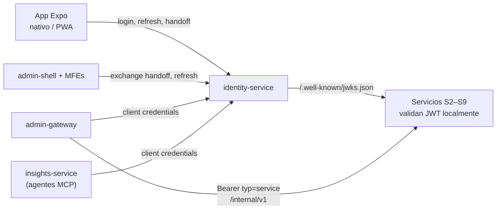
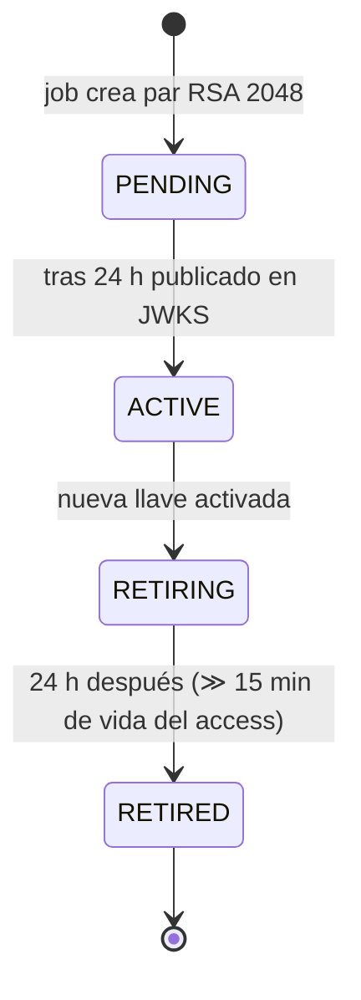
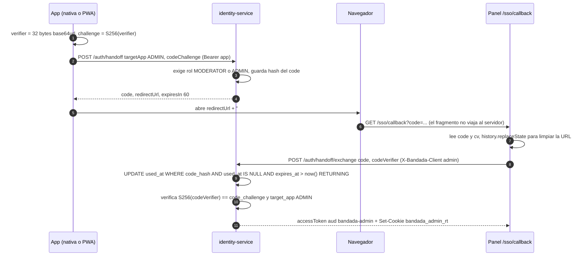

# Seguridad y acceso por una sola entrada (T13)

> Detalle de **D4** y RNF-06/07/08. Normativo para `identity-service` (emisor) y para
> todos los servicios y clientes (validación y almacenamiento de tokens).
> Rutas exactas: D1. Roles: `catalogo-servicios.md` §7.

## 1. Panorama



| Pieza | Decisión |
|---|---|
| Access token | JWT **RS256**, 15 min, validado localmente con JWKS |
| Refresh token | Opaco (32 bytes aleatorios), 30 días, **rotativo**, familia con detección de reutilización |
| Contraseñas | **Argon2id** |
| Servicio a servicio | JWT `typ=service` por *client credentials*, 5 min |
| Salto app ↔ panel | *Handoff code* de un solo uso, 60 s, con PKCE (S256) |
| Edge | Traefik: CORS, rate limit, bloqueo de `/internal/**` |

## 2. JWT

### 2.1 Cabecera y claims

```json
{ "alg": "RS256", "typ": "JWT", "kid": "2026-10-a" }
{
  "iss": "https://api.bandadau.com",
  "aud": "bandada-app",
  "sub": "0192b7c0-7c1e-7d55-9a1e-2f9d8c0b1a10",
  "typ": "user",
  "roles": ["STUDENT", "ORGANIZER"],
  "uni": "0192a000-…",
  "locale": "es",
  "scope": "",
  "jti": "0192b7c4-…",
  "iat": 1792000000,
  "exp": 1792000900
}
```

| Claim | Valores | Uso |
|---|---|---|
| `iss` | `${PUBLIC_API_URL}` (`http://api.bandada.localhost` en dev) | Validado por todos |
| `aud` | `bandada-app` (app), `bandada-admin` (panel), `bandada-internal` (servicio) | Cada servicio acepta solo las audiencias que le corresponden (§6) |
| `sub` | UUIDv7 del usuario, o `service:<nombre>` | Identidad |
| `typ` | `user` \| `service` | Distingue tokens; `/internal/**` exige `service` |
| `roles` | `STUDENT`, `ORGANIZER`, `MODERATOR`, `ADMIN` | Autorización gruesa |
| `uni` | UUID de la universidad | Filtrado multi-universidad (posts, eventos) |
| `locale` | `es` \| `en` (D14) | Idioma por defecto de respuestas/plantillas cuando falta `Accept-Language`. **No** es autorización; puede quedar desactualizado hasta 15 min tras `updateMyPreferences` |
| `scope` | Tokens de servicio: `internal:read`, `internal:write`, `mcp:tools` | Autorización fina servicio a servicio |
| `jti` | UUIDv7 | Trazabilidad; no hay lista negra de access tokens (vida corta) |

Tokens `aud = bandada-admin` solo se emiten a usuarios con `MODERATOR` o `ADMIN`.
El JWT **no** lleva email, nombre ni datos personales adicionales.

### 2.2 Llaves, JWKS y rotación

Tabla `signing_keys` en `identity_db`:

```sql
CREATE TABLE signing_keys (
    kid                VARCHAR(32) PRIMARY KEY,           -- '2026-10-a'
    public_jwk         JSONB       NOT NULL,
    private_key_enc    BYTEA       NOT NULL,              -- cifrada con KEK (JWT_KEK de Secrets Manager)
    status             VARCHAR(12) NOT NULL,              -- PENDING|ACTIVE|RETIRING|RETIRED
    created_at         TIMESTAMPTZ NOT NULL DEFAULT now(),
    activated_at       TIMESTAMPTZ,
    retired_at         TIMESTAMPTZ
);
CREATE UNIQUE INDEX ux_one_active_key ON signing_keys ((status)) WHERE status = 'ACTIVE';
```



- Rotación cada 90 días (job `@Scheduled` diario que evalúa) y a demanda (`make rotate-jwt-key` en caso de fuga).
- JWKS publica `PENDING`, `ACTIVE` y `RETIRING`. `Cache-Control: public, max-age=300`.
- Validadores: caché del JWKS; ante `kid` desconocido refrescan **una vez** (máx. 1 cada 30 s) antes de rechazar.
- Librerías de validación: Spring Security Resource Server (`NimbusJwtDecoder.withJwkSetUri`),
  `@bandada/auth-ts` (sobre `jose`: `createRemoteJWKSet` + `jwtVerify`), Laravel con
  `firebase/php-jwt` + `CachedKeySet` (guard propio `auth.jwt`).
- Validación obligatoria: firma, `alg` = RS256 exactamente (rechazar `none`/HS*),
  `iss`, `aud`, `exp`/`nbf` con tolerancia de 30 s, `typ`.

## 3. Contraseñas: Argon2id

| Parámetro | Valor (OWASP 2025) |
|---|---|
| Memoria | 19 MiB (`19456` KiB) |
| Iteraciones | 2 |
| Paralelismo | 1 |
| Sal / hash | 16 / 32 bytes |

Spring Security: `new Argon2PasswordEncoder(16, 32, 1, 19456, 2)` (requiere
BouncyCastle). Formato PHC (`$argon2id$v=19$m=19456,t=2,p=1$…`) para poder subir
parámetros y rehashear en el siguiente login (`upgradeEncoding`). Mismo encoder para
los secretos de clientes de servicio. Bloqueo por cuenta: 5 intentos fallidos en
15 min → `429 TOO_MANY_ATTEMPTS` para ese email (respuesta idéntica exista o no la cuenta).

## 4. Refresh rotativo con detección de reutilización

```sql
CREATE TABLE refresh_tokens (
    id           UUID PRIMARY KEY,
    user_id      UUID        NOT NULL,
    family_id    UUID        NOT NULL,       -- una por login / handoff
    client       VARCHAR(8)  NOT NULL,       -- APP|ADMIN
    token_hash   CHAR(64)    NOT NULL UNIQUE,-- SHA-256 hex; el token nunca se guarda
    parent_id    UUID,
    expires_at   TIMESTAMPTZ NOT NULL,       -- 30 días (ADMIN: 12 h)
    used_at      TIMESTAMPTZ,                -- se rotó
    revoked_at   TIMESTAMPTZ,
    created_at   TIMESTAMPTZ NOT NULL DEFAULT now()
);
CREATE INDEX idx_refresh_family ON refresh_tokens (family_id);
```

Algoritmo de `POST /auth/refresh`:

1. `SELECT … WHERE token_hash = sha256(t) FOR UPDATE`.
2. No existe / vencido → `401 REFRESH_TOKEN_INVALID`.
3. `used_at IS NOT NULL` o `revoked_at IS NOT NULL` → **reutilización**: revocar toda
   la familia (`UPDATE … SET revoked_at = now() WHERE family_id = ?`), log
   `event=auth.refresh.reuse_detected` (nivel WARN), `401 REFRESH_TOKEN_REUSED`.
4. Si no: `used_at = now()`, insertar hijo (misma familia), emitir access nuevo.

Sin ventana de gracia: los clientes DEBEN hacer refresh *single-flight* (una sola
petición en curso; en web, coordinado entre pestañas con Web Locks API
`navigator.locks.request('bandada-refresh', …)`). Logout y suspensión
(`user.suspended`) revocan todas las familias del usuario.

## 5. Almacenamiento de tokens por cliente (decisión)

| Cliente | Access token | Refresh token | Justificación |
|---|---|---|---|
| App nativa (iOS/Android) | Memoria | `expo-secure-store` (Keychain / Keystore) | Almacén cifrado del SO; no hay XSS de navegador |
| App web / PWA (`app.<dominio>`) | Memoria | **Cookie `HttpOnly`** `bandada_rt` | Un XSS no puede leer el refresh; el access en memoria dura 15 min |
| Panel + MFEs (`admin.<dominio>`) | Memoria del shell (se pasa a los MFEs como **propiedad**) | Cookie `HttpOnly` `bandada_admin_rt` | Ídem; los MFEs nunca ven el refresh |

Cookie (fijada por identity-service en login, verify-email, exchange y refresh):
`HttpOnly; Secure; SameSite=Strict; Path=/api/v1/auth; Max-Age=…`, sin `Domain`
(host-only en `api.<dominio>`). App, panel y API son **mismo sitio**
(`*.bandadau.com`), así que `SameSite=Strict` permite el envío con `fetch(…, { credentials: 'include' })`.

- El cliente declara su modo con la cabecera `X-Bandada-Client: native | web | admin`.
  En `web`/`admin` la respuesta **no** incluye `refreshToken` en el cuerpo, solo la cookie.
- CSRF en `/auth/refresh` y `/auth/logout`: `SameSite=Strict` + verificación de
  `Origin` contra la lista de CORS + cabecera personalizada obligatoria (`X-Bandada-Client`),
  que fuerza *preflight*.
- En dev (`http://*.bandada.localhost`) `COOKIE_SECURE=false` es configurable.
- **Prohibido** `localStorage`/`sessionStorage`/IndexedDB para cualquier token.
- La cola offline (D6) no guarda tokens: al drenar pide uno nuevo con el refresh.

## 6. Autorización

### 6.1 En cada servicio

| Capa | Qué se verifica |
|---|---|
| Traefik | Nada de JWT (solo enrutamiento, CORS, rate limit, bloqueo `/internal/**`) |
| Adaptador HTTP del servicio | Firma, `aud`, `typ`; rol requerido por endpoint |
| Caso de uso / dominio | Reglas de propiedad: "solo el autor borra su post", "solo el ORGANIZER **del evento** valida tickets" |

| Servicio | Audiencias aceptadas en `/api/v1` |
|---|---|
| identity, social, media, events, wallet, ticketing, notification | `bandada-app`, `bandada-admin` |
| insights `/api/v1/insights` y `/mcp` | `bandada-admin` con `ADMIN` (o `MODERATOR` para lectura de alertas), o `typ=service` con `mcp:tools` |
| admin-gateway `/graphql` | `bandada-admin` |
| Todos `/internal/v1/**` | Solo `aud = bandada-internal`, `typ = service` y `scope` adecuado |

Implementación por lenguaje: Spring `SecurityFilterChain` + `@PreAuthorize("hasRole('ORGANIZER')")`
(convertir `roles` a `ROLE_*` con `JwtAuthenticationConverter`); NestJS guards
`JwtAuthGuard` + `@Roles('ADMIN')` de `@bandada/auth-ts`; Laravel middleware
`auth.jwt` + `role:ORGANIZER`. GraphQL: directiva `@auth` (`graphql-admin.md` §5).

### 6.2 Token de servicio (client credentials)

`POST /auth/service-token` (form `grant_type=client_credentials&client_id&client_secret&scope`)
→ `{ access_token, token_type: "Bearer", expires_in: 300 }`. Clientes en tabla
`service_clients (client_id, secret_hash argon2id, allowed_scopes text[], enabled)`.

| Cliente | Scopes |
|---|---|
| `admin-gateway` | `internal:read internal:write` |
| `insights-service` | `internal:read mcp:tools` |
| `n8n` | `internal:read` (+ `internal:write` solo para crear notificaciones/alertas) |

- El llamante cachea el token hasta 30 s antes de `exp`.
- Cuando actúa en nombre de un humano, agrega `X-Actor-Id: <sub>` (solo auditoría; la
  autorización del humano ya se hizo en el gateway).
- Traefik DEBE bloquear `/api/v1/auth/service-token` desde el exterior (regla
  explícita, igual que `/internal/**`).

## 7. Handoff code (D4)

### 7.1 Tabla

```sql
CREATE TABLE handoff_codes (
    code_hash       CHAR(64)    PRIMARY KEY,        -- SHA-256 hex de los 32 bytes
    user_id         UUID        NOT NULL,
    target_app      VARCHAR(8)  NOT NULL,           -- ADMIN|APP
    code_challenge  CHAR(43)    NOT NULL,           -- BASE64URL(SHA256(verifier)), S256
    expires_at      TIMESTAMPTZ NOT NULL,           -- now() + 60 s
    used_at         TIMESTAMPTZ,
    created_ip      INET,
    created_at      TIMESTAMPTZ NOT NULL DEFAULT now()
);
```

Limpieza: job horario borra filas con `expires_at < now() - interval '1 day'`.

### 7.2 Flujo app → panel



- Nativo: `WebBrowser.openBrowserAsync(url)` (`expo-web-browser`, según D4). Web/PWA:
  `window.open(url, '_blank', 'noopener')`.
- El `UPDATE … RETURNING` consume el código **antes** de verificar el `verifier`:
  un verifier incorrecto quema el código (impide fuerza bruta).
- Respuestas de error uniformes: `400 HANDOFF_CODE_INVALID` (no revela si expiró, se usó o no coincide).

### 7.3 Flujo panel → app

Botón "Abrir en la app": el shell crea su propio verifier, llama
`POST /auth/handoff { targetApp: APP, codeChallenge }` (Bearer admin) y navega a
`https://app.<dominio>/sso/callback?code=…#cv=…`:

| Dispositivo | Qué abre |
|---|---|
| iOS con la app | Universal Link (`apple-app-site-association` en `app.<dominio>/.well-known/`) → ruta expo-router `/sso/callback` |
| Android con la app | App Link verificado (`assetlinks.json`, `autoVerify: true`) |
| Sin app / escritorio | PWA en `app.<dominio>/sso/callback` |

El esquema propio `bandadau://` se usa **solo** para navegación sin secretos
(`bandadau://events/<id>`). **Nunca** transporta handoff codes: otra app puede
registrar el mismo esquema y robarlo.

### 7.4 Amenazas y mitigaciones

| Amenaza | Mitigación |
|---|---|
| Código filtrado en logs / historial / `Referer` | Solo el `code` va en la query; el verifier va en el fragmento (no se envía al servidor ni en `Referer`); `Referrer-Policy: no-referrer` en `/sso/callback`; Traefik no registra query strings de esa ruta; 60 s y un solo uso |
| Interceptación por app maliciosa | Solo Universal/App Links verificados; nunca `bandadau://` |
| Fuerza bruta de códigos | 256 bits de entropía; verifier incorrecto quema el código; rate limit en `/auth/handoff/exchange` |
| Escalamiento de privilegios | `ADMIN` como destino exige rol `MODERATOR`/`ADMIN` al crear **y** al canjear (roles leídos de la base, no del token) |
| Reuso del código | `used_at` atómico |
| Sesión del navegador ajena | El token resultante es una familia nueva con `client=ADMIN` y vida de refresh corta (12 h) |
| Login CSRF (atacante hace que la víctima canjee *su* código) | El panel muestra "Sesión iniciada como <nombre>" y botón "No soy yo" |

> Limitación honesta: como el verifier viaja junto al code en la misma URL, PKCE aquí
> no protege si la URL completa se roba en el dispositivo; protege contra fugas del
> lado servidor (logs, proxies, `Referer`). Es aceptable por los 60 s y el uso único.

## 8. Edge: CORS y rate limiting (Traefik v3)

```yaml
# bandadau-infra/traefik/dynamic/middlewares.yml (ilustrativo)
http:
  middlewares:
    cors:
      headers:
        accessControlAllowOriginList:
          - "http://app.bandada.localhost"
          - "http://admin.bandada.localhost"
          - "http://bandada.localhost"
        accessControlAllowMethods: [GET, POST, PUT, PATCH, DELETE, OPTIONS]
        accessControlAllowHeaders: [Authorization, Content-Type, Idempotency-Key, X-Correlation-Id,
          traceparent, tracestate, Accept-Language, X-Bandada-Client]
        accessControlExposeHeaders: [Idempotent-Replayed, Location, Retry-After, X-Correlation-Id, Content-Language]
        accessControlAllowCredentials: true
        accessControlMaxAge: 600
        addVaryHeader: true
    ratelimit-auth:
      rateLimit: { average: 10, period: 1m, burst: 5 }        # RNF-06: 10/min/IP
    ratelimit-api:
      rateLimit: { average: 50, period: 1s, burst: 100 }
    block-internal:                       # router de alta prioridad para /internal y /auth/service-token
      ipAllowList: { sourceRange: ["127.0.0.1/32"] }   # todo cliente externo recibe 403
```

- `ratelimit-auth` en `/api/v1/auth/login`, `/register`, `/resend-code`,
  `/verify-email`, `/handoff/exchange`, `/refresh`. `sourceCriterion.ipStrategy.depth`
  configurado según el balanceador de producción.
- Orígenes desde `BASE_DOMAIN`; nunca `*` (incompatible con credenciales).
- Los MFEs se ejecutan dentro de la página del shell: su origen efectivo es
  `admin.<dominio>`, no `mfe.<dominio>`.
- Los servicios **NO** emiten cabeceras CORS (las duplicarían).
- El límite de Traefik es por instancia (memoria); suficiente con 1 EC2.

## 9. Checklist OWASP Top 10 (2021)

| Riesgo | Control en Bandada U |
|---|---|
| A01 Control de acceso | Autorización en servicio + dominio; `/internal` bloqueado; pruebas de "otro usuario" en cada endpoint con `{id}` |
| A02 Fallas criptográficas | RS256, Argon2id, TLS en prod, refresh hasheado, llaves cifradas con KEK |
| A03 Inyección | JPA/Eloquent/Mongo driver con parámetros; validación de DTOs; prohibido `$where` en Mongo; consultas Dynamo con `ExpressionAttributeValues` |
| A04 Diseño inseguro | SAGA con compensaciones, idempotencia, límites de cupo en dominio |
| A05 Configuración | Validación de env al arrancar, cabeceras de seguridad en Traefik (HSTS, `X-Content-Type-Options`, CSP en landing/panel), sin dashboards expuestos en prod |
| A06 Componentes vulnerables | Renovate + `npm audit`/`composer audit`/OWASP Dependency-Check en CI |
| A07 Autenticación | Rate limit, bloqueo por cuenta, refresh con detección de reuso, verificación de correo institucional |
| A08 Integridad | Webhooks con HMAC; SRI en scripts de MFEs (`microfrontends.md`); imágenes firmadas en CI |
| A09 Logging | Logs JSON sin secretos; `auth.*` y `authz.denied` como eventos; alertas |
| A10 SSRF | Servicios no descargan URLs del usuario; media usa URLs prefirmadas generadas por el propio servicio |

## 10. Reglas

- **DEBE** todo servicio validar el JWT localmente (JWKS), sin llamar a identity por petición.
- **DEBE** rechazarse cualquier `alg` distinto de RS256.
- **DEBE** el panel recibir el access token como propiedad JS en los MFEs, nunca como atributo HTML.
- **NO DEBE** loguearse ningún token, code, verifier ni contraseña.
- **NO DEBE** autorizarse por `locale`, `uni` u otros claims sin rol.
- **NO DEBE** un token `bandada-app` funcionar en `/graphql`.

## 11. Errores comunes

| Error | Corrección |
|---|---|
| Confiar en `roles` para emitir handoff `ADMIN` sin revisar la base | Leer roles actuales del usuario |
| Refresh concurrente desde dos pestañas → familia revocada | Single-flight con Web Locks |
| Validar `aud` como cadena en vez de lista | `aud` puede ser string o array según librería |
| Cookie con `Domain=.bandadau.com` | Host-only en `api.` |
| Olvidar `credentials: 'include'` en web | El refresh no envía la cookie |
