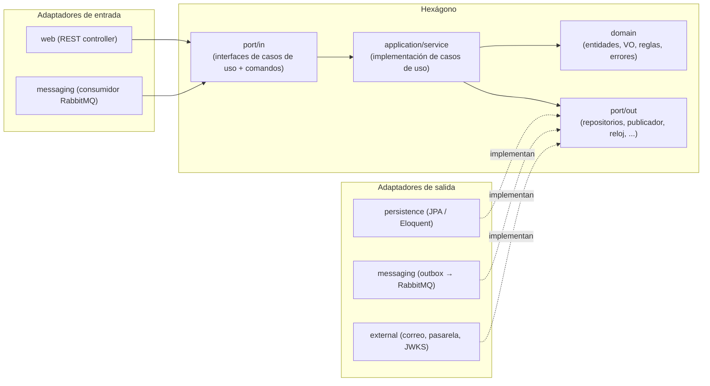
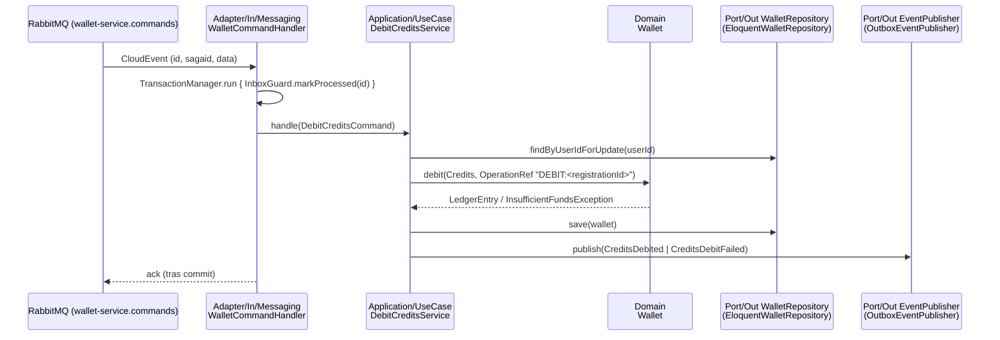

# Arquitectura Hexagonal (Puertos y Adaptadores)

Aplica a **`identity-service`** (Java 25 + Spring Boot 4) y **`wallet-service`**
(PHP 8.4 + Laravel 12). Ver `bandadau-docs/docs/03-arquitectura/catalogo-servicios.md` §1.
Este documento es normativo: las pruebas de arquitectura (ArchUnit / Deptrac) lo
verifican en CI.

## 1. Idea en una frase

El **dominio** y la **aplicación** (casos de uso) forman el hexágono; todo lo que
habla con el mundo (HTTP, RabbitMQ, base de datos, correo, pasarela) es un
**adaptador** que entra por un **puerto de entrada** (`port/in`) o sale por un
**puerto de salida** (`port/out`). El hexágono no conoce Spring, Laravel, JPA,
Eloquent, AMQP ni HTTP.



## 2. Reglas de dependencia (obligatorias)

| Capa | Puede depender de | Prohibido |
|---|---|---|
| `domain` | Solo el lenguaje (Java SE / PHP puro) y otras clases de `domain` | Spring, Jakarta, JPA, Laravel, Eloquent, Carbon\*, AMQP, HTTP, `application`, `adapter` |
| `application` (`port/in`, `port/out`, `service`) | `domain` | Frameworks (salvo anotación de transacción vía puerto, ver §5), `adapter` |
| `adapter/in/*` | `application.port.in`, DTOs propios, framework web/broker | `adapter/out/*`, `application.service` directo, `domain` para persistir |
| `adapter/out/*` | `application.port.out`, `domain`, framework de persistencia/broker | `adapter/in/*`, `application.service` |
| `config` / `Providers` | Todo (composition root) | Lógica de negocio |

\* En PHP el dominio usa `DateTimeImmutable` nativo; Carbon solo en adaptadores.

Reglas complementarias:

1. Un controlador **solo** llama a una interfaz de `port/in` (nunca a un repositorio).
2. Los casos de uso se nombran con **verbo + sustantivo**: `RegisterUserUseCase`,
   `DebitCreditsUseCase`. Una interfaz por caso de uso, un método `handle`/`execute`.
3. Entrada al caso de uso = **comando inmutable** (`DebitCreditsCommand`); salida =
   resultado del dominio o un DTO de aplicación, nunca una entidad JPA/Eloquent.
4. Las entidades de persistencia (`*JpaEntity`, `*Model` Eloquent) viven solo en
   `adapter/out/persistence` y se mapean a/desde el dominio con un `*Mapper`.
5. Errores de negocio = excepciones de dominio (`InsufficientFundsException`) con un
   **código estable** (`INSUFFICIENT_FUNDS`). El adaptador web las traduce a Problem
   Details (ver `api-rest-guidelines.md`); el adaptador de mensajería las traduce a
   evento de fallo.
6. El **outbox** es un puerto de salida (`EventPublisherPort`) cuya implementación
   escribe en la tabla `outbox` en la **misma transacción**; un relay aparte publica a
   RabbitMQ (ver `eventos-y-mensajeria.md`).
7. El **inbox** (mensajes procesados) es responsabilidad del adaptador de entrada de
   mensajería, envolviendo la llamada al caso de uso en la misma transacción.

## 3. identity-service (Spring Boot 4) — árbol exacto

Paquete raíz `com.bandadau.identity`.

```
bandadau-backend/services/identity-service/
├── build.gradle.kts  settings.gradle.kts  Dockerfile  .env.example
└── src/
    ├── main/java/com/bandadau/identity/
    │   ├── IdentityApplication.java
    │   ├── domain/
    │   │   ├── model/            User, UserId, Email, Role, UserStatus, University,
    │   │   │                     Credential, RefreshToken, TokenFamily, EmailVerification, HandoffCode
    │   │   ├── service/          PasswordPolicy, InstitutionalEmailPolicy (reglas puras)
    │   │   ├── event/            UserRegistered, UserRoleChanged, UserSuspended
    │   │   └── exception/        DomainException (+ code), EmailDomainNotAllowedException, ...
    │   ├── application/
    │   │   ├── port/in/          RegisterUserUseCase, VerifyEmailUseCase, LoginUseCase,
    │   │   │                     RefreshTokenUseCase, CreateHandoffCodeUseCase,
    │   │   │                     ExchangeHandoffCodeUseCase, IssueServiceTokenUseCase, ...
    │   │   │                     (+ comandos: RegisterUserCommand, ...)
    │   │   ├── port/out/         UserRepositoryPort, UniversityRepositoryPort,
    │   │   │                     RefreshTokenRepositoryPort, HandoffCodeRepositoryPort,
    │   │   │                     PasswordHasherPort, TokenIssuerPort, VerificationCodeSenderPort,
    │   │   │                     EventPublisherPort, ClockPort, IdGeneratorPort, IdempotencyStorePort
    │   │   └── service/          RegisterUserService, LoginService, ... (implementan port/in)
    │   ├── adapter/
    │   │   ├── in/web/           AuthController, UserController, UniversityController,
    │   │   │                     JwksController, InternalUserController, dto/, ProblemDetailsAdvice
    │   │   ├── in/messaging/     (vacío hoy; identity no consume eventos)
    │   │   ├── out/persistence/  *JpaEntity, *JpaRepository (Spring Data), *PersistenceAdapter, mapper/
    │   │   ├── out/messaging/    OutboxEventPublisherAdapter, OutboxRelay (@Scheduled)
    │   │   └── out/external/     BcryptPasswordHasherAdapter (o Argon2), JwtTokenIssuerAdapter (RS256 + JWKS),
    │   │                         SmtpVerificationCodeSenderAdapter, DynamoIdempotencyStoreAdapter
    │   └── config/               BeanConfig (wiring de servicios), SecurityConfig, OpenTelemetryConfig
    ├── main/resources/
    │   ├── application.yml
    │   └── db/migration/         V1__init.sql, ... (Flyway)
    └── test/java/com/bandadau/identity/
        ├── domain/               pruebas unitarias puras
        ├── application/          casos de uso con dobles de los puertos out
        ├── adapter/              @WebMvcTest / @DataJpaTest + Testcontainers
        └── architecture/         HexagonalArchitectureTest (ArchUnit)
```

Los servicios de aplicación **no** llevan `@Service`: se registran como `@Bean` en
`config/BeanConfig` para que `application` no dependa de Spring. `@Transactional`
se aplica en un decorador del adaptador o mediante `TransactionPort` (ver §5).

## 4. wallet-service (Laravel 12) — árbol exacto

Namespace raíz `Bandada\Wallet\` mapeado a `src/` (PSR-4 en `composer.json`).
Laravel queda como **framework externo**: `app/` solo contiene providers y la
consola; `routes/api.php` apunta a controladores del adaptador web.

```
bandadau-backend/services/wallet-service/
├── composer.json  artisan  Dockerfile  .env.example  deptrac.yaml  phpstan.neon
├── bootstrap/app.php            (registro de rutas, middleware, manejo de excepciones)
├── app/Providers/WalletServiceProvider.php   ← composition root: bind(Port::class, Adapter::class)
├── app/Console/Commands/        ConsumeWalletCommands.php (worker RabbitMQ), RelayOutbox.php
├── routes/api.php               /api/v1/wallet/** e /internal/v1/**
├── database/migrations/         wallets, ledger_entries, top_ups, outbox, processed_messages
├── src/
│   ├── Domain/
│   │   ├── Model/               Wallet, WalletId, LedgerEntry, LedgerEntryType, TopUp, TopUpStatus,
│   │   │                        Credits (VO entero ≥ 0), OperationRef
│   │   ├── Event/               CreditsDebited, CreditsDebitFailed, CreditsRefunded, TopUpPaid
│   │   └── Exception/           DomainException, InsufficientFundsException, WalletNotFoundException
│   ├── Application/
│   │   ├── Port/In/             DebitCreditsUseCase, RefundCreditsUseCase, CreateTopUpUseCase,
│   │   │                        ConfirmTopUpPaymentUseCase, GetMyWalletUseCase, ListLedgerEntriesUseCase
│   │   │                        (+ Command/Query DTOs: DebitCreditsCommand, ...)
│   │   ├── Port/Out/            WalletRepository, TopUpRepository, EventPublisher,
│   │   │                        TransactionManager, Clock, IdGenerator, PaymentGateway
│   │   └── UseCase/             DebitCreditsService, RefundCreditsService, ... (implementan Port/In)
│   └── Adapter/
│       ├── In/Http/             WalletController, TopUpController, PaymentWebhookController,
│       │                        InternalStatsController, Requests/, Resources/, ProblemDetailsRenderer
│       ├── In/Messaging/        WalletCommandHandler (despacha por routing key), InboxGuard
│       ├── Out/Persistence/     EloquentWalletRepository, Models/ (WalletModel, LedgerEntryModel...), Mappers/
│       ├── Out/Messaging/       OutboxEventPublisher, CloudEventFactory, AmqpPublisher
│       └── Out/External/        SimulatedPaymentGateway, DynamoIdempotencyStore
└── tests/
    ├── Unit/Domain/  Unit/Application/
    ├── Integration/             (Postgres + RabbitMQ reales con Testcontainers/Docker)
    └── Architecture/            (Deptrac se ejecuta como paso aparte)
```

## 5. Transacciones

La abre el caso de uso vía puerto (`TransactionManager::run(callable)` en PHP; `TransactionPort` o
decorador con `TransactionTemplate` creado en `config/` en Java). Dentro: agregado + `outbox` +
`processed_messages`. Nunca se publica directo a RabbitMQ dentro del caso de uso.

## 6. Ejemplo completo: `DebitCredits` (paso 2 de la SAGA, UC-12)

Comando entrante `bandada.wallet.cmd.debit-credits.v1` (sobre CloudEvents) con
`data = { sagaId, registrationId, userId, amountCredits, idempotencyKey }`.



### 6.1 Dominio (PHP puro)

```php
<?php
namespace Bandada\Wallet\Domain\Model;

use Bandada\Wallet\Domain\Exception\InsufficientFundsException;

final class Wallet
{
    /** @param list<LedgerEntry> $pendingEntries */
    private function __construct(
        private readonly WalletId $id,
        private readonly string $userId,
        private Credits $balance,
        private int $version,
        private array $pendingEntries = [],
    ) {}

    public function debit(Credits $amount, OperationRef $ref, \DateTimeImmutable $now): LedgerEntry
    {
        if ($this->balance->lessThan($amount)) {
            throw new InsufficientFundsException($this->userId, $amount, $this->balance);
        }
        $this->balance = $this->balance->minus($amount);
        $entry = LedgerEntry::debit($this->id, $amount, $ref, $now);
        $this->pendingEntries[] = $entry;
        return $entry;
    }
    // refund(), credit(), pullPendingEntries(), getters...
}
```

`Credits` es un VO entero ≥ 0 (lanza excepción si es negativo). El invariante
`balanceCredits ≥ 0` vive en el agregado; la unicidad de `operation_ref` la
garantiza además el índice único de la tabla (`bandadau-docs/docs/03-arquitectura/decisiones-clave.md` D3).

### 6.2 Puerto de entrada y caso de uso

```php
namespace Bandada\Wallet\Application\Port\In;

interface DebitCreditsUseCase
{
    public function handle(DebitCreditsCommand $command): DebitCreditsResult;
}

namespace Bandada\Wallet\Application\UseCase;

final class DebitCreditsService implements DebitCreditsUseCase
{
    public function __construct(
        private readonly WalletRepository $wallets,
        private readonly EventPublisher $events,
        private readonly Clock $clock,
    ) {}

    public function handle(DebitCreditsCommand $c): DebitCreditsResult
    {
        $ref = OperationRef::debit($c->registrationId);
        if ($this->wallets->hasOperation($ref)) {            // replay de negocio
            return DebitCreditsResult::alreadyApplied($ref);
        }
        $wallet = $this->wallets->findByUserIdForUpdate($c->userId);
        if ($wallet === null) {
            $this->events->publish(CreditsDebitFailed::walletNotFound($c));
            return DebitCreditsResult::failed('WALLET_NOT_FOUND');
        }
        try {
            $entry = $wallet->debit(Credits::of($c->amountCredits), $ref, $this->clock->now());
        } catch (InsufficientFundsException $e) {
            $this->events->publish(CreditsDebitFailed::insufficientFunds($c));
            return DebitCreditsResult::failed($e->code());
        }
        $this->wallets->save($wallet);
        $this->events->publish(CreditsDebited::from($c, $entry, $wallet));
        return DebitCreditsResult::debited($entry);
    }
}
```

### 6.3 Adaptador de entrada (mensajería)

```php
namespace Bandada\Wallet\Adapter\In\Messaging;

final class WalletCommandHandler
{
    public function __construct(
        private readonly TransactionManager $tx,
        private readonly InboxGuard $inbox,
        private readonly DebitCreditsUseCase $debitCredits,
        private readonly RefundCreditsUseCase $refundCredits,
    ) {}

    public function __invoke(CloudEvent $message): void
    {
        $this->tx->run(function () use ($message) {
            if (! $this->inbox->markProcessed($message->id)) {
                return; // duplicado: ya procesado
            }
            match ($message->type) {
                'bandada.wallet.cmd.debit-credits.v1'  => $this->debitCredits->handle(DebitCreditsCommand::fromCloudEvent($message)),
                'bandada.wallet.cmd.refund-credits.v1' => $this->refundCredits->handle(RefundCreditsCommand::fromCloudEvent($message)),
                default => throw new UnknownMessageTypeException($message->type),
            };
        });
    }
}
```

El worker `php artisan wallet:consume-commands` (en `app/Console/Commands`) solo
deserializa, invoca el handler y hace `ack`/`nack` (librería AMQP: verificar versión
de `php-amqplib` al implementar).

### 6.4 Adaptador de salida (persistencia)

`EloquentWalletRepository::findByUserIdForUpdate()` usa `lockForUpdate()` (o `version` optimista), mapea
`WalletModel` → `Wallet` con `WalletMapper`; `save()` persiste saldo, `version + 1` y `pendingEntries`.

### 6.5 El mismo patrón en Java (identity-service, `RegisterUser`)

```java
public final class RegisterUserService implements RegisterUserUseCase {   // application.service; sin @Service
    // final: UserRepositoryPort users, UniversityRepositoryPort universities,
    //        PasswordHasherPort hasher, EventPublisherPort events, ClockPort clock (inyectados en config/BeanConfig)
    @Override
    public RegisteredUser handle(RegisterUserCommand cmd) {
        var email = Email.of(cmd.email());
        var university = universities.findByEmailDomain(email.domain())
            .orElseThrow(() -> new EmailDomainNotAllowedException(email.domain()));
        if (users.existsByEmail(email)) throw new EmailAlreadyRegisteredException(email);
        var user = User.register(email, university.id(), hasher.hash(cmd.password()), cmd.locale(), clock.now());
        users.save(user);
        events.publish(new UserRegistered(user.id(), university.id(), user.locale(), clock.now())); // outbox
        return RegisteredUser.from(user);   // el código de verificación se envía tras el commit
    }
}
```

## 7. Pruebas de arquitectura

### 7.1 ArchUnit (identity-service)

```java
@AnalyzeClasses(packages = "com.bandadau.identity", importOptions = ImportOption.DoNotIncludeTests.class)
class HexagonalArchitectureTest {

    @ArchTest
    static final ArchRule layers = Architectures.onionArchitecture()
        .domainModels("..domain..")
        .applicationServices("..application..")
        .adapter("web", "..adapter.in.web..")
        .adapter("messaging-in", "..adapter.in.messaging..")
        .adapter("persistence", "..adapter.out.persistence..")
        .adapter("messaging-out", "..adapter.out.messaging..")
        .adapter("external", "..adapter.out.external..");

    @ArchTest
    static final ArchRule domainIsFrameworkFree = noClasses().that().resideInAPackage("..domain..")
        .should().dependOnClassesThat().resideInAnyPackage(
            "org.springframework..", "jakarta..", "org.hibernate..", "com.fasterxml..");

    @ArchTest
    static final ArchRule applicationIsFrameworkFree = noClasses().that().resideInAPackage("..application..")
        .should().dependOnClassesThat().resideInAnyPackage("org.springframework..", "jakarta.persistence..");

    @ArchTest
    static final ArchRule controllersOnlyUsePortsIn = classes().that().resideInAPackage("..adapter.in.web..")
        .should().onlyDependOnClassesThat().resideOutsideOfPackages("..adapter.out..", "..application.service..");
}
```

(`onionArchitecture()` de ArchUnit; verificar versión compatible con Java 25.)

### 7.2 Deptrac (wallet-service)

```yaml
# deptrac.yaml
deptrac:
  paths: [./src, ./app]
  layers:
    - { name: Domain,      collectors: [{ type: directory, value: src/Domain/.* }] }
    - { name: PortIn,      collectors: [{ type: directory, value: src/Application/Port/In/.* }] }
    - { name: PortOut,     collectors: [{ type: directory, value: src/Application/Port/Out/.* }] }
    - { name: UseCase,     collectors: [{ type: directory, value: src/Application/UseCase/.* }] }
    - { name: AdapterIn,   collectors: [{ type: directory, value: src/Adapter/In/.* }] }
    - { name: AdapterOut,  collectors: [{ type: directory, value: src/Adapter/Out/.* }] }
    - { name: Framework,   collectors: [{ type: classLike, value: ^Illuminate\\.* }, { type: classLike, value: ^PhpAmqpLib\\.* }] }
    - { name: Composition, collectors: [{ type: directory, value: app/.* }] }
  ruleset:
    Domain:      []
    PortIn:      [Domain]
    PortOut:     [Domain]
    UseCase:     [Domain, PortIn, PortOut]
    AdapterIn:   [PortIn, Domain, Framework]
    AdapterOut:  [PortOut, Domain, Framework]
    Composition: [Domain, PortIn, PortOut, UseCase, AdapterIn, AdapterOut, Framework]
```

`./vendor/bin/deptrac analyse --fail-on-uncovered` corre en CI (verificar sintaxis
exacta de la versión de Deptrac instalada).

Pruebas por capa (unitarias, Testcontainers, slices web): `testing-strategy.md`.

## 8. Anti-patrones (rechazar en revisión)

- ❌ Inyectar `WalletModel`/`UserJpaEntity` en un caso de uso o devolverlos al controlador.
- ❌ `@Service`, `@Autowired`, `@Transactional` o facades de Laravel (`DB::`, `Log::`,
  `Cache::`) dentro de `domain` o `application`.
- ❌ Controlador que llama directamente al repositorio "porque es solo un GET": se
  crea un caso de uso de consulta (`GetMyWalletUseCase`).
- ❌ Publicar a RabbitMQ desde el caso de uso o fuera de la transacción (rompe outbox).
- ❌ Lógica de negocio en el consumidor de mensajes (el adaptador solo traduce).
- ❌ Saldos como `float`/`decimal` o calculados en el cliente.
- ❌ Un puerto "genérico" (`RepositoryPort<T>`) que filtra detalles de la base al dominio.
- ❌ Excepciones de framework (`QueryException`, `DataIntegrityViolationException`) que cruzan
  hacia `application` (el adaptador las traduce); ❌ puertos con nombre de tecnología (`PostgresWalletPort`).
