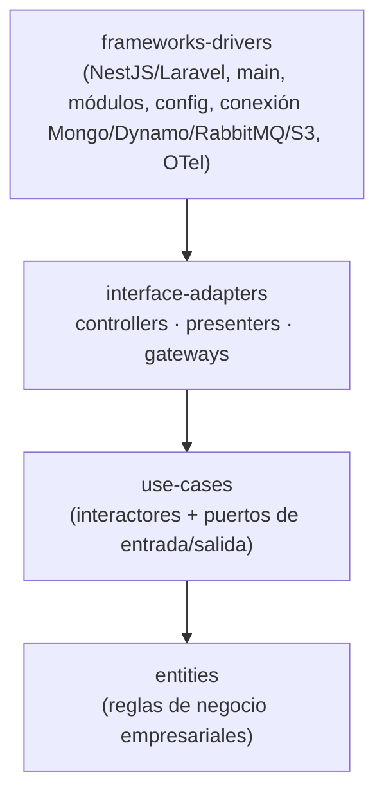
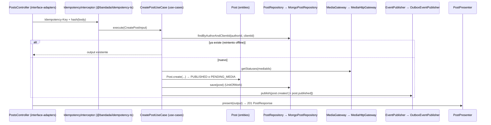

# Clean Architecture

Aplica a **`social-service`**, **`media-service`**, **`ticketing-service`**,
**`insights-service`** (TypeScript + NestJS 11) y **`notification-service`**
(PHP 8.4 + Laravel 12). Ver `bandadau-docs/docs/03-arquitectura/catalogo-servicios.md` §1.
`admin-gateway` **no** usa Clean (es un BFF en capas: resolvers → data sources).

## 1. Las cuatro capas



**Regla de dependencia:** las dependencias de código fuente apuntan **solo hacia
adentro**. Nada en un círculo interno conoce el nombre de algo de un círculo externo
(clases, funciones, decoradores, tipos de Mongoose/DynamoDB, `Request`, `Response`).

| Capa | Contiene | Puede importar | Prohibido importar |
|---|---|---|---|
| `entities` | Entidades, value objects, enums de dominio, errores de dominio, políticas puras (p. ej. `FeedRankingPolicy`) | Solo `entities` | `@nestjs/*`, `mongoose`, `@aws-sdk/*`, `amqplib`, `onnxruntime-node`, ningún `@bandada/*` (tampoco `@bandada/contracts-ts`) |
| `use-cases` | Interactores (`CreatePostUseCase`), DTOs de entrada/salida (`CreatePostInput`, `CreatePostOutput`), **puertos** (`ports/*.ts`: `PostRepository`, `MediaGateway`, `EventPublisher`, `Clock`, `IdGenerator`, `LlmPort`, `TtsPort`) | `entities`, `use-cases` | Todo lo de arriba |
| `interface-adapters` | `controllers/` (HTTP, consumidores de mensajes, herramientas MCP, resolvers), `presenters/` (output → JSON del contrato / Problem Details), `gateways/` (implementaciones de puertos: repositorios Mongo/Dynamo, publicador outbox, clientes HTTP internos, inferencia ONNX, S3) | `use-cases`, `entities`, `@nestjs/common` (decoradores), librerías de driver (`mongoose`, `@aws-sdk/*`, `onnxruntime-node`), `@bandada/*` | `frameworks-drivers` |
| `frameworks-drivers` | `main.ts`, módulos Nest (composition root), `config/` (validación de env), conexiones, bootstrap OTel, workers | Todo | — (no contiene lógica de negocio) |

Reglas complementarias:

1. **Un caso de uso = una clase** con un único método público `execute(input)`.
   Los interactores **no** llevan `@Injectable()`; se registran con `useFactory` en el
   módulo de `frameworks-drivers` (así `use-cases` no importa Nest).
2. Los puertos se nombran por la necesidad, no por la tecnología (`PostRepository`,
   no `MongoPostRepository`). Las implementaciones sí: `MongoPostRepository`.
3. Los tokens de inyección de los puertos son `Symbol`s exportados junto al puerto
   (`export const POST_REPOSITORY = Symbol('PostRepository')`).
4. El **presenter** convierte la salida del caso de uso al shape exacto del contrato
   (tipos de `@bandada/contracts-ts`). La entidad nunca se serializa directo.
5. Errores de dominio → `DomainError` con `code` estable. Un `ProblemDetailsFilter`
   global (interface-adapters) los traduce a RFC 9457 con `title`/`detail` localizados
   según `Accept-Language` (D14, `es` por defecto).
6. **Outbox/inbox**: el gateway `OutboxEventPublisher` escribe en la colección
   `outbox` dentro de la misma sesión/transacción (Mongo replica set) o con
   `TransactWriteItems` (DynamoDB). El consumidor usa `processedMessages` vía
   `@bandada/messaging-ts`.
7. Transacciones: puerto `UnitOfWork.run(fn)` implementado en gateways
   (`MongoUnitOfWork` con `session.withTransaction`).
8. Organización **por capa y luego por feature**: `use-cases/posts/create-post.use-case.ts`.

## 2. Árbol exacto (NestJS, ejemplo `social-service`)

```
bandadau-backend/services/social-service/
├── package.json  tsconfig.json  nest-cli.json  .dependency-cruiser.cjs  Dockerfile  .env.example
├── src/
│   ├── entities/
│   │   ├── post.entity.ts  comment.entity.ts  reaction.entity.ts  profile.entity.ts
│   │   ├── group.entity.ts  group-membership.entity.ts  follow.entity.ts  content-report.entity.ts
│   │   ├── value-objects/  post-text.ts  hashtag.ts  client-id.ts
│   │   ├── policies/       feed-ranking.policy.ts  follow-suggestion.policy.ts
│   │   └── errors/         domain-error.ts  post-errors.ts
│   ├── use-cases/
│   │   ├── ports/          post.repository.ts  profile.repository.ts  media.gateway.ts
│   │   │                   event-publisher.ts  unit-of-work.ts  clock.ts  id-generator.ts
│   │   │                   feed-model.gateway.ts (coeficientes del ranker)
│   │   ├── posts/          create-post.use-case.ts  delete-post.use-case.ts  get-post.use-case.ts
│   │   ├── feed/           get-feed.use-case.ts
│   │   ├── comments/  reactions/  follows/  groups/  reports/  profiles/
│   │   └── media-events/   on-media-approved.use-case.ts  on-media-rejected.use-case.ts
│   ├── interface-adapters/
│   │   ├── controllers/
│   │   │   ├── http/       posts.controller.ts  feed.controller.ts  ...  internal-posts.controller.ts
│   │   │   │               dto/ (validación de entrada, class-validator o zod)
│   │   │   └── messaging/  media-events.consumer.ts  identity-events.consumer.ts
│   │   ├── presenters/     post.presenter.ts  feed.presenter.ts  problem-details.filter.ts
│   │   └── gateways/
│   │       ├── mongo/      schemas/ (Mongoose)  mongo-post.repository.ts  mongo-unit-of-work.ts
│   │       ├── messaging/  outbox-event-publisher.ts
│   │       ├── http/       media-http.gateway.ts (REST /internal de media, con timeout + circuit breaker)
│   │       └── bandadau-ml/         json-feed-model.gateway.ts
│   └── frameworks-drivers/
│       ├── main.ts  app.module.ts
│       ├── modules/        posts.module.ts  feed.module.ts ... (wiring con useFactory)
│       ├── config/         env.schema.ts (fail fast)
│       ├── database/       mongo.connection.ts  indexes.ts (índices idempotentes al arrancar)
│       ├── messaging/      rabbitmq.connection.ts  outbox-relay.worker.ts
│       └── observability/  otel.ts
└── test/
    ├── unit/               entities + use-cases (dobles en memoria de los puertos)
    ├── integration/        gateways con Testcontainers (Mongo rs, RabbitMQ)
    ├── e2e/                HTTP con supertest contra el módulo completo
    └── architecture/       (dependency-cruiser corre como script)
```

Variantes por servicio (misma estructura de capas):

| Servicio | Gateways específicos | Controllers específicos |
|---|---|---|
| `media-service` | `s3-storage.gateway.ts` (URLs prefirmadas), `onnx-image-classifier.gateway.ts`, `onnx-clip-tagger.gateway.ts`, `ocr.gateway.ts`, `ffmpeg-frame-extractor.gateway.ts`, `mongo-media.repository.ts` | `media.controller.ts`, `internal-media.controller.ts`, `post-events.consumer.ts`, `media-pipeline.worker` |
| `ticketing-service` | `dynamo-ticket.repository.ts` (GSI1/GSI2, condiciones), `hmac-qr-signer.gateway.ts`, `dynamo-outbox.publisher.ts` | `tickets.controller.ts`, `ticketing-commands.consumer.ts` |
| `insights-service` | `claude-llm.gateway.ts` / `ollama-llm.gateway.ts` (`LlmPort`), `polly-tts.gateway.ts` / `piper-tts.gateway.ts` (`TtsPort`), `onnx-anomaly-detector.gateway.ts`, `mcp-client.gateway.ts`, `internal-api/*.gateway.ts`, `dynamo-*.repository.ts` | `reports.controller.ts`, `alerts.controller.ts`, `mcp/` (servidor MCP: cada herramienta es un controller que llama a un caso de uso), `analytics.consumer.ts`, `monitoring.scheduler.ts` |

## 3. Árbol exacto (Laravel, `notification-service`)

Namespace `Bandada\Notification\` → `src/`. Laravel es el anillo
*frameworks & drivers*.

```
bandadau-backend/services/notification-service/
├── app/Providers/NotificationServiceProvider.php    ← composition root (bind de puertos)
├── app/Console/Commands/ConsumeNotificationEvents.php  RelayOutbox.php (si aplica)
├── bootstrap/app.php   routes/api.php   config/   resources/templates/{es,en}/
├── src/
│   ├── Entities/          Notification, NotificationType, DeviceToken, NotificationPreference, Channel
│   ├── UseCases/
│   │   ├── Ports/         NotificationRepository, DeviceRepository, PushSender, EmailSender,
│   │   │                  TemplateRenderer, UserLocaleDirectory, Clock, IdGenerator
│   │   ├── Notify/        NotifyRegistrationConfirmed, NotifyNewComment, ... (uno por evento)
│   │   └── Inbox/         ListNotifications, MarkAsRead, MarkAllAsRead, RegisterDevice, UpdatePreferences
│   └── InterfaceAdapters/
│       ├── Controllers/Http/       NotificationController, DeviceController, PreferencesController
│       ├── Controllers/Messaging/  DomainEventDispatcher (routing key → caso de uso)
│       ├── Presenters/             NotificationResource, ProblemDetailsRenderer
│       └── Gateways/               DynamoNotificationRepository, ExpoPushSender, SmtpEmailSender,
│                                   BladeTemplateRenderer, DynamoUserLocaleDirectory
└── tests/  deptrac.yaml
```

## 4. Ejemplo completo: `CreatePost` (UC-05, `social-service`)

`POST /api/v1/posts` ♻️ con `{ clientId, text, visibility, groupId?, mediaIds[] }`.



### 4.1 Entidad

```ts
// src/entities/post.entity.ts  — sin imports externos
export class Post {
  private constructor(private readonly props: PostProps) {}

  static create(input: NewPost, mediaApproved: boolean, now: Date): Post {
    const text = PostText.of(input.text);           // longitud, no vacío si no hay medios
    const status: PostStatus =
      input.mediaIds.length === 0 || mediaApproved ? 'PUBLISHED' : 'PENDING_MEDIA';
    return new Post({ ...input, text, hashtags: text.hashtags(), status, createdAt: now });
  }

  markMediaApproved(allApproved: boolean): void {
    if (this.props.status === 'PENDING_MEDIA' && allApproved) this.props.status = 'PUBLISHED';
  }
  get status(): PostStatus { return this.props.status; }
  // ...
}
```

### 4.2 Puerto y caso de uso

```ts
// src/use-cases/ports/post.repository.ts
export const POST_REPOSITORY = Symbol('PostRepository');
export interface PostRepository {
  findByAuthorAndClientId(authorId: string, clientId: string): Promise<Post | null>;
  save(post: Post): Promise<void>;
}

// src/use-cases/posts/create-post.use-case.ts
export class CreatePostUseCase {
  constructor(
    private readonly posts: PostRepository,
    private readonly media: MediaGateway,
    private readonly events: EventPublisher,
    private readonly uow: UnitOfWork,
    private readonly ids: IdGenerator,
    private readonly clock: Clock,
  ) {}

  async execute(input: CreatePostInput): Promise<CreatePostOutput> {
    const existing = await this.posts.findByAuthorAndClientId(input.authorId, input.clientId);
    if (existing) return CreatePostOutput.from(existing, { replayed: true });

    const statuses = await this.media.getStatuses(input.mediaIds, input.authorId);
    if (statuses.some((s) => s.ownerId !== input.authorId)) throw new MediaNotOwnedError();
    if (statuses.some((s) => s.status === 'REJECTED')) throw new MediaRejectedError();

    const post = Post.create(
      { id: this.ids.next(), ...input },
      statuses.every((s) => s.status === 'APPROVED'),
      this.clock.now(),
    );
    await this.uow.run(async () => {
      await this.posts.save(post);
      await this.events.publish(PostEvents.created(post));
      if (post.status === 'PUBLISHED') await this.events.publish(PostEvents.published(post));
    });
    return CreatePostOutput.from(post);
  }
}
```

### 4.3 Controller, presenter y wiring

```ts
// src/interface-adapters/controllers/http/posts.controller.ts
@Controller('api/v1/posts')
@UseGuards(JwtAuthGuard)                      // de @bandada/auth-ts
export class PostsController {
  constructor(@Inject(CreatePostUseCase) private readonly createPost: CreatePostUseCase) {}

  @Post()
  @HttpCode(201)
  @UseInterceptors(IdempotencyInterceptor)    // de @bandada/idempotency-ts
  async create(@CurrentUser() user: AuthUser, @Body() body: CreatePostDto) {
    const output = await this.createPost.execute({ authorId: user.id, ...body });
    return PostPresenter.toResponse(output);  // tipo components['schemas']['Post']
  }
}

// src/frameworks-drivers/modules/posts.module.ts
@Module({
  controllers: [PostsController],
  providers: [
    { provide: POST_REPOSITORY, useClass: MongoPostRepository },
    { provide: MEDIA_GATEWAY, useClass: MediaHttpGateway },
    {
      provide: CreatePostUseCase,
      useFactory: (r, m, e, u, i, c) => new CreatePostUseCase(r, m, e, u, i, c),
      inject: [POST_REPOSITORY, MEDIA_GATEWAY, EVENT_PUBLISHER, UNIT_OF_WORK, ID_GENERATOR, CLOCK],
    },
  ],
})
export class PostsModule {}
```

### 4.4 Gateway

`MongoPostRepository` (interface-adapters/gateways/mongo) mapea `Post` ⇄ documento
Mongoose (`PostDocument`), usa la sesión activa del `MongoUnitOfWork` y depende del
índice único `{ authorId: 1, clientId: 1 }`. Si Mongo devuelve `E11000` por carrera, lo
traduce a `DuplicateClientIdError`, que el caso de uso resuelve devolviendo el post
existente (idempotencia D3 punto 3).

## 5. dependency-cruiser

```js
// .dependency-cruiser.cjs (extracto)
module.exports = {
  forbidden: [
    { name: 'entities-are-pure', severity: 'error',
      from: { path: '^src/entities' },
      to: { pathNot: '^src/entities' } },
    { name: 'use-cases-inward-only', severity: 'error',
      from: { path: '^src/use-cases' },
      to: { pathNot: '^src/(entities|use-cases)' } },
    { name: 'adapters-not-to-frameworks', severity: 'error',
      from: { path: '^src/interface-adapters' },
      to: { path: '^src/frameworks-drivers' } },
    { name: 'no-nest-in-core', severity: 'error',
      from: { path: '^src/(entities|use-cases)' },
      to: { path: '^node_modules/(@nestjs|mongoose|@aws-sdk|amqplib|onnxruntime-node|@bandada)' } },
    { name: 'no-circular', severity: 'error', from: {}, to: { circular: true } },
  ],
  options: { tsConfig: { fileName: 'tsconfig.json' }, doNotFollow: { path: 'node_modules' } },
};
```

Script: `pnpm depcruise src --config .dependency-cruiser.cjs` (verificar flags de la
versión instalada). En `notification-service` se usa **Deptrac** con capas
`Entities → UseCases → InterfaceAdapters → Framework(app/, Illuminate\*)` y las mismas
reglas.

## 6. Pruebas por capa

| Capa | Tipo | Cómo |
|---|---|---|
| entities | Unitaria | Jest/Vitest (TS), Pest (PHP); sin mocks |
| use-cases | Unitaria | Dobles **en memoria** de los puertos (`InMemoryPostRepository`), no mocks de Mongoose |
| gateways | Integración | Testcontainers (Mongo `rs0`, DynamoDB Local, RabbitMQ, MinIO) |
| controllers | E2E de servicio | `supertest` / Laravel HTTP tests: status, Problem Details, `Idempotency-Key` |
| contrato | Contrato | Schemathesis contra el servicio levantado (ver `testing-strategy.md`) |
| arquitectura | Estática | dependency-cruiser / Deptrac |

## 7. Anti-patrones (rechazar en revisión)

- ❌ `@Injectable()`, `@InjectModel()` o `Logger` de Nest dentro de `use-cases`/`entities`.
- ❌ Devolver un `PostDocument` de Mongoose o un `Item` de DynamoDB desde un controller.
- ❌ "Servicios" de Nest gigantes (`PostsService`) que mezclan validación, persistencia
  y publicación: se divide en casos de uso.
- ❌ Lógica de negocio en el controller o en el consumidor RabbitMQ.
- ❌ Caso de uso que llama a otro caso de uso a través de HTTP propio.
- ❌ Importar tipos de `@bandada/contracts-ts` en `entities` (el contrato es un
  detalle de borde; el presenter lo traduce).
- ❌ Leer `process.env` fuera de `frameworks-drivers/config`.
- ❌ Textos de error en español escritos en el código del dominio: el dominio emite
  `code`; el presenter localiza (D14).
- ❌ Publicar a RabbitMQ directo sin outbox.
