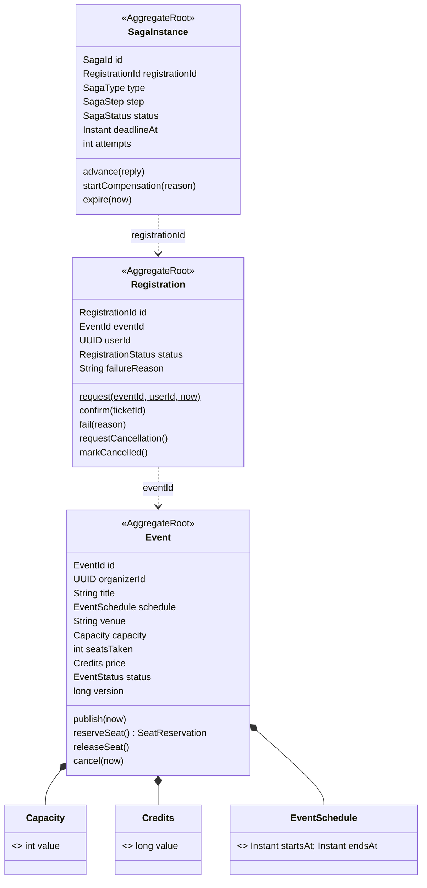
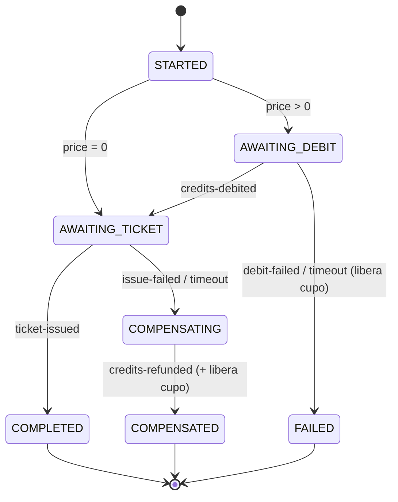

# Domain-Driven Design — `events-service`

`events-service` (Java 25 + Spring Boot 4, PostgreSQL `events_db`, puerto 7004) se
implementa con **DDD táctico** y es el **orquestador de la SAGA** de inscripción
(`bandadau-docs/docs/03-arquitectura/decisiones-clave.md` D2). Este documento fija el diseño
estratégico del contexto, los bloques tácticos y las reglas que verifica ArchUnit.

## 1. Diseño estratégico

### 1.1 Bounded context "Eventos"

| Aspecto | Definición |
|---|---|
| Propósito | Publicar eventos/talleres universitarios y gestionar inscripciones con cupo y precio en créditos |
| Dueño de | `Event`, `Registration`, `SagaInstance` (tablas `events`, `registrations`, `saga_instances`, `outbox`, `processed_messages`) |
| Upstream | **Identidad** (Published Language: JWT con `sub`, `roles`, `universityId`) |
| Downstream (Customer/Supplier) | **Billetera** y **Entradas**: Eventos define los comandos que necesita (`debit-credits`, `refund-credits`, `issue-ticket`, `void-ticket`); ellos los implementan |
| Consumidores conformistas | Notificaciones, Insights, n8n (eventos `bandada.events.*`) |
| Integración | REST público `/api/v1/events`, `/api/v1/registrations`; REST `/internal/v1/sagas`, `/internal/v1/stats/registrations`; RabbitMQ |

Referencias a otros contextos **solo por ID** (`organizerId`, `userId` son `UUID` de
identidad, no entidades). El servicio no guarda saldos ni tickets: guarda **el
estado del proceso** (SAGA) y la respuesta recibida.

### 1.2 Lenguaje ubicuo (usarlo en código, UC y UI)

| Término (es) | Identificador | Significado |
|---|---|---|
| Evento | `Event` | Actividad con fecha, lugar, cupo y precio |
| Cupo | `Capacity` | Número máximo de inscripciones confirmadas o en curso |
| Lugares ocupados | `seatsTaken` | Inscripciones `PENDING` + `CONFIRMED` |
| Precio en créditos | `Credits` / `priceCredits` | Entero ≥ 0; 0 = gratuito (se salta el débito) |
| Horario | `EventSchedule` | `startsAt` < `endsAt`, en UTC |
| Publicar | `publish()` | `DRAFT → PUBLISHED`; desde ahí admite inscripciones |
| Inscripción | `Registration` | Solicitud de un estudiante a un evento |
| Reservar lugar | `reserveSeat()` | `seatsTaken++` respetando el cupo |
| Liberar lugar | `releaseSeat()` | Compensación: `seatsTaken--` |
| Confirmar / Fallar | `confirm()` / `fail(reason)` | Estados finales de la inscripción |
| Proceso de inscripción | `SagaInstance` (`type=REGISTRATION`) | Estado del proceso distribuido |
| Proceso de cancelación | `SagaInstance` (`type=CANCELLATION`) | SAGA inversa (UC-13) |
| Compensar | `compensate()` | Deshacer pasos ya hechos en orden inverso |

## 2. Diseño táctico: agregados



**Por qué tres agregados y no uno:** `Event` es un punto caliente de concurrencia
(muchos estudiantes a la vez); meter las inscripciones dentro lo haría enorme y
bloquearía todo. Cada agregado es una frontera de consistencia transaccional; entre
ellos la consistencia es **eventual**, salvo en el paso 1 de la SAGA, donde por
diseño se modifican `Event` + `Registration` + `SagaInstance` en **una sola
transacción local** (los tres viven en la misma base y el caso de uso lo justifica:
reservar el cupo debe ser atómico con crear la inscripción; está documentado como
excepción explícita a "un agregado por transacción").

### 2.1 Invariantes

| # | Invariante | Dónde se protege |
|---|---|---|
| I1 | `0 ≤ seatsTaken ≤ capacity` | `Event.reserveSeat()` + bloqueo optimista (`@Version`) + `CHECK` en la tabla |
| I2 | Solo se reserva lugar si `status = PUBLISHED` y `now < startsAt` | `Event.reserveSeat(now)` |
| I3 | Una sola inscripción `PENDING`/`CONFIRMED` por (`eventId`, `userId`) | Repositorio + índice parcial único (D3) |
| I4 | Transiciones válidas de `RegistrationStatus`: `PENDING → CONFIRMED | FAILED`; `CONFIRMED → CANCELLATION_PENDING → CANCELLED` | Métodos de `Registration` (lanzan `IllegalRegistrationTransition`) |
| I5 | `capacity` ≥ 1, no se reduce por debajo de `seatsTaken` | `Capacity.of()` y `Event.changeCapacity()` |
| I6 | `priceCredits` entero ≥ 0 | `Credits.of()` |
| I7 | `startsAt < endsAt`; `startsAt` futuro al publicar | `EventSchedule.of()` y `Event.publish()` |
| I8 | Una SAGA terminada (`COMPLETED`, `COMPENSATED`, `FAILED`) ignora respuestas tardías | `SagaInstance.advance()` |

### 2.2 Value objects

```java
package com.bandadau.events.domain.event;

public record Capacity(int value) {
    public Capacity {
        if (value < 1 || value > 10_000) throw new InvalidCapacityException(value);
    }
    public boolean allows(int seatsTaken) { return seatsTaken < value; }
}

public record Credits(long value) {
    public static final Credits ZERO = new Credits(0);
    public Credits { if (value < 0) throw new NegativeCreditsException(value); }
    public boolean isFree() { return value == 0; }
}

public record EventSchedule(Instant startsAt, Instant endsAt) {
    public EventSchedule {
        Objects.requireNonNull(startsAt); Objects.requireNonNull(endsAt);
        if (!startsAt.isBefore(endsAt)) throw new InvalidScheduleException();
    }
    public boolean hasStarted(Instant now) { return !now.isBefore(startsAt); }
}
```

Los VO son `record` inmutables, se validan al construirse y no tienen identidad.

### 2.3 Domain events

Los agregados **registran** eventos de dominio (lista interna `domainEvents()`); el
servicio de aplicación los extrae tras guardar y los convierte en mensajes de
integración (CloudEvents) dentro del **outbox**.

| Evento de dominio (interno) | Evento de integración publicado |
|---|---|
| `EventPublished` | `bandada.events.event.published.v1` |
| `EventCancelled` | `bandada.events.event.cancelled.v1` |
| `RegistrationRequested` | (interno: arranca la SAGA, no se publica) |
| `RegistrationConfirmed` | `bandada.events.registration.confirmed.v1` |
| `RegistrationFailed` | `bandada.events.registration.failed.v1` |
| `RegistrationCancelled` | `bandada.events.registration.cancelled.v1` |

### 2.4 Repositorios

Interfaces en `domain`, una por agregado, con lenguaje del dominio:
`EventRepository.findById / save`, `RegistrationRepository.findActive(eventId, userId) /
save`, `SagaInstanceRepository.findByRegistrationId / findExpired(now, limit) / save`.
Implementación en `infrastructure/persistence` con Spring Data JPA y mappers
(las entidades JPA **no** son los agregados).

### 2.5 Servicios de dominio

Solo cuando la regla no pertenece a un único agregado:
`RegistrationPolicy.ensureCanRegister(Event, Optional<Registration> existing, Instant now)`
(combina I2 e I3 y produce el error `ALREADY_REGISTERED` o `EVENT_FULL`).

### 2.6 Servicios de aplicación

Orquestan un caso de uso: cargan agregados, invocan el dominio, guardan, pasan
eventos al outbox. Son `@Transactional` (la capa `application` sí puede usar
Spring para transacciones; el `domain` no).
`RegisterToEventService`, `CancelRegistrationService`, `CreateEventService`,
`PublishEventService`, `GetRegistrationQuery`.

### 2.7 La SAGA como proceso (process manager)

`RegistrationSagaOrchestrator` (capa `application/saga`) es un *process manager*:
recibe respuestas (`credits-debited`, `ticket-issued`, fallos), carga el
`SagaInstance`, decide el siguiente comando según la tabla de D2 y lo escribe en el
outbox. El **estado** vive en el agregado `SagaInstance` (máquina de estados pura,
testeable sin infraestructura); el orquestador solo coordina.



`SagaTimeoutScheduler` (`@Scheduled` cada 5 s) llama a `SagaInstance.expire(now)` en
las instancias vencidas (`deadlineAt`), con reintentos (3, backoff) antes de compensar.

## 3. Árbol exacto

```
bandadau-backend/services/events-service/src/main/java/com/bandadau/events/
├── EventsApplication.java
├── domain/                       ← sin Spring/JPA/Jackson
│   ├── shared/                   AggregateRoot, DomainEvent, DomainException(code), Clock
│   ├── event/                    Event, EventId, EventStatus, Capacity, Credits, EventSchedule,
│   │                             EventRepository, EventPublished, EventCancelled, *Exception
│   ├── registration/             Registration, RegistrationId, RegistrationStatus, RegistrationRepository,
│   │                             RegistrationPolicy, RegistrationRequested/Confirmed/Failed/Cancelled
│   └── saga/                     SagaInstance, SagaId, SagaType, SagaStep, SagaStatus, SagaReply,
│                                 SagaCommand (qué comando emitir), SagaInstanceRepository
├── application/
│   ├── event/                    CreateEventService, PublishEventService, ListEventsQuery
│   ├── registration/             RegisterToEventService, CancelRegistrationService, GetRegistrationQuery
│   ├── saga/                     RegistrationSagaOrchestrator, SagaTimeoutScheduler
│   └── port/                     IntegrationEventOutbox, IdempotencyStore (interfaces técnicas)
├── infrastructure/
│   ├── persistence/              *JpaEntity, *JpaRepository, Jpa*Repository (implementa domain repos), mappers
│   ├── messaging/                JpaOutbox, OutboxRelay, RabbitSagaReplyListener, InboxRepository,
│   │                             CloudEventMapper, ChaosFlags
│   ├── idempotency/              DynamoIdempotencyStore
│   └── config/                   RabbitConfig, OpenTelemetryConfig, SecurityConfig (JWT por JWKS)
└── interfaces/
    ├── rest/                     EventController, RegistrationController, dto/, ProblemDetailsAdvice
    └── internal/                 InternalSagaController, InternalStatsController
src/main/resources/db/migration/  V1__events.sql, V2__registrations.sql, V3__saga.sql, V4__outbox_inbox.sql
src/test/java/com/bandadau/events/{domain,application,infrastructure,interfaces,architecture,saga}/
```

## 4. Ejemplo: registrar inscripción (UC-12, paso 1 de la SAGA)

`POST /api/v1/events/{eventId}/registrations` ♻️ → **202** `{ registrationId, status: PENDING }`.

```java
package com.bandadau.events.application.registration;

@Transactional
public class RegisterToEventService {
    // EventRepository events; RegistrationRepository registrations;
    // SagaInstanceRepository sagas; IntegrationEventOutbox outbox; Clock clock; RegistrationPolicy policy

    public RegistrationAccepted handle(RegisterToEventCommand cmd) {
        var now = clock.now();
        var event = events.findById(cmd.eventId()).orElseThrow(() -> new EventNotFoundException(cmd.eventId()));
        policy.ensureCanRegister(event, registrations.findActive(event.id(), cmd.userId()), now);

        event.reserveSeat(now);                                      // I1, I2 (puede lanzar EventFullException)
        var registration = Registration.request(event.id(), cmd.userId(), now);
        var saga = SagaInstance.startRegistration(registration.id(), event.price(), now);

        events.save(event);                                          // @Version → OptimisticLock si hay carrera
        registrations.save(registration);                            // índice parcial único (I3)
        sagas.save(saga);
        outbox.append(saga.nextCommand(registration, cmd.userId())); // debit-credits o issue-ticket
        return new RegistrationAccepted(registration.id(), registration.status());
    }
}
```

```java
package com.bandadau.events.domain.event;

public final class Event extends AggregateRoot<EventId> {
    public SeatReservation reserveSeat(Instant now) {
        if (status != EventStatus.PUBLISHED || schedule.hasStarted(now)) throw new EventNotOpenException(id);
        if (!capacity.allows(seatsTaken)) throw new EventFullException(id);   // code EVENT_FULL
        seatsTaken++;
        return new SeatReservation(id, seatsTaken);
    }
    public void releaseSeat() {
        if (seatsTaken == 0) throw new IllegalStateException("seatsTaken already 0");
        seatsTaken--;
    }
}
```

El controlador (`interfaces/rest`) aplica el filtro de `Idempotency-Key`, llama al
servicio y responde 202 con `Location: /api/v1/registrations/{id}`. Ante
`OptimisticLockingFailureException` reintenta el comando hasta 3 veces; si persiste,
`409 CONCURRENT_MODIFICATION`. `EventFullException` → `409 EVENT_FULL`;
`AlreadyRegisteredException` → `409 ALREADY_REGISTERED`.

Respuesta de la SAGA (paso 2):

```java
public void on(SagaReply reply) {                   // llamado por RabbitSagaReplyListener (con inbox)
    var saga = sagas.findById(reply.sagaId()).orElseThrow();
    var registration = registrations.findById(saga.registrationId()).orElseThrow();
    var decision = saga.advance(reply, clock.now()); // máquina de estados pura
    switch (decision) {
        case EmitCommand c      -> outbox.append(c.toMessage(registration));
        case Complete c         -> { registration.confirm(c.ticketId()); }
        case FailAndRelease f   -> { registration.fail(f.reason()); events.findById(registration.eventId()).orElseThrow().releaseSeat(); }
        case Ignore i           -> { /* respuesta tardía o duplicada (I8) */ }
    }
    // save de los agregados modificados + eventos de dominio → outbox
}
```

## 5. Pruebas de arquitectura (ArchUnit)

```java
@AnalyzeClasses(packages = "com.bandadau.events", importOptions = ImportOption.DoNotIncludeTests.class)
class DddArchitectureTest {
    @ArchTest static final ArchRule layers = layeredArchitecture().consideringOnlyDependenciesInLayers()
        .layer("Domain").definedBy("..domain..")
        .layer("Application").definedBy("..application..")
        .layer("Infrastructure").definedBy("..infrastructure..")
        .layer("Interfaces").definedBy("..interfaces..")
        .whereLayer("Interfaces").mayNotBeAccessedByAnyLayer()
        .whereLayer("Infrastructure").mayNotBeAccessedByAnyLayer()
        .whereLayer("Application").mayOnlyBeAccessedByLayers("Interfaces", "Infrastructure")
        .whereLayer("Domain").mayOnlyBeAccessedByLayers("Application", "Interfaces", "Infrastructure");

    @ArchTest static final ArchRule pureDomain = noClasses().that().resideInAPackage("..domain..")
        .should().dependOnClassesThat().resideInAnyPackage("org.springframework..", "jakarta..", "com.fasterxml..");

    @ArchTest static final ArchRule aggregatesReferenceOthersById = noClasses()
        .that().resideInAPackage("..domain.registration..")
        .should().dependOnClassesThat().haveSimpleName("Event");   // solo EventId

    @ArchTest static final ArchRule repositoriesAreInterfacesInDomain = classes()
        .that().haveSimpleNameEndingWith("Repository").and().resideInAPackage("..domain..")
        .should().beInterfaces();
}
```

Las fábricas reciben IDs, no agregados: `Registration.request(EventId, userId, now)`.

## 6. Pruebas específicas DDD/SAGA

- **Agregados**: tabla de transiciones de `Registration` y `SagaInstance`
  (parametrizadas); `Event.reserveSeat` en el borde del cupo.
- **Concurrencia**: N hilos inscribiéndose a un evento de cupo C sobre Postgres
  Testcontainers → exactamente C `PENDING/CONFIRMED`, el resto `EVENT_FULL`.
- **SAGA**: ver `testing-strategy.md` §6 (fallos inyectados, duplicados, timeouts).

## 7. Anti-patrones

- ❌ Modelo anémico: `registration.setStatus(CONFIRMED)` desde el servicio de aplicación.
- ❌ Entidades JPA como agregados (anotaciones `@Entity` en `domain`).
- ❌ Un agregado que contiene la colección completa de inscripciones de un evento.
- ❌ Referencias por objeto entre agregados o hacia otros contextos (`User`, `Wallet`).
- ❌ Lógica de la SAGA en el listener de RabbitMQ en vez de en `SagaInstance` + orquestador.
- ❌ Publicar a RabbitMQ antes del commit; consultar el saldo de wallet por HTTP para
  "decidir" (la decisión la toma wallet con el comando).
- ❌ Términos fuera del lenguaje ubicuo (`Booking`, `Enrollment`, `Seats`) en código.
