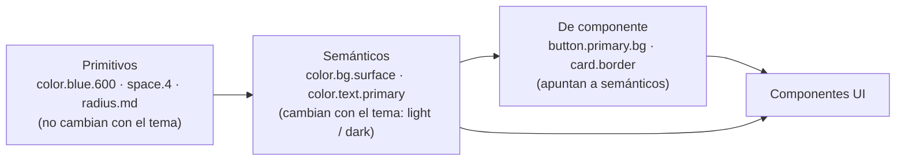
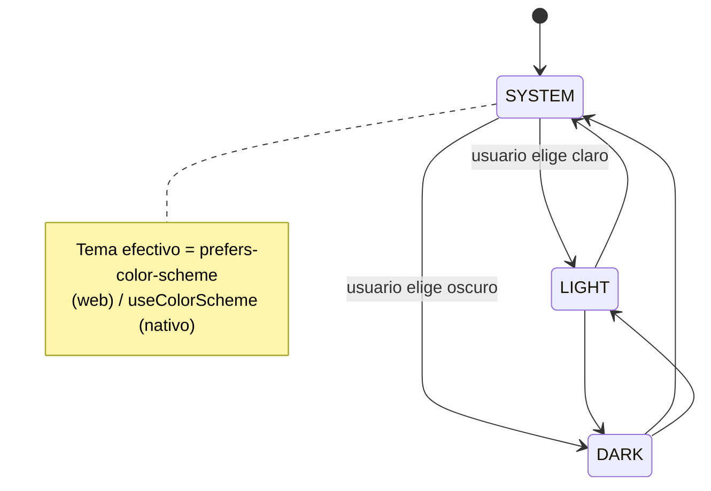

# Tokens de diseño y temas (modo claro / oscuro)

> Normativo (D13 en `bandadau-docs/docs/03-arquitectura/decisiones-clave.md`). Aplica a **todas** las UIs:
> landing, admin-shell, mfe-moderation, mfe-insights, app Expo (nativa y web), gráficos y
> plantillas de email.

## 1. Por qué

- Un solo lugar para decidir colores, tipografía, espacios, radios, sombras y movimiento.
- El modo oscuro se resuelve **cambiando valores de tokens**, no reescribiendo componentes.
- Cinco UIs en cuatro tecnologías (Next.js, Angular, React+Vite, React Native) se ven como
  un solo producto.

## 2. Arquitectura de tokens (3 niveles)



| Nivel | Ejemplo | ¿Quién lo usa? | ¿Cambia con el tema? |
|---|---|---|---|
| Primitivo | `color.blue.600 = #1238A8` | **Solo** los tokens semánticos | No |
| Semántico | `color.action.primary.bg → {color.blue.600}` (light) / `{color.blue.400}` (dark) | Componentes | **Sí** |
| Componente | `button.primary.bg → {color.action.primary.bg}` | Primitivas del design system (`Button`, `Card`…) | Indirectamente |

**Regla de oro:** el código de UI **nunca** referencia primitivos ni valores literales
(`#fff`, `rgb()`, `16px` sueltos, `bg-blue-600`, `text-gray-500`). Solo semánticos o de componente.

## 3. Fuente única: `bandadau-shared/packages/ui-tokens` (`@bandada/ui-tokens`)

Formato **W3C Design Tokens (DTCG)** — archivos `.tokens.json` con `$value`, `$type`,
`$description` — compilados con **Style Dictionary v4** (verificar versión al implementar).

```
bandadau-shared/packages/ui-tokens/
├── tokens/
│   ├── primitive/
│   │   ├── color.tokens.json        # paletas: blue, yellow, red, green, neutral (50…950)
│   │   ├── typography.tokens.json   # familias, tamaños, pesos, alturas de línea
│   │   ├── space.tokens.json        # escala 4 px: 0, 1(4), 2(8), 3(12), 4(16), 6(24), 8(32)…
│   │   ├── radius.tokens.json       # none, sm, md, lg, xl, full
│   │   ├── shadow.tokens.json
│   │   └── motion.tokens.json       # duraciones y easings
│   ├── semantic/
│   │   ├── color.light.tokens.json  # modo claro
│   │   └── color.dark.tokens.json   # modo oscuro (MISMAS claves que light)
│   └── component/
│       └── *.tokens.json            # button, input, card, badge, chart…
├── build/style-dictionary.config.mjs
├── scripts/check-contrast.mjs       # valida WCAG AA en ambos modos
└── dist/                            # generado (no editar)
    ├── css/tokens.css               # :root (light) + [data-theme="dark"]
    ├── css/tailwind-theme.css       # @theme inline → utilidades bg-surface, text-primary…
    ├── scss/_tokens.scss            # Angular (reexporta las mismas CSS vars)
    ├── ts/tokens.ts                 # objeto tipado { light, dark } para React Native / Vega-Lite
    └── json/tokens.flat.json        # para documentación / Figma
```

Ejemplo de primitivo y semántico (DTCG):

```json
// primitive/color.tokens.json
 { "color": { "blue": { "600": { "$type": "color", "$value": "#1238A8" },
                       "400": { "$type": "color", "$value": "#5B8FD6" } } } }

// semantic/color.light.tokens.json
{ "color": { "action": { "primary": {
  "bg": { "$value": "{color.blue.600}", "$description": "Fondo de la acción principal" },
  "fg": { "$value": "{color.neutral.0}" } } } } }

// semantic/color.dark.tokens.json
{ "color": { "action": { "primary": {
  "bg": { "$value": "{color.blue.400}" },
  "fg": { "$value": "{color.neutral.950}" } } } } }
```

## 4. Catálogo de tokens semánticos (contrato mínimo)

Toda UI puede depender de estos nombres; agregar uno nuevo exige definirlo en **ambos** modos.

| Grupo | Tokens |
|---|---|
| Fondos | `color.bg.canvas` (fondo de página), `color.bg.surface` (tarjetas), `color.bg.surface-raised` (modales, popovers), `color.bg.muted`, `color.bg.inverse` |
| Texto | `color.text.primary`, `color.text.secondary`, `color.text.muted`, `color.text.inverse`, `color.text.link`, `color.text.on-action` |
| Bordes | `color.border.default`, `color.border.strong`, `color.border.focus` |
| Acciones | `color.action.primary.{bg,bg-hover,bg-pressed,fg}`, `color.action.secondary.{…}`, `color.action.danger.{…}`, `color.action.disabled.{bg,fg}` |
| Feedback | `color.feedback.{success,warning,danger,info}.{bg,fg,border}` |
| Marca | `color.brand.primary`, `color.brand.accent`, `color.brand.highlight` |
| Datos / gráficos | `color.chart.series.1…8`, `color.chart.grid`, `color.chart.axis` |
| Dominio | `color.status.registration.{pending,confirmed,failed,cancelled}`, `color.status.moderation.{allow,review,block}`, `color.severity.{info,warning,critical}` |
| Códigos | `color.qr.bg`, `color.qr.fg` (siempre oscuro sobre claro, independiente del tema — D13, entradas UC-12/UC-14) |
| Tipografía | `font.family.display`, `font.family.body`, `font.family.mono`, `font.size.{xs…3xl}`, `font.weight.{regular,medium,semibold,bold}`, `line-height.{tight,normal,relaxed}` |
| Espacio / forma | `space.{0…16}`, `radius.{sm,md,lg,xl,full}`, `shadow.{sm,md,lg}` (las sombras también tienen variante dark) |
| Movimiento | `motion.duration.{fast,normal,slow}`, `motion.easing.{standard,emphasized}` (respetar `prefers-reduced-motion`) |
| Capas | `z.{dropdown,sticky,modal,toast}` |

Nombres CSS generados: `--bd-color-bg-surface`, `--bd-color-text-primary`, `--bd-space-4`
(prefijo `bd-` = Bandada, evita colisiones con estilos ajenos).

## 5. Modelo de tema



- Preferencia: `ThemePreference = SYSTEM | LIGHT | DARK` (por defecto `SYSTEM`).
- Tema efectivo: `light | dark` (lo que se pinta).
- Persistencia: local (`localStorage['bandada.theme']` en web, MMKV/AsyncStorage en nativo) y,
  con sesión, en la cuenta (`PATCH /api/v1/users/me/preferences { theme }`). Al iniciar sesión la
  preferencia de la cuenta gana y se guarda localmente.
- La landing (sin cuenta) solo usa la preferencia local.

## 6. Implementación por tecnología

### 6.1 Web común (landing, admin-shell, app web)

```css
/* dist/css/tokens.css (generado) */
:root, [data-theme="light"] { color-scheme: light; --bd-color-bg-canvas: #F7F7F5; /* … */ }
[data-theme="dark"]         { color-scheme: dark;  --bd-color-bg-canvas: #0F1419; /* … */ }
```

- `<html data-theme="…">` se fija **antes del primer pintado** con un script inline en el `<head>`
  (lee `localStorage` y `matchMedia('(prefers-color-scheme: dark)')`) → sin parpadeo (FOUC).
- Si la preferencia es `SYSTEM`, se escucha `matchMedia(...).addEventListener('change', …)`.
- `<meta name="theme-color">` con dos entradas (`media="(prefers-color-scheme: …)"`) y se actualiza
  al cambiar de tema.
- Hook/servicio único `useTheme()` → `{ preference, effective, setPreference }`.

### 6.2 Next.js 16 + Tailwind v4 (landing, admin-shell)

```css
/* app/globals.css */
@import "tailwindcss";
@import "@bandada/ui-tokens/css/tokens.css";
@import "@bandada/ui-tokens/css/tailwind-theme.css"; /* @theme inline { --color-surface: var(--bd-color-bg-surface); … } */
@custom-variant dark (&:where([data-theme="dark"], [data-theme="dark"] *));
```

- Utilidades semánticas: `bg-canvas`, `bg-surface`, `text-primary`, `text-muted`, `border-default`,
  `bg-action-primary`, `text-on-action`, `bg-feedback-danger`…
- **No** se usa `dark:` para colores (los tokens ya cambian); `dark:` solo para casos excepcionales
  no cromáticos (p.ej. cambiar una ilustración) y debe justificarse en el PR.
- Lint: regla ESLint/`eslint-plugin-tailwindcss` (o script) que rechaza clases de paleta cruda
  (`(bg|text|border)-(red|blue|gray|slate|…)-\d+`) y hex arbitrarios `[#…]`.

### 6.3 Microfrontends (Web Components con Shadow DOM)

- Las **CSS custom properties heredan a través del Shadow DOM**: el shell carga `tokens.css` una
  vez y los MFEs consumen `var(--bd-…)` dentro de su shadow root.
- El shell además pasa el atributo `theme="light|dark"` (para lógica JS, p.ej. gráficos) y emite
  `bandada:theme-changed`. Los MFEs **no** redefinen tokens ni cargan otra copia de `tokens.css`
  (en modo standalone de desarrollo sí la cargan).
- Angular (`mfe-moderation`): estilos con `var(--bd-…)`; `_tokens.scss` solo como alias tipado.
- React (`mfe-insights`): CSS Modules o Tailwind con el mismo `tailwind-theme.css` inyectado en el shadow root.

### 6.4 Expo SDK 57 (nativo + web)

- `app.config`: `userInterfaceStyle: "automatic"`; splash e íconos con variante dark;
  `expo-system-ui` para el color de fondo raíz; `StatusBar style="auto"`.
- Tema efectivo con `useColorScheme()` combinado con la preferencia del usuario.
- **NativeWind v4**: los tokens semánticos se inyectan como variables con `vars()` en el
  `ThemeProvider` raíz según el tema efectivo; las clases usan los mismos nombres semánticos que la
  web (`bg-surface`, `text-primary`). Así un componente no lleva `dark:` ni condicionales de color.
- Donde no aplica className (navegación, `react-native-svg`, gráficos, `StatusBar`), usar el objeto
  tipado `tokens.ts` vía `useTokens()` → `tokens[effective].color.bg.surface`.
- Tema de expo-router/React Navigation (`ThemeProvider` de navegación) derivado de los tokens.

### 6.5 Gráficos, mapas y QR

- Vega-Lite (`mfe-insights`, reportes): `config` generado desde `tokens.ts` por tema (fondo,
  ejes, grilla, `range.category = color.chart.series.*`).
- El QR del ticket se renderiza siempre **oscuro sobre claro** (legibilidad de lectores) dentro de
  una tarjeta `bg-surface`, incluso en modo oscuro.

### 6.6 Emails

Las plantillas de email usan tokens **solo del modo claro**, con estilos inline generados en el
build (muchos clientes de correo ignoran variables CSS y `prefers-color-scheme`).

## 7. Primitivas del design system

Cada app tiene (o comparte) primitivas que encapsulan tokens: `Button`, `IconButton`, `Card`,
`Input`, `Textarea`, `Select`, `Switch`, `Badge`, `Alert`, `Modal`/`Sheet`, `Toast`, `Skeleton`,
`EmptyState`, `Avatar`, `Tabs`, `ThemeToggle`, `LanguageSwitcher`. Las pantallas componen
primitivas; no reimplementan estilos.

## 8. Accesibilidad y calidad

- `scripts/check-contrast.mjs` (CI) verifica WCAG 2.2 AA para cada par declarado en
  `contrast-pairs.json` (`text.primary` / `bg.surface`, `text.on-action` / `action.primary.bg`, …)
  en **ambos** modos: 4.5:1 texto normal, 3:1 texto grande y componentes UI.
- El foco visible usa `color.border.focus` y nunca se elimina.
- No comunicar estado solo por color (ícono o texto además del color).
- Revisión visual: cada PR de UI adjunta captura en claro y en oscuro (o Storybook/Playwright
  screenshot de ambos).

## 9. Flujo para agregar o cambiar un token

1. Editar el `.tokens.json` (semántico: en `light` **y** `dark`).
2. `pnpm --filter @bandada/ui-tokens build` → regenera `dist/`.
3. `pnpm --filter @bandada/ui-tokens test` (contraste + claves idénticas entre modos).
4. Si es un token nuevo de uso general, agregarlo a la tabla §4 de este documento.
5. Commit `feat(ui-tokens): …`; los consumidores lo reciben vía workspace.

## 10. Checklist de una pantalla/componente nuevo

- [ ] Cero colores, tamaños o sombras literales; solo tokens.
- [ ] Probado en modo claro y oscuro (captura de ambos en el PR).
- [ ] Contraste AA en ambos modos; foco visible.
- [ ] Respeta `prefers-reduced-motion`.
- [ ] Sin `dark:` para colores.
- [ ] Textos vía i18n (ver `i18n.md`).
