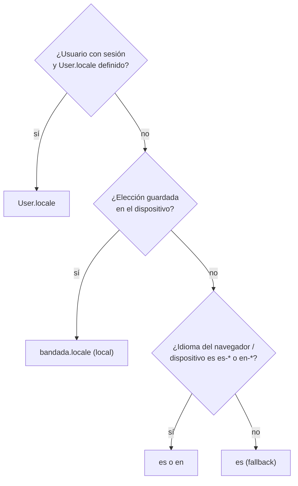

# Internacionalización (i18n) — español e inglés

> Normativo (D14 en `bandadau-docs/docs/03-arquitectura/decisiones-clave.md`). Aplica a todas las UIs y a
> todo contenido generado por el sistema (errores, notificaciones, emails, reportes, audio).

## 1. Idiomas y reglas generales

| Código | Idioma | Formato regional (`Intl`) | Rol |
|---|---|---|---|
| `es` | Español | `es-BO` | **Principal**: idioma fuente y *fallback* |
| `en` | Inglés | `en-US` | Secundario, debe estar completo en cada release |

- **Prohibido** texto literal visible al usuario en código (JSX, templates Angular, plantillas de
  email, mensajes push). Todo sale de un catálogo de traducciones.
- **Prohibido** concatenar fragmentos traducidos (`t('a') + nombre + t('b')`): usar interpolación ICU.
- El contenido creado por usuarios (posts, comentarios, nombres de grupos/eventos) **no** se traduce.
- Identificadores de claves en inglés; documentación de i18n en español.
- Zona horaria de presentación: `America/La_Paz` (independiente del idioma).

## 2. Resolución del idioma



- Al cambiar de idioma con sesión: `PATCH /api/v1/users/me/preferences { locale }`
  (`updateMyPreferences`) → evento `bandada.identity.user.preferences-changed.v1`.
- Web: `<html lang="es|en">` se actualiza; Expo: `expo-localization` (`getLocales()`) para el idioma del dispositivo.
- El cliente HTTP envía siempre `Accept-Language: <locale>`.

## 3. Formato de mensajes: ICU MessageFormat

Archivos JSON por idioma y namespace, claves anidadas:

```
locales/
├── es/
│   ├── common.json        # (los comunes vienen de @bandada/i18n; aquí solo lo propio)
│   ├── feed.json
│   └── events.json
└── en/
    ├── feed.json
    └── events.json
```

```json
// es/events.json
{
  "registration": {
    "cta": "Inscribirme por {price, plural, =0 {gratis} one {# crédito} other {# créditos}}",
    "pending": "Estamos procesando tu inscripción…",
    "confirmed": "¡Listo, {name}! Tu entrada para {event} está confirmada.",
    "seatsLeft": "{count, plural, =0 {Sin cupos} one {Queda # cupo} other {Quedan # cupos}}"
  }
}
```

```json
// en/events.json
{
  "registration": {
    "cta": "Register for {price, plural, =0 {free} one {# credit} other {# credits}}",
    "pending": "We're processing your registration…",
    "confirmed": "You're in, {name}! Your ticket for {event} is confirmed.",
    "seatsLeft": "{count, plural, =0 {Sold out} one {# seat left} other {# seats left}}"
  }
}
```

Convención de claves: `<namespace>.<pantalla|sección>.<elemento>` en `camelCase`
(`events.registration.cta`, `wallet.topUp.title`). Una clave = un significado (no reutilizar
"Guardar" de otra pantalla si el contexto difiere; los genéricos van en `common`).

## 4. Paquete compartido `@bandada/i18n` (`bandadau-shared/packages/i18n`)

| Contenido | Detalle |
|---|---|
| `locales/{es,en}/common.json` | Acciones genéricas (`common.actions.save`, `cancel`, `retry`), estados vacíos, errores de red, offline |
| `locales/{es,en}/enums.json` | Etiquetas de enums del dominio: `enums.RegistrationStatus.CONFIRMED`, `enums.ReactionType.HELPFUL`, `enums.Role.ORGANIZER`… |
| `locales/{es,en}/errors.json` | Mensaje por **código** de Problem Details: `errors.EVENT_FULL`, `errors.INSUFFICIENT_FUNDS`, `errors.IDEMPOTENCY_IN_PROGRESS`, `errors.VALIDATION_FAILED`… |
| `src/format.ts` | `formatCredits(n, locale)`, `formatDate`, `formatDateTime`, `formatRelative` (Intl.RelativeTimeFormat), `formatNumber` — siempre con `timeZone: 'America/La_Paz'` |
| `src/resolve-locale.ts` | Algoritmo de §2 reutilizable |
| `src/config.ts` | `SUPPORTED_LOCALES = ['es','en']`, `DEFAULT_LOCALE = 'es'` |
| `scripts/i18n-check.mjs` | Verificador usado por todas las apps (§8) |

Angular consume los mismos JSON (son ICU estándar).

## 5. Implementación por tecnología

| App | Librería | Notas |
|---|---|---|
| `bandadau-landing` (Next.js 16 static) | `i18next` + `react-i18next` + `i18next-icu` | Rutas **`/es/...` y `/en/...`** con `app/[locale]/` + `generateStaticParams` (SEO, `hreflang`, `<html lang>`); `/` redirige en cliente según §2. Metadata (`title`, `description`, OG) traducida por locale |
| `bandadau-admin/shell` (Next.js 16 static) | `i18next` + `react-i18next` + `i18next-icu` | Sin rutas por idioma (no requiere SEO); idioma en el `LanguageSwitcher` del header; pasa `locale` a los MFEs |
| `bandadau-admin/mfe-insights` (React + Vite) | `i18next` + `react-i18next` + `i18next-icu` | Instancia **propia** (no comparte la del shell); reacciona al atributo `locale` |
| `bandadau-admin/mfe-moderation` (Angular 21) | **Transloco** + `@jsverse/transloco-messageformat` | Reacciona al atributo `locale`; carga `locales/{es,en}/*.json` del propio MFE + los de `@bandada/i18n` |
| `bandadau-frontend` (Expo SDK 57) | `i18next` + `react-i18next` + `i18next-icu` + `expo-localization` | Recursos empaquetados en el bundle (funciona **offline**); cambio de idioma sin reiniciar; textos de `app.config` (permisos iOS `NSCameraUsageDescription`, etc.) localizados con `locales` de Expo |

Reglas comunes:
- Namespaces cargados por pantalla/ruta (lazy) en web; en la app todo empaquetado (offline).
- `fallbackLng: 'es'`, `returnNull: false`; en desarrollo una clave faltante se muestra como
  `⟦clave⟧` y se loguea; en producción cae a `es`.
- Accesibilidad: `aria-label`, `alt` y textos de lectores de pantalla también traducidos.
- Tipos: generar tipos de claves desde `es/*.json` (declaración de módulo de i18next) para que una
  clave inexistente falle en `tsc`.

## 6. Backend

| Aspecto | Regla |
|---|---|
| Errores REST | Problem Details con `code` **estable** (`EVENT_FULL`). `title`/`detail` localizados según `Accept-Language` (`es` por defecto); respuesta con `Content-Language`. **Los clientes traducen por `code`** con `@bandada/i18n/errors`; `detail` del servidor es respaldo |
| Spring Boot | `MessageSource` con `messages_es.properties` / `messages_en.properties`; `LocaleResolver` por `Accept-Language` |
| Laravel | `lang/es/*.php`, `lang/en/*.php`; middleware que fija `App::setLocale()` desde `Accept-Language` |
| NestJS | módulo i18n (p.ej. `nestjs-i18n`, verificar versión) con resolver de `Accept-Language` |
| GraphQL | `admin-gateway` propaga `Accept-Language` del panel a los servicios; errores con `extensions.code` |
| Validación | Los mensajes de validación también usan claves (`errors.VALIDATION_FAILED` + `errors[].code` por campo, p.ej. `TOO_LONG`) |
| Notificaciones | `notification-service` renderiza push, in-app y email con plantillas `templates/{es,en}/<NotificationType>`; usa el `locale` del destinatario (copia local mantenida por `user.preferences-changed.v1` y `user.registered.v1`). La notificación in-app guarda `type` + `params` para poder re-renderizarse si el usuario cambia de idioma |
| Reportes IA | `insights-service` genera el reporte en el `locale` del solicitante (prompt de sistema por idioma, voz TTS por idioma: es → es-MX/es-US, en → en-US) |
| Eventos de dominio | **Nunca** llevan textos traducidos; solo datos y códigos |
| n8n | Emails con plantillas por idioma según `locale` del destinatario |

## 7. Formateo de datos

- Fechas: `formatDateTime(iso, locale)` → `es`: "14 oct 2026, 18:30" · `en`: "Oct 14, 2026, 6:30 PM".
- Créditos: `formatCredits(1500, 'es')` → "1.500 créditos"; `'en'` → "1,500 credits" (plural ICU).
- Relativo: "hace 5 min" / "5 min ago" con `Intl.RelativeTimeFormat`.
- Nunca formatear a mano con `toFixed`, `split` o concatenaciones.

## 8. Calidad (CI)

`pnpm i18n:check` (script de `@bandada/i18n`) en cada app falla si:
1. Una clave existe en `es` y no en `en` (o viceversa).
2. Un mensaje no es ICU válido o los placeholders difieren entre idiomas.
3. Hay claves sin uso (advertencia) o claves usadas que no existen (error).

Además: regla ESLint contra literales en JSX (`i18next/no-literal-string` o equivalente) en apps
React; en Angular, revisión de templates con un lint de literales. Para backend, test que verifica
que cada `code` de error documentado en `bandadau-docs/contracts/` tenga mensaje en `es` y `en`.

## 9. Flujo para agregar textos

1. Escribir la clave y el texto en **`es`** (idioma fuente).
2. Agregar la traducción en **`en`** en el mismo PR (puede ser borrador marcado en la descripción
   del PR, pero la clave debe existir).
3. Usar la clave en el componente con `t('events.registration.cta', { price })`.
4. `pnpm i18n:check` en verde.

## 10. Checklist de una pantalla nueva

- [ ] Cero literales visibles; todo con claves (incl. `alt`, `aria-*`, placeholders, toasts).
- [ ] Claves en `es` y `en`; plurales con ICU.
- [ ] Fechas, números y créditos con los helpers de `@bandada/i18n`.
- [ ] Probada en ambos idiomas (los textos en inglés suelen ser más cortos y en español más largos:
      verificar que no se corten).
- [ ] Errores mostrados por `code`, no por el `detail` crudo del servidor.
