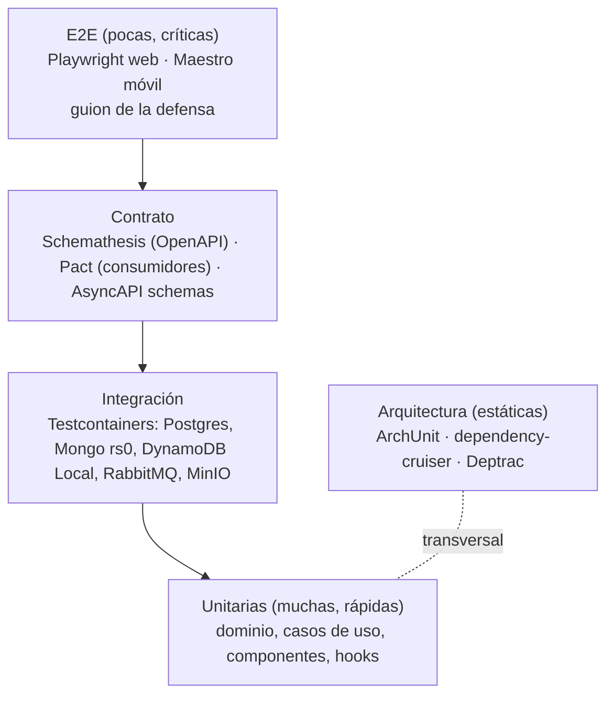

# Estrategia de pruebas

Cómo se prueba Bandada U: niveles, herramientas por lenguaje, pruebas especiales
(SAGA, idempotencia, contratos, arquitectura, carga) y qué corre en CI. Cada caso de
uso ICONIX enlaza sus pruebas de aceptación (sección 5 del `UC-xx.md`) con las
pruebas reales (`07-trazabilidad.md`).

## 1. Pirámide



| Nivel | Proporción orientativa | Tiempo objetivo | Dónde corre |
|---|---|---|---|
| Unitarias | ~70 % | < 30 s por componente | Cada PR |
| Integración | ~20 % | < 5 min por servicio | Cada PR (servicios tocados) |
| Contrato | por endpoint/mensaje | < 5 min | Cada PR que toca `bandadau-docs/contracts/` o el servicio |
| E2E | ~10 escenarios | < 15 min | `develop` y nocturno; manual antes de la defensa |
| Arquitectura | por servicio | segundos | Cada PR |
| Carga (k6) | 3 escenarios | 5–10 min | Manual / nocturno semanal |

## 2. Herramientas por stack

| Stack | Unit | Integración | Cobertura mínima (líneas, dominio+casos de uso) |
|---|---|---|---|
| Java 25 / Spring Boot 4 | JUnit 5, AssertJ, Mockito | `@SpringBootTest` / slices + Testcontainers (`@ServiceConnection`, verificar soporte en Boot 4) | 80 % |
| NestJS 11 | Jest o Vitest (uno por servicio, declarado en su `AGENTS.md`) | Testcontainers for Node + `supertest` | 80 % |
| Laravel 12 / PHP 8.4 | Pest | Pest + contenedores (Testcontainers PHP o `make infra-up` en CI) | 80 % |
| Next/React/Vite | Vitest + Testing Library + MSW | — | 60 % (lógica, hooks) |
| Angular 21 | runner por defecto del CLI v21 (verificar) + Testing Library | — | 60 % |
| Expo | Jest (`jest-expo`) + RNTL | — | 60 % |
| Python (`bandadau-ml/`) | pytest (utilidades, export) | Validación ONNX (§9) | — |

Reglas:

- Unitarias del dominio **sin mocks de framework**; los puertos se sustituyen por dobles
  en memoria (`InMemoryWalletRepository`).
- Integración siempre contra el motor real en contenedor; **prohibido** H2/SQLite/mongodb-memory-server
  como sustituto de Postgres/Mongo en pruebas de gateways.
- Datos de prueba con *builders* (`aRegistration().pending().build()`), no fixtures gigantes.
- Tiempo controlado con `Clock` inyectado; nada de `sleep` (usar Awaitility / `vi.waitFor` / polling acotado).

## 3. Pruebas de arquitectura

| Servicio(s) | Herramienta | Documento |
|---|---|---|
| identity, wallet | ArchUnit / Deptrac | `arquitectura-hexagonal.md` §7 |
| social, media, ticketing, insights, notification | dependency-cruiser / Deptrac | `clean-architecture.md` §5 |
| events | ArchUnit | `ddd.md` §5 |
| admin-gateway | dependency-cruiser (resolvers → data sources, nunca al revés) | `bandadau-backend/services/admin-gateway/AGENTS.md` |
| apps | ESLint `import/no-restricted-paths` (features no importan otras features internas) | `frontend-guidelines.md` |

## 4. Pruebas de contrato

### 4.1 Proveedor REST — Schemathesis

Cada servicio levantado (Docker Compose de CI con su base) se prueba contra su
`bandadau-docs/contracts/openapi/<servicio>.yaml`:

```bash
schemathesis run bandadau-docs/contracts/openapi/wallet-service.yaml \
  --url http://localhost:7005 --checks all \
  -H "Authorization: Bearer $TEST_JWT" --hypothesis-max-examples 50
```

(Verificar flags de la versión instalada de Schemathesis.) Falla el PR si una
respuesta no cumple el esquema, si un 4xx no es `application/problem+json` o si
aparece un 5xx.

### 4.2 Consumidor → proveedor — Pact

Para llamadas síncronas internas con lógica relevante: `admin-gateway → *`,
`insights-service → events/wallet/social/media` (herramientas MCP), `social → media`,
`mobile → social/events/wallet` (flujos críticos). El consumidor publica el pacto en
`bandadau-docs/contracts/pacts/` (sin broker para mantenerlo simple); el proveedor lo verifica en su CI.

### 4.3 Mensajes — AsyncAPI

- Cada productor valida en una prueba que el CloudEvent que escribe en el outbox cumple el
  esquema `data` de `bandadau-docs/contracts/asyncapi/bandada-events.yaml` (validador JSON Schema).
- Cada consumidor tiene una prueba con el **ejemplo** del contrato como entrada.
- GraphQL: `graphql-inspector` detecta cambios incompatibles en `bandadau-docs/contracts/graphql/admin.graphql`.

## 5. Idempotencia (T8)

Batería obligatoria para **cada endpoint ♻️** (se genera a partir de una plantilla común por lenguaje):

| # | Escenario | Esperado |
|---|---|---|
| 1 | Misma `Idempotency-Key` + mismo body ×2 (secuencial) | Mismo status y body; segunda con `Idempotent-Replayed: true`; un solo efecto en BD |
| 2 | Misma clave + body distinto | `422 IDEMPOTENCY_KEY_REUSED` |
| 3 | 10 peticiones concurrentes con la misma clave | 1 ejecución; el resto `409 IDEMPOTENCY_IN_PROGRESS` o réplica |
| 4 | Sin clave en endpoint obligatorio | `400 IDEMPOTENCY_KEY_REQUIRED` |
| 5 | Primera ejecución termina en 5xx | Reintento con la misma clave se ejecuta |

Consumidores: entregar el **mismo mensaje dos veces** (mismo `id`) y verificar un solo
efecto (inbox). Restricciones únicas: insertar duplicado de negocio (`operation_ref`,
`posts(authorId, clientId)`, `registrations` activas, ticket por `registrationId`) → rechazo.
Webhook de pago repetido → 200 y un solo `LedgerEntry`.
Offline (móvil): encolar post, simular 3 reintentos con timeout de respuesta → un solo post.

## 6. SAGA con fallos inyectados (C1)

Suite `bandadau-backend/services/events-service/src/test/.../saga/` + suite de sistema en
`bandadau-infra/tests/saga/` (Compose con events, wallet, ticketing, RabbitMQ).

| # | Inyección | Resultado esperado |
|---|---|---|
| S1 | Ninguna, precio > 0 | `CONFIRMED`; 1 `DEBIT`; 1 ticket `ISSUED`; `registration.confirmed.v1` |
| S2 | Precio 0 | Sin comando a wallet; `CONFIRMED` |
| S3 | Saldo insuficiente | `FAILED (INSUFFICIENT_FUNDS)`; cupo liberado; sin ticket |
| S4 | `CHAOS_TICKETING_FAIL=true` | `COMPENSATED`: `REFUND` igual al `DEBIT`, cupo liberado, `registration.failed.v1` |
| S5 | `CHAOS_WALLET_DELAY_MS` > timeout (30 s; en test, timeout reducido por config) | Reintentos ×3 → compensación; respuesta tardía de wallet **ignorada** y reembolsada si llegó a debitar |
| S6 | Respuesta `credits-debited` duplicada | Un solo `issue-ticket` |
| S7 | Caída de events-service entre paso 2 y 3 (detener contenedor) | Al reiniciar, el outbox reenvía y la SAGA termina |
| S8 | RabbitMQ reiniciado durante la SAGA | Termina sin duplicados (outbox + inbox) |
| S9 | Cancelación (UC-13) de inscripción `CONFIRMED` | `void-ticket` → `refund` → cupo liberado → `CANCELLED` |
| S10 | Carrera: cupo 1, dos estudiantes | 1 `PENDING/CONFIRMED`, otro `409 EVENT_FULL` |

Verificaciones de **invariantes globales** al final de cada escenario (consultando cada
servicio por su API interna, nunca su base): `suma(DEBIT) − suma(REFUND)` por
registración ∈ {0, precio}; tickets `ISSUED` ⇔ registraciones `CONFIRMED`;
`seatsTaken` = inscripciones activas.

En unidad, `SagaInstance` se prueba con tabla de transiciones (estado × respuesta → decisión).

## 7. E2E

### 7.1 Web — Playwright

- `bandadau-admin/shell/e2e`: login + handoff (UC-03), moderación en el MFE Angular (UC-18),
  reporte generativo en el MFE React (UC-19, LLM simulado con `OllamaAdapter` o stub), gestión
  de usuarios (UC-21). Incluye `@axe-core/playwright` y ejecución en **ambos temas** y **ambos idiomas**
  para las pantallas principales (capturas de referencia).
- `bandadau-landing/e2e`: `/es` y `/en`, enlaces "Entrar"/"Panel", lista de eventos públicos.
- `bandadau-frontend/e2e-web`: PWA — instalación (manifest), feed offline, cola offline (UC-05).
- Modo **mock** (fixtures del contrato, sin backend) en cada PR; modo **full stack** (`make up`) en nocturno.

### 7.2 Móvil — Maestro

`bandadau-frontend/.maestro/`: `uc02-login.yaml`, `uc05-post-offline.yaml` (activa modo avión),
`uc12-register-event.yaml`, `uc14-scan-ticket.yaml`, `uc17-assistant-offline.yaml`.
Corre manualmente/nocturno en emulador Android (CI con runner que soporte emulador).

## 8. Carga — k6

`bandadau-infra/tests/load/`:

| Script | Escenario | Umbral (RNF) |
|---|---|---|
| `feed.js` | 200 VUs leyendo `GET /feed` | p95 < 300 ms, errores < 1 % |
| `registration-rush.js` | 500 inscripciones simultáneas a un evento de cupo 100 | exactamente 100 confirmadas, 0 sobreventa, p95 aceptación < 500 ms |
| `idempotent-topups.js` | 50 VUs repitiendo la misma `Idempotency-Key` | 1 recarga por clave |

Umbrales finales según `requisitos-no-funcionales.md`; si difieren, mandan los RNF.

## 9. ML / IA

- `bandadau-ml/`: pytest de utilidades; cada export ONNX se valida comparando salidas
  PyTorch/sklearn vs ONNX Runtime (tolerancia 1e-4) sobre un lote fijo y se registra
  métrica (accuracy/F1) en `bandadau-ml/models/<nombre>/<versión>/model-card.md`.
- `media-service`: prueba de integración con imágenes de `test/fixtures/` (segura/no apta
  sintética) verificando `ALLOW/REVIEW/BLOCK` según umbrales D7.
- `insights-service`: agentes con `LlmPort` falso (respuestas grabadas) que verifica límite
  de pasos (8), herramientas usadas y registro en `AgentRun`. Una prueba "real" opcional con
  Ollama marcada `@slow`.
- n8n: cada workflow exportado se valida (JSON válido, credenciales por variable, nodos
  disparadores esperados) con un script en `bandadau-infra/n8n/scripts/validate.mjs`.

## 10. Qué corre en CI

| Disparador | Trabajos |
|---|---|
| PR (filtrado por rutas tocadas) | lint + format check · typecheck · unit · arquitectura · integración (Testcontainers) · contrato (Schemathesis del servicio, Pact del consumidor/proveedor) · `i18n:check` + contraste de tokens (frontends y `bandadau-shared`) · build (static export / bundle / imagen Docker) · E2E en modo mock de la app tocada |
| PR que toca `bandadau-docs/contracts/` | `make contracts-lint` · `graphql-inspector` · regenerar `bandadau-shared/packages/contracts-ts` (`pnpm contracts:gen`, checkout hermano) y avisar si hay diff pendiente en `bandadau-shared` · contratos de **todos** los consumidores afectados |
| Merge a `develop` | Todo lo anterior + E2E full stack (`make up` en `bandadau-infra`) + suite SAGA de sistema (S1–S10) |
| Nocturno | E2E completo web, k6 `feed` + `registration-rush`, Maestro (si hay runner) |
| Antes de la defensa (manual) | Guion completo de `cumplimiento-catedra.md` en el entorno AWS |

Un PR no se fusiona con pruebas rojas, *skipped* sin issue enlazado o cobertura por debajo
del mínimo en dominio/casos de uso.

## 11. Anti-patrones

- ❌ Probar el dominio a través de HTTP; ❌ mocks de Mongoose/Eloquent/JPA en casos de uso.
- ❌ Bases en memoria como sustituto del motor real.
- ❌ `sleep` fijos; pruebas dependientes del orden; datos compartidos entre pruebas.
- ❌ E2E que llaman a un LLM de pago en cada PR.
- ❌ Verificar la SAGA leyendo directamente las bases de wallet/ticketing.
- ❌ Snapshots enormes de componentes en vez de aserciones de comportamiento.
